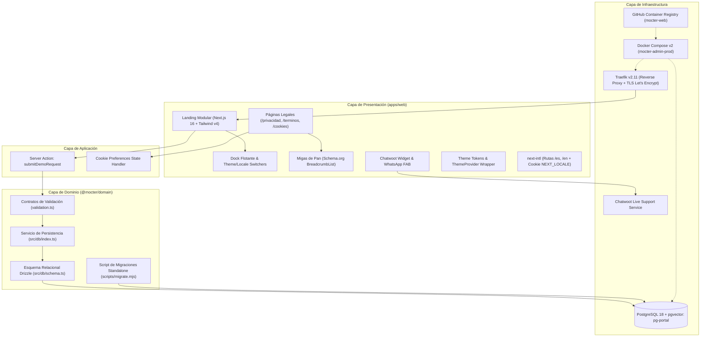

# Estado Técnico Actual del Proyecto — Plataforma Mocter (`mocter-portal`)

**Fecha de actualización:** 18 de octubre de 2026  
**Repositorio:** `EnuarRosales/landig-agencia`  
**Rama activa:** `feature/mocter-nextjs-migration`  
**Organización / Marca:** Mocter  
**Remoto de origen:** `https://github.com/EnuarRosales/landig-agencia.git`  
**Versión del Sistema:** `1.2.0`

---

## 1. Resumen Ejecutivo de la Transformación

El proyecto ha completado una **transformación arquitectónica integral, profesional y funcional**, evolucionando desde una landing page monolítica en un único archivo HTML estático (`index.html`) hacia una **plataforma web empresarial contenerizada de nivel de producción basada en Next.js 16 (App Router), React 19, Turbopack, Tailwind CSS v4, Clean Architecture en monorepo pnpm + Turborepo, y despliegue continuo (CD) automatizado**.

Adicionalmente, el sistema incorpora:
1. **Capa agnóstica de dominio y persistencia (`@mocter/domain`)** con arquitectura canónica de Drizzle ORM (`src/db/schema.ts`, `src/db/index.ts`, `validation.ts`) conectada a **PostgreSQL 18 con extensión `pgvector`**, asegurando persistencia transaccional y validación estricta de prospectos (leads) mediante Server Actions.
2. **Ciclo de Vida de Migraciones Autónomo y Resiliente:** Separación de responsabilidades donde PostgreSQL maneja el namespace de datos de negocio (`public.leads`) y Drizzle gestiona de manera aislada sus metadatos de versionamiento en `drizzle.__drizzle_migrations`. Las migraciones se ejecutan mediante un script independiente (`migrate.mjs`) integrado en el pipeline de despliegue antes de habilitar tráfico web.
3. **Flujo de Despliegue Continuo (CD-001) y Gobernanza Git:** Suite de automatización en GitHub Actions (`ci.yml`, `cd.yml`, `deploy.yml`) con publicación de imágenes a **GitHub Container Registry (GHCR)** (`ghcr.io/enuarrosales/mocter-web`), orquestación con Traefik v2.11 (sin puertos expuestos en el host), TLS automático con Let's Encrypt y script de servidor con rollback automático (`deploy.sh`).
4. **Metodología Spec-Driven Development (SDD):** Marco de ingeniería riguroso basado en especificaciones formales versionadas en `docs/specs/` (`requirements.md`, `design.md`, `tasks.md`), gobernadas por la constitución permanente del repositorio en `.agents/AGENTS.md`.
5. **Atención en vivo y omnicanalidad:** Widget oficial de atención en línea **Chatwoot** (`chatwoot-widget.tsx`) con inyección DOM asíncrona no bloqueante, complementado con botón flotante interactivo de WhatsApp FAB reubicado a media altura lateral izquierda.
6. **Internacionalización y Navegación Avanzada:** Selector de idioma interactivo (`ES | EN`) con persistencia en cookie `NEXT_LOCALE`, cabecera con menú centrado en cápsula flotante translúcida tipo dock (`Floating Glass Island`) y botón de conmutación de tema con alta denotación visual y micro-rotación.
7. **Páginas Legales y Cumplimiento Normativo (Colombia & RGPD):** Secciones de Política de Privacidad (13 cláusulas bajo Ley 1581/2012 de Habeas Data), Términos y Condiciones (Ley 527/1999 y Ley 1480/2011) y Configuración de Privacidad y Cookies con panel interactivo de consentimiento (`CookiePreferences`) y persistencia local.
8. **SEO, AIO, GEO y LLMO:** Prerenderizado estático de 19 rutas con Schema.org (`BreadcrumbList`, `Organization`, `SoftwareApplication`), sitemap multilingüe con `hreflang` y manifiestos de IA (`llms.txt`, `llms-full.txt`).

---

## 2. Matriz Comparativa: Estado Inicial vs. Estado Actual

| Dimensión | Estado Inicial (16 Oct 2026) | Estado Actual (18 Oct 2026) |
| :--- | :--- | :--- |
| **Arquitectura** | Monolito de un solo archivo `index.html` (~591 líneas) | Monorepo modular (`pnpm workspaces` + `Turborepo v2`) con Clean Architecture |
| **Metodología** | Sin especificaciones ni control de tareas | **Spec-Driven Development (SDD)** con `AGENTS.md` y especificaciones `MIG-001` y `CD-001` |
| **Framework Frontend** | Vanilla HTML5 / JS sin framework | **Next.js 16.4.2** con Turbopack, React 19 y Server Components |
| **Estilos y Temas** | CSS embebido en `<style>` (solo tema oscuro) | **Tailwind CSS v4** con modo claro/oscuro dinámico, tokens contrastados y ThemeProvider protegido |
| **Cabecera y Navegación** | Menú estático rígido a la izquierda | **Cápsula Flotante Dock** centrada con pestañas interactivas y botón de tema con halo de luz |
| **Internacionalización** | Español estático en código duro | **`next-intl`** bilingüe estructurado (`/es`, `/en`) con selector `LocaleSwitcher` (cookie `NEXT_LOCALE`) |
| **Atención al Cliente** | Enlaces inertes a WhatsApp | **Chatwoot oficial** (soporte en línea asíncrono) + **WhatsApp FAB flotante** lateral izquierdo |
| **Marco Legal y Cumplimiento** | Inexistente (sin enlaces ni políticas) | **Páginas completas** de Privacidad (Ley 1581/2012), Términos y Configuración de Cookies interactiva |
| **Navegación Secundaria** | Inexistente | **Migas de pan (Breadcrumbs)** semánticas con marcado estructurado Schema.org `BreadcrumbList` |
| **Persistencia de Datos** | Inexistente (sin backend ni base de datos) | **PostgreSQL 18 (`pgvector`)** con Drizzle ORM canónico (`src/db/`) y pool resiliente |
| **Migraciones de BD** | Inexistente / scripts acoplados a `initdb.d` | **Drizzle Migrator aislado (`migrate.mjs`)** con registro seguro en schema `drizzle` y sin colisiones |
| **Captura de Leads** | Formularios simulados / enlaces estáticos | **Server Action real** con validación Zod y guardado transaccional |
| **Testing y Calidad** | Inexistente (0 pruebas, sin linters) | **15 pruebas automatizadas** pasando (Vitest), compilación limpia con 19 rutas prerenderizadas |
| **CI/CD y Registro** | Inexistente | **GitHub Actions** (`ci.yml`, `cd.yml`, `deploy.yml`) + **GHCR** (`ghcr.io/enuarrosales/mocter-web`) |
| **Despliegue Producción** | Inexistente | **VPS Hostinger con Traefik v2.11**, TLS automático, cero puertos expuestos y script `deploy.sh` con rollback |
| **Identidad de Marca** | Placeholder "agencIA / IdenTechnology" | **Mocter** estandarizado con favicon claro en SVG, legalidad colombiana y canales oficiales |

---

## 3. Estructura Actual del Repositorio

```text
landig-agencia/
├── .agents/                          # Constitución y directivas de agentes IA
│   └── AGENTS.md                     # Reglas permanentes y restricciones del repositorio
├── .github/
│   └── workflows/                    # Automatización de integración y entrega continua
│       ├── ci.yml                    # CI: Lint, tests, build y drizzle-kit check en PRs
│       ├── cd.yml                    # CD: Construcción y publicación de imágenes en GHCR
│       └── deploy.yml                # Despliegue automatizado por SSH a Hostinger (staging/prod)
├── apps/
│   └── web/                         # Aplicación Web y PWA en Next.js 16
│       ├── app/
│       │   ├── [locale]/             # Enrutamiento localizado bilingüe (/es, /en)
│       │   │   ├── cookies/          # Página de Configuración de Privacidad y Cookies
│       │   │   │   └── page.tsx
│       │   │   ├── privacidad/       # Página de Política de Privacidad (Ley 1581/2012)
│       │   │   │   └── page.tsx
│       │   │   ├── terminos/         # Página de Términos y Condiciones
│       │   │   │   └── page.tsx
│       │   │   ├── layout.tsx        # Layout raíz (SEO, JSON-LD, ThemeProvider, Chatwoot)
│       │   │   └── page.tsx          # Landing page de alta fidelidad
│       │   ├── actions/              # Server Actions con mutaciones seguras
│       │   │   ├── demo-request.ts   # Acción de captura y persistencia de leads
│       │   │   └── types.ts          # Tipos y contratos del formulario
│       │   ├── globals.css           # Tokens de diseño Tailwind v4 (dark/light)
│       │   ├── icon.svg              # Favicon vectorial en tono claro
│       │   ├── proxy.ts              # Proxy de internacionalización Next.js
│       │   └── sitemap.ts            # Generador dinámico de Sitemap multilingüe
│       ├── components/               # Componentes modulares de interfaz
│       │   ├── sections/             # Secciones (Hero, Features, Sectores, Pipeline, FAQ, Footer, WhatsApp FAB)
│       │   ├── breadcrumbs.tsx       # Migas de pan semánticas con JSON-LD Schema.org
│       │   ├── chatwoot-widget.tsx   # Widget oficial de soporte en vivo Chatwoot
│       │   ├── cookie-preferences.tsx# Panel interactivo de gestión de cookies y consentimiento
│       │   ├── demo-form.tsx         # Formulario interactivo responsivo (ancho completo)
│       │   ├── locale-switcher.tsx   # Selector de idioma ES/EN con cookie persistente
│       │   ├── theme-provider.tsx    # Wrapper anti-FOUC con supresión de falsos positivos en React 19
│       │   ├── theme-toggle.tsx      # Conmutador accesible de Modo Claro / Oscuro con sol/luna estilizados
│       │   ├── nav.tsx               # Barra de navegación con cápsula flotante centrada
│       │   └── floating-background.tsx # Fondo reactivo con cursor glow y blobs
│       ├── messages/                 # Diccionarios de traducción estructurados (es.json, en.json)
│       ├── public/                   # PWA Manifest, llms.txt, llms-full.txt, robots.txt, iconos
│       ├── next.config.ts            # Configuración de compilador, orígenes dev e imágenes
│       └── package.json              # Dependencias específicas de la app web
├── packages/
│   └── domain/                       # Capa de dominio y persistencia agnóstica
│       ├── drizzle/                  # Migraciones SQL versionadas generadas por Drizzle
│       ├── scripts/
│       │   └── migrate.mjs           # Script ejecutor de migraciones standalone para Docker/CI
│       ├── src/
│       │   ├── db/
│       │   │   ├── index.ts          # Pool postgres-js perezoso, proxy db y funciones (insertLead)
│       │   │   └── schema.ts         # Definición tipada de la entidad PostgreSQL 'leads'
│       │   ├── validation.ts         # Contratos y esquemas de validación Zod
│       │   ├── validation.test.ts    # Pruebas unitarias de validación (Vitest)
│       │   └── index.ts              # Reexportación de la API pública del paquete
│       ├── drizzle.config.ts         # Configuración oficial de Drizzle Kit
│       ├── README.md                 # Documentación técnica del paquete
│       └── package.json              # Dependencias y exports del paquete
├── deploy/
│   └── server/                       # Artefactos y scripts de aprovisionamiento en servidor
│       ├── deploy.sh                 # Script de despliegue con pre-deploy hook, healthcheck y rollback
│       ├── deploy.conf.example       # Plantilla de configuración del servidor
│       ├── env.prod.example          # Plantilla de variables de entorno para producción
│       └── env.test.example          # Plantilla de variables de entorno para staging/test
├── docs/
│   ├── deployment.md                 # Manual operativo de despliegue y administración
│   └── specs/                        # Especificaciones Spec-Driven Development (SDD)
│       ├── mig-001-nextjs-migration/ # Especificación técnica de migración a Next.js 16
│       │   ├── requirements.md
│       │   └── tasks.md
│       └── cd-001-despliegue-continuo/ # Especificación técnica de CI/CD y despliegue
│           ├── requirements.md
│           ├── design.md
│           └── tasks.md
├── k8s/                              # Manifiestos enterprise para Kubernetes
│   ├── namespace.yaml                # Aislamiento de namespace 'mocter'
│   ├── secrets.example.yaml          # Plantilla para secretos de producción
│   ├── pg-portal.yaml                # StatefulSet y Service para PostgreSQL 18 (pgvector)
│   ├── deployment.yaml               # Deployment de Next.js (web-portal) con startupProbe
│   ├── service.yaml                  # Service ClusterIP interno
│   └── ingress.yaml                  # Enrutamiento Nginx Ingress con TLS
├── docker-compose.dev.yml            # Entorno de desarrollo local con HMR y volúmenes aislados
├── docker-compose.test.yml           # Entorno de pruebas y staging contenerizado
├── docker-compose.prod.yml           # Entorno de producción standalone con Traefik v2.11 y servicio migrate
├── Dockerfile                        # Multi-stage build optimizado (Node 24 Alpine, Next.js standalone + migrator)
├── .env.example                      # Plantilla de variables de entorno de raíz documentada
├── turbo.json                        # Pipeline de compilación y orquestación Turborepo
├── package.json                      # Configuración raíz de pnpm workspaces
└── README.md                         # Documentación general del sistema de información
```

---

## 4. Arquitectura de Software y Capas

El sistema implementa una arquitectura limpia (*Clean Architecture*) orientada a dominios:



---

## 5. Pila Tecnológica Implementada

### 5.1 Frontend (`apps/web`)
- **Next.js 16.4.2 (App Router Exclusivo):** Motor de renderizado híbrido estructurado bajo la convención moderna `apps/web/app/` (React Server Components, Route Handlers y Server Actions). Prohibido el uso de Pages Router (`pages/`) o métodos legados (`getServerSideProps`, `getStaticProps`). Compilación acelerada con Turbopack y React 19.
- **Tailwind CSS v4:** Motor CSS basado en variables dinámicas para alternancia instantánea entre tema claro y oscuro sin recarga.
- **`next-intl`:** Internacionalización nativa con diccionarios estructurados y soporte de cambio dinámico mediante `LocaleSwitcher`.
- **Chatwoot SDK:** Integración asíncrona no bloqueante de atención en línea (`chatwoot-widget.tsx`).
- **PWA & Accesibilidad:** Manifiesto web nativo (`manifest.webmanifest`), `sw.js`, contraste auditado (`text-a1 dark:text-[#dff0ff]`) y componentes accesibles (Radix UI primitives).
- **Documentación OpenAPI 3.1 & Swagger/Scalar:** Especificación autogenerada desde esquemas Zod con `@asteasolutions/zod-to-openapi` servida en `/api/openapi.json` y visualizador interactivo moderno montado en `/api-docs` con `@scalar/api-reference-react`.
- **Control de Scroll:** Atributo `data-scroll-behavior="smooth"` en `<html>` para compatibilidad completa con transiciones de ruta en Next.js 16.

### 5.2 Capa de Dominio y Persistencia (`@mocter/domain`)
- **PostgreSQL 18 (`pgvector/pgvector:pg18`):** Motor relacional preparado para almacenamiento transaccional y futuras capacidades de búsqueda vectorial e indexación semántica con IA.
- **Drizzle ORM v0.45:** ORM tipado de cero sobrecarga computacional con arquitectura canónica:
  - `src/db/schema.ts`: Definición declarativa de tablas y tipos `Lead` / `NewLead`.
  - `src/db/index.ts`: Inicialización perezosa de conexión `postgres-js`, pool administrado, proxy dinámico y operaciones de repositorio (`insertLead`).
  - `scripts/migrate.mjs`: Ejecutor de migraciones idempotente con conexión transitoria (`max: 1`).
- **Aislamiento de Schemas en Base de Datos:**
  - `public`: Almacena exclusivamente tablas de negocio (`public.leads`).
  - `drizzle`: Schema dedicado que almacena únicamente la tabla de control de versiones `drizzle.__drizzle_migrations`, garantizando cero impacto en rendimiento y cero colisiones.
- **Zod v4:** Validación estricta de contratos en tiempo de ejecución en el servidor (`leadSchema`).
- **Resiliencia de Conexión:** Pool de conexiones perezoso (*lazy pooling*), fail-fast ante variables ausentes y healthcheck proactivo `checkDatabaseConnection()`.

### 5.3 Infraestructura, CI/CD y DevOps
- **pnpm Workspaces & Turborepo v2.11:** Grafo de dependencias optimizado con tareas paralelizadas y filtrado por workspaces.
- **Imagen Dual-Purpose Única:** `Dockerfile` multi-stage basado en Node 24 Alpine que empaqueta la aplicación Next.js standalone y el migrador (`/app/migrator`), reduciendo el almacenamiento a una sola imagen en GHCR.
- **Docker Compose v2:** Stacks dedicados:
  - `docker-compose.dev.yml`: Desarrollo local con HMR, volúmenes de `node_modules` aislados y migración automática en el arranque.
  - `docker-compose.test.yml`: Entorno de pruebas y staging aislado.
  - `docker-compose.prod.yml`: Producción standalone con integración Traefik v2.11, red interna `backend`, red perimetral `traefik_network` y servicio de pre-despliegue `migrate`.
- **Despliegue Continuo Automatizado:**
  - Publicación a GHCR mediante `cd.yml` ante tags `vX.Y.Z` o commits en ramas de desarrollo.
  - Despliegue seguro por SSH a VPS Hostinger (`deploy.yml`) ejecutando `deploy.sh`.
  - Rollback automático si el healthcheck no responde satisfactoriamente tras el despliegue.
  - Acceso seguro a la base de datos de producción mediante túneles SSH (puertos de PostgreSQL no expuestos a internet).

---

## 6. Estado de Madurez de Funcionalidades

| Funcionalidad | Estado Anterior | Estado Actual | Detalle Técnico |
| :--- | :---: | :---: | :--- |
| **Landing Page** | Estática monolítica | **Modular en Next.js 16** | Dividida en componentes atómicos con SSR y SSG optimizados. |
| **Cabecera y Menú** | Enlaces planos dispersos | **Cápsula Flotante Dock** | Menú centrado con fondo translúcido, padding suave y microinteracciones. |
| **Temas (Dark / Light)** | Solo oscuro (hardcoded) | **Totalmente Dinámico** | Botón de tema con sol ámbar resplandeciente / luna azul, tokens adaptados y contraste auditado. |
| **Soporte en Vivo** | Enlaces inertes | **Chatwoot Integrado** | Widget oficial con carga asíncrona en DOM y fallback resiliente. |
| **WhatsApp Flotante** | Inferior derecho | **Lateral Izquierdo a Media Altura** | Posición `fixed left-4 top-1/2 -translate-y-1/2` con microanimación de pulso. |
| **Selector de Idioma** | Inexistente en UI | **Interactivo (ES \| EN)** | Conmutador tipo chip en cabecera con persistencia en cookie `NEXT_LOCALE`. |
| **Páginas Legales** | Inexistentes | **100% Desarrolladas** | Páginas dedicadas de Privacidad (Habeas Data Colombia), Términos y Cookies. |
| **Gestión de Cookies** | Inexistente | **Panel Interactivo** | `CookiePreferences` con interruptores por categoría y guardado en `localStorage`. |
| **Migas de Pan** | Inexistentes | **Semánticas con Schema.org** | Componente `Breadcrumbs` con marcado estructurado `BreadcrumbList` en JSON-LD. |
| **Acordeón FAQ** | Estático / No expandible | **Interactivo y Accesible** | Animación suave basada en CSS Grid (`grid-rows-[1fr]/[0fr]`) y rotación de icono. |
| **Captura de Leads** | Mockup sin backend | **100% Funcional** | Validación Zod en Server Action con persistencia en tabla `leads` de PostgreSQL. |
| **Diseño del Formulario** | 3 columnas con hueco | **Responsivo 100% Ancho** | Cuadrícula modular `grid-cols-1 md:grid-cols-3` + bloque textarea a ancho completo. |
| **Pipeline Interactivo** | Contadores hardcodeados | **Animado y Reactivo** | Simulación de pipeline con rotación automática cada 3.2s y contadores dinámicos. |
| **SEO y Metadatos IA** | Meta tags básicos | **Enterprise SEO + llms.txt** | OpenGraph, Twitter Cards, Schema.org JSON-LD, sitemap dinámico con `hreflang`, `llms.txt` y `llms-full.txt`. |
| **Soporte PWA** | Inexistente | **Instalable (PWA Ready)** | Manifest completo, service worker configurado, favicon claro en SVG y recursos precacheados. |
| **Base de Datos** | Inexistente | **PostgreSQL 18 + Vector** | Tabla relacional `leads` con UUIDs, timestamps timezone y soporte pgvector. |
| **Control de Migraciones**| Manual / initdb | **Drizzle Migrator Automatizado** | Ejecución desacoplada mediante `migrate.mjs`, schema de control `drizzle` y cero colisiones. |
| **Pipeline CI/CD** | Inexistente | **GitHub Actions + GHCR** | Validación automática en PRs, compilación de imágenes y despliegue continuo a Hostinger. |
| **Proxy y Seguridad Web**| Inexistente | **Traefik v2.11 + Let's Encrypt** | Redirección HTTPS/WWW automática, redes internas aisladas y administración vía SSH Tunnel. |

---

## 7. Verificación de Calidad y Pruebas

El monorepo cuenta con compuertas de calidad automatizadas tanto en host como en entornos Dockerizados:

```bash
# 1. Ejecución de pruebas unitarias
pnpm test
# Resultado: 15/15 pruebas unitarias pasando (11 en @mocter/domain, 4 en @mocter/web) (Vitest)

# 2. Verificación de tipado estático
pnpm --filter @mocter/domain lint
pnpm --filter @mocter/web lint
# Resultado: tsc --noEmit finalizado con 0 errores de tipado

# 3. Verificación de migraciones y esquema Drizzle
pnpm --filter @mocter/domain exec drizzle-kit check
# Resultado: Everything's fine 🐶🔥

# 4. Compilación de producción
pnpm build
# Resultado: Compilación standalone exitosa en Next.js 16 con Turbopack
# 19 páginas estáticas generadas exitosamente:
# - /[locale] (/es, /en)
# - /[locale]/privacidad (/es/privacidad, /en/privacidad)
# - /[locale]/terminos (/es/terminos, /en/terminos)
# - /[locale]/cookies (/es/cookies, /en/cookies)
# - /sitemap.xml, /robots.txt, /icon.svg, /manifest.webmanifest
```

---

## 8. Conclusión

El proyecto ha superado con éxito la fase de desarrollo preliminar y se consolida en un **estado de excelencia técnica y madurez productiva (Production-Ready)**. 

La solución posee una arquitectura desacoplada y mantenible, contratos de datos verificados, persistencia resiliente en PostgreSQL 18 con soporte para inteligencia artificial (`pgvector`), migrador Drizzle automatizado, suites de calidad ejecutables, atención omnicanal en tiempo real (Chatwoot y WhatsApp), cumplimiento legal normativo riguroso (Habeas Data Ley 1581/2012) y una cadena de suministro de software automatizada (CI/CD con GHCR, Traefik y despliegue continuo seguro en VPS).

---

*Documento técnico de estado actual consolidado el 18 de octubre de 2026 bajo la auditoría de arquitectura de software para Mocter.*
