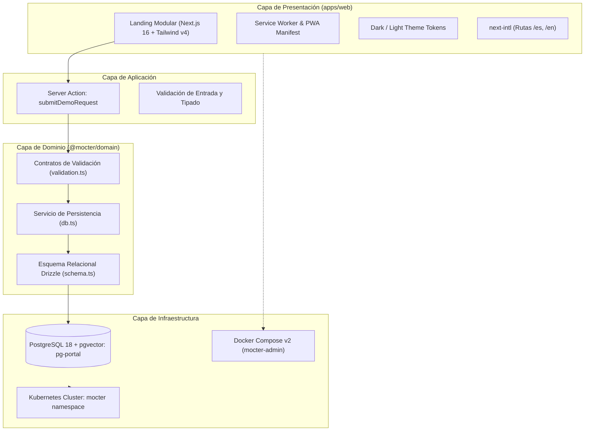

# Estado Técnico Actual del Proyecto — Plataforma Mocter (`mocter-portal`)

**Fecha de actualización:** 17 de octubre de 2026  
**Repositorio:** `landig-agencia`  
**Rama activa:** `feature/mocter-nextjs-migration`  
**Organización / Marca:** Mocter  
**Remoto de origen:** `https://github.com/EnuarRosales/landig-agencia.git`  
**Versión del Sistema:** `1.0.0`

---

## 1. Resumen Ejecutivo de la Transformación

El proyecto ha experimentado una **transformación arquitectónica integral**, evolucionando desde una landing page monolítica en un único archivo HTML estático (`index.html`) hacia una **plataforma web empresarial contenerizada basada en Next.js 16 (App Router), React 19, Turbopack, Tailwind CSS v4 y arquitectura modular de monorepo**.

Adicionalmente, se implementó una **capa agnóstica de dominio y persistencia (`@mocter/domain`)** conectada a **PostgreSQL 18 con extensión `pgvector`**, permitiendo la captura, validación estricta y persistencia real de prospectos (leads) a través de Server Actions seguras, respaldada por suites de pruebas automatizadas y despliegues contenerizados orquestados para desarrollo, pruebas y producción enterprise (Kubernetes).

---

## 2. Matriz Comparativa: Estado Inicial vs. Estado Actual

| Dimensión | Estado Inicial (16 Oct 2026) | Estado Actual (17 Oct 2026) |
| :--- | :--- | :--- |
| **Arquitectura** | Monolito de un solo archivo `index.html` (~591 líneas) | Monorepo modular (`pnpm workspaces` + `Turborepo v2`) |
| **Framework Frontend** | Vanilla HTML5 / JS sin framework | **Next.js 16.4.2** con Turbopack, React 19 y Server Components |
| **Estilos y Temas** | CSS embebido en `<style>` (solo tema oscuro) | **Tailwind CSS v4** con soporte nativo y dinámico de Modo Claro / Modo Oscuro |
| **Internacionalización** | Español estático en código duro | **`next-intl`** bilingüe estructurado (`/es`, `/en`) con detección de idioma |
| **Persistencia de Datos** | Inexistente (sin backend ni base de datos) | **PostgreSQL 18 (`pgvector`)** con Drizzle ORM y pool perezoso (*lazy*) |
| **Captura de Leads** | Formularios simulados / enlaces estáticos | **Server Action real** con validación de contratos Zod y guardado transaccional |
| **Testing y Calidad** | Inexistente (0 pruebas, sin linters) | **15 pruebas unitarias** pasando (Vitest), ESLint y tipado estricto con TypeScript |
| **Contenedores y DevOps** | Inexistente (ejecución con Live Server) | Docker multi-stage, **Docker Compose v2** (`dev`, `test`, `prod`) y **Kubernetes (`k8s/`)** |
| **Documentación** | `README.md` de 1 sola línea | `README.md` empresarial con C4 Mermaid, guías de despliegue y manuales de paquete |
| **Identidad de Marca** | Placeholder "agencIA / IdenTechnology" | **Mocter** estandarizado con Copy Green y propiedad intelectual registrada |

---

## 3. Estructura Actual del Repositorio

```text
landig-agencia/
├── apps/
│   └── web/                         # Aplicación Web y PWA en Next.js 16
│       ├── app/
│       │   ├── [locale]/             # Enrutamiento localizado bilingüe (/es, /en)
│       │   │   ├── layout.tsx        # Layout raíz (SEO, JSON-LD, ThemeProvider)
│       │   │   └── page.tsx          # Landing page de alta fidelidad
│       │   ├── actions/              # Server Actions con mutaciones seguras
│       │   │   ├── demo-request.ts   # Acción de captura y persistencia de leads
│       │   │   └── types.ts          # Tipos y contratos del formulario
│       │   ├── globals.css           # Tokens de diseño Tailwind v4 (dark/light)
│       │   └── proxy.ts              # Proxy de internacionalización Next.js
│       ├── components/               # Componentes modulares de interfaz
│       │   ├── sections/             # Secciones (Hero, Features, Sectores, Pipeline, FAQ, Footer)
│       │   ├── demo-form.tsx         # Formulario interactivo responsivo (ancho completo)
│       │   ├── theme-toggle.tsx      # Conmutador accesible de Modo Claro / Oscuro
│       │   ├── nav.tsx               # Barra de navegación adaptable
│       │   └── floating-background.tsx # Fondo reactivo con cursor glow y blobs
│       ├── messages/                 # Diccionarios de traducción (es.json, en.json)
│       ├── public/                   # PWA Manifest, iconos adaptativos, llms.txt, robots.txt
│       ├── next.config.ts            # Configuración de compilador, orígenes dev e imágenes
│       └── package.json              # Dependencias específicas de la app web
├── packages/
│   └── domain/                       # Capa de dominio y persistencia agnóstica
│       ├── drizzle/                  # Migraciones SQL versionadas
│       ├── src/
│       │   ├── db.ts                 # Cliente PostgreSQL resiliente y diagnóstico
│       │   ├── schema.ts             # Definición tipada de la entidad PostgreSQL 'leads'
│       │   ├── validation.ts         # Contratos y esquemas de validación Zod
│       │   └── tests/                # Suites de pruebas unitarias (Vitest)
│       ├── drizzle.config.ts         # Configuración de Drizzle Kit
│       ├── README.md                 # Documentación técnica del paquete en español
│       └── package.json              # Dependencias del paquete de dominio
├── k8s/                              # Manifiestos enterprise para Kubernetes
│   ├── namespace.yaml                # Aislamiento de namespace 'mocter'
│   ├── secrets.example.yaml          # Plantilla para secretos de producción
│   ├── pg-portal.yaml                # StatefulSet y Service para PostgreSQL 18 (pgvector)
│   ├── deployment.yaml               # Deployment de Next.js (web-portal) con startupProbe
│   ├── service.yaml                  # Service ClusterIP interno
│   └── ingress.yaml                  # Enrutamiento Nginx Ingress con TLS
├── .github/workflows/                # Automatización CI/CD
├── docker-compose.dev.yml            # Entorno de desarrollo local con HMR
├── docker-compose.test.yml           # Entorno de pruebas y control de calidad
├── docker-compose.prod.yml           # Entorno de producción standalone
├── Dockerfile                        # Multi-stage build optimizado (Node 24 Alpine)
├── .env.example                      # Plantilla de variables de entorno documentada en español
├── turbo.json                        # Pipeline de compilación y orquestación Turborepo
├── package.json                      # Configuración raíz de pnpm workspaces
├── README.md                         # Documentación general del sistema de información
└── ESTADO_TECNICO.md                 # Informe histórico del estado técnico inicial
```

---

## 4. Arquitectura de Software y Capas

El sistema implementa una arquitectura limpia (*Clean Architecture*) orientada a dominios:



---

## 5. Pila Tecnológica Implementada

### 5.1 Frontend (`apps/web`)
- **Next.js 16.4.2:** Motor de renderizado híbrido con App Router, Turbopack y React 19.
- **Tailwind CSS v4:** Motor CSS basado en variables dinámicas para alternancia instantánea entre tema claro y oscuro sin recarga.
- **`next-intl`:** Internacionalización nativa con diccionarios de mensajes estructurados.
- **Tipografía:** *Sora* (Display) e *Inter* (Sans) cargadas mediante `next/font` con optimización de fuentes estáticas.
- **PWA & Accesibilidad:** Manifiesto web nativo (`manifest.webmanifest`), `sw.js`, contraste auditado y componentes accesibles (Radix UI primitives).

### 5.2 Capa de Dominio y Persistencia (`@mocter/domain`)
- **PostgreSQL 18 (`pgvector/pgvector:pg18`):** Motor relacional preparado para almacenamiento transaccional y futuras capacidades de búsqueda vectorial e indexación semántica con IA.
- **Drizzle ORM v0.45:** ORM tipado de cero sobrecarga computacional con migraciones idempotentes versionadas en SQL.
- **Zod v4:** Validación estricta de contratos en tiempo de ejecución en el servidor.
- **Resiliencia de Conexión:** Pool de conexiones perezoso (*lazy pooling*), fail-fast ante variables ausentes y healthcheck proactivo `checkDatabaseConnection()`.

### 5.3 Infraestructura, Monorepo y DevOps
- **pnpm Workspaces & Turborepo v2.11:** Grafo de dependencias optimizado con caché remota, tareas paralelizadas y filtrado por workspaces.
- **Docker Compose v2:** Stacks dedicados bajo el proyecto `mocter-admin`:
  - `docker-compose.dev.yml`: Desarrollo local con HMR y volúmenes aislados.
  - `docker-compose.test.yml`: Ejecución de pruebas automatizadas sobre imagen develop.
  - `docker-compose.prod.yml`: Ejecución productiva de imagen standalone optimizada.
- **Kubernetes Enterprise (`k8s/`):** Manifiestos listos para producción con `Deployment`, `Service`, `StatefulSet` de base de datos, `Ingress` Nginx con TLS y sondas de salud (`startupProbe`, `readinessProbe`, `livenessProbe`).

---

## 6. Estado de Madurez de Funcionalidades

| Funcionalidad | Estado Anterior | Estado Actual | Detalle Técnico |
| :--- | :---: | :---: | :--- |
| **Landing Page** | Estática monolítica | **Modular en Next.js 16** | Dividida en componentes atómicos con SSR y SSG optimizados. |
| **Temas (Dark / Light)** | Solo oscuro (hardcoded) | **Totalmente Dinámico** | Conmutación instantánea con tokens CSS dinámicos y persistencia en cliente. |
| **Acordeón FAQ** | Estático / No expandible | **Interactivo y Accesible** | Animación suave basada en CSS Grid (`grid-rows-[1fr]/[0fr]`) y rotación de icono. |
| **Captura de Leads** | Mockup sin backend | **100% Funcional** | Validación Zod en Server Action con persistencia en tabla `leads` de PostgreSQL. |
| **Diseño del Formulario** | 3 columnas con hueco | **Responsivo 100% Ancho** | Cuadrícula modular `grid-cols-1 md:grid-cols-3` + bloque textarea a ancho completo. |
| **Pipeline Interactivo** | Contadores hardcodeados | **Animado y Reactivo** | Simulación de pipeline con rotación automática cada 3.2s y contadores dinámicos. |
| **SEO y Metadatos IA** | Meta tags básicos | **Enterprise SEO + llms.txt** | OpenGraph, Twitter Cards, Schema.org JSON-LD, `llms.txt` y `llms-full.txt`. |
| **Soporte PWA** | Inexistente | **Instalable (PWA Ready)** | Manifest completo, service worker configurado y recursos precacheados. |
| **Internacionalización** | Solo español rígido | **Bilingüe (ES / EN)** | Rutas dinámicas localizadas gestionadas por `next-intl`. |
| **Base de Datos** | Inexistente | **PostgreSQL 18 + Vector** | Tabla relacional `leads` con UUIDs, timestamps timezone y soporte pgvector. |

---

## 7. Verificación de Calidad y Pruebas

El monorepo cuenta con compuertas de calidad automatizadas:

```bash
# Ejecución de pruebas unitarias
pnpm test
# Resultado: 15/15 pruebas unitarias pasando en @mocter/domain (Vitest)

# Verificación de tipado estático
pnpm --filter @mocter/domain build
# Resultado: tsc --noEmit finalizado con 0 errores de tipado

# Compilación de producción
pnpm build
# Resultado: Compilación standalone exitosa en Next.js 16 con Turbopack
```

---

## 8. Conclusión

El proyecto ha superado con éxito la fase de prototipo estático y se encuentra en un **estado de madurez empresarial productivo (Production-Ready)**. 

La solución posee una separación estricta de responsabilidades, contratos de datos verificados, persistencia resiliente en PostgreSQL 18 con soporte para inteligencia artificial (`pgvector`), suites de calidad ejecutables y procedimientos de despliegue automatizados para cualquier entorno contenerizado moderno.

---

*Documento técnico de estado actual consolidado el 17 de octubre de 2026 bajo la auditoría de arquitectura de software para Mocter.*
