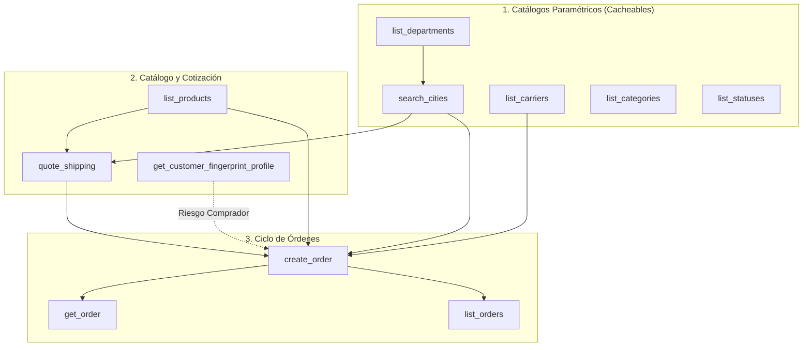
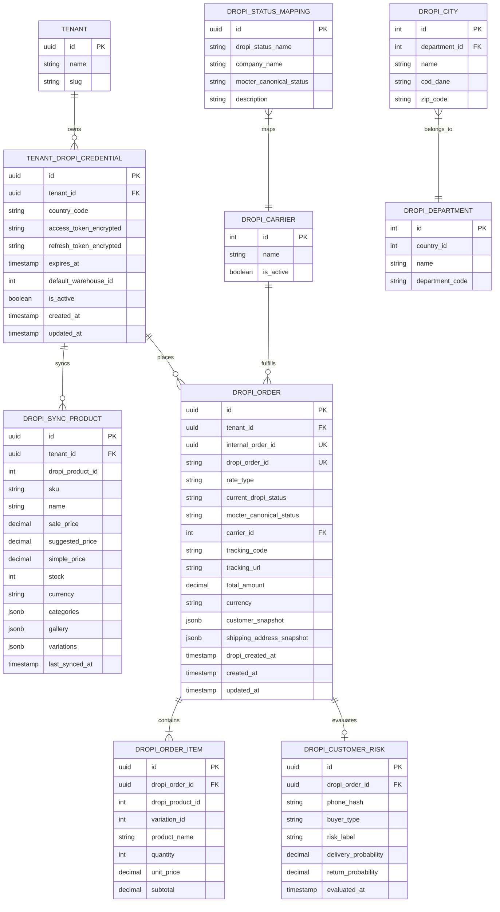

# Levantamiento Técnico y Análisis Inicial: Integración Mocter (Multi-tenant) con Plataforma Dropi

> **Estado**: Investigación y Acercamiento Técnico Inicial  
> **Fecha**: Noviembre 2026  
> **Autor**: Equipo de Arquitectura de Software Mocter  
> **Área**: Integraciones / E-commerce Logistics  
> **Objetivo**: Documentar en detalle las capacidades, limitaciones, estructuras de datos, catálogos paramétricos y modelos entidad-relación identificados a partir del servidor MCP oficial de Dropi, como base para diseñar la arquitectura de integración de Mocter y sus inquilinos (*tenants*).

---

## 1. Contexto y Objetivos del Levantamiento

El presente documento consolida la investigación preliminar realizada sobre el servidor oficial de **Dropi** basado en el protocolo **MCP (Model Context Protocol)** (`https://mcp.dropi.co/mcp`).

El propósito de este acercamiento inicial es:
1. Conocer de primera mano las capacidades operativas reales y las restricciones de seguridad que expone la infraestructura de Dropi.
2. Identificar los objetos de negocio, modelos de datos, catálogos paramétricos y flujos transaccionales requeridos para que **Mocter** permita a sus inquilinos (*tenants*) sincronizar catálogos, cotizar fletes y emitir/seguir despachos de mercadería bajo modelos de comercio electrónico y dropshipping.
3. Definir la estrategia de arquitectura de software (Clean Architecture / Hexagonal Architecture con Anti-Corruption Layer) necesaria para desacoplar el núcleo de `mocter-core` de las particularidades de Dropi.

---

## 2. Alcance Operativo y Fronteras de Seguridad

A partir de la inspección de permisos y la consola de consentimiento OAuth oficial de Dropi, se definieron con claridad los límites operativos del conector:

### 2.1. Rol Soportado: Dropshipper / Vendedor
El conector y las herramientas expuestas están orientados exclusivamente al rol de **vendedor / dropshipper**:
- Consulta y búsqueda en el catálogo general de productos de proveedores de Dropi.
- Cotización en tiempo real de fletes logísticos entre transportadoras aliadas.
- Consulta de georreferenciación nacional (departamentos y ciudades).
- Evaluación antifraude mediante huella digital del comprador final.
- Creación y seguimiento de órdenes de venta con o sin recaudo (pago contra entrega).

### 2.2. Operaciones Críticas Bloqueadas / No Expuestas
Dropi aísla por completo las operaciones financieras y de administración de inventario propio dentro de este canal:
- **Finanzas**: No es posible consultar la *wallet*, retirar saldo ni realizar transferencias de dinero.
- **Modificación de Órdenes**: `create_order` es de escritura única; no existen herramientas de edición, cancelación ni anulación de órdenes o guías.
- **Gestión de Catálogo Propio**: No se permite crear, editar ni eliminar productos como proveedor (cualquier funcionalidad de Mocter que actúe como *supplier* requerirá la API REST tradicional de proveedores de Dropi, fuera del alcance del MCP de vendedor).
- **Seguridad**: No se permite consultar perfiles de usuario, listar tiendas conectadas ni cerrar sesiones activas.

---

## 3. Arquitectura de Transporte, Autenticación y Conectividad

### 3.1. Especificación del Endpoint MCP
- **URL Base**: `https://mcp.dropi.co/mcp`
- **Transporte MCP**: *Streamable HTTP* (MCP Specification).
- **Respuesta no autenticada**: Código HTTP `401 Unauthorized` con cabecera:
  ```http
  Www-Authenticate: Bearer resource_metadata="https://mcp.dropi.co/.well-known/oauth-protected-resource/mcp"
  ```

### 3.2. Topología OAuth 2.0 y Metadatos
Dropi implementa OAuth 2.0 con Dynamic Client Registration (RFC 7591) y endpoints desacoplados:
- **Authorization Server Discovery**: `https://integrations.dropi.co/.well-known/oauth-authorization-server`
- **Issuer**: `https://integrations.dropi.co`
- **Authorization Endpoint**: `https://oauth.dropi.co/oauth/authorize`
- **Token Endpoint**: `https://integrations.dropi.co/oauth/token`
- **Registration Endpoint (DCR)**: `https://integrations.dropi.co/oauth/register`
- **Scopes**: `mcp`
- **PKCE**: Obligatorio con `code_challenge_method: S256`

### 3.3. Restricción de Infraestructura (AWS WAF / ALB)
Durante las pruebas de conexión local se identificó un comportamiento de red determinante:
- El endpoint `https://oauth.dropi.co/oauth/authorize` está respaldado por un balanceador de carga de AWS (`Server: awselb/2.0`).
- Dicho balanceador rechaza peticiones con `redirect_uri` locales en loopback (`http://127.0.0.1:...`), arrojando `HTTP 403 Forbidden`.
- **Por qué funciona en Claude**: Claude Desktop orquesta el flujo OAuth mediante un servicio intermediario en la nube (`https://claude.ai/api/organizations/.../mcp/start-auth`), con URLs de redirección homologadas por Dropi, y transfiere el token hacia el cliente desktop vía *browser handoff*.
- **Implicación para Mocter (Multi-tenant)**: Para conectar inquilinos en producción, Mocter no debe depender de clientes CLI locales. Mocter Backend debe implementar su propio redirect URI público autorizado (ej. `https://api.mocter.com/integrations/dropi/oauth/callback`) que complete el intercambio de código por tokens y almacene de forma cifrada el par `access_token` y `refresh_token` vinculado al `tenant_id`.

---

## 4. Catálogo Detallado de Herramientas (11 Tools)

El servidor expone **11 herramientas**: 10 de consulta/lectura y 1 de escritura transaccional con impacto real.



### 4.1. Herramientas Paramétricas y Geográficas

#### `search_cities`
- **Tipo**: Lectura.
- **Propósito**: Resolver nombres parciales o completos de ciudades a identificadores Dropi, códigos DANE y códigos postales.
- **Parámetros**:
  - `name` (*string*, requerido): Nombre parcial o completo (ej. `"Bogota"`, `"Cali"`).
- **Salida**: Lista de objetos ciudad: `id` (int), `department_id` (int), `name` (string en mayúsculas), `cod_dane` (string), `zip_code` (string).
- **Comportamiento**: Búsqueda por coincidencia de subcadena. Por ejemplo, `"Bogota"` devuelve tanto `BOGOTA` (`id: 50`, `department_id: 3`) como `PUERTO BOGOTA` (`id: 969`). El código DANE para Bogotá viene en formato de 8 dígitos (`"11001000"`).

#### `list_departments`
- **Tipo**: Lectura / Catálogo (Fallback a MCP Resource: `dropi://logistic/departments`).
- **Propósito**: Obtener la lista maestra de departamentos por país.
- **Parámetros**: Ninguno.
- **Salida**: Lista de departamentos con `id` (int), `country_id` (int), `name` (string), `department_code` (string con ceros a la izquierda, ej. `"05"`, `"08"`).
- **Peculiaridades**: 
  - Existen 33 departamentos en Colombia en la base de Dropi.
  - Siete departamentos tienen `department_code` vacío (`""`): Arauca, Guaviare, Chocó, Vaupés, Vichada, Amazonas y Guainía.
  - Registro duplicado identificado: `LA GUAJIRA` (`id: 9`, `department_code: "44"`) y `GUAJIRA` (`id: 94`, `department_code: ""`).

#### `list_carriers`
- **Tipo**: Lectura / Catálogo (Fallback a MCP Resource: `dropi://logistic/carriers`).
- **Propósito**: Consultar las empresas de transporte habilitadas para la cuenta.
- **Parámetros**: Ninguno.
- **Salida**: Lista de transportadoras con `id` (int) y `name` (string).
- **Transportadoras identificadas**:
  1. `VELOCES` (`id: 6`)
  2. `ENVIA` (`id: 2`)
  3. `INTERRAPIDISIMO` (`id: 3`)
  4. `DOMINA` (`id: 4`)
  5. `COORDINADORA` (`id: 5`)
  6. `99MINUTOS` (`id: 7`)
  7. `TCC` (`id: 10`)
  8. `JAMV-DRIVE` (`id: 13`)
  9. `WIILOG` (`id: 17`)
  10. `DEROCHA-EXPRESS` (`id: 14`)

#### `list_categories`
- **Tipo**: Lectura / Catálogo (Fallback a MCP Resource: `dropi://products/categories`).
- **Propósito**: Categorías de productos activas en la plataforma.
- **Parámetros**: Ninguno.
- **Salida**: Lista con `id` (int), `name` (string) y `parent_category` (int).
- **Peculiaridades**: Catálogo plano (todas tienen `parent_category = 0`). Los nombres mezclan mayúsculas y acentos (`"Ropa Deportiva"`, `"Bebé"`). Nota técnica: `list_products` filtra por el nombre de la categoría, no por su identificador numérico.

#### `list_statuses`
- **Tipo**: Lectura / Catálogo (Fallback a MCP Resource: `dropi://orders/statuses`).
- **Propósito**: Estados posibles por los que puede transitar una orden y su guía logística.
- **Parámetros**: Ninguno.
- **Salida**: 207 estados identificados con campos `id` (string), `name` (string) y opcionalmente `company` (string, nombre del carrier).

---

### 4.2. Catálogo de Productos y Cotización de Envíos

#### `list_products`
- **Tipo**: Lectura paginada (Cursor).
- **Propósito**: Búsqueda y sincronización de artículos del marketplace de Dropi.
- **Parámetros de Entrada**:
  - `search` (*string*, opcional): Búsqueda libre por texto en título.
  - `category` (*string*, opcional): Nombre exacto de la categoría.
  - `min_price` / `max_price` (*number*, opcional): Rango de precios.
  - `active` / `inactive` / `archive` (*boolean*, opcional): Estados de publicación.
  - `get_stock` (*boolean*, opcional): Bandera para incluir cantidad disponible en bodega.
  - `supplier_id` (*integer*, opcional): Filtro por proveedor.
  - `warehouse_id` (*integer*, opcional): Filtro por bodega de despacho.
  - `order_by` (*string*, opcional) / `order_type` (*string*, `"asc" | "desc"`).
  - `page_size` (*integer*, default 20, máx 100).
  - `start_data` (*integer*, cursor numérico: 0 al inicio, luego `start_data + page_size`).
- **Estructura Observada en Payload Real**:
  ```yaml
  id: 517903                      # int
  sku: "1"                        # string
  name: "Adidas GoPro Hombre PRIVADO 3"
  sale_price: 157000              # Precio de venta
  suggested_price: 219990         # Precio sugerido
  simple_price: 157000            # Precio base
  combo_min_sale_price: 0
  combo_min_suggested_price: 0
  stock: 20                       # Disponible (si get_stock=true)
  supplier_id: 105522
  categories: ["Ropa Deportiva", "Moda", "Otro"]
  gallery: 
    - urlS3: "https://..."
  variations: []                  # Arreglo de variantes si es VARIABLE
  currency: "COP"                 # Definido a nivel contenedor
  ```

#### `quote_shipping`
- **Tipo**: Lectura / Cálculo en tiempo real.
- **Propósito**: Calcular tarifas y tiempos de entrega estimados entre múltiples transportadoras sin reservar cupo ni bloquear inventario.
- **Parámetros de Entrada**:
  - `cash_on_delivery` (*boolean*, requerido): `true` para pago contra entrega con recaudo, `false` para pago previo.
  - `destination_city` (*object*, requerido):
    - `id` (*integer*, requerido): Obtenido de `search_cities.id`.
    - `zip_code` (*string | null*, requerido): Obtenido de `search_cities.zip_code`.
    - `dane_code` (*string*, opcional): Código DANE (ej. `"11001000"`).
  - `products` (*array*, requerido, mínimo 1 ítem):
    - `id` (*integer*, requerido): ID del producto.
    - `type` (*string*, requerido): `"SIMPLE" | "VARIABLE" | "COMBO"`.
    - `quantity` (*integer*, requerido, $\ge 1$).
    - `price` (*number*, requerido): Precio unitario declarado.
    - `variation_id` (*integer | null*, condicional): Requerido si `type == "VARIABLE"`.
  - `zip_code` (*string | null*, condicional): Obligatorio para Argentina (4 dígitos) y México (5 dígitos).
  - `neighborhood` (*string | null*, condicional): Obligatorio en Costa Rica (distrito).
  - `direction` (*string | null*, opcional): Dirección de entrega.
- **Salida**: Tarifa cotizada por cada transportadora habilitada con desglose de `shipping_cost`, `service`, `insurance` y `trajectory`. Si una transportadora no tiene cobertura, devuelve `shipping_cost: null` con el motivo explícito.

---

### 4.3. Huella Digital y Análisis Antifraude

#### `get_customer_fingerprint_profile`
- **Tipo**: Lectura.
- **Propósito**: Evaluación predictiva de riesgo del comprador final basada en el histórico de entregas y devoluciones registrado en la red de Dropi para ese número telefónico.
- **Parámetros**:
  - `phone` (*string*, requerido): Dígitos puros sin caracteres especiales. Se recomienda formato nacional.
- **Salida**:
  - `buyer_type` (*string*): Etiqueta descriptiva (ej. `"Recurrente"`, `"Nuevo"`).
  - `risk_label` (*string*): Nivel de riesgo (ej. `"Bajo"`, `"Medio"`, `"Alto"`).
  - `delivery_probability` (*number*): Probabilidad estimada de entrega exitosa (0 a 100).
  - `return_probability` (*number*): Probabilidad estimada de devolución/rechazo (0 a 100).
- **Reglas de Dominio**:
  - `delivery_probability + return_probability` **no suman 100** debido a pedidos actualmente en tránsito.
  - Valores en 0 significan datos insuficientes, no necesariamente un comprador de alto riesgo.
  - Si el teléfono no tiene historial previo, la herramienta devuelve `"No se encontró huella digital para ese teléfono"`.

---

### 4.4. Transacciones y Gestión de Envíos

#### `create_order`
- **Tipo**: **Escritura Transaccional con Efecto Físico Real**.
- **Propósito**: Registrar formalmente una venta y solicitar a Dropi la preparación y despacho del paquete con la transportadora.
- **Parámetros de Entrada**:
  - Datos de Entrega:
    - `name` (*string*, requerido): Nombre del destinatario.
    - `surname` (*string*, requerido): Apellidos.
    - `phone` (*string*, requerido): Teléfono de contacto.
    - `dir` (*string*, requerido): Dirección domiciliaria detallada.
    - `state` (*string*, requerido): Nombre del departamento o `department_code`.
    - `city` (*string*, requerido): Nombre exacto de la ciudad.
    - `rate_type` (*string*, requerido): `"CON RECAUDO"` o `"SIN RECAUDO"`.
    - `client_email` (*string*, opcional).
    - `dni` (*string*, opcional): Documento de identidad.
    - `notes` (*string*, opcional): Instrucciones para el transportador.
    - `zip_code` / `colonia` (condicional según país: AR, MX, CR).
  - Identificadores de Mocter:
    - `shop_order_id` (*string*, opcional pero **crítico**): Identificador único de la orden en Mocter.
    - `shop_order_number` (*string*, opcional): Número visual de la orden en la tienda.
    - `distribution_company_id` (*integer | null*, opcional): ID de transportadora preferida. Si se omite, Dropi selecciona automáticamente según su algoritmo de cobertura y costo.
  - `products` (*array*, requerido, mínimo 1 ítem):
    - `id` (*integer*, requerido): ID del producto en Dropi.
    - `price` (*number*, requerido): Precio de venta pactado.
    - `quantity` (*integer*, requerido, $\ge 1$).
    - `variation_id` (*integer | null*, condicional si es variante).
    - `combo_combination_id` (*integer | null*, condicional si es combo).
- **Salida**: `order_id` (numérico en Dropi), `status`, `total`, `created_at`.

#### `get_order`
- **Tipo**: Lectura.
- **Propósito**: Obtener el detalle completo y estado actualizado de una orden específica.
- **Parámetros**:
  - `id` (*string*, requerido): `order_id` de Dropi (ej. `"93204655"`).
- **Salida**: Estado, información del cliente, subtotales, costo de envío, transportadora asignada, fechas de hitos y `tracking_code` (guía de seguimiento) una vez generada.

#### `list_orders`
- **Tipo**: Lectura paginada por offset.
- **Propósito**: Sincronización periódica y reconciliación de órdenes.
- **Parámetros**:
  - `from` / `until` (*string YYYY-MM-DD*, ventana máxima permitida: 90 días).
  - `status` (*string*, opcional): Filtro por estado exacto.
  - `text_to_search` (*string*, opcional): Búsqueda por `order_id`, tracking, nombre o teléfono.
  - `city_id` / `department_id` / `distribution_company_id` (*integer*, opcional).
  - `start` (*integer*, offset de paginación: 0, `start + result_number`).
  - `result_number` (*integer*, tamaño de página, máx. recomendado 100).

---

## 5. Modelo Entidad-Relación Propuesto para Mocter (Multi-tenant)

Para integrar Dropi en una arquitectura multi-inquilino sin acoplar el esquema central de `mocter-core`, se propone el siguiente modelo de persistencia en PostgreSQL:



---

## 6. Anti-Corruption Layer (ACL) y Manejo de Peculiaridades

Para que el núcleo de Mocter permanezca limpio y mantenible, el adaptador de integración debe implementar las siguientes estrategias:

### 6.1. Normalización de los 207 Estados de Orden
El catálogo de estados de Dropi presenta duplicidad de nombres entre transportadoras y cadenas con caracteres mal codificados (ej. `"ENVO ADMITIDO"` en lugar de `"ENVÍO ADMITIDO"`, `"NOVEDAD EN AEROPUERTO  "` con espacios al final).

**Solución de Diseño**:
Implementar un `DropiOrderStatusMapper` que resuelva una tupla `(company, status_name)` hacia una máquina de estados canónica de Mocter:

| Estado Canónico Mocter | Estados de Origen Dropi (Muestra) |
| :--- | :--- |
| `PENDING_CONFIRMATION` | `PENDIENTE CONFIRMACION`, `PENDIENTE` |
| `PREPARING` | `GENERANDO_GUIA`, `PREPARADO PARA TRANSPORTADORA`, `EN BODEGA DROPI` |
| `SHIPPED` | `GUIA_GENERADA`, `ENTREGADO A TRANSPORTADORA`, `EN DISTRIBUCION URBANA` |
| `IN_TRANSIT` | `EN VIAJE`, `EN TRASLADO INTERMUNICIPAL`, `EN REPARTO` |
| `DELIVERED` | `ENTREGADO`, `ENTREGADA` (cualquier transportadora) |
| `EXCEPTION_INCIDENT` | `NOVEDAD EN AEROPUERTO`, `DIRECCION ERRADA`, `CERRADO POR INCIDENCIA` |
| `RETURNING` | `DEVOLUCION EN TRANSITO`, `DEVOLUCION` |
| `CANCELLED` | `CANCELADO`, `GUIA_ANULADA`, `RECHAZADO` |

### 6.2. Estrategia de Idempotencia y Reconciliación en `create_order`
Dado que Dropi no proporciona una clave de idempotencia en la cabecera HTTP ni permite anular/actualizar órdenes creadas:

1. **Fase Previa**: Antes de disparar la petición HTTP a Dropi, Mocter registra la orden en estado local `SUBMITTING_TO_DROPI`, asociando el `shop_order_id` (UUID interno).
2. **Fase de Ejecución**: Se ejecuta la llamada a `create_order`.
3. **Manejo de Timeout de Red / Error 5xx**:
   - **Prohibido**: No se debe reintentar `create_order` de forma automática e inmediata, ya que Dropi podría haber recibido y procesado el pedido, provocando un despacho físico duplicado con costo para el inquilino.
   - **Protocolo de Reconciliación**: Un worker en segundo plano ejecuta `list_orders` filtrando por `text_to_search = shop_order_id` en una ventana de 24 horas.
     - Si la orden aparece: se captura el `dropi_order_id` asignado y se pasa a estado `SYNCED`.
     - Si tras $N$ comprobaciones con retroceso exponencial (*exponential backoff*) la orden no existe: se marca como `FAILED` para revisión humana o reintento seguro.

### 6.3. Modelado de Monedas (Value Object `Money`)
Dropi opera en múltiples países con monedas distintas. Especial atención requiere el caso de Venezuela, donde el catálogo de proveedores lista precios referenciales en USD, pero la orden de venta debe liquidarse en moneda nacional (VES).
- Todo valor monetario debe encapsularse en un Value Object:
  ```typescript
  export class Money {
    constructor(
      public readonly amount: number,
      public readonly currency: 'COP' | 'USD' | 'MXN' | 'CLP' | 'VES'
    ) {}
  }
  ```

---

## 7. Plan de Acción y Próximos Pasos

1. **Diseño de Puertos del Dominio**:
   - `DropiCatalogPort`: Métodos para búsqueda paginada y consulta de stock.
   - `DropiShippingPort`: Métodos de cotización multicarrier y consulta de cobertura DANE.
   - `DropiOrderPort`: Método de creación con reconciliación y consulta de guías.
2. **Definición del Flujo OAuth Multi-tenant en Mocter**:
   - Implementar el endpoint de redirección en Mocter Core para el intercambio del código de autorización por tokens de Dropi por cada inquilino.
   - Diseñar el mecanismo de refresco automático de token (`/oauth/token` con `grant_type: refresh_token`).
3. **Mapeo de Webhooks / Polling de Estados**:
   - Diseñar el cron de reconciliación periódica (`list_orders` con ventana de 7 a 30 días) para mantener actualizadas las guías y estados de entrega sin saturar los rate limits de Dropi.
4. **Validación con API REST Directa de Dropi**:
   - Utilizar las firmas y comportamientos descubiertos en esta investigación MCP para auditar la documentación y endpoints REST correspondientes de Dropi para entornos productivos de alta concurrencia.

