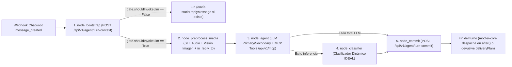

# Guía de Arquitectura e Interoperabilidad: `mocter-core` ↔ `mocter-engine` (Python + LangGraph) ↔ `mocter-chatwoot`

| Atributo | Valor |
| --- | --- |
| **Documento** | Manual de Decisiones Arquitectónicas y Contrato de Integración Machine-to-Machine (M2M) para `mocter-engine` |
| **Especificaciones fuente** | [SPEC-22](specs/spec-22-particionamiento-pgvector-embeddings-busqueda-hibrida/requirements.md) (`v1.1.0`) y [SPEC-23](specs/spec-23-gateway-hibrido-rest-mcp-agente-langgraph/requirements.md) (`v1.2.0`) |
| **Componentes involucrados** | `mocter-core` (`@mocter/domain` + `apps/admin`), `mocter-engine` (Python 3.12+ / LangGraph), `mocter-chatwoot` (Chatwoot v4.19.1), `mocter-media` (SeaweedFS S3 + `imgproxy`) |
| **Estado** | Aprobado · Vigente |

---

## 1. Propósito del Documento

Este documento consolida todas las decisiones arquitectónicas, contratos de red, esquemas de datos, reglas de seguridad e invariantes de negocio definidos en **`mocter-core`** (`SPEC-22` y `SPEC-23`) que el equipo y los agentes a cargo del proyecto **`mocter-engine` (Python + LangGraph)** deben conocer para interoperar con `mocter-core` y `mocter-chatwoot`.

---

## 2. Topología de Red Privada y Escalabilidad (Docker Actual → Kubernetes Multi-Celda)

### 2.1 Reglas Innegociables de Red
1. **Tráfico Este–Oeste 100 % interno:** `mocter-core`, `mocter-engine` y `mocter-chatwoot` se comunican exclusivamente dentro de una **red privada interna de Docker** (y en el futuro mediante `Service` `ClusterIP` + `NetworkPolicy` en **Kubernetes**). Ningún servicio publica puertos al host en producción o pruebas (`AGENTS.md R-10`).
2. **Rutas Machine-to-Machine (M2M) bloqueadas en el borde público:** El router público de Traefik (`admin.mocter.co`) **no expone** `/api/v1/agent/*` ni `/api/v1/mcp` hacia Internet.
3. **Exposición Norte–Sur mínima para clientes finales y Meta WhatsApp Cloud API:** Hacia Internet (TLS 443) únicamente son alcanzables las URLs públicas firmadas de archivos multimedia que WhatsApp o el navegador del comprador necesitan descargar sin sesión ni cabeceras:
   - **Imágenes (`@jpg` / `@png`):** servidas por `imgproxy` (`IMGPROXY_PUBLIC_URL`, ej. `https://media.mocter.co/...`).
   - **Audios, Videos y PDFs:** servidos en streaming con firma HMAC-SHA256 stateless por `${MOCTER_PUBLIC_ADMIN_URL}/api/v1/public-media/:mediaId?clientId=...&exp=...&sig=...`.
4. **Diseño 100 % Stateless listo para Kubernetes:** `mocter-core` no guarda sesiones MCP, locks de idempotencia, contadores de *rate limit* ni ventanas de enfriamiento (*cooldown*) en memoria local del proceso Node.js; todo el estado efímero distribuido vive en el **Redis del Control Plane (`ioredis`)**. `mocter-engine` tampoco requiere *sticky sessions* hacia `mocter-core`.

### 2.2 Variables de Entorno de Interoperabilidad

#### En `mocter-engine` (Python / LangGraph)
```env
# Origen interno de mocter-core (Docker actual vs Kubernetes futuro)
MOCTER_CORE_BASE_URL=http://admin-portal:3003
# En Kubernetes: http://mocter-admin.mocter.svc.cluster.local:3003

# Clave secreta Machine-to-Machine (M2M) compartida con mocter-core (mínimo 32 caracteres)
MOCTER_AGENT_SERVICE_KEY=<secreto_compartido_m2m_min_32_chars>

# Origen interno de mocter-chatwoot para descarga de adjuntos entrantes o envío directo
CHATWOOT_INTERNAL_URL=http://mocter-chatwoot-rails-1:3000
# En Kubernetes: http://mocter-chatwoot.mocter.svc.cluster.local:3000

# Base de datos propia de mocter-engine para el Checkpointer nativo de LangGraph (PostgresSaver)
ENGINE_CHECKPOINTER_DATABASE_URL=postgresql://...
```

#### En `mocter-core` (`@mocter/domain` y `apps/admin`)
```env
MOCTER_AGENT_SERVICE_KEY=<secreto_compartido_m2m_min_32_chars>
MOCTER_PUBLIC_ADMIN_URL=https://admin.mocter.co
MOCTER_PUBLIC_MEDIA_SIGNING_KEY=<secreto_hmac_dedicado_min_32_chars>
MOCTER_PUBLIC_MEDIA_TTL_SECONDS=3600
MOCTER_AGENT_RATE_LIMIT_PER_CONV_PER_MIN=30
MOCTER_EMBEDDING_API_KEY=<api_key_dedicada_embeddings_1536d>
MOCTER_EMBEDDING_PROVIDER=openai
MOCTER_EMBEDDING_MODEL=text-embedding-3-small
MOCTER_STT_API_KEY=<api_key_opcional_respaldo_stt>
MOCTER_WHATSAPP_POST_MEDIA_PAUSE_MS=5000
MOCTER_INCIDENT_COOLDOWN_SECONDS=1800
```

---

## 3. Seguridad Machine-to-Machine (M2M), Contexto de Tenencia (`InjectedToolArg`) y Trazabilidad

La comunicación **Machine-to-Machine (M2M)** es el esquema de seguridad entre servidores (`mocter-engine` ↔ `mocter-core`) sin sesión de navegador ni intervención humana.

### 3.1 Cabeceras HTTP entre `mocter-engine` y `mocter-core`

| Cabecera | Obligatoriedad | Propósito |
| --- | --- | --- |
| `Authorization: Bearer <MOCTER_AGENT_SERVICE_KEY>` *(o `X-Mocter-Agent-Key`)* | **Obligatoria** en toda petición | Autenticación Machine-to-Machine (M2M) validada en tiempo constante (`timingSafeEqual` sobre SHA-256). |
| `X-Request-Id` | **Obligatoria / Recomendada** | UUID de correlación extremo a extremo propagado por `apps/admin/proxy.ts` y `AsyncLocalStorage` en todos los logs JSON. |
| `X-Mocter-Engine-Run-Id` | **Recomendada** | Identificador del *run/trace* de LangGraph / LangSmith para correlacionar logs de Python y Node.js. |
| `X-Mocter-Client-Id` | **Obligatoria** en `tools/call` y endpoints por inquilino | UUID del inquilino (`clientId`) inyectado por el runtime de `mocter-engine` desde `AgentState` (nunca generado por el LLM). |
| `X-Mocter-Conversation-Id` | **Recomendada** | ID numérico de la conversación en Chatwoot; alimenta el *rate limiter* distribuido en Redis. |

### 3.2 Regla Anti-Conflicto de Tenencia (`400 TENANT_CONTEXT_MISMATCH`)
- **El LLM jamás debe inventar ni pasar `clientId` como argumento libre.** En LangGraph, `clientId` y `chatwootConversationId` se mantienen en el `AgentState` tras llamar a `turn-context` y se inyectan vía cabeceras HTTP (`X-Mocter-Client-Id`, `X-Mocter-Conversation-Id`) o `InjectedToolArg`.
- Si una petición envía simultáneamente `X-Mocter-Client-Id`, `body.clientId` o `chatwootAccountId` y cualquiera de ellos resuelve a un inquilino distinto, `mocter-core` rechaza inmediatamente la operación con HTTP `400` (`TENANT_CONTEXT_MISMATCH`).
- Internamente, toda consulta celular en `mocter-core` corre dentro de `withTenantCellTransaction(clientId, ...)` ejecutando `SET LOCAL app.current_client_id` bajo `FORCE ROW LEVEL SECURITY` y podando físicamente las particiones `LIST (client_id)` en PostgreSQL 18.

### 3.3 Rate Limiting Distribuido Anti-Bucle
- `mocter-core` limita las llamadas por `(clientId, chatwootConversationId)` a `MOCTER_AGENT_RATE_LIMIT_PER_CONV_PER_MIN` (por defecto **30 peticiones/minuto**).
- Si un grafo en `mocter-engine` entra en bucle de herramientas, `mocter-core` responde HTTP `429 Too Many Requests` (RFC 9457) con cabecera `Retry-After`. `mocter-engine` debe tratar `429` como señal de corte del ciclo de herramientas y pasar al nodo de cierre/commit.

---

## 4. Separación Estricta: Descubrimiento No Determinista vs. Servicios Deterministas

Una de las decisiones fundamentales de `SPEC-22` y `SPEC-23` es la **frontera inquebrantable entre datos vectorizados y datos transaccionales**:

| Dominio | Naturaleza | Dónde vive y cómo se resuelve en `mocter-core` | Regla para `mocter-engine` |
| --- | --- | --- | --- |
| **Búsqueda de catálogo por intención, beneficios, FAQs o palabras clave** | No determinista (Semántica + Léxica) | Tabla particionada `admin.product_embeddings` (`PARTITION BY LIST (client_id)`), índice local `HNSW (halfvec(1536))` + índice local `GIN (lexical_text)` sin tildes + fusión **RRF (`k = 60`)**. | Usar `search_catalog_hybrid`. `mocter-core` vectoriza el query internamente con `MOCTER_EMBEDDING_API_KEY`; `mocter-engine` envía texto plano, nunca vectores crudos. |
| **Precios, escalones por cantidad, promociones (`SPEC-18`), stock físico/combos y variantes** | **100 % Determinista** | Tablas `admin.products`, `admin.product_bundle_items` y `resolveEffectivePromotionsForProducts`. **Jamás se guardan en embeddings.** | `search_catalog_hybrid` y `get_product_details_and_pricing` ya devuelven los resultados **hidratados en tiempo real** desde las tablas transaccionales. |
| **Cálculo de subtotal, descuentos, envío y total de un pedido** | **100 % Determinista** | `quote_order_items` (`AgentGatewayOrchestratorService.quoteOrderItems`). | **Prohibido hacer aritmética de precios en el LLM.** Siempre invocar `quote_order_items` o `register_order`. |
| **Registro de pedido (`ORD-YYYYMM-####`)** | **100 % Determinista e Idempotente** | `register_order` recalcula obligatoriamente con `quoteOrderItems()` e invoca `BotOrderCaptureService.capture()` por `chatwootConversationId`. | El contrato de `register_order` **no acepta campos de precio ni descuento** desde `mocter-engine`. |
| **Homologación geográfica (país, departamento/estado, ciudad, código DANE/transportadora)** | **100 % Determinista** | `resolve_geographic_location` (`LocationResolverService`, `SPEC-20`: ISO 3166-1/2 + ACL `Dropi`/`Effi`/`MercadoLibre`). | Invocar antes de confirmar despacho para obtener `resolved`, `soft_normalized`, `ambiguous` o `unresolved`. |
| **Prompt Maestro de Comercialización del Producto (`bot_master_prompt`, hasta 32 KB)** | **100 % Determinista** | Columna `admin.products.bot_master_prompt` (`SPEC-19`). **Jamás se vectoriza** para no contaminar la similitud coseno. | Se entrega íntegro en `turn-context` (si hay `activeProduct`) o al llamar a `get_product_details_and_pricing`. |

---

## 5. Frontera de Memoria: Corto Plazo (LangGraph) vs. Largo Plazo (`mocter-core`)

Para evitar duplicidad de almacenamiento y fugas de contexto entre conversaciones:

1. **Memoria Conversacional de Corto Plazo (Ventana de Turnos Recientes — responsabilidad de `mocter-engine`):**
   - Reside en la base de datos operativa propia de `mocter-engine` usando el **`PostgresSaver` Checkpointer nativo de LangGraph**, indexado por:
     ```python
     thread_id = f"{client_id}:{chatwoot_conversation_id}"
     ```
   - Mantiene la ventana deslizante de los **últimos 20 mensajes** de la conversación activa.
   - **Regla de seguridad obligatoria al hidratar historial desde Chatwoot:** `mocter-engine` (y `ChatwootHttpConversationGateway.getRecentMessages` en `mocter-core`) deben filtrar y descartar siempre:
     - `message.private == True` (notas privadas internas de agentes humanos o alertas de incidentes BYOK).
     - `message.message_type == 2` (mensajes de actividad del sistema de Chatwoot, cambios de etiquetas o asignaciones).
2. **Memoria Semántica de Largo Plazo (Perfil y Episodios del Comprador — responsabilidad de `mocter-core`):**
   - Reside en la celda del inquilino en `admin.contact_memories` (`PARTITION BY LIST (client_id)`, `SPEC-22`), con `kind = 'profile'` (1 ficha viva por contacto) y `kind = 'episode'` (historial relevante entre distintas conversaciones).
   - `mocter-core` la entrega automáticamente en `POST /api/v1/agent/turn-context` (`contactMemory: { profile, episodes }` e inyectada en el System Prompt IDEAL) y la actualiza cuando `mocter-engine` envía `memoryConsolidation` en `POST /api/v1/agent/turn-commit`.

---

## 6. Protocolo Híbrido: RESTful (OpenAPI 3.1) + MCP Streamable HTTP Stateless

`mocter-core` expone exactamente las mismas **9 operaciones canónicas** por dos vías respaldadas por un único esquema Zod v4 (`packages/domain/src/validation/agent-gateway.schemas.ts`), más **1 endpoint REST auxiliar** de infraestructura:

- **Vía 1 — RESTful (`/api/v1/agent/*`):** Ideal para los nodos deterministas del grafo (`node_bootstrap` → `POST /api/v1/agent/turn-context`, `node_commit` → `POST /api/v1/agent/turn-commit` y `POST /api/v1/agent/media-receipts`). Errores estandarizados bajo **RFC 9457 (`application/problem+json`)**. Especificación viva en `GET /api/v1/agent/openapi.json`.
- **Vía 2 — MCP Server Streamable HTTP Stateless (`POST /api/v1/mcp`):** Ideal para enlazar las herramientas de negocio directamente al nodo de *Tool Calling* de LangGraph (`langchain-mcp-adapters` / `streamablehttp_client`).
  - Cumple la especificación **MCP `2025-03-26`** (con negociación retrocompatible a `2024-11-05`).
  - Soporta `initialize`, `notifications/initialized` (responde `202 Accepted`), `ping`, `tools/list` y `tools/call`.
  - `GET /api/v1/mcp` y `DELETE /api/v1/mcp` devuelven `405 Method Not Allowed` (`Allow: POST`), confirmando al cliente MCP que opera en modo stateless sin stream SSE residente.

### 6.1 Catálogo de Operaciones

| # | Tool MCP (`POST /api/v1/mcp`) | Endpoint REST (`/api/v1/agent/*`) | Cuándo la invoca `mocter-engine` |
| --- | --- | --- | --- |
| **1** | `bootstrap_conversation_turn` | `POST /api/v1/agent/turn-context` | **Inicio de cada turno (`node_bootstrap`)**: resuelve tenencia/celda, evalúa guardrails (`gate.shouldInvokeLlm`), resuelve `in_reply_to`, normaliza adjuntos entrantes, entrega System Prompt IDEAL (3 planos) + Prompt Clasificador + `{fecha_actual}`, `llmCandidates` y `sttCredential`. |
| **2** | `search_catalog_hybrid` | `POST /api/v1/agent/catalog/search` | **Tool del Agente**: búsqueda híbrida RRF (HNSW + léxica sin tildes + SKU) hidratada en vivo con precios en centavos, promociones vigentes (`SPEC-18`), stock, variantes y resumen multimedia. |
| **3** | `get_product_details_and_pricing` | `GET /api/v1/agent/catalog/products/:productId` | **Tool del Agente**: obtiene la ficha completa por `productId`, `sku` o `mediaTerm`, incluyendo `botMasterPrompt` completo, componentes de combo, promoción, stock y multimedia firmada. |
| **4** | `get_product_media_assets` | `GET /api/v1/agent/catalog/products/:productId/media` | **Tool del Agente**: consulta fotos (`imgproxy` `@jpg`/`@png`), audios ordenados (`audioOrder: 1..N`), videos o PDFs (`/api/v1/public-media/:mediaId`) con flag `whatsappCompatible`. |
| **5** | `quote_order_items` | `POST /api/v1/agent/orders/quote` | **Tool del Agente**: cotiza en centavos exactos subtotal, descuentos automáticos (`SPEC-18`), flete (`shipping_policy`) y total, validando stock y atributos `requiredForOrder`. |
| **6** | `resolve_geographic_location` | `POST /api/v1/agent/geo/resolve` | **Tool del Agente**: homologa país, departamento/estado y ciudad contra ISO 3166-1/2 y transportadoras (`Dropi`, `Effi`, `MercadoLibre`). |
| **7** | `upsert_contact_and_address` | `POST /api/v1/agent/crm/contacts/upsert` | **Tool del Agente**: actualiza contacto con validación E.164, semántica de **patch no destructivo** (`COALESCE(NULLIF(..., ''), actual)`), dirección de 8 campos y consentimientos Habeas Data. |
| **8** | `register_order` | `POST /api/v1/agent/orders/register` | **Tool del Agente**: registra el pedido recalculando precios en servidor (no recibe precios del LLM), genera `ORD-YYYYMM-####` idempotente por conversación y apaga seguimientos (`followup_active = false`). |
| **9** | `commit_conversation_turn` | `POST /api/v1/agent/turn-commit` | **Fin de cada turno (`node_commit`)**: idempotente por `idempotencyKey` en Redis; procesa `inferenceIncident` y `requestHumanHandoff`, aplica clasificación monotónica, sincroniza Chatwoot (`GET→merge→POST`), compila `deliveryPlan`, despacha vía `after()` (si `dispatchToChatwoot=true`), registra tokens en `ai_usage_events` y consolida `contact_memories`. |
| **Aux** | *(Solo REST — no expuesto al LLM)* | `POST /api/v1/agent/media-receipts` | **Solo si `dispatchToChatwoot = false`**: `mocter-engine` reporta los `chatwootMessageId` devueltos por Chatwoot al enviar multimedia para poblar `admin.conversation_sent_media_log`. |

---

## 7. Arquitectura Recomendada del `StateGraph` en `mocter-engine` (Python + LangGraph)



### 7.1 Detalle Operativo de los 5 Nodos en `mocter-engine`

#### Nodo 1: `node_bootstrap` (`POST /api/v1/agent/turn-context`)
Envía los metadatos crudos del webhook de Chatwoot:
```json
{
  "chatwootAccountId": 12,
  "chatwootConversationId": 9481,
  "chatwootInboxId": 3,
  "channel": "whatsapp",
  "conversation": {
    "customAttributes": { "desactivar_bot": false },
    "labels": ["lead-tibio"],
    "priority": null
  },
  "sender": {
    "chatwootContactId": 5512,
    "name": "Carlos Pérez",
    "phoneMobile": "+573001112233"
  },
  "message": {
    "id": "88219",
    "content": "¿Cuánto cuesta este que me mandaste?",
    "messageType": "incoming",
    "inReplyToChatwootMessageId": 88190,
    "attachments": [
      {
        "id": 991,
        "fileType": "audio",
        "dataUrl": "https://chat.mocter.co/rails/active_storage/blobs/...",
        "mimeType": "audio/ogg"
      }
    ]
  }
}
```
**Qué recibe `mocter-engine` en `TurnContextDto`:**
- `gate`: `{ shouldInvokeLlm: boolean, reason: "ready" | "ignoring_non_incoming" | "bot_paused" | "channel_disabled" | "conversation_handed_off" | "max_turns_exceeded" | "out_of_hours" | "llm_credentials_unavailable", staticReplyMessage: string | null }`.
  - Si `gate.shouldInvokeLlm == False`, `mocter-engine` **corta la ejecución inmediatamente** sin invocar ningún LLM.
- `repliedMediaContext`: si el cliente usó «Responder» sobre una imagen/audio/video enviado antes por el bot (`inReplyToChatwootMessageId`), `mocter-core` busca en `admin.conversation_sent_media_log` en `< 2 ms` y devuelve `{ chatwootMessageId, productId, productName, mediaId, mediaKind }` (o `null` si citó un mensaje de texto).
- `inboundAttachments`: lista de adjuntos entrantes (`audio`, `image`, `video`, `file`) con `internalDownloadUrl` ya reescrita hacia `CHATWOOT_INTERNAL_URL` para descarga por la red privada Docker.
- `prompts`: `{ systemPrompt, classifierPrompt, formattedCurrentDate, estimatedTokens }` con los 3 planos IDEAL (`SPEC-19`) y `{fecha_actual}` formateada en la zona horaria (`clients.timezone`) e idioma (`clients.locale`) del comercio.
- `llmCandidates`: arreglo ordenado `[primary, secondary]` con `{ providerId, providerSlug, modelId, modelSlug, apiKey, temperature, maxTokens, mode }`.
- `sttCredential`: credencial lista para transcripción de voz (`openai` o `google` del BYOK del inquilino, o `MOCTER_STT_API_KEY` de respaldo cuando el comercio usa Anthropic/DeepSeek para texto).

#### Nodo 2: `node_preprocess_media` (Audio STT + Imagen Visión + Contexto Citado)
1. **Si hay adjuntos `fileType == "audio"`:** descarga el binario desde `internalDownloadUrl` y lo transcribe con `sttCredential`. Concatena la transcripción al texto del turno del comprador.
2. **Si hay adjuntos `fileType == "image"`:** descarga la imagen desde `internalDownloadUrl` y la incorpora como bloque multimodal (`image_url` en base64) en el `HumanMessage` de LangChain/LangGraph para que el LLM analice comprobantes de pago (ej. Nequi/Bancolombia/Bre-B), fotos de productos o guías. **Nunca descartar imágenes entrantes.**
3. **Si `repliedMediaContext != null`:** antepone al mensaje del usuario una nota estructurada:
   `[Contexto del sistema: El cliente está respondiendo directamente al archivo multimedia (${repliedMediaContext.mediaKind}) del producto "${repliedMediaContext.productName}" (productId: ${repliedMediaContext.productId})]`.

#### Nodo 3: `node_agent` (Razonamiento + MCP Tool Calling + Failover LLM)
- Construye el modelo primario desde `llmCandidates[0]` y enlaza `.with_fallbacks([build_llm(c) for c in llmCandidates[1:]])`.
- Conecta con `POST {MOCTER_CORE_BASE_URL}/api/v1/mcp` inyectando en las cabeceras HTTP del cliente MCP:
  ```python
  headers = {
      "Authorization": f"Bearer {MOCTER_AGENT_SERVICE_KEY}",
      "X-Request-Id": state["request_id"],
      "X-Mocter-Engine-Run-Id": state["run_id"],
      "X-Mocter-Client-Id": state["client_id"],
      "X-Mocter-Conversation-Id": str(state["chatwoot_conversation_id"]),
  }
  ```
- **Manejo de incidentes de inferencia (`inferenceIncident`):**
  - Si el candidato `primary` falla por `401 / invalid_api_key` o `429 / insufficient_quota`, pero el candidato `secondary` responde con éxito, `mocter-engine` continúa normalmente la venta y adjunta en `turn-commit`:
    `inferenceIncident = { "scope": "partial_failover", "failedProviderId": primary.providerId, "failedRole": "primary", "errorType": "..." }`.
  - Si **todos** los candidatos fallan, `mocter-engine` no lanza excepción fatal: pasa directamente a `node_commit` enviando `inferenceIncident = { "scope": "total_failure", ... }` para que `mocter-core` pause el bot, marque la conversación como urgente, deje nota privada en Chatwoot y dispare la alerta de correo con anti-flood de 30 minutos.

#### Nodo 4: `node_classifier` (Clasificador Dinámico Multidimensional)
- Ejecuta una llamada liviana con `prompts.classifierPrompt` sobre los últimos turnos de la conversación, produciendo `{ functionalLabel, operationalLabels }` ( más cualquier solicitud explícita de `requestHumanHandoff`).

#### Nodo 5: `node_commit` (`POST /api/v1/agent/turn-commit`)
- Envía siempre `idempotencyKey = f"turn:{client_id}:{chatwoot_conversation_id}:{inbound_message_id}"`.
- Si ocurre un timeout de red, `mocter-engine` puede reintentar con seguridad la misma petición: `mocter-core` devolverá el resultado cacheado en Redis (`idempotentReplay: true`) sin duplicar mensajes en WhatsApp ni cobros de tokens.

---

## 8. Reglas Operativas Críticas que `mocter-core` Ejecuta y `mocter-engine` Debe Respetar

### 8.1 Sintaxis de Burbujas y Multimedia en la Salida del Agente (`rawAgentResponse`)
El System Prompt IDEAL (`SPEC-19`) instruye al LLM para usar estos marcadores, que `compileTurnDeliveryPlan` en `mocter-core` compila determinísticamente:
- `[[SPLIT]]` o `[[SPLIT:1500]]`: divide la respuesta en múltiples burbujas naturales con pausa adaptativa (`800–5.000 ms`).
- `[[SPLIT:media]]`: separador inmediato (`0 ms`) alrededor de bloques multimedia.
- `[[MEDIA:termino:tipo:orden]]`:
  - `termino`: puede ser el UUID `productId`, la palabra `"activo"` (producto en foco), el `media_term` del producto (ej. `hidrolavadora_a_vapor`) o el nombre del producto (resuelto sin tildes vía `slugifyMediaTerm`).
  - `tipo`: `image` (o `imagen`), `audio`, `video`, `pdf`.
  - `orden` (opcional, 1-based): para audios secuenciales (`[[MEDIA:hidrolavadora_a_vapor:audio:1]]`, `[[MEDIA:hidrolavadora_a_vapor:audio:2]]`).

Comportamiento garantizado por `compileTurnDeliveryPlan` en `mocter-core`:
1. **Normalización y tope:** normaliza `\r\n` → `\n` y aplica un tope defensivo de **`MAX_SEGMENTS = 6`** (fusionando excedentes en la 6.ª burbuja).
2. **Red de seguridad para URLs crudas:** si el LLM pega por error una URL cruda de `IMGPROXY_PUBLIC_URL` o `${MOCTER_PUBLIC_ADMIN_URL}/api/v1/public-media/` dentro del texto, `mocter-core` la extrae automáticamente del texto y la convierte en un paso `{ kind: "media", caption: null }`.
3. **Regla Anti-Caption (`RN-SPEC-23-03`) sin reordenamiento ciego:** ningún archivo multimedia se envía con texto comercial en el `caption`. Si un segmento mezcla texto y `[[MEDIA:...]]`, `mocter-core` emite primero el paso `media` (`caption: null`) y luego el paso `text`, **respetando la posición exacta** donde el prompt IDEAL ubicó cada audio o imagen (sin mover todos los medios al inicio del turno).
4. **Pausa Post-Multimedia (`postMediaPauseMs = 5000 ms`):** en WhatsApp, todo paso `text` inmediatamente posterior a un paso `media` lleva una pausa mínima de `5.000 ms` (configurable hasta `8.000 ms`) para que Meta entregue el binario antes que la pregunta de cierre.
5. **Ejecución no bloqueante (`after()` de Next.js 16):** cuando `dispatchToChatwoot = true`, `POST /api/v1/agent/turn-commit` responde HTTP `200` de inmediato (`dispatchStatus: "scheduled_async"`) y ejecuta los envíos y pausas en background dentro de `after()`, registrando cada `chatwoot_message_id` en `admin.conversation_sent_media_log`.

### 8.2 Protección Monotónica de Conversión y Seguimientos (`followup_active`)
- Una vez que una conversación alcanza una etiqueta funcional con `is_conversion = true` (por defecto `compra-realizada`), `mocter-core` **bloquea cualquier degradación** hacia `lead-frio`, `lead-tibio` o `lead-caliente`.
- **Excepciones siempre permitidas tras la compra:**
  1. Transición a la etiqueta funcional `devolucion`.
  2. Aplicación de cualquier **Etiqueta Operativa** (`soporte_humano`, `pagado`, `despachado`, `cliente_recurrente`, etc.) y sus `sideEffects` (`handoff_human`, `pause_bot`, `send_email_notification`).
- Tanto al registrar un pedido (`register_order`) como al clasificar en conversión o pausar el bot (`bot_paused = true`), `mocter-core` cambia automáticamente `conversation_state.followup_active = false` y detiene las secuencias activas en `admin.bot_followup_runs`.

### 8.3 Sincronización Segura con `mocter-chatwoot` (Cero Pérdida de Datos Humanos)
- **Preservación de etiquetas manuales (`GET → merge → POST`):** al actualizar etiquetas tanto en la **Conversación** (`/conversations/:id/labels`) como en el **Contacto** (`/contacts/:contactId/labels`), `mocter-core` lee primero las etiquetas actuales en Chatwoot y conserva todas aquellas que un agente humano haya asignado manualmente fuera del catálogo automático `admin.tenant_labels`.
- **Respeto en tiempo real a `custom_attributes.desactivar_bot`:** antes de escribir `custom_attributes` en `turn-commit`, `mocter-core` consulta el estado fresco de la conversación en Chatwoot (`GET /conversations/:id`). Si un agente humano activó `desactivar_bot: true` mientras el LLM estaba generando la respuesta, `mocter-core` jamás lo sobrescribe a `false` y sincroniza `conversation_state.bot_paused = true`.

### 8.4 Lo que `mocter-engine` NO Debe Implementar como Tools del LLM
1. **No crear tools de agenda/citas (Cal.com) en el agente comercial:** está fuera del alcance de `SPEC-22`/`SPEC-23` y corresponderá a una especificación futura dedicada.
2. **No crear una tool artificial `Think`:** usar las capacidades nativas de razonamiento del modelo y los nodos del grafo LangGraph.
3. **No crear tools separadas para `etiqueta_compra` o `actualizar_prioridad_urgente`:** `register_order` y `turn-commit` aplican las etiquetas, la prioridad `urgent` en Chatwoot y el apagado de seguimientos de manera 100 % determinista en servidor.
4. **No validar API Keys con regex `sk-` ni longitud fija:** `mocter-core` soporta múltiples proveedores (OpenAI, Anthropic, Google Gemini, DeepSeek); la validez se determina por resolución criptográfica y códigos HTTP/SDK reales reportados en `inferenceIncident`.
