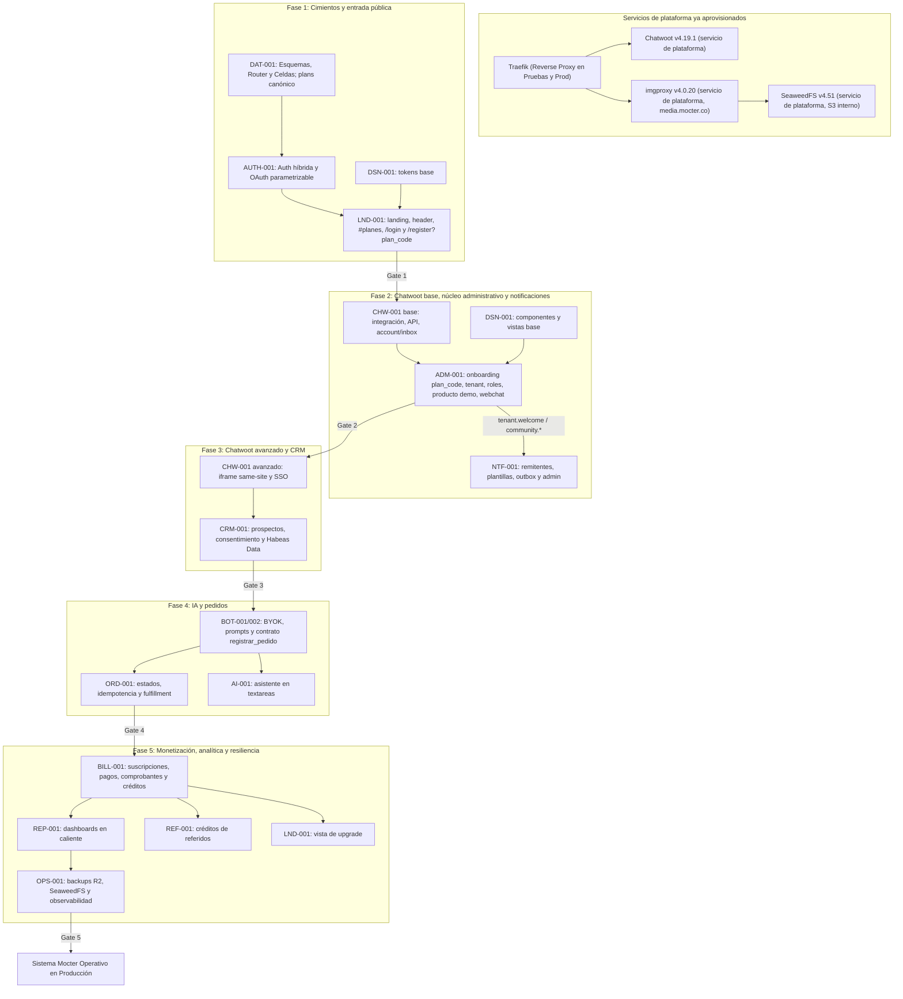

# Plan Maestro de Implementación Secuencial por Fases (Mocter Core)

## Resumen Ejecutivo
Plan estratégico de codificación modular dividido en **5 fases secuenciales**, diseñado bajo la metodología **Spec-Driven Development (SDD)** y la Constitución del Proyecto ([`AGENTS.md`](file:///d:/DataDev/1.%20Proyectos%20Dev/landig-agencia/.agents/AGENTS.md)). Cada fase aborda una capa arquitectónica autónoma con dependencias estrictas, culminando en una **Compuerta de Verificación Automatizada (Verification Gate)** obligatoria que debe superarse al 100% antes de autorizar el inicio de la siguiente fase.

> [!NOTE]
> **Estado de la Hoja de Ruta:** Especificaciones técnicas creadas, actualizadas y sincronizadas (incluyendo la nueva spec [`LND-001`](file:///d:/DataDev/1.%20Proyectos%20Dev/landig-agencia/docs/specs/lnd-001-landing-planes-comerciales/requirements.md)). **Fase de planificación activa; no se iniciará codificación aún.**

---

## 1. Topología de Infraestructura y Diferenciación de Ambientes

El sistema Mocter opera en contenedores **Docker con Docker Compose**, aplicando una separación clara por ambiente:

1. **Desarrollo Local:**
   - **No se utiliza Traefik en desarrollo local.** La aplicación corre mediante `docker-compose.yml` y publica solo en `127.0.0.1` (loopback), nunca en `0.0.0.0`. Los servicios de plataforma ya aprovisionados se consumen en las direcciones que defina el entorno local; como referencia: SeaweedFS `:8333`/`:8888`, imgproxy `:8080` y Chatwoot `:3001`.
2. **Ambientes de Pruebas (Staging) y Producción:**
   - **Traefik v2.11** actúa como reverse proxy único para todo el tráfico público (HTTP, HTTPS, WebSockets).
   - En staging/producción, ningún contenedor publica puertos directamente en el host (cumplimiento estricto de `R-10`); en desarrollo local solo se publican en `127.0.0.1`.
   - **Chatwoot (`chatwoot/chatwoot:v4.19.1`):** Corre en contenedor administrado por Traefik, accediendo a PostgreSQL 18 con pgvector y Redis 7+ en el plano de soporte (`CHW-001`).
   - **SeaweedFS v4.51:** servicio de plataforma **ya aprovisionado** en desarrollo, pruebas y producción; S3 **interno**, sin ruta pública, para la gestión y deduplicación de archivos multimedia de inquilinos (`ADM-001`, `OPS-001`).
   - **imgproxy v4.0.20:** servicio de plataforma **ya aprovisionado** en `media.mocter.co`; entrega imágenes con resize/WebP/AVIF y URLs firmadas HMAC. SeaweedFS no se expone.
   - **Chatwoot, SeaweedFS e imgproxy no se despliegan en este plan:** los contenedores ya existen en los tres ambientes. La documentación define cómo se consumen, no cómo se provisionan. El estado observado de producción está en [`docs/reference/production-services.md`](reference/production-services.md).
   - **RabbitMQ (`rabbitmq:3.13-management`):** Cola interna para notificaciones (`NTF-001`), sin puertos públicos ni router de Traefik; credenciales en secrets y healthcheck para OPS-001.
   - **Mocter Web (`ghcr.io/enuarrosales/mocter-web`):** Contenedor único para la aplicación Next.js 16 App Router y el migrador Drizzle en modo standalone sobre Node.js 24 Alpine.

---

## 2. Mapa de Dependencias y Fases

---

## 3. Detalle de Fases de Codificación

### Fase 1 · Cimientos y entrada pública (`DAT-001` + `AUTH-001` + `LND-001` slice + `DSN-001` base)

> **Objetivo:** Persistencia multi-inquilino, autenticación híbrida, catálogo canónico de planes y la porción pública de la landing: header, `#planes`, login y registro con `plan_code`.

#### 1.1 Persistencia y Esquemas Drizzle (`packages/domain`)
- Reestructurar `packages/domain/src/db/`:
  - `schemas/admin/`: Router Global (`clients`, `plans`, `client_plans`, `users`, `identities`, `sessions`, `email_verification_tokens`, `password_reset_tokens`, `user_consents`, `two_factor_secrets`, `auth_providers_config`).
  - `schemas/tenant/`: celda (`tenant_users`, `products`, `orders`, `conversations`, `prospects`).
  - `schemas/public/`: `leads`.
- Modelo canónico de `plans`: `id uuid`, `code` único, `name`/`description`/`marketing_features` JSONB `{es,en}`, `status` (`draft`/`active`/`retired`), `is_public`, `is_popular`, `sort_order`, `trial_days`, `grace_days`, `billing_cycles`, `price_monthly_cents`, `price_annual_cents`, `currency`. FKs `plan_id` uuid.
- Generar y verificar la migración fundacional (`pnpm --filter @mocter/domain db:generate`).

#### 1.2 Autenticación híbrida (`apps/web` & `packages/domain`)
- Registro/login nativo con Argon2id y política de complejidad.
- Cookie `__Host-mocter_sid` (`HttpOnly`, `Secure`, `SameSite=Strict`), hash SHA-256 en BD y middleware en Next.js.
- OAuth parametrizable desde la SaaS (`auth_providers_config`, `AUTH-D-08`), 2FA TOTP opcional y roles/scopes `D-31`.

#### 1.3 Landing y registro (`LND-001` slice + DSN base)
- Header con botón «Iniciar sesión» contiguo a «Solicitar demo».
- Sección `#planes` solo si `plans.status = 'active' AND plans.is_public = true`; usa `plan.code` y `marketing_features[locale]`.
- `/[locale]/login` y `/[locale]/register?plan_code=...`: el registro crea el usuario y conserva `plan_code` para el onboarding; no crea inquilino.
- DSN base: tokens, tipografía y componentes mínimos para las vistas públicas.
- La vista de **upgrade** de LND-001 no entra en esta fase; se implementa en Fase 5 con BILL-001.

> [!IMPORTANT]
> **Compuerta 1:**
> - `drizzle-kit check` y migración fundacional pasan.
> - Tests de auth (Argon2id, sesión, tokens, TOTP, OAuth dinámico).
> - `#planes` aparece/desaparece según `status` + `is_public`; el CTA usa `plan_code`.
> - `/login` ↔ `/register` conservan `plan_code`; el registro no crea inquilino.
> - Tokens base pasan AA en claro/oscuro.

---

### Fase 2 · Chatwoot base, núcleo administrativo y notificaciones (`CHW-001` base + `ADM-001` + `DSN-001` + `NTF-001`)

> **Objetivo:** Aprovisionar Chatwoot y construir `mocter-admin`: onboarding con `plan_code`, creación de inquilino, roles, producto demo, multimedia y webchat activo.

#### 2.1 Chatwoot base (`CHW-001`)
- Servicio Chatwoot v4.19.1 ya aprovisionado; la fase integra su API y SSO.
- Adaptador de API: creación de cuenta, inbox webchat y token de servicio por inquilino.
- Correlación `client_id` ↔ `chatwoot_account_id` con idempotencia y reintentos.
- El iframe same-site y el SSO se completan en Fase 3; el webchat puede operar sin la bandeja embebida.

#### 2.2 Sistema de diseño y shell (`DSN-001`)
- Tokens HUD, componentes base accesibles, tablas con paginación/filtros/orden, tema sistema con fallback oscuro.
- Catálogo interno `/design-system`.

#### 2.3 Consola administrativa y onboarding (`ADM-001`)
- Layout, navegación y RBAC `D-31`.
- Onboarding: recibe `plan_code`, resuelve `plans.code` → `plans.id`, crea `client`, `tenant_owner`, asigna plan y enruta a celda.
- Producto demo, catálogo multimedia usando SeaweedFS v4.51 + imgproxy v4.0.20 ya aprovisionados, deduplicación, cuota y entrega con URLs firmadas.
- Pre-activación del webchat; `lifecycle_status` del inquilino.
- Si el usuario abandona, conserva avance y `plan_code` para retomar sin inquilino vacío.
- Bandeja `/admin/leads` para `platform_sales` con la tabla `leads` y gestión de estados/notas/asignación (ADM-001 RF-16).

#### 2.4 Notificaciones y plantillas (`NTF-001`)
- Remitentes múltiples y proveedor SMTP; plantillas TipTap versionadas por evento/locale.
- Catálogo de eventos: bienvenida, comunidad, auth (migrado desde AUTH), y base para BILL/REF.
- **Outbox transaccional + RabbitMQ + worker independiente**: `enqueueEmail` no espera la cola ni el SMTP; si RabbitMQ/proveedor falla, el negocio continúa y el outbox se publica al recuperarse.
- Reintentos con DLQ, log de entregas y administración en `/admin/settings/notifications`.

> [!IMPORTANT]
> **Compuerta 2:**
> - Onboarding funcional de punta a punta: usuario → inquilino → plan UUID → webchat activo.
> - Cuenta e inbox de Chatwoot creados y correlacionados; reintento idempotente.
> - Producto demo, multimedia deduplicada y RBAC/auditoría.
> - imgproxy sirve imágenes solo con URL firmada y bucket `media`; el gateway S3 responde 403 sin credenciales y no se expone a Internet.
> - Correo de bienvenida enviado una sola vez; plantillas/remitentes administrables y entrega registrada.
> - **RabbitMQ caído no bloquea el onboarding**: el alta termina, el outbox queda pendiente y se publica al recuperarse.
> - Objetivo de 5 minutos medido y reportado; **no es un SLA duro** (ADM-001 RF-14.8).

---

### Fase 3 · Chatwoot avanzado y CRM (`CHW-001` avanzado + `CRM-001`)

> **Objetivo:** Completar la bandeja embebida y el maestro de prospectos con Habeas Data.

#### 3.1 Chatwoot avanzado (`CHW-001`)
- Iframe same-site en `mocter-admin` (`ADM-001` D-32).
- SSO embebido (`/auth/chatwoot/embed`), cookies same-site y validación de framing.
- Webhooks de mensajes/contactos con idempotencia.

#### 3.2 CRM (`CRM-001`)
- `prospects` y `prospect_consents`; dos propósitos (`data_treatment`, `commercial_comms`).
- Aviso de privacidad versionado y editable; captura por botones interactivos + enlace.
- Derecho al olvido/anonimización y proyección a Chatwoot.

> [!IMPORTANT]
> **Compuerta 3:**
> - Iframe/SSO validados en laboratorio contra la versión canónica de Chatwoot.
> - Webhooks idempotentes; consentimiento y anonimización probados.

---

### Fase 4 · IA y pedidos (`BOT-001` + `BOT-002` + `ORD-001` + `AI-001`)

> **Objetivo:** Activar el bot, el motor de prompts, la captura de pedidos y la asistencia AI.

#### 4.1 Contrato primero (`BOT-002` ↔ `ORD-001`)
- Definir `registrar_pedido`: payload, idempotencia por conversación, estados y errores.
- ORD y BOT-002 se implementan como una unidad; no se avanza uno sin el contrato.

#### 4.2 Bot y prompts (`BOT-001` + `BOT-002`)
- BYOK, catálogo de proveedores/modelos, prompts en runtime, timeout 10 s y fallback a humano.
- Billetera/spread como fundaciones activables por fases.

#### 4.3 Pedidos (`ORD-001`)
- `orders`, `order_items`, `order_events`, estados, idempotencia, fulfillment manual y devoluciones.

#### 4.4 Asistente AI (`AI-001`)
- `AiEnhanceTextarea`, modelo propio configurable y consumo en la billetera compartida.

> [!IMPORTANT]
> **Compuerta 4:**
> - Contrato `registrar_pedido` probado con reintentos y sin duplicados.
> - Timeout/fallback del bot y flujo de pedidos completo.
> - Asistente AI en los textareas priorizados.

---

### Fase 5 · Monetización, analítica y resiliencia (`BILL-001` + `REP-001` + `REF-001` + `OPS-001` + `LND-001` upgrade)

> **Objetivo:** Cerrar el ciclo comercial y operativo.

#### 5.1 Facturación (`BILL-001`)
- Wompi + Stripe, suscripciones, facturas, pagos, comprobantes y dunning.
- Créditos de referidos: `credit_cents`, aplicación a la próxima factura y CA-BILL-06.
- Prorrateo de cambios de plan y métodos de pago tokenizados.
- Emite `billing.payment_succeeded`, `billing.payment_failed` y `billing.renewal` a NTF-001.

#### 5.2 Informes (`REP-001`)
- Cálculo en caliente, 7 períodos, exportación Excel/PDF y roles D-31; consume BILL/ORD.

#### 5.3 Referidos (`REF-001`)
- Modelo A unilateral, recompensa fija/porcentual configurable, crédito único, 365 días, tope opcional y toggle.
- Emite `referral.registered` a NTF-001.

#### 5.4 Operación (`OPS-001`)
- Backups R2 (full semanal + diff diario), SeaweedFS, adjuntos de Chatwoot (volumen local o bucket), logs 14 días, sin WORM, operador único.

#### 5.5 Upgrade de landing (`LND-001`)
- Vista de suscripción/upgrade en `mocter-admin` enlazada a BILL-001.

> [!IMPORTANT]
> **Compuerta 5:**
> - Webhooks Wompi/Stripe, comprobante y crédito aplicado.
> - REP P95 ≤ 800 ms y exportaciones válidas.
> - REF: crédito único, vencimiento y toggle.
> - OPS: restore de PostgreSQL, SeaweedFS y adjuntos de Chatwoot probado.

---

## 4. Estado de Preparación

El plan ya no declara un “100% blindado”. Estado real:

- **Decisiones:** 29/29 cerradas (REF, BOT, OPS, CRM, DSN, AI).
- **Modelo de planes:** canónico aprobado (UUID + `code`, JSONB i18n, `status`, precios mensual/anual, `marketing_features` separado).
- **Fases:** revisadas para corregir LND→ADM/BILL/DSN, ADM→CHW, ORD→REP, BILL↔REP y BOT-002↔ORD.
- **Handoff:** `/register?plan_code` → onboarding ADM con resolución a `plans.id` (UUID).
- **Bloqueantes resueltos:** modelo de `plans`, orden de fases, `payment_methods`/prorrateo, `tenant_admin`, Chatwoot 4.19.1, topología dev/Traefik y BOT-002/ORD-001.
- **Nuevo alcance:** NTF-001 (remitentes, plantillas, eventos y entregas) y bandeja de leads de la landing en ADM-001.
- **Pendiente:** brechas RNF/BDD/i18n en las specs de Fase 2+ (ADM, BOT-001, CRM, OPS, CHW) antes de congelar cada fase.
- **Implementación de código:** en pausa hasta que el usuario lo autorice explícitamente.
