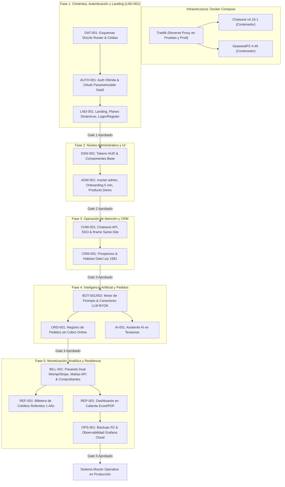

# Plan Maestro de Implementación Secuencial por Fases (Mocter Core)

## Resumen Ejecutivo
Plan estratégico de codificación modular dividido en **5 fases secuenciales**, diseñado bajo la metodología **Spec-Driven Development (SDD)** y la Constitución del Proyecto ([`AGENTS.md`](file:///d:/DataDev/1.%20Proyectos%20Dev/landig-agencia/.agents/AGENTS.md)). Cada fase aborda una capa arquitectónica autónoma con dependencias estrictas, culminando en una **Compuerta de Verificación Automatizada (Verification Gate)** obligatoria que debe superarse al 100% antes de autorizar el inicio de la siguiente fase.

> [!NOTE]
> **Estado de la Hoja de Ruta:** Especificaciones técnicas creadas, actualizadas y sincronizadas (incluyendo la nueva spec [`LND-001`](file:///d:/DataDev/1.%20Proyectos%20Dev/landig-agencia/docs/specs/lnd-001-landing-planes-comerciales/requirements.md)). **Fase de planificación activa; no se iniciará codificación aún.**

---

## 1. Topología de Infraestructura y Diferenciación de Ambientes

El sistema Mocter opera en contenedores **Docker con Docker Compose**, aplicando una separación clara por ambiente:

1. **Desarrollo Local:**
   - **No se utiliza Traefik en desarrollo local.** Los servicios corren directamente en sus puertos mapeados locales mediante `docker-compose.yml` (`apps/web` en `:3000`, PostgreSQL en `:5432`, Redis en `:6379`, SeaweedFS en `:8333`/`:8888` y Chatwoot en `:3001`).
2. **Ambientes de Pruebas (Staging) y Producción:**
   - **Traefik v2.11** actúa como reverse proxy único para todo el tráfico público (HTTP, HTTPS, WebSockets).
   - Ningún contenedor publica puertos directamente en el host (cumplimiento estricto de la directiva `R-10`).
   - **Chatwoot (`chatwoot/chatwoot:v4.19.1`):** Corre en contenedor administrado por Traefik, accediendo a PostgreSQL 18 con pgvector y Redis 7+ en el plano de soporte (`CHW-001`).
   - **SeaweedFS (`seaweedfs/seaweedfs:4.49`):** Contenedor gestionado por Traefik para la gestión y deduplicación de archivos multimedia de inquilinos (`ADM-001`, `OPS-001`).
   - **Mocter Web (`ghcr.io/enuarrosales/mocter-web`):** Contenedor único para la aplicación Next.js 16 App Router y el migrador Drizzle en modo standalone sobre Node.js 24 Alpine.

---

## 2. Mapa de Dependencias y Fases

---

## 3. Detalle de Fases de Codificación

### Fase 1 · Cimientos de Datos, Autenticación Híbrida y Landing (`DAT-001` + `AUTH-001` + `LND-001`)

> **Objetivo:** Establecer el plano de persistencia base multi-inquilino en Drizzle ORM, la autenticación híbrida completa y la interfaz pública de la landing con planes dinámicos y accesos.

#### 1.1 Persistencia y Esquemas Drizzle (`packages/domain`)
- Reestructurar modularmente `packages/domain/src/db/`:
  - `schemas/admin/`: Tablas del Router Global (`clients`, `plans`, `client_plans`, `users`, `identities`, `sessions`, `email_verification_tokens`, `password_reset_tokens`, `user_consents`, `two_factor_secrets`, `auth_providers_config`).
  - `schemas/tenant/`: Tablas de la celda del inquilino (`tenant_users`, `products`, `orders`, `conversations`, `prospects`).
  - `schemas/public/`: Tabla de aterrizaje (`leads`).
- Extender la entidad `plans` con `is_public`, `is_popular`, `sort_order`, `price_monthly_cents`, `price_annual_cents`, `currency`, `features`.
- Re-exportar desde `packages/domain/src/db/schema.ts` para compatibilidad transparente con `drizzle-kit`.
- Generar y verificar la migración SQL fundacional (`pnpm --filter @mocter/domain db:generate`).

#### 1.2 Autenticación Híbrida Completa (`apps/web` & `packages/domain`)
- **Nativa:** Registro y login con Email + Contraseña, política estricta de complejidad (6+ chars, mayúscula, número, especial), y hashing criptográfico con **Argon2id**.
- **Sesiones en Base de Datos:** Cookie `__Host-mocter_sid` (`HttpOnly`, `Secure`, `SameSite=Strict`), hash SHA-256 en BD y middleware en Next.js App Router.
- **Proveedores OAuth Parametrizables desde Backoffice SaaS (`AUTH-D-08`):**
  - Tabla `auth_providers_config` para gestionar dinámicamente proveedores (Google, Facebook, Microsoft, etc.) con banderas `is_enabled` y credenciales cifradas con AES-256-GCM.
  - La pantalla de login renderiza en runtime únicamente los botones de proveedores activos en la configuración de la SaaS.
  - Resolución automática de cuentas duplicadas y vinculación de identidades.
- **2FA Optativo:** TOTP basado en RFC 6238, generación de QR con URI oficial, secreto cifrado en reposo con **AES-256-GCM**, y desafío de 6 dígitos al iniciar sesión.
- **Roles y Scopes (`D-31`):** Soporte de scopes independientes (`platform_*`, `tenant_*`, `community_*`).

#### 1.3 Landing Page, Planes Comerciales y Accesos (`LND-001`)
- **Header Principal:** Botón de acción ("Iniciar sesión" / "Sign in") ubicado inmediatamente contiguo a «Solicitar demo», con enlace directo a `/[locale]/login`.
- **Sección Dinámica de Planes (`#planes`):**
  - **Renderizado condicional:** Solo aparece en la landing (y su link en el menú cápsula) si existen planes con `is_active = true` y `is_public = true` parametrizados desde la SaaS. Si no hay planes activos, la sección y el link se ocultan por completo.
  - Tarjetas de planes con selector mensual/anual (descuento visible), características y botón CTA "Comenzar ahora" enlazado a `/[locale]/register?plan_id=[id]`.
- **Formularios Interconectados:**
  - `/[locale]/login`: Formulario de acceso con enlace inferior "¿Aún no tienes cuenta? Regístrate aquí" (`/[locale]/register`).
  - `/[locale]/register`: Formulario de alta con captura de `plan_id` preseleccionado y enlace "¿Ya tienes cuenta? Inicia sesión" (`/[locale]/login`).
- **Vista de Upgrade en Backoffice:**
  - El inquilino autenticado tiene acceso en `mocter-admin` (`/admin/settings/billing`) para consultar su plan actual y ejecutar **Upgrade** de plan a voluntad (`BILL-001`).
- **Internacionalización:** Diccionarios `messages/es.json` y `messages/en.json` actualizados para todos los nuevos textos de navegación, planes y autenticación.

> [!IMPORTANT]
> **Compuerta de Verificación 1 (Gate 1):**
> - `pnpm --filter @mocter/domain exec drizzle-kit check` pasa al 100%.
> - Suite de tests unitarios de autenticación: hashing Argon2id, validación de sesiones, tokens de un solo uso, TOTP 2FA, activación dinámica de proveedores OAuth.
> - Test de renderizado condicional de `LND-001`: comprobación de que `#planes` desaparece cuando no hay planes y se muestra cuando existen planes públicos activos.
> - Verificación de navegación fluida entre `/login` y `/register` con parámetro `plan_id`.
> - Cero advertencias de TypeScript en `@mocter/domain` y `@mocter/web`.

---

### Fase 2 · Núcleo Administrativo de Inquilinos y UI Shell (`ADM-001` + `DSN-001`)

> **Objetivo:** Construir la interfaz de usuario `mocter-admin`, el sistema de tokens HUD, el catálogo multimedia sobre SeaweedFS 4.49 y el onboarding express en 5 minutos.

#### 2.1 Sistema de Diseño HUD y Tokens (`apps/web`)
- Implementar tokens de color y tipografía (Space Grotesk / Inter / IBM Plex Mono) con Tailwind CSS v4.
- Construir componentes base de UI con Radix UI accesibles (WCAG 2.2 AA): botones, diálogos, dropdowns, inputs, tablas HUD paginadas.
- Soporte de modo oscuro predeterminado y conmutador de tema.

#### 2.2 Consola Administrativa y Onboarding Express 5 min
- Layout principal de `mocter-admin` con navegación adaptativa y separación de roles `D-31`.
- Wizard de onboarding express:
  1. Registro de usuario e inquilino.
  2. Auto-creación de un **producto demo parametrizable desde el backoffice de la SaaS**.
  3. Pre-activación del canal webchat con preset de bienvenida.
- Conexión con **SeaweedFS 4.49** para subida y canonicalización de imágenes a WebP y videos a WebM.
- Gestión del ciclo de vida del inquilino (`lifecycle_status`: `trialing`, `active`, `past_due`, `suspended`).

> [!IMPORTANT]
> **Compuerta de Verificación 2 (Gate 2):**
> - Test e2e automatizado (Playwright) ejecutando el flujo completo de alta express en menos de 300 segundos.
> - Verificación de carga y deduplicación de imágenes en SeaweedFS 4.49.
> - Comprobación de auditoría de accesos y restricción estricta de rutas por rol `D-31`.

---

### Fase 3 · Atención Conversacional y Gestión Comercial (`CHW-001` + `CRM-001`)

> **Objetivo:** Habilitar la bandeja de entrada unificada mediante Chatwoot v4.19.1 embebido en iframe same-site y el maestro de prospectos con cumplimiento de Habeas Data.

#### 3.1 Integración Técnica con Chatwoot v4.19.1
- Adaptador de API de Chatwoot: aprovisionamiento de cuentas, sincronización de inboxes y emisión de token SSO de un solo uso (TTL 5 min).
- Embebido de Chatwoot en `mocter-admin` mediante iframe same-site (`ADM-001` D-32).
- Webhook receiver para eventos de mensajes y contactos entrantes.

#### 3.2 Maestro de Prospectos y Consentimiento (Ley 1581)
- Entidad `prospects` en la celda y tabla `prospect_consents`.
- Captura de consentimiento mediante botones interactivos de WhatsApp y formulario web.
- Mecanismo de derecho al olvido: sobreescritura de datos con hashes irreversibles en Mocter y eliminación asociada en Chatwoot.

> [!IMPORTANT]
> **Compuerta de Verificación 3 (Gate 3):**
> - Prueba de integración de webhooks Chatwoot ↔ Mocter con procesamiento idempotente.
> - Verificación de inmutabilidad del registro de consentimientos y prueba de anonimización de prospecto.

---

### Fase 4 · Automatización con IA y Gestión de Pedidos (`BOT-001` + `BOT-002` + `ORD-001` + `AI-001`)

> **Objetivo:** Activar el bot conversacional para atención y captura de pedidos, junto con la asistencia inteligente en la configuración.

#### 4.1 Motor de Atención y Prompts (`BOT-001` + `BOT-002`)
- Conectores LLM con soporte BYOK (OpenAI, Anthropic, Gemini) y preset Mocter.
- Composición dinámica de prompts en runtime con contexto de negocio y catálogo de productos.
- Límite de timeout (10s) con derivación automática a agente humano en Chatwoot.

#### 4.2 Registro de Pedidos sin Cobro Online (`ORD-001`)
- Extracción de entidades de pedido desde el diálogo del bot (`CreateOrderIntentPayload`) con validación de clave de idempotencia (`Idempotency-Key`).
- Entidad `orders` y `order_items` en la celda del inquilino.
- Interfaz web para que el inquilino gestione manualmente los estados (`creado` → `confirmado` → `despachado` → `entregado` | `cancelado`).
- Documentación de adaptadores para Dropshipping (Dropi, Effi) sin implementación de código.

#### 4.3 Asistencia AI en Textareas (`AI-001`)
- Componente `AiEnhanceTextarea` integrado con los prompts maestros del catálogo de plataforma en los campos de instrucciones de bot, notas de pedido y notas de CRM.

> [!IMPORTANT]
> **Compuerta de Verificación 4 (Gate 4):**
> - Test automatizado de extracción de pedidos desde texto conversacional con verificación de idempotencia contra pedidos duplicados.
> - Prueba de streaming y fallback de inferencia LLM ante timeouts simulados.

---

### Fase 5 · Monetización, Analítica y Resiliencia (`BILL-001` + `REF-001` + `REP-001` + `OPS-001`)

> **Objetivo:** Completar el ciclo comercial de la SaaS: pasarelas duales, créditos de referidos, dashboards en caliente y copias de seguridad automáticas.

#### 5.1 Facturación SaaS y Comprobantes (`BILL-001`)
- Integración de pasarela dual: **Wompi** (Colombia, COP) y **Stripe** (Internacional, USD) con webhooks criptográficamente verificados.
- Captura de datos fiscales bajo la especificación de **Matías API** (`identity_document_id`, `dni`, `company_name`, `email`).
- Emisión de comprobantes internos y despacho automático por correo electrónico.
- Módulo de exportación en **Excel (`.xlsx`) y PDF (`.pdf`)** con filtros por período.

#### 5.2 Billetera de Créditos por Referidos (`REF-001`)
- Entidades `referral_wallets` y `referral_credit_transactions`.
- Incentivo administrable desde el backoffice SaaS (fijo o porcentual), con vigencia de 1 año y aplicación en checkout.
- Reglas anti-fraude: maduración de 30 días y exclusión de auto-referidos.

#### 5.3 Informes y Dashboards en Caliente (`REP-001`)
- Consultas agregadas en caliente optimizadas con índices compuestos por `(client_id, created_at)`.
- Vistas de dashboard para inquilino y SaaS con los 7 períodos y rango personalizado.
- Exportación nativa a **Excel (`.xlsx`) y PDF (`.pdf`)** garantizando P95 ≤ 800 ms.

#### 5.4 Continuidad y Observabilidad (`OPS-001`)
- Script automatizado de backup diario completo a Cloudflare R2 con cifrado simétrico y retención de 30 días.
- Configuración de métricas y alertas de salud a Grafana Cloud.

> [!IMPORTANT]
> **Compuerta de Verificación 5 (Gate 5):**
> - Simulación de webhooks de Wompi y Stripe con verificación de comprobante generado y correo enviado.
> - Benchmark de consultas analíticas en caliente confirmando P95 ≤ 800 ms para rangos de 1 año.
> - Comprobación de exportación de reportes en `.xlsx` y `.pdf` y test de restauración de backup R2 en sandbox.

---

## 4. Estado de Preparación

El plan y las especificaciones están 100% blindados y alineados con las directivas de arquitectura e infraestructura:
- `LND-001`: Creada y aprobada, integrada formalmente en la **Fase 1** (landing con planes dinámicos condicionales, botón acceso en header, `/login` y `/register` interconectados y upgrade en backoffice).
- `AUTH-001`: Actualizada con `AUTH-D-08` (OAuth dinámico parametrizable) y botón de acceso en header.
- `CHW-001`: Actualizada con Chatwoot `v4.19.1` contenerizado bajo Traefik (pruebas y producción).
- `ADM-001`: Actualizada con SeaweedFS `4.49` contenerizado y acceso desde landing header.
- `OPS-001`: Actualizada con topología Docker Compose y Traefik (exclusivo para pruebas y producción; no en desarrollo local).
- **Implementación de código:** En pausa hasta que indiques la orden de inicio.
