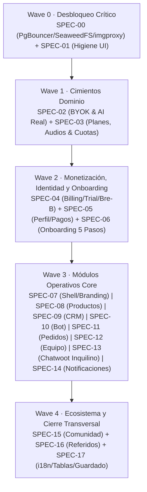

# Matriz de Trazabilidad Maestra y Roadmap de Implementación (`SPEC-00` a `SPEC-17`)

> **Propósito:** Garantizar trazabilidad bidireccional al 100% entre el catálogo normalizado de **58 observaciones** del Backoffice del Inquilino (`ONB-01..12`, `TAB-01..02`, `PRD-01..09`, `INC-01`, `CRM-01..05`, `PED-01..06`, `AIB-01..04`, `EQU-01..04`, `PLN-01..04`, `GEN-01..07`, `TRV-01..04`) y el conjunto de **18 nuevas especificaciones SDD (`SPEC-00`..`SPEC-17`)**, sin modificar ninguna de las 23 especificaciones previas del repositorio ni el código fuente de la aplicación.

---

## 1. Resumen Ejecutivo de Cobertura

| Métrica | Valor |
| --- | --- |
| **Total de observaciones en insumo** | **58 / 58 (100%)** |
| **Observaciones sin cobertura** | **0** |
| **Conflictos o reglas contradictorias entre specs** | **0** |
| **Propuestas a Validar (`PV-01..PV-05`) cerradas** | **5 / 5 (100% aprobadas y modeladas)** |
| **Nuevas especificaciones generadas** | **18 (`SPEC-00` a `SPEC-17`, 54 archivos SDD + 1 Matriz)** |
| **Specs existentes modificadas** | **0 (intangibilidad garantizada)** |

---

## 2. Inventario de Nuevas Especificaciones (`SPEC-00` a `SPEC-17`)

| ID | Título Corto | Carpeta en `docs/specs/` | IDs Cubiertos | Prioridad | Wave |
| --- | --- | --- | --- | --- | --- |
| `SPEC-00` | Remediación Infraestructura: SeaweedFS, imgproxy y PgBouncer | [`spec-00-remediacion-multimedia-pgbouncer`](spec-00-remediacion-multimedia-pgbouncer/requirements.md) | `PRD-09`, `INC-01` | P0 | Wave 0 |
| `SPEC-01` | Higiene Terminológica y Lenguaje Comercial en UI del Inquilino | [`spec-01-higiene-terminologica-ui-inquilino`](spec-01-higiene-terminologica-ui-inquilino/requirements.md) | `TRV-04`, `TAB-02`, `PRD-01`, `PRD-02`, `CRM-01`, `PED-01`, `EQU-01` | P0 | Wave 0 |
| `SPEC-02` | Motor Real de Inferencia AI, BYOK y Prompts Maestros | [`spec-02-motor-inferencia-byok-prompts-ai`](spec-02-motor-inferencia-byok-prompts-ai/requirements.md) | `GEN-02`, `ONB-10`, `TRV-03` | P0 | Wave 1 |
| `SPEC-03` | Homologación de Planes, Audios/Producto, Capacidades Chatwoot y Cuotas | [`spec-03-modelo-planes-capacidades-cuotas`](spec-03-modelo-planes-capacidades-cuotas/requirements.md) | `PLN-01`, `ONB-09`, `EQU-03`, `EQU-04` *(+ ajuste planes `PRD-03`)* | P0 | Wave 1 |
| `SPEC-04` | Suscripción SaaS, Trial, Canal Bre-B Colombia, Alertas D-5/D-0 y Upgrade | [`spec-04-suscripcion-trial-breb-renovacion-upgrade`](spec-04-suscripcion-trial-breb-renovacion-upgrade/requirements.md) | `ONB-12`, `PLN-02`, `PLN-03`, `PLN-04` | P0 | Wave 2 |
| `SPEC-05` | Perfil del Comercio, Idioma, Logo Básico y Canales de Pago del Inquilino | [`spec-05-perfil-negocio-identidad-canales-pago`](spec-05-perfil-negocio-identidad-canales-pago/requirements.md) | `GEN-01`, `ONB-02`, `ONB-03`, `ONB-04`, `ONB-05`, `ONB-06`, `PED-03` | P0 | Wave 2 |
| `SPEC-06` | Rediseño del Onboarding en 5 Pasos, Logo Mocter y Utilidad Automática | [`spec-06-rediseno-onboarding-cinco-pasos`](spec-06-rediseno-onboarding-cinco-pasos/requirements.md) | `ONB-01`, `ONB-07`, `ONB-08` *(orquesta Paso 1–5)* | P0 | Wave 2 |
| `SPEC-07` | Shell del Inquilino (Logo, Nombre Completo, Conectado) y Marca Blanca | [`spec-07-shell-branding-inquilino-marca-blanca`](spec-07-shell-branding-inquilino-marca-blanca/requirements.md) | `TAB-01`, `GEN-05` | P1 | Wave 3 |
| `SPEC-08` | Catálogo Productos: CRUD, Cover, Audios, Prompt 32k, Atributos, Combos y Stock | [`spec-08-catalogo-productos-crud-multimedia-combos-stock`](spec-08-catalogo-productos-crud-multimedia-combos-stock/requirements.md) | `PRD-03`, `PRD-04`, `PRD-05`, `PRD-06`, `PRD-07`, `PRD-08` | P0 | Wave 3 |
| `SPEC-09` | CRM Completo: Ficha Ver/Editar, Calificación, Ventana 24h y Direcciones | [`spec-09-crm-contactos-calificacion-direcciones-prospeccion`](spec-09-crm-contactos-calificacion-direcciones-prospeccion/requirements.md) | `CRM-02`, `CRM-03`, `CRM-04`, `CRM-05` | P1 | Wave 3 |
| `SPEC-10` | Asistente AI y Bot: Objetivo, Presets Reales, Políticas, 6 Mensajes y Etiquetas | [`spec-10-asistente-ai-bot-presets-politicas-mensajes`](spec-10-asistente-ai-bot-presets-politicas-mensajes/requirements.md) | `AIB-01`, `AIB-02`, `AIB-03`, `ONB-11` | P0 | Wave 3 |
| `SPEC-11` | Pedidos Completo: CRUD, 12 Estados Dropi/Effi, Guías y Repetir Pedido | [`spec-11-pedidos-crud-estados-guias-repetir`](spec-11-pedidos-crud-estados-guias-repetir/requirements.md) | `PED-02`, `PED-04`, `PED-05`, `PED-06` | P0 | Wave 3 |
| `SPEC-12` | Equipo del Comercio: Invitaciones, Roles, Suspensión y Cuotas | [`spec-12-equipo-usuarios-comercio`](spec-12-equipo-usuarios-comercio/requirements.md) | `EQU-02` | P1 | Wave 3 |
| `SPEC-13` | Acceso Integrado Chatwoot Inquilino y Menú Posición 2 (Sin Regresión SaaS) | [`spec-13-acceso-integrado-chatwoot-inquilino`](spec-13-acceso-integrado-chatwoot-inquilino/requirements.md) | `GEN-04` | P0 | Wave 3 |
| `SPEC-14` | Centro de Notificaciones Inquilino y Plantillas Administrativas Email | [`spec-14-notificaciones-plantillas-email`](spec-14-notificaciones-plantillas-email/requirements.md) | `GEN-06` *(+ soporte admin `PRD-08`, `PLN-03`)* | P1 | Wave 3 |
| `SPEC-15` | Comunidades Líder-Miembros (Inquilinos) y Clonación de Catálogo | [`spec-15-comunidades-lider-miembros-clonacion`](spec-15-comunidades-lider-miembros-clonacion/requirements.md) | `GEN-03` *(+ aclaración `PV-05`)* | P2 | Wave 4 |
| `SPEC-16` | Programa de Referidos en Backoffice del Inquilino | [`spec-16-programa-referidos-inquilino`](spec-16-programa-referidos-inquilino/requirements.md) | `GEN-07` | P2 | Wave 4 |
| `SPEC-17` | Reglas Transversales UI: i18n Completa, Tablas Estándar y Barra Guardado | [`spec-17-reglas-transversales-ui-i18n-tablas-guardado`](spec-17-reglas-transversales-ui-i18n-tablas-guardado/requirements.md) | `TRV-01`, `TRV-02`, `AIB-04` | P1 | Wave 4 |

---

## 3. Matriz Detallada de Trazabilidad (58 Observaciones → Spec → Reglas → Gherkin)

### 3.1 Vista de Onboarding (`ONB-01` .. `ONB-12`)

| ID | Observación Resumida | Spec Dueño | Specs Secundarias / Soporte | Reglas de Negocio Clave | Criterios Gherkin de Verificación |
| --- | --- | --- | --- | --- | --- |
| `ONB-01` | Logo de Mocter estandarizado con Login y Registro | `SPEC-06` | `—` | `RN-SPEC-06-01`, §10 UI/UX | Escenario: *Nuevo comercio completa los 5 pasos del onboarding con logo, utilidad automática y periodo de prueba* |
| `ONB-02` | Capturar correo electrónico comercial | `SPEC-05` | `SPEC-06` | `RN-SPEC-05-03`, `RN-SPEC-06-01` | `SPEC-05`: *Propietario actualiza datos comerciales...* / `SPEC-06`: *Rechazo en Paso 1 si falta correo comercial...* |
| `ONB-03` | Capturar página web del comercio | `SPEC-05` | `SPEC-06` | `RN-SPEC-05-03` | `SPEC-05`: *Rechazo de sitio web sin protocolo...* / `SPEC-06`: *Nuevo comercio completa los 5 pasos...* |
| `ONB-04` | Capturar teléfono de contacto | `SPEC-05` | `SPEC-06` | `RN-SPEC-05-03` | `SPEC-06`: *Nuevo comercio completa los 5 pasos...* / *Rechazo en Paso 1...* |
| `ONB-05` | Seleccionar idioma del comercio (`locale`) | `SPEC-05` | `SPEC-06`, `SPEC-17` | `RN-SPEC-05-02`, `RN-SPEC-06-02` | `SPEC-05`: *...cambia Idioma Del Comercio a en* / `SPEC-06`: *Nuevo comercio completa los 5 pasos...* |
| `ONB-06` | Carga opcional de logo comercial en todos los planes | `SPEC-05` | `SPEC-06`, `SPEC-00` | `RN-SPEC-05-01`, `RN-SPEC-05-06` | `SPEC-05`: *...sube un logo PNG válido* / *Eliminación del logotipo revierte de forma limpia...* |
| `ONB-07` | Plan como Paso 2 dentro de wizard de 5 pasos | `SPEC-06` | `SPEC-03` | `RN-SPEC-06-01`, `RN-SPEC-06-03` | `SPEC-06`: *Nuevo comercio completa los 5 pasos...* / *Reanudación automática tras recargar navegador...* |
| `ONB-08` | Producto como Paso 3 con costo, venta y utilidad automática | `SPEC-06` | `SPEC-08` | `RN-SPEC-06-04` | `SPEC-06`: *Nuevo comercio completa los 5 pasos...* / *Cálculo automático de utilidad con advertencia...* |
| `ONB-09` | Informar cantidad de productos y multimedia permitidos del plan | `SPEC-03` | `SPEC-06` | `RN-SPEC-03-07` | `SPEC-03`: *Inquilino en Onboarding visualiza los límites de productos y multimedia de su plan elegido* |
| `ONB-10` | Botón «Mejorar con AI» real con prompt maestro y API LLM | `SPEC-02` | `SPEC-06` | `RN-SPEC-02-01`, `RN-SPEC-02-02`, `RN-SPEC-02-05` | `SPEC-02`: *Inquilino en periodo de prueba usa «Mejorar con AI» con llave de plataforma real* |
| `ONB-11` | Paso 4: objetivo, preset del bot sincronizado + etiquetas Chatwoot | `SPEC-10` | `SPEC-06` | `RN-SPEC-10-01`, `RN-SPEC-10-04`, `RN-SPEC-06-05` | `SPEC-10`: *Inicialización idempotente de etiquetas predeterminadas de Chatwoot al completar Onboarding* |
| `ONB-12` | Paso 5: pago (Wompi/Stripe/Bre-B Colombia QR dinámico + voucher) o acceso en trial | `SPEC-04` | `SPEC-06`, `SPEC-14` | `RN-SPEC-04-01`..`07`, `RN-SPEC-06-06` | `SPEC-04`: *Inquilino nuevo omite pago inmediato...* / *Inquilino en Colombia paga con Bre-B mediante QR dinámico y mantiene su trial...* |

### 3.2 Vista de Tablero (`TAB-01` .. `TAB-02`)

| ID | Observación Resumida | Spec Dueño | Specs Secundarias | Reglas de Negocio Clave | Criterios Gherkin de Verificación |
| --- | --- | --- | --- | --- | --- |
| `TAB-01` | Esquina superior izq.: logo comercio, nombre completo sin truncar, ícono conexión + «Conectado» (sin `pg-cell-01`) | `SPEC-07` | `SPEC-01`, `SPEC-05` | `RN-SPEC-07-01`, `RN-SPEC-07-02` | `SPEC-07`: *Shell muestra logo del comercio, nombre completo sin truncar e indicador Conectado* |
| `TAB-02` | Eliminar del header «Nodo Celular: cell-01» y usar logo cargado o default | `SPEC-01` | `SPEC-07` | `RN-SPEC-01-01`, `RN-SPEC-01-02` | `SPEC-01`: *Navegación completa del inquilino sin términos de infraestructura* / *Renderizado seguro cuando el inquilino aún no ha cargado su logo comercial* |

### 3.3 Vista de Productos y Catálogo (`PRD-01` .. `PRD-09`)

| ID | Observación Resumida | Spec Dueño | Specs Secundarias | Reglas de Negocio Clave | Criterios Gherkin de Verificación |
| --- | --- | --- | --- | --- | --- |
| `PRD-01` | Sustituir etiqueta «Catálogo Celular» por texto comercial | `SPEC-01` | `—` | `RN-SPEC-01-01`, `RN-SPEC-01-03` | `SPEC-01`: *Navegación completa del inquilino sin términos de infraestructura* |
| `PRD-02` | Eliminar mención a SeaweedFS e imgproxy del subtítulo | `SPEC-01` | `—` | `RN-SPEC-01-01`, `RN-SPEC-01-03` | `SPEC-01`: *Verificación estática automática de higiene terminológica en código fuente UI* |
| `PRD-03` | CRUD completo (`Ver/Crear/Editar/Inactivar/Eliminar`), multimedia (img/video/audio/PDF) y cuota `audios_per_product` en planes SaaS | `SPEC-08` | `SPEC-03` (`audios_per_product` en planes), `SPEC-00` | `RN-SPEC-08-01`, `RN-SPEC-08-07`, `RN-SPEC-03-01`, `RN-SPEC-03-04` | `SPEC-03`: *Administrador SaaS configura plan con límite explícito de pistas de audio por producto* / `SPEC-08`: *Propietario crea producto físico con atributos, audios...* |
| `PRD-04` | Prompt maestro por producto de gran tamaño (`TEXT` hasta 32k chars) y estructura de mejores prácticas | `SPEC-08` | `SPEC-02`, `SPEC-10` | `RN-SPEC-08-03` | `SPEC-08`: *...redacta un prompt maestro de 3.500 caracteres mejorado con AI real* |
| `PRD-05` | Atributos dinámicos por producto (talla, color, sabor, etc.) | `SPEC-08` | `SPEC-11` | `RN-SPEC-08-04` | `SPEC-08`: *...añade el atributo dinámico Molienda con valores Grano, Espresso, Prensa* |
| `PRD-06` | Productos simples y compuestos (combos) sin ciclos | `SPEC-08` | `—` | `RN-SPEC-08-05` | `SPEC-08`: *Creación de producto compuesto (combo)...* / *Bloqueo de eliminación de producto simple que pertenece a un combo activo* |
| `PRD-07` | Foto principal (`cover` / miniatura) por producto | `SPEC-08` | `—` | `RN-SPEC-08-02` | `SPEC-08`: *...marcando la segunda imagen como foto principal (cover)* / *Promoción automática de nueva portada si se elimina la imagen principal actual* |
| `PRD-08` | Stock vigente y stock mínimo solo físicos + email automático y plantilla configurable en admin | `SPEC-08` | `SPEC-14` (`/admin/settings/notifications`), `SPEC-11` | `RN-SPEC-08-06`, `RN-SPEC-14-01`, `RN-SPEC-14-02` | `SPEC-08`: *Envío único de alerta por email al alcanzar stock mínimo en producto físico* / `SPEC-14`: *Administrador SaaS visualiza, edita plantilla y activa/desactiva evento de stock mínimo* |
| `PRD-09` | Defecto persistencia multimedia en SeaweedFS e imgproxy | `SPEC-00` | `—` | `RN-SPEC-00-03`..`06` | `SPEC-00`: *Subida exitosa de imagen a SeaweedFS y entrega firmada con imgproxy* / *Creación automática e idempotente del bucket "media"* |

### 3.4 Incidente de Infraestructura (`INC-01`)

| ID | Observación Resumida | Spec Dueño | Specs Secundarias | Reglas de Negocio Clave | Criterios Gherkin de Verificación |
| --- | --- | --- | --- | --- | --- |
| `INC-01` | Error `FATAL: database "-d" does not exist` en `pgbouncer-cell` | `SPEC-00` | `—` | `RN-SPEC-00-01`, `RN-SPEC-00-02` | `SPEC-00`: *Healthcheck limpio y continuo en pgbouncer-cell* |

### 3.5 Vista de CRM y Contactos (`CRM-01` .. `CRM-05`)

| ID | Observación Resumida | Spec Dueño | Specs Secundarias | Reglas de Negocio Clave | Criterios Gherkin de Verificación |
| --- | --- | --- | --- | --- | --- |
| `CRM-01` | Sustituir «CRM Celular» por nombre comercial limpio | `SPEC-01` | `—` | `RN-SPEC-01-01`, `RN-SPEC-01-03` | `SPEC-01`: *Navegación completa del inquilino sin términos de infraestructura* |
| `CRM-02` | Modal Ver/Editar completo con teléfono 2, empresa, cumpleaños y calificación 1–5 + historial | `SPEC-09` | `—` | `RN-SPEC-09-02` | `SPEC-09`: *Agente califica un contacto con 5 estrellas dejando traza histórica* |
| `CRM-03` | Estado de ventana de 24 horas de WhatsApp y tiempo restante | `SPEC-09` | `SPEC-13` (webhooks) | `RN-SPEC-09-01` | `SPEC-09`: *Webhook entrante de Chatwoot activa la ventana de 24 horas en el CRM* / *Expiración exacta de la ventana de 24 horas...* |
| `CRM-04` | Múltiples direcciones por contacto sincronizadas con Pedidos | `SPEC-09` | `SPEC-11` | `RN-SPEC-09-03` | `SPEC-09`: *Operador agrega múltiples direcciones y cambia la dirección predeterminada* |
| `CRM-05` | Embudo de prospección, conversión a cliente y consentimiento | `SPEC-09` | `—` | `RN-SPEC-09-04`, `RN-SPEC-09-05` | `SPEC-09`: *Rechazo de calificación fuera de rango...* / *Colaborador puede editar, calificar y agregar direcciones...* |

### 3.6 Vista de Pedidos (`PED-01` .. `PED-06`)

| ID | Observación Resumida | Spec Dueño | Specs Secundarias | Reglas de Negocio Clave | Criterios Gherkin de Verificación |
| --- | --- | --- | --- | --- | --- |
| `PED-01` | Sustituir «Pedidos Celular» por texto comercial | `SPEC-01` | `—` | `RN-SPEC-01-01`, `RN-SPEC-01-03` | `SPEC-01`: *Navegación completa del inquilino sin términos de infraestructura* |
| `PED-02` | CRUD completo Ver, Crear, Editar pre-despacho y Cancelar pedidos | `SPEC-11` | `SPEC-08`, `SPEC-09` | `RN-SPEC-11-01`, `RN-SPEC-11-03`, `RN-SPEC-11-04` | `SPEC-11`: *Bloqueo de edición de ítems o dirección cuando el pedido ya fue despachado* / *Cancelación de pedido confirmado restituye el inventario descontado* |
| `PED-03` | Canales de pago propios del inquilino estructurados (`tenant_payment_channels`) | `SPEC-05` | `SPEC-11` | `RN-SPEC-05-04`, `RN-SPEC-05-05` | `SPEC-05`: *Propietario configura canales de pago informativos disponibles para Pedidos y Bot* |
| `PED-04` | 12 estados homologados Dropi y Effi ERP con transiciones e historial | `SPEC-11` | `—` | `RN-SPEC-11-02` | `SPEC-11`: *Ciclo completo de 12 estados con descuento e inventario e impresión de guía* |
| `PED-05` | Funcionalidad «Repetir Pedido» con catálogo y precios vigentes | `SPEC-11` | `—` | `RN-SPEC-11-05` | `SPEC-11`: *Repetir pedido clona ítems activos recalculando precios vigentes* |
| `PED-06` | Generación e impresión de Guía / Remisión (`10x15` y Carta) | `SPEC-11` | `—` | `RN-SPEC-11-06` | `SPEC-11`: *Ciclo completo de 12 estados... genera la guía imprimible con el número SRV-998811* |

### 3.7 Asistente AI y Bot (`AIB-01` .. `AIB-04`)

| ID | Observación Resumida | Spec Dueño | Specs Secundarias | Reglas de Negocio Clave | Criterios Gherkin de Verificación |
| --- | --- | --- | --- | --- | --- |
| `AIB-01` | Objetivo, Preset y Tono reales desde BD (sin arreglos hardcoded) + guardarraíles | `SPEC-10` | `SPEC-02` | `RN-SPEC-10-01`, `RN-SPEC-10-05` | `SPEC-10`: *Propietario configura objetivo, preset desde BD, política de envíos y los 6 mensajes clave* |
| `AIB-02` | Políticas completas (Devoluciones, Garantía, Envíos y FAQs) | `SPEC-10` | `SPEC-02` | `RN-SPEC-10-03` | `SPEC-10`: *...redacta la política de envíos* / *Intento de guardar FAQ con pregunta o respuesta vacía* |
| `AIB-03` | 6 mensajes clave predeterminados editables y asistidos por AI | `SPEC-10` | `SPEC-02` | `RN-SPEC-10-02` | `SPEC-10`: *...mejora con AI el mensaje de Notificación De Despacho Y Guía* / *Migración limpia de comercios existentes...* |
| `AIB-04` | Botón de guardar también al final de pantalla (barra dual superior/inferior) | `SPEC-17` | `SPEC-10` | `RN-SPEC-17-04` | `SPEC-17`: *Barra de guardado inferior en /workspace/bot permite guardar sin volver arriba* |

### 3.8 Equipo de Usuarios (`EQU-01` .. `EQU-04`)

| ID | Observación Resumida | Spec Dueño | Specs Secundarias | Reglas de Negocio Clave | Criterios Gherkin de Verificación |
| --- | --- | --- | --- | --- | --- |
| `EQU-01` | Eliminar «Celular» y vocabulario interno del módulo Equipo | `SPEC-01` | `—` | `RN-SPEC-01-01`, `RN-SPEC-01-03` | `SPEC-01`: *Navegación completa del inquilino sin términos de infraestructura* |
| `EQU-02` | Invitaciones, aceptación por enlace seguro, edición, suspensión y retiro | `SPEC-12` | `SPEC-14`, `SPEC-03` | `RN-SPEC-12-01`..`05` | `SPEC-12`: *Propietario invita colaborador dentro de cuota...* / *Suspensión de colaborador revoca su sesión inmediatamente* |
| `EQU-03` | Mostrar agentes/canales Chatwoot reales del plan activo sin límites ficticios | `SPEC-03` | `SPEC-12`, `SPEC-13` | `RN-SPEC-03-02`, `RN-SPEC-03-05` | `SPEC-03`: *Backoffice del inquilino refleja fielmente límites, consumo real y capacidades Chatwoot del plan* |
| `EQU-04` | Mostrar consumo real vs límite (`used / limit`) de usuarios y recursos | `SPEC-03` | `SPEC-12` | `RN-SPEC-03-02`, `RN-SPEC-03-03` | `SPEC-03`: *...visualiza Productos: 8 / 100, Usuarios Del Equipo: 2 / 5* / *Conteo de uso estricto por tenant...* |

### 3.9 Planes y Facturación SaaS (`PLN-01` .. `PLN-04`)

| ID | Observación Resumida | Spec Dueño | Specs Secundarias | Reglas de Negocio Clave | Criterios Gherkin de Verificación |
| --- | --- | --- | --- | --- | --- |
| `PLN-01` | Reparar desconexión entre `/admin/plans` y resumen en comercio (`limitRow.mode`, `Date` en SQL) | `SPEC-03` | `—` | `RN-SPEC-03-02`..`06` | `SPEC-03`: *Consulta de capacidades cuando existen overrides temporales vencidos y vigentes* |
| `PLN-02` | Activación formal de periodo de prueba (`trial_days`) y pago con canales habilitados SaaS (Wompi/Stripe/Bre-B) | `SPEC-04` | `SPEC-06` | `RN-SPEC-04-01`, `RN-SPEC-04-03`, `RN-SPEC-04-07` | `SPEC-04`: *Inquilino nuevo omite pago inmediato y accede en periodo de prueba en el paso 5* / *Canal desactivado desde el Backoffice de la SaaS no puede usarse...* |
| `PLN-03` | Alertas in-app y recordatorios por email `D-5` y `D-0` | `SPEC-04` | `SPEC-14` | `RN-SPEC-04-08`, `RN-SPEC-14-01` | `SPEC-04`: *Recordatorio automático en D-5 y D-0 de vencimiento de suscripción o trial* |
| `PLN-04` | Flujo completo de renovación, cambio de ciclo y upgrade de plan (incl. verificación Bre-B sin pérdida de plan) | `SPEC-04` | `SPEC-03` | `RN-SPEC-04-05`, `RN-SPEC-04-06`, `RN-SPEC-04-09` | `SPEC-04`: *Administrador SaaS aprueba pago Bre-B y activa suscripción o upgrade* / *Continuidad del plan actual para comercio antiguo...* |

### 3.10 Módulos Generales (`GEN-01` .. `GEN-07`)

| ID | Observación Resumida | Spec Dueño | Specs Secundarias | Reglas de Negocio Clave | Criterios Gherkin de Verificación |
| --- | --- | --- | --- | --- | --- |
| `GEN-01` | Nuevo módulo `/workspace/profile` con datos comerciales, idioma, logo y redes | `SPEC-05` | `SPEC-00` | `RN-SPEC-05-01`..`03` | `SPEC-05`: *Propietario actualiza datos comerciales, sube logo y cambia el idioma del comercio a Inglés* |
| `GEN-02` | Política BYOK obligatoria en planes pagos con excepción exclusiva en `trial`/onboarding y vista BYOK segura | `SPEC-02` | `—` | `RN-SPEC-02-02`, `03`, `06`, `07`, `08` | `SPEC-02`: *Inquilino registra, verifica y usa su propia API Key BYOK* / *Bloqueo controlado cuando el periodo de prueba expiró y no existe BYOK* |
| `GEN-03` | Comunidades operativas en `/workspace/community`: líder inquilino publica y miembros inquilinos clonan productos | `SPEC-15` | `SPEC-00`, `SPEC-03`, `SPEC-08` | `RN-SPEC-15-01`..`05` | `SPEC-15`: *Inquilino líder comparte producto y un inquilino miembro lo clona a su propio catálogo* |
| `GEN-04` | Estabilización Chatwoot inquilino (`.../app/accounts/{id}/dashboard`), enlace Pos 2 menú lateral e intangibilidad SaaS admin | `SPEC-13` | `—` | `RN-SPEC-13-01`..`05` | `SPEC-13`: *Menú lateral muestra Conversaciones en segunda posición...* / *Bloqueo de acceso cruzado... e intangibilidad del flujo admin SaaS* |
| `GEN-05` | Módulo Marca Blanca operativo en `/workspace/branding` con validación WCAG 2.2 AA y restauración | `SPEC-07` | `SPEC-03` | `RN-SPEC-07-02`..`05` | `SPEC-07`: *Propietario con plan Enterprise configura paleta WCAG válida y dominio propio* / *Rechazo de paleta... WCAG 2.2 AA* |
| `GEN-06` | Centro in-app `/workspace/notifications`, preferencias del inquilino y plantillas administrativas | `SPEC-14` | `SPEC-04`, `SPEC-08` | `RN-SPEC-14-01`..`05` | `SPEC-14`: *Comercio dirige alertas de stock mínimo al correo de su jefe de bodega* / *Evento desactivado globalmente...* |
| `GEN-07` | Programa de referidos en `/workspace/referrals`: enlace único, métricas, antifraude y créditos | `SPEC-16` | `SPEC-04` | `RN-SPEC-16-01`..`05` | `SPEC-16`: *Propietario visualiza por primera vez su enlace único de referido y métricas reales* / *Acreditación automática...* |

### 3.11 Reglas Transversales (`TRV-01` .. `TRV-04`)

| ID | Observación Resumida | Spec Dueño | Specs Secundarias | Reglas de Negocio Clave | Criterios Gherkin de Verificación |
| --- | --- | --- | --- | --- | --- |
| `TRV-01` | i18n completo `es`/`en` sin literales en JSX, cascada de idioma y cero APIs `@deprecated` | `SPEC-17` | `SPEC-05` | `RN-SPEC-17-01`, `RN-SPEC-17-02`, `RN-SPEC-17-05` | `SPEC-17`: *Cambio de idioma a Inglés actualiza inmediatamente todo el Backoffice del Inquilino* |
| `TRV-02` | Estandarización de tablas con paginación, filtros, ordenamiento y cards móviles | `SPEC-17` | `SPEC-08`, `09`, `11`, `12`, `14`, `15`, `16` | `RN-SPEC-17-03` | `SPEC-17`: *Toda tabla operativa soporta búsqueda, ordenamiento y cambio de tamaño de página* |
| `TRV-03` | «Mejorar con AI» real en todo `textarea` de configuración (la AI propone, humano acepta) | `SPEC-02` | `SPEC-06`, `08`, `10` | `RN-SPEC-02-01`, `RN-SPEC-02-04`, `RN-SPEC-02-05` | `SPEC-02`: *La AI propone y el usuario descarta la sugerencia sin alterar su borrador* |
| `TRV-04` | Higiene terminológica total: cero menciones a `celda`, `cell-01`, `pg-cell-01`, `SeaweedFS`, `imgproxy`, códigos SDD | `SPEC-01` | Todas (`SPEC-02`..`17`) | `RN-SPEC-01-01`..`04` | `SPEC-01`: *Verificación estática automática de higiene terminológica en código fuente UI* |

---

## 4. Decisiones Cerradas de Propuestas a Validar (`PV-01` .. `PV-05`)

| Código | Resolución Aprobada | Spec(s) que la Implementan |
| --- | --- | --- |
| `PV-01` | Canales SaaS (`Wompi`, `Stripe`, `Bre-B`) activables/desactivables desde `/admin/billing`; `Bre-B` exclusivo Colombia (COP) con llave en texto + QR dinámico con monto exacto, reporte de voucher y verificación manual SaaS conservando trial (nuevos) o plan actual (antiguos) mientras se verifica. | `SPEC-04`, `SPEC-06` |
| `PV-02` | Contacto CRM ampliado con teléfono secundario, empresa, fecha de cumpleaños, calificación 1–5 estrellas, comentario e historial `cell_contact_ratings`. | `SPEC-09` |
| `PV-03` | 6 mensajes predeterminados asistidos por AI (Bienvenida, Confirmación y Pagos, Despacho y Guía, Novedad Entrega, Fuera de Horario, Handoff a Humano). | `SPEC-10`, `SPEC-02` |
| `PV-04` | 12 estados de pedido homologados con Dropi y Effi ERP (`pending_confirmation` → `delivered` / `returned` / `cancelled`). | `SPEC-11` |
| `PV-05` | En Comunidades, tanto el líder que comparte catálogo como los miembros que clonan productos son **inquilinos** de la SaaS; clonación de líder → miembro con control de cuotas del miembro. | `SPEC-15` |

---

## 5. Plan de Ejecución Sugerido por Olas (Waves)

> **Recordatorio de ejecución (`.agents/AGENTS.md` §2 y §4.18`):**
> Cada especificación se implementa estrictamente en el orden de su `tasks.md`, respetando sus restricciones (`R-01`..`R-10`), migraciones Drizzle versionadas, pruebas `vitest`, verificación estática de higiene UI e i18n, y compilación + reinicio Docker + healthcheck HTTP 200 al cerrar cada spec.

