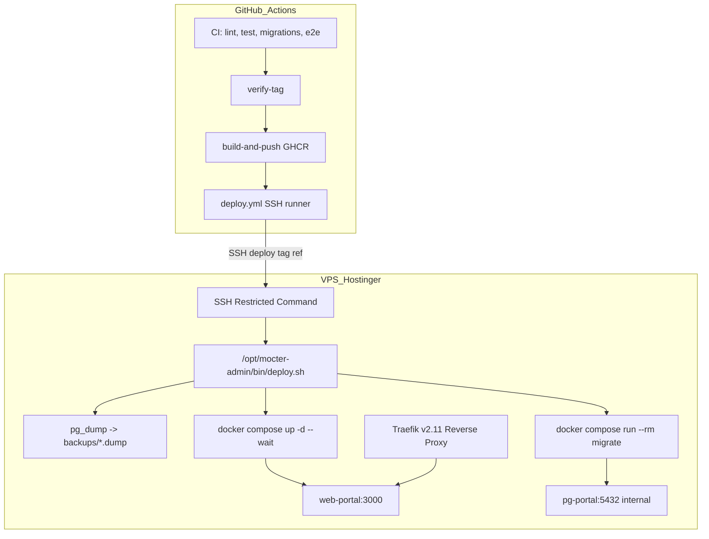

# CD-001 · Diseño · Despliegue continuo de Mocter

| Atributo | Valor |
|---|---|
| ID | CD-001 |
| Versión | 1.1 |
| Requisitos | [`requirements.md`](requirements.md) |
| Tareas | [`tasks.md`](tasks.md) |

## 1. Decisiones de diseño

| ID | Decisión | Justificación | Requisitos |
|---|---|---|---|
| DD-01 | Una sola imagen para pruebas y producción; solo cambia la etiqueta | Lo validado en pruebas es lo que llega a producción | RNF-06 |
| DD-02 | `latest` solo con tags estables; el servidor nunca la usa (`${TAG:?}`) | Rollback determinista; no desplegar código no liberado | RF-02.2, R-04 |
| DD-03 | El tag debe pertenecer a `main` (`verify-tag`) | No liberar código no integrado | RF-02.4 |
| DD-04 | Aprobación manual en environment `production` | Control humano antes de afectar usuarios | RF-03.1 |
| DD-05 | Estándar Drizzle: `push` solo local; `generate` + `migrate` en entornos compartidos | `push` no deja historial y puede eliminar columnas | RF-01.3, R-08 |
| DD-06 | Migrador embebido en `/app/migrator` con driver `postgres-js` | Standalone de Next.js no incluye migrador ni drizzle/ | RF-02.5 |
| DD-07 | Migración como paso de release, antes de reemplazar `web-portal` | Si falla, la versión anterior sigue sirviendo | RF-03.6, RF-03.7 |
| DD-08 | Job de CI `migrations`: `check` + `generate` sin cambios | Impide liberar esquema sin migración | RF-01.3, RF-01.4 |
| DD-09 | Se elimina el montaje en `docker-entrypoint-initdb.d` | Solo corre con volumen vacío y no registra en la tabla de control | RF-03.6 |
| DD-10 | Sin puertos publicados; Postgres en red `backend` interna | Docker omite UFW; aislamiento de red | RNF-03, R-10 |
| DD-11 | Nombres Traefik con prefijo `mocter-prod-` / `mocter-test-` | Traefik compartido; evita colisiones | RNF-08 |
| DD-12 | Middleware propio para `www` → apex | Redirección 301 con certificado TLS propio | RF-03.10 |
| DD-13 | SSH con llave restringida a `deploy.sh` | El usuario `deploy` equivale a root vía grupo docker; restringir a comando único | RNF-02 |
| DD-14 | El servidor descarga el compose desde `raw.githubusercontent.com` en la ref exacta | Compose versionado e inmutable junto a la imagen | RNF-06 |
| DD-15 | `pg_dump` antes de cada despliegue, retención 10 | Respaldo preventivo antes de cualquier migración | RF-03.5 |
| DD-16 | Rollback automático de imagen si no hay `healthy` | Minimiza tiempo de caída ante fallos | RF-03.8 |
| DD-17 | Interruptor `STAGING_ENABLED` | Activar/desactivar staging sin tocar código | RF-03.2, RF-03.3 |
| DD-18 | Paquete GHCR público con soporte de `GHCR_READ_TOKEN` opcional | Descarga ágil con fallback a token si el paquete es privado | RNF-01 |
| DD-19 | Plataforma `linux/amd64` | Arquitectura de VPS Hostinger | — |
| DD-20 | `NODE_ENV=production` en la etapa `build` | Compilación estándar de Next.js | — |

## 2. Arquitectura de Despliegue



## 3. Contratos y Especificación de Artefactos

### 3.1 `deploy.sh` (`SSH_ORIGINAL_COMMAND`)
- `deploy <image_tag> <git_ref>`
  - Para producción: `image_tag` cumple regex `^v\d+\.\d+\.\d+(-.+)?$`; `git_ref == image_tag`.
  - Para staging: `image_tag` cumple regex `^sha-[0-9a-f]{7}$`; `git_ref` es SHA de 40 carácteres.
- `status`: Muestra estado de contenedores y último release.
- Cualquier otro comando es rechazado.

### 3.2 Servicio `migrate`
- Imagen: `ghcr.io/enuarrosales/mocter-web:${TAG}`
- Perfil: `migrate`
- Comando: `["node", "migrator/scripts/migrate.mjs"]`
- Conexión: `DATABASE_URL` contra `pg-portal:5432` en la red `backend` interna.

### 3.3 Estructura en el Servidor
```
/opt/mocter-admin/            deploy:deploy 750
├── bin/deploy.sh             root:root 755
├── deploy.conf               deploy:deploy 600
├── .env                      deploy:deploy 600
├── compose.yml / compose.yml.prev
├── releases.log
├── backups/*.dump
└── logs/deploy.log
```
