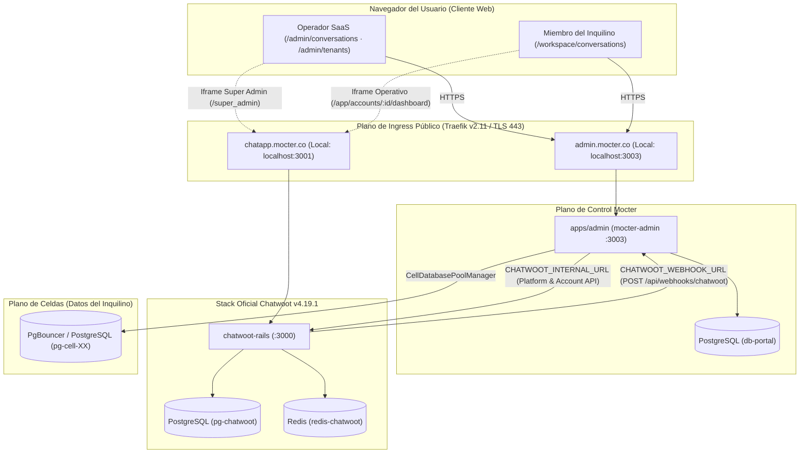
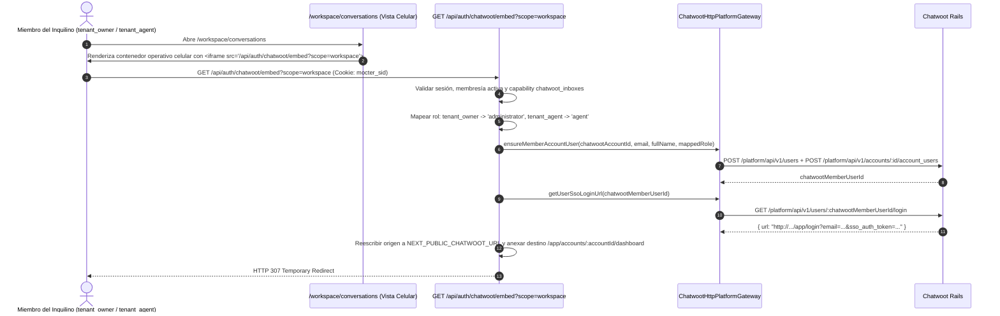

# CHW-002 · Diseño Técnico · Estabilización de la Interoperabilidad Chatwoot–Mocter

| Atributo | Valor |
|---|---|
| ID | CHW-002 |
| Versión | 1.1 |
| Estado | Aprobada · Revisión y remediación SDD cerrada en `/grill-me` |
| Fecha | 2026-11-11 |
| Documentos | [`requirements.md`](requirements.md) · `design.md` (este) · [`tasks.md`](tasks.md) |
| Depende de | [CHW-001](../chw-001-inventario-chatwoot/design.md) · [ADM-001](../adm-001-mocter-admin/design.md) · [TNT-001](../tnt-001-entorno-operativo-inquilino/design.md) · [AUTH-001](../auth-001-autenticacion-hibrida/design.md) · [DAT-001](../dat-001-arquitectura-datos-multiinquilino/design.md) |

---

## 1. Arquitectura General y Topología de Red

La interoperabilidad entre Mocter y Chatwoot Community `v4.19.1` opera bajo una **separación estricta de planos de tráfico y de superficies de usuario**:
1. **Backoffice Administrativo SaaS (`/admin/conversations` y `/admin/tenants`):** Exclusivo para `platform_owner` y `platform_admin` sobre el plano de control (`db-portal`) y la consola global `/super_admin` de Chatwoot.
2. **Backoffice Operativo del Inquilino (`/workspace/conversations`):** Exclusivo para `tenant_owner` y `tenant_agent` sobre su celda asignada (`pg-cell-XX`) y su bandeja operativa `/app/accounts/:account_id/dashboard`.



### 1.1 Contrato de Variables de Entorno en `env.ts` y `.env.example`

Todas las variables se tipan y validan mediante `@t3-oss/env-nextjs` / `zod` en `apps/admin/env.ts` y `packages/domain/src/utils/env.ts` (`AGENTS.md` §4.12):

| Variable | Ámbito | Propósito | Valor en Desarrollo Local (`docker-compose.yml`) | Valor en Producción (`production-services.md`) |
|---|---|---|---|---|
| `CHATWOOT_INTERNAL_URL` | Servidor (`server`) | Llamadas HTTP servidor-a-servidor desde `mocter-admin` hacia Chatwoot (`Platform API` y `Account API`) | `http://chatwoot-rails:3000` (con fallback a `CHATWOOT_BASE_URL`) | `https://chatapp.mocter.co` |
| `NEXT_PUBLIC_CHATWOOT_URL` | Cliente y Servidor (`client` / `server`) | Origen público al que el navegador se conecta dentro del `<iframe>` tras el redirect SSO | `http://localhost:3001` | `https://chatapp.mocter.co` |
| `CHATWOOT_PLATFORM_TOKEN` | Servidor (`server`) | Token maestro de `PlatformApp` para `/platform/api/v1/*` | Token local de `PlatformApp` en `pg-chatwoot` | Secreto de plataforma inyectado en entorno |
| `CHATWOOT_WEBHOOK_URL` | Servidor (`server`) | URL destino que `chatwoot-rails` invoca al emitir eventos de webhook hacia `mocter-admin` | `http://admin-portal:3003/api/webhooks/chatwoot` | `https://admin.mocter.co/api/webhooks/chatwoot` |
| `CHATWOOT_SUPER_ADMIN_USER_ID` | Servidor (`server`) | ID numérico del usuario `SuperAdmin` en Chatwoot empleado para el SSO de `/admin/conversations` | `1` (por defecto) | ID numérico del `SuperAdmin` en producción (ej. `1`) |

---

## 2. Modelo de Datos Existente y Reglas de Habilitación

### 2.1 Esquema Drizzle Real: `admin.chatwoot_accounts` (`db-portal`)

No se requieren migraciones DDL nuevas. El diseño respeta exactamente la definición vigente en [`packages/domain/src/db/schemas/admin/chatwoot-media-onboarding.ts`](../../../../packages/domain/src/db/schemas/admin/chatwoot-media-onboarding.ts):

- `id`: `uuid("id").primaryKey().defaultRandom()`
- `clientId`: `uuid("client_id").notNull().unique()` (FK a `admin.clients.id` con `ON DELETE CASCADE`)
- `chatwootAccountId`: `integer("chatwoot_account_id").unique()`
- `serviceUserId`: `integer("service_user_id")`
- `serviceTokenCiphertext`: `bytea("service_token_ciphertext")` (`Buffer` cifrado con AES-256-GCM y AAD `client_id`)
- `serviceTokenKeyId`: `varchar("service_token_key_id", { length: 32 })` (sujeto al check constraint `(service_token_ciphertext IS NULL) = (service_token_key_id IS NULL)`)
- `webchatInboxId`: `integer("webchat_inbox_id")`
- `webchatWebsiteToken`: `varchar("webchat_website_token", { length: 128 })`
- `state`: `varchar("state", { length: 24 })` (`'pending' | 'provisioning' | 'active' | 'failed'`)
- `lastError`: `text("last_error")`
- `idempotencyKey`: `varchar("idempotency_key", { length: 128 }).notNull().unique()`
- `syncedAt`, `createdAt`, `updatedAt`: `timestamp(..., { withTimezone: true })`

### 2.2 Corrección de `TenantCapabilityGateService` y `buildChatwootFeaturesAndLimitsForPlan`

#### A. Derivación de `chatwoot_inboxes` en `TenantCapabilityGateService`
En [`packages/domain/src/services/tenant-capability-gate.service.ts`](../../../../packages/domain/src/services/tenant-capability-gate.service.ts):
1. Además de leer `admin.plan_capability_values`, consulta `admin.plan_limits` para el `planId` activo del inquilino.
2. Si la fila con `dimension = 'chatwoot_inboxes'` tiene `mode === 'UNLIMITED'` o `(mode === 'NUMERIC' && (value ?? 0) > 0)`, establece `capabilities['chatwoot_inboxes'] = true` antes de aplicar `admin.client_feature_overrides`.
3. Esto desbloquea de forma consistente tanto `WorkspaceConversationsPage` como `GET /api/auth/chatwoot/embed`.

#### B. Corrección del Mapeo de Límites y Habilitación en `ChatwootProvisioningService`
En [`packages/domain/src/services/chatwoot-provisioning.service.ts`](../../../../packages/domain/src/services/chatwoot-provisioning.service.ts):
1. En `buildChatwootFeaturesAndLimitsForPlan(planId)`:
   - Se corrige la lectura de `admin.plan_limits` usando los códigos canónicos de [`PLAN_DIMENSION_KEYS`](../../../../packages/domain/src/db/schemas/admin/plan-catalogs.ts) y la propiedad real `row.mode`:
     ```typescript
     for (const row of limitRows) {
       const resolvedLimit =
         row.mode === "UNLIMITED" ? null : row.mode === "DISABLED" ? 0 : (row.value ?? null);
       if (row.dimension === "chatwoot_agents") {
         limits.agents = resolvedLimit;
       } else if (row.dimension === "chatwoot_inboxes") {
         limits.inboxes = resolvedLimit;
       }
     }
     ```
2. En `isChatwootEnabledForPlan(planId)`:
   - Evalúa si el plan tiene alguna capacidad activa en `admin.plan_capability_values` (`enabled = true`) **o** si en `admin.plan_limits` las dimensiones `'chatwoot_agents'` o `'chatwoot_inboxes'` tienen `mode === 'UNLIMITED'` o `(mode === 'NUMERIC' && (value ?? 0) > 0)`.

---

## 3. Flujo de Aprovisionamiento Automatizado (Fail-Soft) y Sincronización Celular

El aprovisionamiento se ejecuta a través de `provisionOrRetryAccount` en tres puntos de entrada:
1. **Alta Manual (`/admin/tenants`):** invocado al final de `createAdminTenant` en [`admin-dashboard.service.ts`](../../../../packages/domain/src/services/admin-dashboard.service.ts).
2. **Paso 1 del Onboarding Unificado (`/onboarding`):** invocado en `completeStep1Business` en [`tenant-onboarding.service.ts`](../../../../packages/domain/src/services/tenant-onboarding.service.ts) tanto en el Caso B (alta autónoma de nuevo cliente) como en el Caso A (`existingClient` proveniente de alta manual cuya cuenta de Chatwoot aún no exista o esté en estado `pending` / `failed`).
3. **Acción Manual en Backoffice SaaS (`/admin/tenants`):** invocada vía `POST /api/admin/tenants/[id]/chatwoot/provision`.

```mermaid
sequenceDiagram
    autonumber
    actor Actor as Operador SaaS / Inquilino en Paso 1
    participant Service as Servicio de Dominio (Mocter)
    participant DbPortal as PostgreSQL (db-portal)
    participant Gateway as ChatwootHttpPlatformGateway
    participant Chatwoot as Chatwoot Rails (:3000)
    participant PgCell as Celda del Inquilino (pg-cell-XX)

    Actor->>Service: Alta Manual / Paso 1 Onboarding / Reintento Manual
    Service->>DbPortal: Verificar plan e idempotencia en admin.chatwoot_accounts
    alt Cuenta ya en state = 'active' y chatwoot_account_id presente
        Service-->>Actor: Retornar cuenta activa existente (Idempotente)
    else Requiere aprovisionamiento (pending, failed o inexistente)
        Service->>DbPortal: UPSERT admin.chatwoot_accounts (state = 'provisioning')
        critical Bloque Fail-Soft (No revierte el alta del inquilino si falla)
            Service->>Gateway: createAccount / updateAccount (name, locale, features, limits)
            Gateway->>Chatwoot: POST /platform/api/v1/accounts
            Chatwoot-->>Gateway: accountId
            Service->>Gateway: createOrUpdateServiceUser + attachUserToAccount(administrator)
            Gateway->>Chatwoot: POST /platform/api/v1/users & account_users
            Chatwoot-->>Gateway: serviceUserId + rawAccessToken
            Service->>Service: Cifrar rawAccessToken (AES-256-GCM, AAD = clientId)
            Service->>Gateway: ensureDefaultWebchatInbox(accountId, serviceToken, tenantName)
            Gateway->>Chatwoot: GET/POST /api/v1/accounts/:id/inboxes
            Chatwoot-->>Gateway: inboxId, websiteToken
            loop 6 Etiquetas Reservadas (lead-frio, lead-tibio, lead-caliente, compra-realizada, soporte, escalation-humano)
                Service->>Gateway: pushLabelToChatwoot(accountId, serviceToken, label)
                Gateway->>Chatwoot: POST /api/v1/accounts/:id/labels
                Chatwoot-->>Gateway: chatwootLabelId
                Service->>PgCell: UPDATE admin.tenant_labels SET chatwoot_label_id = :id WHERE client_id = :clientId AND code = :code
            end
            Service->>Gateway: ensureAccountWebhook(accountId, serviceToken, CHATWOOT_WEBHOOK_URL)
            Gateway->>Chatwoot: GET/POST /api/v1/accounts/:id/webhooks
            Service->>DbPortal: UPDATE admin.chatwoot_accounts (state = 'active', last_error = null, synced_at = now())
        option Error de Red / Timeout / HTTP 4xx-5xx
            Service->>DbPortal: UPDATE admin.chatwoot_accounts (state = 'failed', last_error = mensaje)
            Service->>Service: Emitir appLogger.warn({ event: 'chatwoot.provisioning.failed', ... })
        end
        Service-->>Actor: Respuesta exitosa con estado de vinculación Chatwoot
    end
```

---

## 4. Diseño de Acceso Transparente SSO y Separación de Vistas (`/workspace` vs `/admin`)

### 4.1 Handoff SSO Operativo para el Inquilino (`/workspace/conversations`)

En la vista operativa del inquilino en la celda (`scope=workspace`), ningún miembro utiliza el `service_user_id` técnico para su sesión interactiva, garantizando que `tenant_agent` opere con rol `agent` y `tenant_owner` con rol `administrator`.



### 4.2 Consola Administrativa del Backoffice SaaS (`/admin/conversations`)

La vista `/admin/conversations` es exclusiva del Backoffice SaaS (`platform_owner` y `platform_admin`) y mantiene una arquitectura completamente diferenciada de `/workspace/conversations`:

1. **Plano de Gobierno SaaS (Cabecera y Panel de Control):**
   - Muestra KPIs globales de cuentas en `admin.chatwoot_accounts` (Total vinculadas, Activas, Fallidas/Pendientes, Capacidades del catálogo de 42 códigos).
   - Selector de vista de plataforma:
     - **Consola Super Admin Global:** carga `/super_admin` en el visor.
     - **Directorio de Cuentas en Chatwoot:** carga `/super_admin/accounts` en el visor.
     - **Ficha Administrativa de Cuenta (`?accountId=<chatwootAccountId>`):** cuando el operador navega desde `/admin/tenants`, carga `/super_admin/accounts/<chatwootAccountId>` para auditar la cuenta en la consola de infraestructura de Chatwoot sin abrir la bandeja operativa de mensajes del comercio.
2. **Handoff SSO Super Admin (`/api/auth/chatwoot/embed?scope=admin&targetPath=...`):**
   - Verifica que el usuario autenticado tenga rol global `platform_owner` o `platform_admin`.
   - Invoca `GET /platform/api/v1/users/:super_admin_id/login` usando `CHATWOOT_SUPER_ADMIN_USER_ID`.
   - Reescribe el origen de la URL efímera con `NEXT_PUBLIC_CHATWOOT_URL` e incorpora el `targetPath` validado (restringido exclusivamente a rutas bajo `/super_admin*`), respondiendo con `HTTP 307 Temporary Redirect`.

---

## 5. Contratos de Endpoints y Métodos de Gateway

### 5.1 Nuevos Métodos en `ChatwootPlatformGateway` (`packages/domain/src/services/chatwoot-provisioning.service.ts`)

```typescript
export interface ChatwootWebhookRegistrationResult {
  id: number;
  url: string;
}

export interface ChatwootPlatformGateway {
  // Métodos existentes conservados...
  createAccount(input: { name: string; locale: "es" | "en"; features: Record<string, boolean>; limits: Record<string, number | null> }): Promise<{ accountId: number }>;
  updateAccount(accountId: number, input: { name?: string; locale?: "es" | "en"; features: Record<string, boolean>; limits: Record<string, number | null> }): Promise<void>;
  createOrUpdateServiceUser(input: { email: string; name: string; password: string }): Promise<{ userId: number; accessToken: string }>;
  attachUserToAccount(input: { accountId: number; userId: number; role: "administrator" | "agent" }): Promise<void>;
  ensureDefaultWebchatInbox(input: { accountId: number; serviceToken: string; websiteName: string }): Promise<{ inboxId: number; websiteToken: string }>;
  pushLabelToChatwoot(input: { accountId: number; serviceToken: string; title: string; description: string | null; color: string; showOnSidebar: boolean }): Promise<{ labelId: number }>;

  // Nuevos métodos requeridos por CHW-002:
  /**
   * Registra de forma idempotente el webhook de la cuenta hacia mocter-admin.
   */
  ensureAccountWebhook(input: {
    accountId: number;
    serviceToken: string;
    webhookUrl: string;
    subscriptions?: string[];
  }): Promise<ChatwootWebhookRegistrationResult>;

  /**
   * Asegura que el miembro del inquilino exista en Chatwoot y esté vinculado a la cuenta con su rol.
   */
  ensureMemberUserInAccount(input: {
    accountId: number;
    email: string;
    name: string;
    role: "administrator" | "agent";
  }): Promise<{ userId: number }>;

  /**
   * Obtiene la URL efímera de inicio de sesión SSO (5 minutos, single-use) desde la Platform API.
   */
  getUserSsoLoginUrl(input: {
    userId: number;
  }): Promise<{ url: string }>;
}
```

### 5.2 Superficie de Route Handlers en `apps/admin`

| Método | Ruta | Roles Autorizados | Propósito |
|---|---|---|---|
| `GET` | `/api/auth/chatwoot/embed` | `tenant_owner`, `tenant_agent` (`scope=workspace`) · `platform_owner`, `platform_admin` (`scope=admin`) | Resuelve el usuario de Chatwoot correspondiente al ámbito (`workspace` o `admin`), obtiene la URL SSO efímera desde `GET /platform/api/v1/users/:id/login`, adapta el origen a `NEXT_PUBLIC_CHATWOOT_URL` y redirige con HTTP 307. Envuelto en `handle()` (RFC 9457). |
| `POST` | `/api/admin/tenants/[id]/chatwoot/provision` | `platform_owner`, `platform_admin` | Ejecuta bajo demanda `provisionOrRetryAccount(id)` para aprovisionar por primera vez o reintentar una cuenta en estado `failed` / `pending`, sincronizando etiquetas en `pg-cell-XX` y webhook. Envuelto en `handle()`. |
| `GET` | `/api/admin/tenants/[id]/chatwoot/status` | `platform_owner`, `platform_admin` | Retorna el registro actual de `admin.chatwoot_accounts` para el inquilino indicado. Envuelto en `handle()`. |
| `POST` | `/api/webhooks/chatwoot` | Webhook público validado | Recibe los eventos de conversaciones, mensajes y contactos emitidos por Chatwoot hacia `CHATWOOT_WEBHOOK_URL`. |

---

## 6. Componentes de UI y Reglas de Presentación

1. **Directorio de Inquilinos (`apps/admin/app/admin/tenants/page.tsx` y `tenant-actions.tsx`):**
   - Muestra en cada fila el badge semántico de estado de Chatwoot (`Activo`, `Aprovisionando`, `Pendiente`, `Fallido`, `Sin Vincular`) y un tooltip/texto con `lastError` cuando `state === 'failed'`.
   - En `TenantActions`, incorpora el botón en Title Case **«Aprovisionar En Chatwoot»** (cuando no tiene cuenta o está `pending`) o **«Reintentar Sincronización»** (cuando está `failed`), el cual abre un modal de confirmación accesible (`role="dialog"`, `aria-modal="true"`, tokens `--dsn-*`, cero `window.confirm()`) que invoca `POST /api/admin/tenants/[id]/chatwoot/provision`.
   - Cuando la cuenta tiene `chatwootAccountId`, ofrece la acción **«Ver Cuenta En Super Admin»** que navega a `/admin/conversations?accountId=<chatwootAccountId>`.
2. **Consola Administrativa SaaS (`apps/admin/app/admin/conversations/page.tsx` + cliente dedicado):**
   - Vista exclusiva de Backoffice SaaS: barra superior de telemetría de cuentas aprovisionadas, selector de destino Super Admin (`/super_admin`, `/super_admin/accounts`, `/super_admin/accounts/:id`) e iframe conectado a `/api/auth/chatwoot/embed?scope=admin&targetPath=...`.
   - Ningún identificador de especificación (`CHW-001`, `CHW-002`, `ADM-001`, `D-32`, etc.) se expone en badges, títulos ni textos visibles (`AGENTS.md` §4.15).
3. **Consola Operativa Celular del Inquilino (`apps/admin/app/workspace/conversations/page.tsx` + cliente dedicado):**
   - Vista exclusiva de operación del inquilino en su celda: verifica `capabilities.chatwoot_inboxes`, verifica que la cuenta en `admin.chatwoot_accounts` esté `active` y renderiza el iframe hacia `/api/auth/chatwoot/embed?scope=workspace` a pantalla completa dentro del layout celular.
