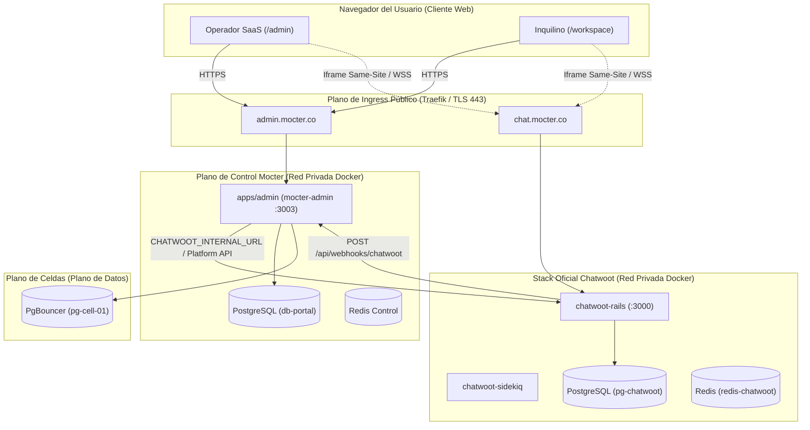
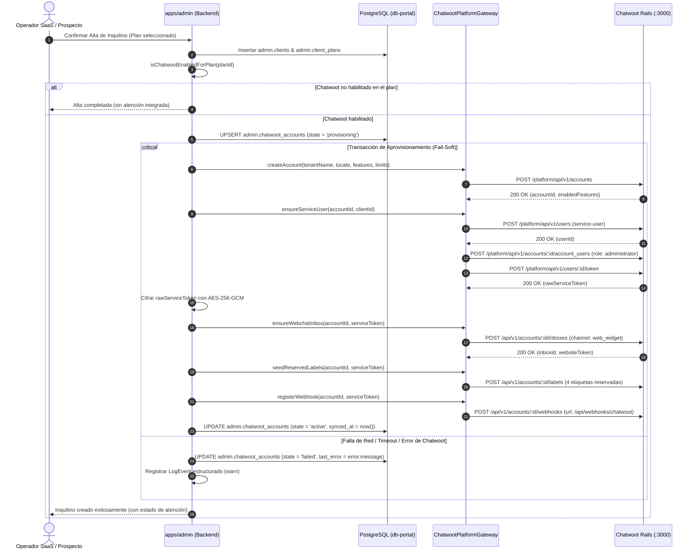
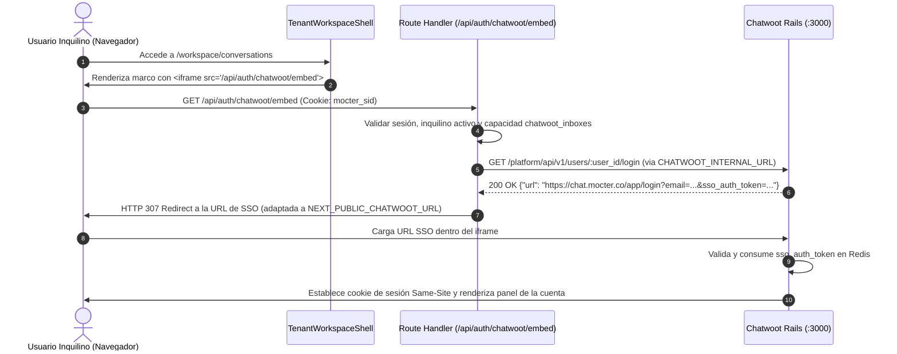

# CHW-002 · Diseño Técnico · Estabilización de la Interoperabilidad Chatwoot–Mocter

| Atributo | Valor |
|---|---|
| ID | CHW-002 |
| Versión | 1.0 |
| Estado | Aprobada (Fase de Planeamiento `/grill-me`) |
| Fecha | 2026-11-10 |
| Documentos | [`requirements.md`](requirements.md) · `design.md` (este) · [`tasks.md`](tasks.md) |
| Depende de | [CHW-001](../chw-001-inventario-chatwoot/design.md) · [ADM-001](../adm-001-mocter-admin/design.md) · [TNT-001](../tnt-001-entorno-operativo-inquilino/design.md) · [AUTH-001](../auth-001-autenticacion-hibrida/design.md) · [DAT-001](../dat-001-arquitectura-datos-multiinquilino/design.md) |

---

## 1. Arquitectura General y Topología de Red

La interoperabilidad entre Mocter y Chatwoot v4.19.1 opera bajo una **separación estricta de planos de tráfico** para eliminar colisiones de red, evitar puertos fijos y blindar la aplicación frente a restricciones de navegadores modernos (same-site cookies, partitioning CHIPS, CSP frame-ancestors).



### 1.1 Contrato de Doble URL en `env.ts`

Se definen dos variables de entorno tipadas mediante `@t3-oss/env-nextjs` y `zod`:

| Variable | Ámbito | Propósito | Valor en Desarrollo Local | Valor en Producción (Traefik) |
|---|---|---|---|---|
| `CHATWOOT_INTERNAL_URL` | Servidor (`server`) | Llamadas HTTP backend a Platform API de Chatwoot (`fetch`) | `http://mocter-chatwoot-rails-1:3000` (o `http://host.docker.internal:3000`) | `http://chatwoot-rails:3000` (red Docker privada interna) |
| `NEXT_PUBLIC_CHATWOOT_URL` | Cliente / Servidor (`client` y `server`) | URL pública que el navegador del usuario carga dentro del `<iframe>` | `http://localhost:3000` | `https://chat.mocter.co` |
| `CHATWOOT_PLATFORM_TOKEN` | Servidor (`server`) | Token de acceso maestro de la `PlatformApp` para gestionar cuentas y usuarios | Token configurado en el stack de Chatwoot | Docker secret compartido inyectado como variable de entorno |

---

## 2. Contrato de Datos y Detección de Habilitación

### 2.1 Tabla de Correlación: `admin.chatwoot_accounts`

La correlación entre el inquilino de Mocter y Chatwoot vive exclusivamente en el Plano de Control de Mocter (`db-portal`):

```sql
CREATE TABLE admin.chatwoot_accounts (
    client_id UUID PRIMARY KEY REFERENCES admin.clients(id) ON DELETE CASCADE,
    chatwoot_account_id INTEGER UNIQUE,
    service_user_id INTEGER,
    service_token_ciphertext TEXT,
    service_token_key_id VARCHAR(32) NOT NULL DEFAULT 'k1',
    webchat_inbox_id INTEGER,
    webchat_website_token VARCHAR(255),
    state VARCHAR(32) NOT NULL DEFAULT 'pending', -- pending | provisioning | active | failed
    idempotency_key VARCHAR(128) NOT NULL UNIQUE,
    last_error TEXT,
    created_at TIMESTAMPTZ NOT NULL DEFAULT now(),
    synced_at TIMESTAMPTZ,
    updated_at TIMESTAMPTZ NOT NULL DEFAULT now()
);
```

### 2.2 Algoritmo de Habilitación de Atención (`isChatwootEnabledForPlan`)

Se erradica la dependencia con la columna fantasma `plan.chatwootEnabled`. La función canónica de dominio evalúa:

```typescript
/**
 * Determina autoritativamente si un plan comercial incluye atención integrada con Chatwoot.
 *
 * @param planId - Identificador UUID del plan.
 * @param db - Instancia de base de datos Drizzle.
 * @returns Booleano indicando si el plan tiene cuota de agentes o capacidades activas de atención.
 */
export async function isChatwootEnabledForPlan(planId: string, db: any): Promise<boolean> {
  // 1. Verificar límite numérico en chatwoot_agents
  const [agentsLimit] = await db
    .select()
    .from(planLimits)
    .where(and(eq(planLimits.planId, planId), eq(planLimits.dimension, "chatwoot_agents")))
    .limit(1);

  if (agentsLimit && (agentsLimit.mode === "UNLIMITED" || (agentsLimit.value ?? 0) > 0)) {
    return true;
  }

  // 2. Verificar capacidades de atención activas en el catálogo de capabilities
  const activeCapabilities = await db
    .select()
    .from(planCapabilityValues)
    .where(and(eq(planCapabilityValues.planId, planId), eq(planCapabilityValues.enabled, true)))
    .limit(1);

  return activeCapabilities.length > 0;
}
```

---

## 3. Flujo de Aprovisionamiento Automatizado (Fail-Soft)

El aprovisionamiento se dispara en dos puntos de entrada:
1. **Alta Manual (`/admin/tenants`):** dentro de `createAdminTenant`.
2. **Alta Autónoma (`/onboarding`):** al guardar el **Paso 1** del Wizard.



---

## 4. Flujo de Acceso Transparente y SSO (Iframe Same-Site)

### 4.1 Handoff SSO para Inquilino (`/workspace/conversations`)



### 4.2 Acceso Administrativo Global del Platform Owner (`/admin/conversations`)

1. Para el **Platform Owner**: existe un usuario maestro pre-registrado en Chatwoot con rol `super_admin`.
2. La vista `/admin/conversations` consulta el enlace de acceso SSO de este usuario maestro mediante `GET /platform/api/v1/users/:super_admin_id/login`.
3. El iframe se redirige a la consola solicitada por el selector de vistas:
   - **Super Admin Global:** `/super_admin`
   - **Ajustes de Plataforma:** `/app/accounts/1/settings`
   - **Bandeja Maestra:** `/app/accounts/1/inbox`
4. **Soporte / Inspección de Inquilinos:** En `/admin/tenants/[id]`, el botón «Inspeccionar Bandeja de Chatwoot» emite un token de login como administrador en la cuenta del inquilino, abriendo la sesión confinada a dicho comercio.

---

## 5. Endpoints y Superficie de Rutas

### 5.1 Route Handlers en `apps/admin`

| Método | Ruta | Autenticación | Propósito |
|---|---|---|---|
| `GET` | `/api/auth/chatwoot/embed` | Cookie `mocter_sid` | Endpoint de handoff SSO para el iframe del inquilino y del administrador. Obtiene el token de la Platform API y redirige con HTTP 307. |
| `POST` | `/api/admin/tenants/[id]/chatwoot/provision` | `platform_owner`, `platform_admin` | Acción manual para aprovisionar por primera vez o reintentar la creación de la cuenta de Chatwoot de un inquilino. |
| `GET` | `/api/admin/tenants/[id]/chatwoot/status` | `platform_owner`, `platform_admin` | Consulta el estado actual de aprovisionamiento, cuenta y última sincronización en `admin.chatwoot_accounts`. |
| `GET` | `/api/admin/tenants/[id]/chatwoot/impersonate` | `platform_owner` | Emite una URL de SSO temporal para inspeccionar la cuenta de Chatwoot del inquilino en sesión de soporte. |
| `POST` | `/api/webhooks/chatwoot` | Secreto / Header Chatwoot | Recibe eventos de mensajería y contactos de Chatwoot y los ingesta en el CRM celular (`CrmService`). |

---

## 6. Mapeo de Capacidades y Límites (Mocter ↔ Chatwoot)

Mocter traduce atómicamente la configuración del plan a los atributos admitidos por Chatwoot Community `v4.19.1`:

```typescript
export interface ChatwootAccountPayload {
  name: string;
  locale: "es" | "en";
  features: {
    channel_email?: boolean;
    channel_facebook?: boolean;
    channel_instagram?: boolean;
    channel_tiktok?: boolean;
    channel_website?: boolean;
    agent_bots?: boolean;
    automations?: boolean;
    crm?: boolean;
    custom_attributes?: boolean;
    inbox_management?: boolean;
    reports?: boolean;
    help_center?: boolean;
    // ... 42 códigos canónicos
  };
  limits: {
    agents: number | null;
    inboxes: number | null;
    emails: number | null;
  };
}
```

---

## 7. Medidas de Seguridad y Blindaje de Navegadores

1. **Same-Site Cookie Boundary:** Al compartir el dominio principal `mocter.co` (`admin.mocter.co` y `chat.mocter.co`), la cookie de sesión emitida por Chatwoot es considerada `SameSite=Lax` o `SameSite=None; Secure`, previniendo bloqueos de almacenamiento particionado en Chrome, Safari y Firefox.
2. **CSP Frame Ancestors:** Chatwoot se configura para emitir:
   `Content-Security-Policy: frame-ancestors 'self' https://admin.mocter.co https://*.mocter.co http://localhost:3003;`
3. **Cifrado de Credenciales:** Los tokens de acceso de la API de Chatwoot se cifran con AES-256-GCM con autenticación AAD en reposo.
4. **Expiración Estricta:** Las URLs de SSO emitidas por la Platform API expiran en exactamente 5 minutos en Redis y se eliminan atómicamente tras su primer uso (`single-use`).

