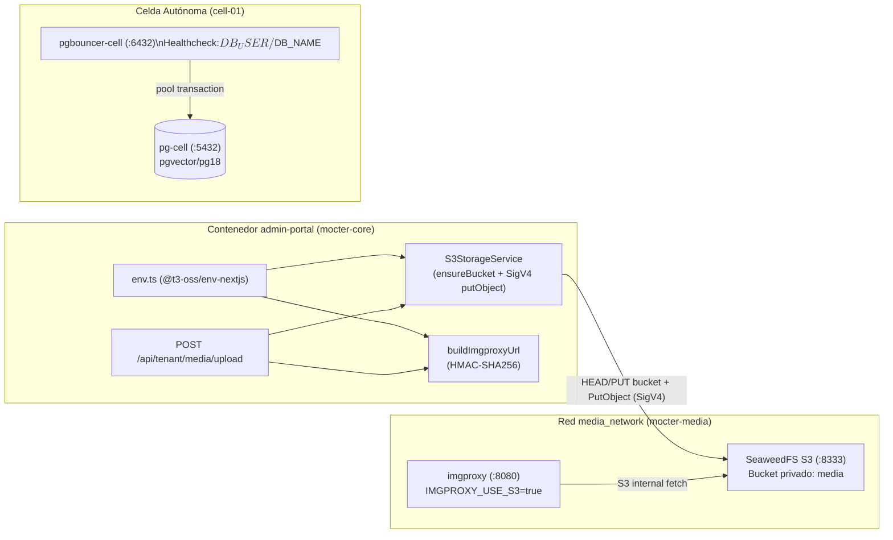

# SPEC-00 · Diseño Técnico · Remediación de Persistencia Multimedia y Healthcheck de PgBouncer

## 1. Arquitectura de Solución

La remediación aborda dos frentes independientes de infraestructura y dominio sin alterar código de producto ni las redes externas gobernadas por Traefik:



---

## 2. Corrección de `INC-01` (PgBouncer Healthcheck)

### 2.1 Cambios en Generador de Manifiestos y Compose Celular
En los 3 perfiles de `packages/domain/src/services/compose-cell-manifest-renderer.ts` (`control_plane_vps` línea 173, `external_vps` línea 275 y `local_development` línea 372) y en `data-cell-dev/docker-compose.yml` (línea 60):

- **Antes (defectuoso):**
  ```yaml
  healthcheck:
    test: ["CMD-SHELL", "pg_isready -h 127.0.0.1 -p 6432 -U $$POSTGRES_USER -d $$POSTGRES_DB"]
  ```
- **Después (canónico):**
  ```yaml
  healthcheck:
    test: ["CMD-SHELL", "pg_isready -h 127.0.0.1 -p ${pool.listenPort} -U $$DB_USER -d $$DB_NAME"]
  ```
- **Justificación técnica:** La imagen `edoburu/pgbouncer:v1.26.1-p0` recibe las variables `DB_USER` y `DB_NAME` en su sección `environment`. Al utilizar `$$DB_USER` y `$$DB_NAME`, Docker Compose escapa el signo `$` para que el shell dentro del contenedor expanda los valores reales (`mocter_app` y `pg-cell-01`). Adicionalmente, se actualizan los archivos *golden* de pruebas en `packages/domain/src/services/__fixtures__/cell-manifest/*.golden.json`.

---

## 3. Corrección de `PRD-09` (SeaweedFS + imgproxy)

### 3.1 Variables de Entorno Tipadas (`env.ts` y `.env.example`)
Asegurar que `packages/domain/src/utils/env.ts` y `apps/admin/env.ts` declaren y validen con Zod:
- `S3_ENDPOINT`: URL interna S3 (ej. `http://seaweedfs:8333`).
- `S3_REGION`: Región S3 (default `'us-east-1'`).
- `S3_BUCKET`: Nombre del bucket privado (default `'media'`).
- `S3_ACCESS_KEY_ID`: Identificador de acceso S3.
- `S3_SECRET_ACCESS_KEY`: Secreto de firma S3.
- `IMGPROXY_KEY`: Clave hexadecimal HMAC (sin fallback hardcodeado divergente).
- `IMGPROXY_SALT`: Sal hexadecimal HMAC (sin fallback hardcodeado divergente).
- `IMGPROXY_PUBLIC_URL`: URL pública consumible por el navegador para servir imágenes firmadas (ej. `http://localhost:8081` en local o `https://media.mocter.co` en producción).

### 3.2 Orquestación Docker (`docker-compose.yml` y `docker-compose.prod.yml`)
1. Añadir la red externa `media_network` al bloque `networks` de `docker-compose.yml` (y en producción la red interna compartida con el stack de medios según `docs/reference/production-services.md`) y adjuntarla al servicio `admin-portal` (y `web-portal` si consume S3).
2. Inyectar las variables `S3_*` e `IMGPROXY_*` en el bloque `environment` de `admin-portal` sin hardcodear secretos (referenciando `${VAR}`).

### 3.3 Auto-inicialización del Bucket e Inyección de `env` en `S3StorageService`
En `packages/domain/src/services/s3-storage.service.ts`:
- Reemplazar las lecturas directas `process.env.S3_*` por lectura desde `env` de `packages/domain/src/utils/env.ts`.
- Agregar un conjunto `private static initializedBuckets = new Set<string>()` y el método `async ensureBucketExists(): Promise<void>`:
  1. Si `initializedBuckets.has(cacheKey)`, retorna de inmediato.
  2. Ejecuta `HEAD /{bucket}` firmado con SigV4.
  3. Si retorna `200`, agrega a `initializedBuckets`.
  4. Si retorna `404`, ejecuta `PUT /{bucket}` firmado con SigV4 y, ante `200`/`409` (`BucketAlreadyOwnedByYou`), agrega a `initializedBuckets`.
- Invocar `await this.ensureBucketExists()` al inicio de `putObject()`.

### 3.4 Corrección de Firma y URL Pública en `tenant-workspace.service.ts`
En `packages/domain/src/services/tenant-workspace.service.ts` (líneas 41–47):
- Eliminar los literales `keyHex`/`saltHex` desalineados y leer `env.IMGPROXY_KEY` y `env.IMGPROXY_SALT` directamente.
- Resolver `baseUrl` priorizando `env.IMGPROXY_PUBLIC_URL` sobre `env.IMGPROXY_BASE_URL` para asegurar URLs resolubles desde el navegador del inquilino tanto en desarrollo como detrás de Traefik en producción.

---

## 4. Estrategia de Pruebas y Verificación

1. **Pruebas unitarias (`Vitest`):**
   - `compose-cell-manifest-renderer.test.ts`: validar que ningún perfil emitido contenga `POSTGRES_USER` ni `POSTGRES_DB` dentro del healthcheck de `pgbouncer-cell`.
   - `s3-storage.service.test.ts`: validar que ante `HEAD /{bucket}` → `404`, `S3StorageService` emita `PUT /{bucket}` antes de `PUT /{bucket}/{key}` y cachee la existencia del bucket en llamadas subsecuentes.
   - `tenant-workspace.service.test.ts`: validar que `buildImgproxyUrl` genera la firma HMAC-SHA256 con la longitud y codificación URL-safe esperadas usando `IMGPROXY_PUBLIC_URL`.
2. **Verificación de integración en contenedores en caliente (`AGENTS.md §4.18`):**
   - Reiniciar `mocter-cell-01-pgbouncer-cell-1` y monitorear logs 60 segundos.
   - Recompilar y reiniciar `mocter-core-admin-portal-1`, ejecutar subida multipart real y validar `HTTP 200` en la URL firmada de `imgproxy`.

