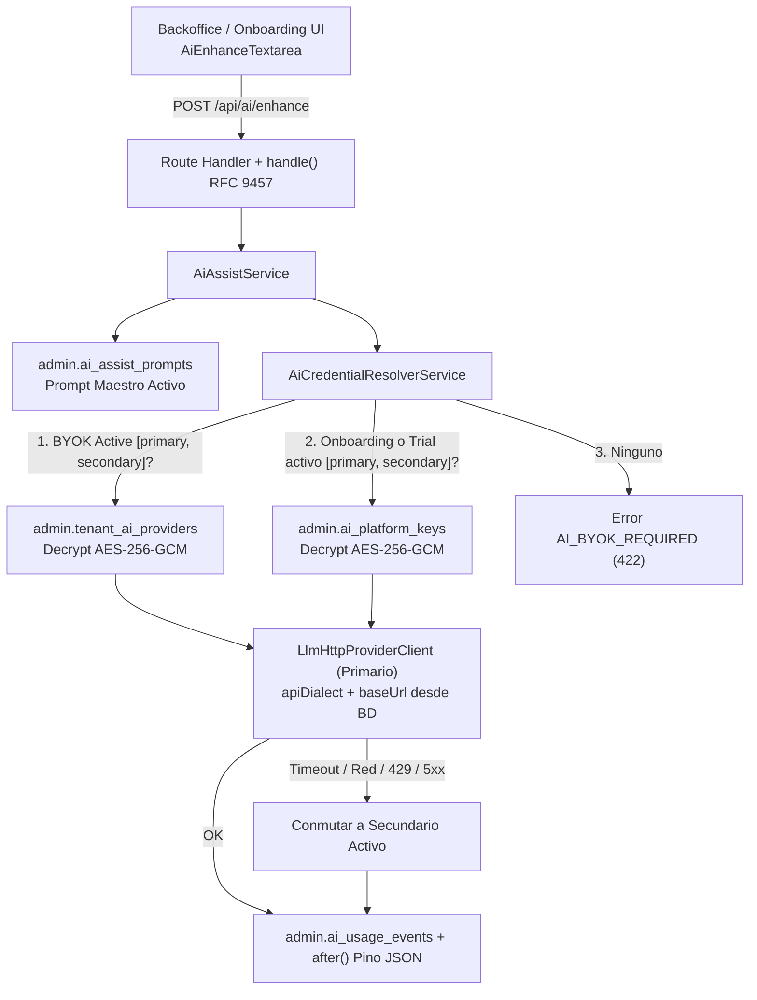

# SPEC-02 · Diseño Técnico: Motor Real de Inferencia AI y BYOK

## 1. Arquitectura de Solución

El diseño reemplaza la simulación en cliente y el handler inyectado con `{}` por un **pipeline único server-side** dentro de `@mocter/domain`, desacoplando:

1. **Resolución de credenciales con Failover (`AiCredentialResolverService`):** Resuelve candidatos ordenados `[primary, secondary]` entre las credenciales BYOK del comercio o, durante onboarding o periodo de prueba vigente, entre las credenciales activas de plataforma (`primary` / `secondary`).
2. **Adaptador multi-proveedor dinámico (`LlmHttpProviderClient`):** Implementa `IAiAssistModelClient` consumiendo dinámicamente `(apiDialect, baseUrl, verifyPath)` leídos desde `admin.ai_providers` (`openai_compatible`, `anthropic`, `google_gemini`) mediante `fetch` tipado con `AbortSignal.timeout`.
3. **Orquestación de asistencia y Failover (`AiAssistService`):** Combina `admin.ai_assist_prompts` + guardarraíles globales + límite de tasa + invocación LLM sobre primario con conmutación automática a secundario ante indisponibilidad (`timeout`, red, `429`, `5xx`) + auditoría en `admin.ai_usage_events`.
4. **Identidad visual y catálogo administrable (`admin-dashboard.service.ts`):** CRUD completo de `admin.ai_providers` (con cargue de logo a SeaweedFS + URL firmada de `imgproxy`) y `admin.ai_models` (con unicidad de modelo por defecto `is_default` por proveedor).



---

## 2. Cambios en Base de Datos y Esquema Drizzle

### 2.1 Archivo: `packages/domain/src/db/schemas/admin/bot-tenancy.ts`

- En `tenantAiProviders`:
  - Agregar `lastVerifiedAt: timestamp("last_verified_at", { withTimezone: true })` (con comentario SQL descriptivo).
  - Agregar `lastVerificationError: text("last_verification_error")` (sin almacenar claves ni headers).
- En `aiPlatformKeys`:
  - Verificar columna `defaultModelId` y `monthlyTokenCap` para proteger el consumo durante periodos de prueba.
- En `aiUsageEvents`:
  - Agregar columna opcional `fieldKey: varchar("field_key", { length: 120 })` y `requestId: varchar("request_id", { length: 64 })` para correlación exacta de logs y trazabilidad de qué `textarea` generó consumo.
- Generar migración SQL limpia con `pnpm --filter @mocter/domain db:generate` y validar con `drizzle-kit check`.

### 2.3 Extensión de Esquema para Fase 2 (`bot-catalog.ts` y `bot-tenancy.ts`)

- **`admin.ai_providers` (`packages/domain/src/db/schemas/admin/bot-catalog.ts`):**
  - `DROP CONSTRAINT ai_providers_code_check` (lista cerrada de 6 códigos) y reemplazo por `CHECK (code ~ '^[a-z0-9_-]{2,40}$')` + índice único parcial `WHERE deleted_at IS NULL` (reemplazando `unique` absoluto cuando exista borrado lógico).
  - Nuevas columnas con comentario SQL:
    - `api_dialect`: `TEXT NOT NULL DEFAULT 'openai_compatible'` (`CHECK (api_dialect IN ('openai_compatible', 'anthropic', 'google_gemini'))`).
    - `base_url`: `TEXT NOT NULL DEFAULT 'https://api.openai.com/v1'` (backfill automático en migración para los 6 proveedores semilla).
    - `verify_path`: `TEXT NOT NULL DEFAULT '/models'` (ej. `'/auth/key'` para `openrouter`).
    - `logo_storage_key`: `TEXT` (nullable, clave SeaweedFS en bucket `media`).
    - `deleted_at`: `TIMESTAMPTZ` (nullable) y `deleted_by`: `TEXT` (nullable).
- **`admin.ai_models` (`packages/domain/src/db/schemas/admin/bot-catalog.ts`):**
  - `is_default`: `BOOLEAN NOT NULL DEFAULT false` con índice único parcial `ai_models_provider_default_unique` sobre `(provider_id)` donde `is_default = true AND deleted_at IS NULL`.
  - `deleted_at`: `TIMESTAMPTZ` (nullable) y `deleted_by`: `TEXT` (nullable).
- **`admin.ai_platform_keys` y `admin.tenant_ai_providers` (`bot-tenancy.ts`):**
  - `priority_role`: `TEXT NOT NULL DEFAULT 'primary'` (`CHECK (priority_role IN ('primary', 'secondary', 'standby'))`).
  - En `admin.ai_platform_keys`: incorporar `temperature: text("temperature").notNull().default("0.7")` y `maxTokens: integer("max_tokens").notNull().default(1000)` (`CHECK (max_tokens >= 64 AND max_tokens <= 8192)`) con comentarios SQL descriptivos, pre-poblados desde `default_temperature` y `default_max_tokens` del modelo elegido.
  - Índices únicos parciales para garantizar a lo sumo una credencial activa `primary` y una `secondary` por ámbito (`(purpose, priority_role) WHERE status = 'active' AND priority_role IN ('primary', 'secondary')` en `ai_platform_keys`, y `(client_id, priority_role) WHERE deleted_at IS NULL AND status = 'active' AND priority_role IN ('primary', 'secondary')` en `tenant_ai_providers`).
- **`CANONICAL_INITIAL_MODELS` (`packages/domain/src/services/admin-dashboard.service.ts`):**
  - Completar modelos iniciales (marcando uno `isDefault: true` por proveedor) para los 6 proveedores base, incorporando modelos por defecto activos para `openrouter` (ej. `openai/gpt-4o-mini`) y `together_ai` (ej. `meta-llama/Llama-3.3-70B-Instruct-Turbo`) además de `openai`, `anthropic`, `google` y `deepseek`, con sincronización idempotente si algún proveedor semilla tiene `0 modelos`.

### 2.2 Semilla de `ai_assist_fields` y `ai_assist_prompts`

Revisar `packages/domain/src/services/ai-assist-catalog.seed.ts` para asegurar prompts maestros iniciales (`status = 'active'`, en `es`/`en`) para todos los campos cubiertos por esta y las specs dependientes:

- `product.description`
- `product.bot_master_prompt`
- `onboarding.product_description`
- `bot.objective`
- `bot.persona`
- `bot.greeting_message`
- `bot.order_confirmation_message`
- `policy.returns`, `policy.warranty`, `policy.shipping`

---

## 3. Diseño de Servicios en `@mocter/domain`

### 3.1 Cifrado de Llaves (`packages/domain/src/services/secret-crypto.service.ts` o módulo crypto existente)

- Lectura obligatoria de clave maestra vía `env` de `@t3-oss/env-nextjs` (`AI_ENCRYPTION_KEY`, `AI_ENCRYPTION_KEY_ID`).
- Algoritmo: `crypto.createCipheriv("aes-256-gcm", keyBuffer, iv12bytes)`. Formato persistido: `v1:<ivHex>:<authTagHex>:<cipherHex>`.
- Prohibido exponer funciones que retornen `plaintext` fuera del bloque de llamada HTTP al proveedor.

### 3.2 Resolvedor de Credenciales con Lista Ordenada `[Primario, Secundario]` (`packages/domain/src/services/ai-credential-resolver.service.ts`)

```typescript
export type AiApiDialect = "openai_compatible" | "anthropic" | "google_gemini";
export type AiPriorityRole = "primary" | "secondary" | "standby";

export interface ResolvedAiCredential {
  source: "byok" | "platform_trial";
  mode: "byok" | "mocter";
  priorityRole: AiPriorityRole;
  providerId: string;
  providerCode: string;
  apiDialect: AiApiDialect;
  baseUrl: string;
  verifyPath: string;
  modelId: string;
  modelCode: string;
  apiKey: string;
  keyLast4: string;
  temperature: number;
  maxTokens: number;
  monthlyTokenCap: number | null;
}
```

Lógica:

1. Consultar hasta 2 credenciales activas no eliminadas del comercio en `tenantAiProviders` ordenadas por `priorityRole` (`primary` primero, `secondary` después), unidas a `aiProviders` (`deleted_at IS NULL AND is_active = true`) y a su modelo seleccionado en `tenantModelSettings` (o modelo `isDefault` del proveedor). Si existen, descifrar llaves y retornar la cadena de candidatos BYOK `[primary, secondary?]`.
2. Si no existe BYOK activo, consultar estado del comercio en `admin.subscriptions` (`trialing` vigente) y `admin.onboarding_sessions` (`completed_at IS NULL`).
3. Si aplica excepción de prueba/onboarding, consultar las llaves activas de `admin.ai_platform_keys` ordenadas por `priorityRole` (`primary`, luego `secondary`), uniendo `aiProviders` y `aiModels` (`default_model_id` o `is_default` del proveedor), tomando `temperature` y `max_tokens` desde la fila de `ai_platform_keys` (con fallback a `default_temperature` y `default_max_tokens` del modelo) y respetando el `monthly_token_cap` por candidato.
4. En caso contrario, retornar `err(BusinessError("AI_BYOK_REQUIRED", ...))`.

### 3.3 Cliente Multi-Proveedor Dinámico (`packages/domain/src/services/llm-http-provider.client.ts`)

Implementa `IAiAssistModelClient` y `verifyApiKey(params)` leyendo la configuración de conexión desde la BD (con fallback compatible hacia los defaults conocidos para tests/legacy):

- `apiDialect = "openai_compatible"`: `{baseUrl}/chat/completions` y `{baseUrl}{verifyPath}` con header `Authorization: Bearer <apiKey>` (cubre OpenAI, DeepSeek, OpenRouter, Together AI, Groq, Mistral, xAI o cualquier endpoint OpenAI-compatible).
- `apiDialect = "anthropic"`: `{baseUrl}/messages` y `{baseUrl}{verifyPath}` con `x-api-key` y `anthropic-version`.
- `apiDialect = "google_gemini"`: `{baseUrl}/models/{modelCode}:generateContent` y `{baseUrl}{verifyPath}` con `x-goog-api-key`.
- Mapea `401`/`403` → `AI_KEY_INVALID`, `429` → `AI_PROVIDER_RATE_LIMIT`, timeout/red/`5xx` → `AI_UPSTREAM_ERROR`.

### 3.4 Failover Automático, Logos en SeaweedFS y Eliminación Híbrida (`ai-assist.service.ts` y `admin-dashboard.service.ts`)

- **Failover Primario → Secundario:** En `AiAssistService.enhanceText`, si la llamada contra el candidato `primary` falla con `AI_PROVIDER_RATE_LIMIT` o `AI_UPSTREAM_ERROR` (timeout, error de red/DNS o HTTP `5xx`) y existe candidato `secondary` en la lista devuelta por `resolveCredentialCandidates`, registra el evento de error del primario y reintenta automáticamente en caliente con el candidato `secondary`, devolviendo éxito con `failoverUsed: true` y el proveedor/modelo que respondió.
- **Carga de logo de proveedor:** El endpoint multipart valida tamaño ≤ 2 MB y magic bytes reales (`PNG`, `JPEG`, `WebP`, `AVIF`, rechazando SVG/GIF/ejecutables con helper compartido de multimedia), persiste el objeto en `S3StorageService` bajo `ai-providers/<providerSlug>-<sha16>.<ext>` y actualiza `admin.ai_providers.logo_storage_key`. Al leer los catálogos (`fetchAdminAiGovernanceOverview` y `GET /api/tenant/ai/settings`), `logoUrl` se firma con HMAC-SHA256 para `imgproxy`.
- **Eliminación híbrida segura (`deleteAdminAiProvider` / `deleteAdminAiModel`):**
  1. Verificar dependencias activas (`ai_platform_keys` con `status = 'active'`, `tenant_ai_providers` con `deleted_at IS NULL AND status = 'active'`, `tenant_bots` con `deleted_at IS NULL AND status IN ('draft','active','paused')`, `bot_presets` con `is_active = true`). Si existe al menos una, retornar error de negocio `409 Conflict` (`AI_RESOURCE_IN_ACTIVE_USE`) detallando la razón.
  2. Verificar existencia de historial en `ai_usage_events` o llaves retiradas/revocadas. Si existe historial, ejecutar borrado lógico (`deleted_at = NOW()`, `is_active = false`, `is_default = false`).
  3. Si no existen referencias activas ni historial, ejecutar `DELETE` físico en PostgreSQL (eliminando primero sus modelos sin historial si se elimina un proveedor sin uso).

---

## 4. Diseño de Interfaz de Usuario (`apps/admin`)

### 4.1 Componente `<AiEnhanceTextarea />` (`apps/admin/components/ai-enhance-textarea.tsx` o ubicación actual)

- Props: `fieldKey`, `value`, `onChange`, `label`, `contextPayload`, `locale`, `disabled`.
- Flujo de estado: `idle` → `loading` → `preview` (muestra sugerencia resaltada con botones «Aplicar Sugerencia», «Generar Otra Opción», «Descartar») → `error` (alerta inline amigable con link a `/workspace/ai` o pestaña BYOK si error = `AI_BYOK_REQUIRED`).
- Reemplaza directamente el botón simulado en `apps/admin/app/workspace/products/products-view.tsx` y en el asistente de onboarding.

### 4.2 Vista BYOK en Backoffice del Inquilino (`/workspace/ai`)

- Nueva vista dedicada accesible desde el menú lateral y enlaces de alerta (`apps/admin/app/workspace/ai/page.tsx` + `ai-settings-view.tsx`), protegida para `tenancy_owner`.
- Controles en Title Case, Mobile First, modal de confirmación `--dsn-*` para revocar llave existente, cero `window.confirm`.
- **(Fase 2):** Visualización del logo firmado del proveedor en tarjetas y selector, preselección automática del modelo con `isDefault = true` al cambiar de proveedor y selector de **Rol De Prioridad** (`Predeterminado (Primario)` vs `Respaldo (Secundario)`) para soportar múltiples llaves BYOK activas con failover automático.

### 4.3 Consola `/admin/ai` — Gestión Completa de Proveedores, Modelos y Failover

- En `apps/admin/app/admin/ai/ai-governance-view.tsx`:
  - **Grilla de Proveedores LLM:** Muestra logo firmado de `imgproxy` (o monograma fallback de 2 letras), badge de estado, dialecto HTTP y conteo de modelos; incluye botón «Agregar Proveedor LLM» y acciones de «Editar» (con subida/reemplazo de logo), activar/inactivar y «Eliminar» (con `ConfirmationModal --dsn-*`).
  - **Tabla y Modal de Modelos LLM (`apps/admin/app/admin/ai/models-catalog-section.tsx`):** Botón «Agregar Modelo», columna/badge «Por Defecto» (`isDefault`), barra de filtros client-side (búsqueda por nombre/`modelId`, selector de Proveedor LLM, selector de Estado `Todos/Activos/Inactivos`, toggle «Solo Por Defecto» y botón «Limpiar Filtros»), ordenamiento por columnas (`Modelo`, `Proveedor`, `Ventana Contexto`, `Spread Comercial`, `Precio Al Inquilino`, `Estado`; inicio Proveedor → Por Defecto), paginación client-side (`10` filas por defecto con selector `5/10/25/50`, contador «Mostrando X–Y de Z modelos» y navegación Anterior/Siguiente con clamp automático), presentación Mobile First de filas (`< md` apiladas con etiqueta de columna, `md+` tabla estándar en un único DOM accesible) y acciones por fila para editar todos los campos del modelo (incluyendo `modelId`, `displayName`, ventana de contexto, **«Temperatura De Respuesta (0.0 – 2.0)»**, **«Límite Máximo De Tokens»**, costos, spread, uso recomendado y `isDefault`), inactivar/activar y eliminar (con `ConfirmationModal --dsn-*`).
  - **Llaves De Prueba De Plataforma:** Selector de Rol De Prioridad («Predeterminado Del Sistema (Primario)» vs «Secundario De Respaldo (Failover)») junto al modelo por defecto del proveedor seleccionado, más los campos numéricos en Title Case **«Temperatura De Respuesta (0.0 – 2.0)»** (`step="0.1"`, `min="0"`, `max="2"`) y **«Límite Máximo De Tokens»** (`min="64"`, `max="8192"`), pre-cargados automáticamente con los valores del modelo elegido y visibles en cada tarjeta registrada, permitiendo mantener activas simultáneamente una llave primaria y una secundaria con acciones para promover a Primaria/Secundaria o retirar.

---

## 5. Observabilidad, Entorno y Despliegue

- **Variables de entorno en `env.ts` y `.env.example`:**
  - `AI_ENCRYPTION_KEY`: Clave hex/base64 de 32 bytes para cifrado AES-256-GCM de credenciales AI.
  - `AI_ENCRYPTION_KEY_ID`: Identificador de versión de llave activa (ej. `key-v1`).
  - `AI_HTTP_TIMEOUT_MS`: Timeout por defecto en ms (`15000`).
- **Logs Pino:** Evento `ai.enhance.completed` y `ai.byok.verified` con `{ requestId, clientId, fieldKey, mode, providerCode, latencyMs }` y lista de redacción garantizada.
