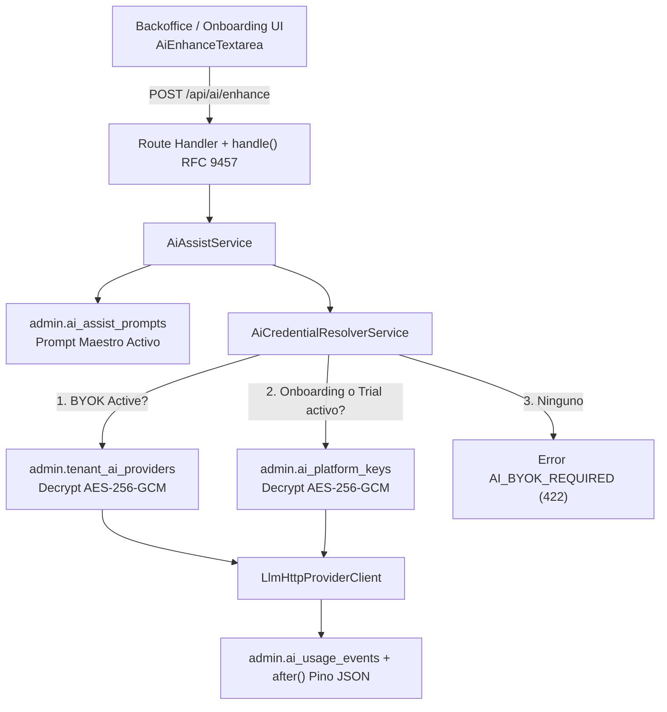

# SPEC-02 · Diseño Técnico: Motor Real de Inferencia AI y BYOK

## 1. Arquitectura de Solución

El diseño reemplaza la simulación en cliente y el handler inyectado con `{}` por un **pipeline único server-side** dentro de `@mocter/domain`, desacoplando:
1. **Resolución de credenciales (`AiCredentialResolverService`):** Decide determinísticamente entre la API Key BYOK del comercio o la API Key de plataforma únicamente si el comercio cursa onboarding o periodo de prueba vigente.
2. **Adaptador multi-proveedor (`LlmHttpProviderClient`):** Implementa `IAiAssistModelClient` consumiendo los endpoints oficiales de OpenAI, Anthropic, Google Gemini, DeepSeek, OpenRouter y Together AI mediante `fetch` tipado con `AbortSignal.timeout`.
3. **Orquestación de asistencia (`AiAssistService`):** Combina `admin.ai_assist_prompts` + guardarraíles globales + límite de tasa + invocación LLM + auditoría en `admin.ai_usage_events`.



---

## 2. Cambios en Base de Datos y Esquema Drizzle

### 2.1 Archivo: `packages/domain/src/db/schemas/admin/bot-tenancy.ts`
- En `tenantAiProviders`:
  - Agregar `lastVerifiedAt: timestamp("last_verified_at", { withTimezone: true })` (con comentario SQL descriptivo).
  - Agregar `lastVerificationError: text("last_verification_error")` (sin almacenar claves ni headers).
- En `aiPlatformKeys`:
  - Verificar columna `defaultModelId` y `monthlyTokenCap` para proteger el consumo durante periodos de prueba.
- En `aiUsageEvents`:
  - Agregar columna opcional `fieldKey: varchar("field_key", { length: 120 })` y `requestId: varchar("request_id", { length: 64 })` para correlación exacta de logs y trazabilidad de qué `textarea` generó consumo.
- Generar migración SQL limpia con `pnpm --filter @mocter/domain db:generate` y validar con `drizzle-kit check`.

### 2.2 Semilla de `ai_assist_fields` y `ai_assist_prompts`
Revisar `packages/domain/src/services/ai-assist-catalog.seed.ts` para asegurar prompts maestros iniciales (`status = 'active'`, en `es`/`en`) para todos los campos cubiertos por esta y las specs dependientes:
- `product.description`
- `product.bot_master_prompt`
- `onboarding.product_description`
- `bot.objective`
- `bot.persona`
- `bot.greeting_message`
- `bot.order_confirmation_message`
- `policy.returns`, `policy.warranty`, `policy.shipping`

---

## 3. Diseño de Servicios en `@mocter/domain`

### 3.1 Cifrado de Llaves (`packages/domain/src/services/secret-crypto.service.ts` o módulo crypto existente)
- Lectura obligatoria de clave maestra vía `env` de `@t3-oss/env-nextjs` (`AI_ENCRYPTION_KEY`, `AI_ENCRYPTION_KEY_ID`).
- Algoritmo: `crypto.createCipheriv("aes-256-gcm", keyBuffer, iv12bytes)`. Formato persistido: `v1:<ivHex>:<authTagHex>:<cipherHex>`.
- Prohibido exponer funciones que retornen `plaintext` fuera del bloque de llamada HTTP al proveedor.

### 3.2 Resolvedor de Credenciales (`packages/domain/src/services/ai-credential-resolver.service.ts` [Nuevo])
```typescript
export interface ResolvedAiCredential {
  source: "byok" | "platform_trial";
  providerCode: AiProviderCode;
  modelCode: string;
  apiKeyPlaintext: string;
  providerId: string;
  modelId: string;
  maxOutputTokensCap: number;
  maxTemperatureCap: number;
}
```
Lógica:
1. Consultar `tenantAiProviders` donde `clientId = input.clientId AND deletedAt IS NULL AND status = 'active'`, unido a `tenantModelSettings`. Si existe, descifrar llave, unir guardarraíles globales y retornar `source: 'byok'`.
2. Si no existe BYOK activo, consultar estado del comercio en `admin.subscriptions` y `admin.onboarding_sessions`:
   - `isTrial = subscription?.status === 'trialing' && subscription.trialEndsAt > now`
   - `isOnboarding = onboardingSession !== null && onboardingSession.completedAt === null`
3. Si `isTrial || isOnboarding`, seleccionar llave activa en `admin.ai_platform_keys`, descifrar y retornar `source: 'platform_trial'`.
4. En caso contrario, retornar `err(BusinessError("AI_BYOK_REQUIRED", ...))`.

### 3.3 Cliente Multi-Proveedor (`packages/domain/src/services/llm-http-provider.client.ts` [Nuevo])
Implementa `IAiAssistModelClient` y método `verifyApiKey(params)`:
- Adapter registry por `providerCode`:
  - `openai` / `deepseek` / `openrouter` / `together_ai`: formato Chat Completions compatible (`/v1/chat/completions`, header `Authorization: Bearer ...`).
  - `anthropic`: `POST https://api.anthropic.com/v1/messages` (`x-api-key`, `anthropic-version`).
  - `google`: endpoint Gemini `generateContent` (`x-goog-api-key`).
- Extrae `inputTokens` y `outputTokens` normalizados; mapea errores HTTP `401`/`403` del proveedor a `AI_KEY_INVALID` y `429` a `AI_PROVIDER_RATE_LIMIT`.

### 3.4 Integración con `AiAssistService` y Route Handler
- Refactorizar `apps/admin/app/api/ai/enhance/route.ts` para instanciar dependencias reales (`DrizzleAiAssistRepository`, `AiCredentialResolverService`, `LlmHttpProviderClient`) usando el wrapper estándar `handle()`.
- Eliminar el chequeo obsoleto `if (!hasByokConfigured && walletBalanceCents <= 0)` delegando el control de acceso completamente a `AiCredentialResolverService`.
- Registrar evento en `admin.ai_usage_events` de forma no bloqueante vía `after()`.

---

## 4. Diseño de Interfaz de Usuario (`apps/admin`)

### 4.1 Componente `<AiEnhanceTextarea />` (`apps/admin/components/ai-enhance-textarea.tsx` o ubicación actual)
- Props: `fieldKey`, `value`, `onChange`, `label`, `contextPayload`, `locale`, `disabled`.
- Flujo de estado: `idle` → `loading` → `preview` (muestra sugerencia resaltada con botones «Aplicar Sugerencia», «Generar Otra Opción», «Descartar») → `error` (alerta inline amigable con link a `/workspace/ai` o pestaña BYOK si error = `AI_BYOK_REQUIRED`).
- Reemplaza directamente el botón simulado en `apps/admin/app/workspace/products/products-view.tsx` y en el asistente de onboarding.

### 4.2 Vista BYOK en Backoffice del Inquilino
- Nueva vista o pestaña dedicada accesible desde la configuración del comercio / menú de perfil y enlace directo desde los mensajes de bloqueo (`apps/admin/app/workspace/ai/page.tsx` [Nuevo] + `ai-settings-view.tsx` [Nuevo]), protegida para `tenancy_owner`.
- Controles en Title Case, Mobile First, modal de confirmación `--dsn-*` para revocar llave existente, cero `window.confirm`.

### 4.3 Validación en `/admin/ai`
- Garantizar en `apps/admin/app/admin/ai/ai-governance-view.tsx` que la pestaña «Proveedores y Modelos LLM» permita administrar la `ai_platform_key` de pruebas de la SaaS y que «Biblioteca de Prompts Maestros» muestre y edite todas las versiones de `ai_assist_prompts`.

---

## 5. Observabilidad, Entorno y Despliegue

- **Variables de entorno en `env.ts` y `.env.example`:**
  - `AI_ENCRYPTION_KEY`: Clave hex/base64 de 32 bytes para cifrado AES-256-GCM de credenciales AI.
  - `AI_ENCRYPTION_KEY_ID`: Identificador de versión de llave activa (ej. `key-v1`).
  - `AI_HTTP_TIMEOUT_MS`: Timeout por defecto en ms (`15000`).
- **Logs Pino:** Evento `ai.enhance.completed` y `ai.byok.verified` con `{ requestId, clientId, fieldKey, mode, providerCode, latencyMs }` y lista de redacción garantizada.

