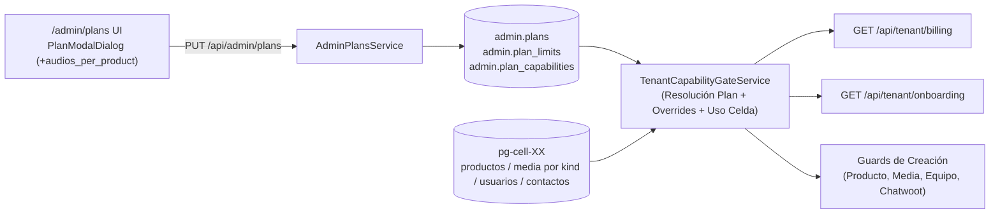

# SPEC-03 · Diseño Técnico: Homologación de Planes, Audios y Entitlements

## 1. Arquitectura y Unificación de Fuentes de Verdad

Se corrige la fragmentación actual donde `TenantWorkspaceService.getWorkspaceBilling()`, `TenantCapabilityGateService` y `TenantProductsAndMediaService` consultaban tablas distintas o fallaban por errores SQL/de propiedad. Todo cálculo de cuota y capacidad converge en un servicio canónico en `@mocter/domain`.



---

## 2. Cambios en Base de Datos (`packages/domain`)

### 2.1 `packages/domain/src/db/schemas/admin/plan-catalogs.ts`
- Agregar `"audios_per_product"` al arreglo/tupla `PLAN_DIMENSION_KEYS`:
  ```typescript
  export const PLAN_DIMENSION_KEYS = [
    "products",
    "images_per_product",
    "videos_per_product",
    "audios_per_product",
    "pdfs_per_product",
    "contacts",
    "tenant_users",
    "storage_bytes",
    "chat_retention_days",
    "chatwoot_agents",
    "chatwoot_inboxes",
    "chatwoot_outbound_emails",
  ] as const;
  ```
- Asegurar etiqueta i18n en semillas / catálogo `admin.plan_dimensions`:
  - `es`: `"Pistas De Audio Por Producto"`
  - `en`: `"Audio Tracks Per Product"`

### 2.2 Migración SQL de Backfill
- Insertar en `admin.plan_dimensions` el registro `audios_per_product`.
- Para todo `plan_id` existente en `admin.plans` que no posea fila en `admin.plan_limits` con `dimension_key = 'audios_per_product'`, insertar valor inicial seguro (`mode = 'LIMITED'`, `limit_value = 0`, editable de inmediato desde `/admin/plans`).

---

## 3. Correcciones Críticas de Servicios en `@mocter/domain`

### 3.1 `packages/domain/src/services/tenant-capability-gate.service.ts`
- Reemplazar las comparaciones temporales en líneas 105–106 (donde se interpolaba `new Date()` directamente en `sql\`...\``) por operadores nativos Drizzle `lte(clientFeatureOverrides.validFrom, now)` y `or(isNull(clientFeatureOverrides.validTo), gt(clientFeatureOverrides.validTo, now))`.
- Aplicar la misma corrección sobre `clientPlanOverrides` y `clientCapabilityOverrides`.
- Exponer `getResolvedLimitsForClient(clientId, planId)` devolviendo mapa completo de las 12 dimensiones (incluyendo `audios_per_product`).

### 3.2 `packages/domain/src/services/tenant-products-and-media.service.ts`
- En `getPlanQuota()` (líneas 275–323):
  - Reemplazar `now` crudo en `sql\`...\`` por helpers Drizzle nativos (`lte`, `gt`, `isNull`) o utilizar directamente `TenantCapabilityGateService.getResolvedLimitsForClient()`.
  - Corregir `limitRow.limitMode` → `limitRow.mode` (nombre real de columna en esquema).
  - Añadir lectura explícita de `maxAudiosPerProduct`.
- En `countProductMediaByKind()` (líneas 335–350):
  - Agregar condición `eq(cellProductMedia.mediaKind, kind)` (o resolver en una sola consulta `GROUP BY media_kind` para retornar `{ image, video, audio, pdf }` de una sola ida a PostgreSQL de la celda).

### 3.3 `packages/domain/src/services/tenant-workspace.service.ts`
- En `getWorkspaceBilling()`:
  - Integrar resultados de `TenantCapabilityGateService.getTenantCapabilities(clientId)`.
  - Consultar uso real en celda (`CellDatabasePoolManager`): conteo de `cellProducts` (`deletedAt IS NULL`), `cellContacts`, `cellTenantUsers` (`status = 'active'`) y `cellClientUsage.storageUsedBytes`.
  - Devolver objeto completo `{ plan, quotas, capabilities }` conforme al contrato §9.1 de `SPEC-03`.

---

## 4. Diseño de Interfaz de Usuario (`apps/admin`)

### 4.1 `/admin/plans` (`apps/admin/app/admin/plans/plan-modal-dialog.tsx`)
- En estado `catalogLimits`, añadir clave `audios_per_product: { mode: "LIMITED", value: 2 }`.
- En `useEffect` de carga por `GET /api/admin/plans?id=...`, hidratar `audios_per_product`.
- En tab `"catalog"`, renderizar el bloque de entrada para **«Pistas De Audio Por Producto»** manteniendo paridad visual exacta con imágenes/videos/PDFs (selector `Limitado`/`Ilimitado` + input numérico).
- En submit (`POST`/`PATCH /api/admin/plans`), incluir `audios_per_product` en `limits`.

### 4.2 `/workspace/billing` (`apps/admin/app/workspace/billing/billing-view.tsx`)
- Consumir `quotas` y `capabilities` reales del nuevo payload de `GET /api/tenant/billing`.
- Renderizar componentes visuales dedicados:
  - `<PlanQuotaProgressCard />`: muestra nombre humanizado, uso actual, tope (o badge «Ilimitado») y barra porcentual con estado de alerta en rojo/ámbar al superar 85%.
  - `<MediaLimitsGrid />`: chips claros con límite por producto para Imágenes, Videos, Audios y PDFs.
  - `<PlanCapabilitiesMatrix />`: agrupación funcional de funcionalidades Chatwoot y Mocter en idioma del usuario (`es`/`en`), prohibido mostrar `code` técnicos o códigos `SPEC-*`.

### 4.3 Exposición en Onboarding y Productos (`ONB-09`)
- Crear subcomponente liviano reutilizable `<CatalogQuotaBanner />` que recibe `{ productsUsed, productsLimit, imagesLimit, videosLimit, audiosLimit, pdfsLimit }` y se monta tanto en el Paso 3 del Onboarding (`apps/admin/app/onboarding/tenant-onboarding-wizard.tsx`) como en la cabecera de creación de producto (`apps/admin/app/workspace/products/products-view.tsx`).

