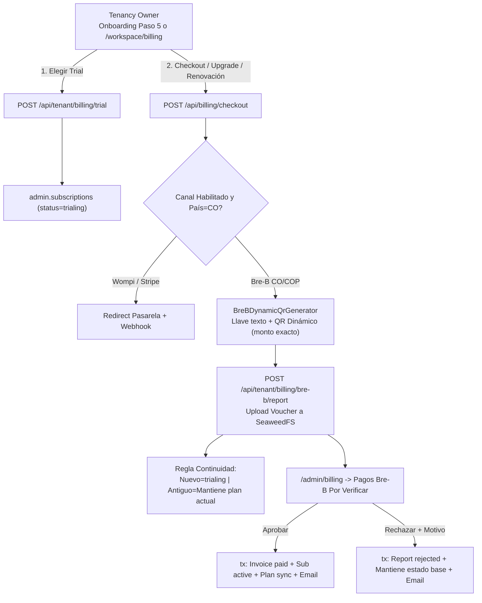

# SPEC-04 · Diseño Técnico: Suscripción SaaS, Bre-B (Colombia), Trial y Upgrade

## 1. Arquitectura de Flujos Financieros SaaS

---

## 2. Cambios en Esquema y Migraciones (`packages/domain`)

1. **`packages/domain/src/db/schemas/admin/plans.ts` (Fase 2 — Precios Duales COP / USD):**
   - Mantener `priceMonthlyCents` y `priceAnnualCents` como los precios canónicos en **COP** para Colombia (`country === 'CO'`).
   - Añadir `priceMonthlyUsdCents` (`price_monthly_usd_cents`) y `priceAnnualUsdCents` (`price_annual_usd_cents`) para almacenar el precio fijo en **USD** aplicable a comercios internacionales (`country !== 'CO'`).
   - Migrar/normalizar planes existentes para que todo plan activo tenga su tarifa en COP y su tarifa en USD correctamente pobladas (evitando que `3000` centavos de USD se interpreten como `$ 30 COP`).
2. **`packages/domain/src/db/schemas/admin/payment-gateways-config.ts`:**
   - Ampliar enum/check de `id` a `wompi | stripe | bre_b`.
   - Agregar campos de configuración no secretos para Bre-B (`supportedCountries`, `breBKeyType`, `breBKeyValue`, `breBRecipientName`) con comentarios `.comment(...)`. Se elimina de la UI y del servicio el uso de `breBQrPayloadTemplate`.
3. **`packages/domain/src/db/schemas/admin/billing.ts`:**
   - Ampliar `gateway` enum a `wompi | stripe | bre_b | trial`.
   - Añadir `pendingUpgradePlanId`, `pendingUpgradeCycle`, `d5ReminderSentAt`, `d0ReminderSentAt` a `admin.subscriptions`.
   - Crear tabla `admin.billing_manual_payment_reports` conforme a §7.3 de `SPEC-04/requirements.md`.

---

## 3. Diseño de Servicios en `@mocter/domain`

### 3.1 `packages/domain/src/services/breb-qr.service.ts`

- **Responsabilidad:** Construir el payload EMVCo/Bre-B interoperable parametrizado con la llave configurada en `admin.payment_gateways_config`, nombre del receptor, código de país `CO`, moneda ISO 4217 `170` (`COP`), **importe exacto en COP** (`amountCop = amountCents / 100`) y referencia única de factura, calculando CRC-16 CCITT y generando SVG/DataURL renderizable.
- **Estructura exacta del Tag `26` (`Merchant Account Information`):**
  - Sub-tag `00`: `"CO.COM.BANREP.BREB"` (GUI de la red Bre-B).
  - Sub-tag `01`: **`safeKey` (`config.breBKeyValue`)** — el valor de la llave Bre-B (ej. `3208292559`), de modo que las aplicaciones bancarias colombianas prellenen directamente el valor de la llave y nunca el string del tipo (`phone`).
- **Eliminación de plantilla manual:** No se procesa `breBQrPayloadTemplate`; el generador aplica siempre la estructura TLV EMVCo estándar.

### 3.2 `packages/domain/src/services/checkout.service.ts`, `billing.service.ts` y `tenant-onboarding.service.ts`

- **Resolución de precio y moneda por país (`resolvePlanPriceForCountry(plan, country, cycle)`):**
  - Si `country === 'CO'`: retorna `{ currency: 'COP', amountCents: cycle === 'annual' ? plan.priceAnnualCents : plan.priceMonthlyCents }`.
  - Si `country !== 'CO'`: retorna `{ currency: 'USD', amountCents: cycle === 'annual' ? plan.priceAnnualUsdCents : plan.priceMonthlyUsdCents }`.
- **`listAvailableChannelsForTenant(country, currency)`:** Lee `admin.payment_gateways_config` donde `isEnabled = true`; para Colombia (`CO` / `COP`) habilita `bre_b` y `wompi`; para internacional (`!= CO` / `USD`) habilita `stripe`.
- **`createCheckoutSession(...)`:** Resuelve autoritativamente el monto desde el plan en base de datos según el país del cliente (`CO` → `COP`, resto → `USD`), ignorando montos manipulados o en otra divisa desde el cliente; crea `admin.invoices` en `issued` y despacha a Wompi, Stripe o `BreBQrService`.
- **Inicio automático de Trial en Onboarding (`completeStep3BotAndActivate`) y auto-provisión defensiva (`getBillingDetails` / `resolveAuthenticatedPortalContext`):**
  - Al finalizar el Paso 3 del Onboarding sin pago activo, se invoca `activateTrialForTenant(client.id, client.planId)` dejando creada la suscripción en `trialing` con `trial_ends_at = NOW() + plan.trial_days`.
  - Si un comercio ya existente con `lifecycleStatus === 'activo'` carece aún de fila en `admin.subscriptions`, se inicializa su fila `trialing` una única vez.
  - **Prohibición de re-trial:** Una vez existe cualquier registro en `admin.subscriptions` para el comercio, `activateTrialForTenant` jamás concede un periodo de prueba adicional.
- **Restricción de acceso por expiración (`PortalContext.isSubscriptionExpiredLocked`):**
  - Cuando la suscripción del comercio está vencida (`status === 'expired'` o `expiresAt <= NOW()`) y **no** existe un reporte Bre-B en `pending_review`, `resolveAuthenticatedPortalContext` marca `subscriptionExpiredLocked = true`.
  - `PortalShellRouter` intercepta cualquier ruta `/workspace/*` distinta de `/workspace/billing` y redirige a `/workspace/billing`.
  - `TenantWorkspaceShell` oculta/bloquea los enlaces del menú distintos de «Mi Plan Y Cuotas» (`/workspace/billing`) para que el comercio solo pueda ejecutar la renovación de su plan.
- **`submitManualBreBReport(...)`:**
  1. Valida archivo voucher (`<= 10 MiB`, MIME permitido `image/png`, `image/jpeg`, `image/webp`, `application/pdf`).
  2. Sube archivo a `S3StorageService` bajo key privada `tenants/${clientId}/billing-vouchers/${invoiceId}-${uuid}.${ext}`.
  3. Verifica que no exista otro reporte `pending_review` para esa factura.
  4. Persiste `admin.billing_manual_payment_reports`.
  5. **Garantiza continuidad:** si el cliente no tiene suscripción activa previa (comercio nuevo), asegura `subscriptions.status = 'trialing'` (respetando `trial_days` del `targetPlanId`); si es comercio antiguo, registra `pending_upgrade_plan_id` sin tocar `admin.clients.plan_id` ni sus cuotas vigentes.
- **`reviewManualBreBReport({ reportId, action, rejectionReason, reviewerUserId })`:**
  - Ejecutado con lock de fila dentro de `db.transaction`.
  - Si `approve`: marca `report.status = 'approved'`, `invoice.status = 'paid'`, inserta registro en `admin.payments` (`gateway: 'bre_b'`), actualiza o promueve `admin.subscriptions` a `active` con nuevo ciclo (`current_period_start`, `current_period_end`), sincroniza `admin.clients.plan_id` e incrementa `quota_version`. Dispara notificación por email vía `after()`.
  - Si `reject`: exige `rejectionReason.trim().length >= 10`, marca `report.status = 'rejected'`, limpia `pending_upgrade_plan_id` manteniendo el plan base intacto, y envía email de rechazo con motivo claro.

### 3.3 `packages/domain/src/services/billing-reminders.service.ts` [Nuevo]

- Consulta suscripciones cuya expiración (`trialEndsAt` o `currentPeriodEnd`) cae en ventana `[D+5 días]` (`d5ReminderSentAt IS NULL`) o `[Hoy D-0]` (`d0ReminderSentAt IS NULL`), encola correos en `admin.email_deliveries` mediante el motor de plantillas (`SPEC-14`) y marca el timestamp idempotente.

---

## 4. Diseño de APIs y UI (`apps/admin`)

- **Remediación `apps/admin/app/api/billing/checkout/route.ts`:** Reemplazar `createCheckoutRouteHandler({} as any)` por fábrica conectada a dependencias reales y envuelta en `handle()`, eliminando `catch (error: any)`.
- **Nuevas rutas API:**
  - `apps/admin/app/api/tenant/billing/trial/route.ts` [Nuevo]
  - `apps/admin/app/api/tenant/billing/bre-b/report/route.ts` [Nuevo]
  - `apps/admin/app/api/admin/billing/manual-reports/route.ts` [Nuevo]
  - `apps/admin/app/api/admin/billing/manual-reports/[id]/review/route.ts` [Nuevo]
  - `apps/admin/app/api/admin/billing/manual-reports/[id]/voucher/route.ts` [Nuevo — streaming autorizado]
- **Actualización UI Backoffice SaaS (`apps/admin/app/admin/billing/`):**
  - `gateways-config-form.tsx`: extender de `"wompi" | "stripe"` a incluir tarjeta Bre-B con switches uniformes para los 3 canales y campos específicos Bre-B en Title Case.
  - `billing-tabs-view.tsx` + nuevo componente `manual-breb-reports-table.tsx` [Nuevo] usando tabla con paginación/filtros/ordenamiento y modal `--dsn-*` para revisar comprobante, aprobar o ingresar motivo de rechazo.
- **Actualización UI Inquilino (`apps/admin/app/workspace/billing/billing-view.tsx` + Paso 5 en Onboarding):**
  - Selector de planes para upgrade/cambio de ciclo, selector de canal activo, tarjeta QR dinámico + llave Bre-B + cargador de comprobante y estado visual «Pago En Verificación Manual».
  - Banner global de aviso `<= 5 días` en `tenant-workspace-shell.tsx` con enlace directo a `/workspace/billing`.
