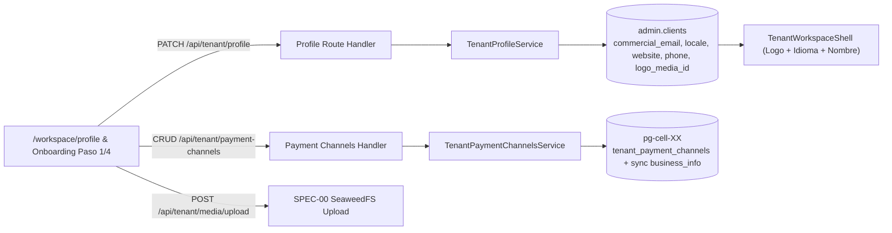

# SPEC-05 · Diseño Técnico: Perfil del Negocio, Idioma y Canales de Pago

## 1. Arquitectura y Relación entre Plano de Control y Celda

---

## 2. Esquema Drizzle y Migraciones

1. **`packages/domain/src/db/schemas/admin/clients.ts`:**
   - Agregar `commercialEmail: varchar("commercial_email", { length: 255 })` con `.comment("Correo electrónico comercial público visible para clientes del inquilino")`.
2. **`packages/domain/src/db/schemas/tenant/orders.ts`:**
   - Definir `cellTenantPaymentChannels` (`tenant_payment_channels`) con:
     - `id`, `clientId`, `channelCode`, `displayName`, `accountIdentifier`, `accountHolderName`, `instructions`, `isActive`, `sortOrder`, `createdAt`, `updatedAt`.
     - Índice compuesto `(client_id, is_active, sort_order)` para lecturas rápidas desde Bot y Pedidos.
     - Política RLS estándar de celda usando `app.current_client_id`.
3. Generar migración tanto para esquema control (`drizzle/`) como para plantilla/migración de celdas (`packages/domain/src/services/cell-migration.service.ts` o carpeta SQL de celdas).

---

## 3. Servicios en `@mocter/domain`

### 3.1 `packages/domain/src/services/tenant-profile.service.ts` [Nuevo]
- **`getTenantProfile(clientId)`:** Combina fila `admin.clients` + URL resuelta del logo en `admin.media_catalog` vía `ImgproxyService` (`SPEC-00`) + información resumida de `cell_client_business_info`.
- **`updateTenantProfile(clientId, actorRole, input)`:**
  - Verifica `actorRole === 'tenant_owner' || actorRole === 'platform_*'`.
  - Valida `commercialEmail`, `websiteUrl`, `phone`, `locale` (`'es'|'en'`).
  - Actualiza `admin.clients` y, si cambia `displayName` o `locale`, actualiza metadatos relacionados de sesión/caché del workspace y registra auditoría en `admin.audit_log`.

### 3.2 `packages/domain/src/services/tenant-payment-channels.service.ts` [Nuevo]
- **`listChannels(clientId)`:** Retorna canales ordenados por `sortOrder, createdAt`.
- **`upsertChannel(clientId, actorRole, payload)`:** Crea o edita canal y sincroniza lista de nombres activos en `cell_client_business_info.payment_methods`.
- **`deleteOrDeactivateChannel(clientId, actorRole, channelId)`:**
  - Verifica si `cell_orders` contiene filas que referencien ese `channel_id` o `channel_code` del cliente; si existe historial, retorna `err(ConflictError("CHANNEL_USED_IN_ORDERS"))` para forzar desactivación lógica; de lo contrario elimina físicamente.

---

## 4. Interfaz de Usuario y Navegación (`apps/admin`)

- **`apps/admin/components/tenant-workspace-shell.tsx`:** Añadir ítem «Perfil Del Negocio» (`/workspace/profile`) en la navegación del comercio (visible para `tenancy_owner`, lectura limitada o oculta edición para agentes según permiso).
- **`apps/admin/app/workspace/profile/page.tsx` [Nuevo] + `profile-view.tsx` [Nuevo]:**
  - Server Component carga perfil inicial y lista de canales usando `resolveAuthenticatedPortalContext`.
  - Client Component dividido en 4 secciones claras Mobile First con formularios validados en cliente + servidor, botones explícitos de guardado por bloque o formulario con indicador de cambios sin guardar (`SPEC-17` compatible), carga de logo con drag/drop liviano y preview, y modal `--dsn-*` para gestión de canales de pago.
- **Diccionarios i18n (`es`/`en`):** Todas las claves bajo `workspace.profile.*` y `workspace.paymentChannels.*`.

