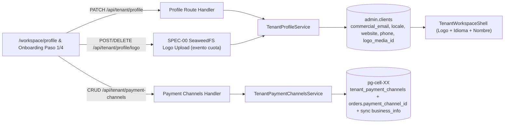

# SPEC-05 · Diseño Técnico: Perfil del Negocio, Idioma y Canales de Pago

## 1. Arquitectura y Relación entre Plano de Control y Celda

---

## 2. Esquema Drizzle y Migraciones

1. **`packages/domain/src/db/schemas/admin/clients.ts`:**
   - Agregar `commercialEmail: text("commercial_email")` con `.comment(...)` o documentación SQL e invariante lowercase opcional (`commercial_email IS NULL OR commercial_email = lower(commercial_email)`).
2. **`packages/domain/src/db/schemas/tenant/orders.ts`:**
   - Definir `cellTenantPaymentChannels` (`admin.tenant_payment_channels`) con:
     - `id`, `clientId`, `channelCode`, `displayName`, `accountIdentifier`, `accountHolderName`, `instructions`, `isActive`, `sortOrder`, `createdAt`, `updatedAt`, `createdBy`, `updatedBy`.
     - Llave primaria compuesta `(client_id, id)` e índice compuesto `(client_id, is_active, sort_order)` para lecturas rápidas desde Bot y Pedidos.
     - Política RLS estándar de celda (`ENABLE` + `FORCE ROW LEVEL SECURITY`) usando `app.current_client_id`.
   - Agregar columna nullable `paymentChannelId: uuid("payment_channel_id")` en `cellOrders` (`admin.orders`) para trazabilidad directa con `tenant_payment_channels` en pedidos nuevos.
3. Generar migración tanto para esquema control (`packages/domain/drizzle/`) como para migración de celdas (`packages/domain/drizzle-cell/` + `meta/_journal.json`).

---

## 3. Servicios en `@mocter/domain`

### 3.1 `packages/domain/src/services/tenant-profile.service.ts` [Nuevo]
- **`getTenantProfile(clientId)`:** Lee fila `admin.clients` + URL resuelta del logo en `admin.media_catalog` vía `buildImgproxyUrl` (`SPEC-00`) + fallback `clientBrandings.logoUrl` + información resumida de `cell_client_business_info`.
- **`updateTenantProfile(clientId, actorRole, input, actorContext?)`:**
  - Verifica `actorRole` en `['tenant_owner', 'tenancy_owner', 'platform_owner', 'platform_admin']`.
  - Rechaza edición de `slug` (solo lectura post-onboarding).
  - Valida `commercialEmail` (normalizado a lowercase), `contactEmail`, `websiteUrl`, `phone`, `locale` (`'es'|'en'`).
  - Actualiza `admin.clients` y registra entrada en `admin.audit_log`.
- **`uploadTenantLogo(clientId, actorRole, file, actorContext?)` y `removeTenantLogo(clientId, actorRole, actorContext?)`:**
  - Valida `validateMediaMagicBytes` permitiendo únicamente raster (`image/png`, `image/jpeg`, `image/webp`) hasta `5 MiB` (prohíbe SVG por seguridad XSS).
  - Sube a SeaweedFS S3 bajo prefijo `logos/{clientId}/{hash}.{ext}`, inserta/actualiza `admin.media_catalog`, pre-firma con `buildImgproxyUrl` y actualiza `admin.clients.logo_media_id` **sin registrar consumo en `cell_client_usage` (`storage_bytes`)** para que todos los planes operen sin bloqueo.

### 3.2 `packages/domain/src/services/tenant-payment-channels.service.ts` [Nuevo]
- **`listChannels(clientId)`:** Retorna canales ordenados por `sortOrder ASC, createdAt ASC`.
- **`upsertChannel(clientId, actorRole, payload)` / `toggleChannelActive(...)`:** Crea o edita canal (validando que no se capturen secretos prohibidos como CVV/contraseñas), garantiza RLS con `withTenantCellTransaction` y sincroniza la lista de nombres activos (`displayName`) en `cell_client_business_info.payment_methods`.
- **`deleteChannel(clientId, actorRole, channelId)`:**
  - Verifica si `admin.orders` contiene filas que referencien `payment_channel_id = channelId` o coincidencia case-insensitive del snapshot `payment_method` con `channel_code` o `display_name`; si existe historial, retorna `err(..., "CHANNEL_USED_IN_ORDERS")` (`409 Conflict`) sugiriendo desactivar; de lo contrario elimina físicamente y re-sincroniza `cell_client_business_info.payment_methods`.

---

## 4. Interfaz de Usuario y Navegación (`apps/admin`)

- **`apps/admin/components/portal-shell-router.tsx` y `session-context.service.ts`:** Propagar `logoUrl` resuelto del comercio hacia `TenantWorkspaceShell` para actualizar en tiempo real el encabezado tras subir/quitar el logotipo.
- **`apps/admin/components/tenant-workspace-shell.tsx`:** Añadir ítem «Perfil Del Negocio» (`/workspace/profile`) en la navegación del comercio visible solo para `tenant_owner` (`tenancy_owner`) y oculto para `tenant_agent`.
- **`apps/admin/app/workspace/profile/page.tsx` [Nuevo] + `profile-view.tsx` [Nuevo]:**
  - Server Component carga perfil inicial y lista de canales usando `resolveAuthenticatedPortalContext`. En acceso directo por URL de `tenant_agent`, pasa `readOnly={true}`.
  - Client Component dividido en 4 secciones claras Mobile First con botones de guardado, carga/eliminación de logo con modal de confirmación `--dsn-*`, slug en solo lectura, selector de idioma (`es`/`en` con `router.refresh()`), redes sociales y CRUD de canales de pago con modal `--dsn-*`.
- **Diccionarios i18n (`es`/`en`):** Claves bajo `workspace.profile*` y `workspace.paymentChannels*`.

