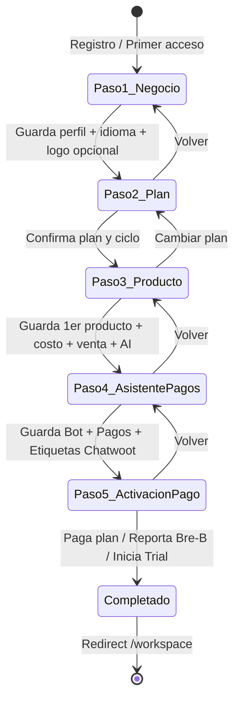

# SPEC-06 · Diseño Técnico: Onboarding Unificado en 5 Pasos

## 1. Máquina de Estados del Asistente



---

## 2. Esquema y Contratos (`packages/domain`)

### 2.1 `packages/domain/src/db/schemas/admin/chatwoot-media-onboarding.ts`
- Actualizar valores válidos de `currentStep` a `"business" | "plan" | "product" | "assistant_payments" | "billing" | "completed"`.
- Conservar campo `draftPayload` `JSONB` con tipo exportado `OnboardingDraftPayloadV2`.

### 2.2 `packages/domain/src/services/tenant-onboarding.service.ts`
- **`mapLegacyStep(rawStep)`:** Convierte `'bot_channel'` heredado → `'assistant_payments'` y valida pasos 1..5.
- **Métodos granulares:**
  - `saveBusinessStep(clientId, data)` → actualiza `admin.clients` + borrador.
  - `savePlanStep(clientId, planId, cycle)` → valida plan activo público y guarda preselección en `draft` + `clients.planId`.
  - `saveFirstProductStep(clientId, data)` → valida `costPriceCents >= 0`, `salePriceCents > 0`, calcula y registra utilidad esperada en borrador, prepara alta de producto en celda (o actualiza el borrador del primer producto).
  - `saveAssistantAndPaymentsStep(clientId, data)` → persiste en `admin.tenant_bots` (usando `SPEC-10`), `tenant_payment_channels` (`SPEC-05`) y ejecuta `ensureDefaultChatwootLabels(clientId)` sobre `cell_tenant_labels` + `chatwoot_accounts`.
  - `completeOnboardingStep(clientId, billingChoice)` → ejecuta finalización transaccional delegando en `SPEC-04` (`activateTrialForTenant` o verificación de pago/reporte Bre-B), crea el primer producto definitivo en `pg-cell-XX` si no se había materializado aún, marca `completedAt` y retorna URL `/workspace`.

### 2.3 Utilidad compartida de cálculo de margen (`packages/domain/src/utils/pricing-margin.ts` [Nuevo])
```typescript
export function calculateProductProfitability(costCents: number, salePriceCents: number) {
  const profitCents = salePriceCents - costCents;
  const marginPct = salePriceCents > 0 ? Math.round((profitCents / salePriceCents) * 10000) / 100 : 0;
  const markupPct = costCents > 0 ? Math.round((profitCents / costCents) * 10000) / 100 : null;
  return { profitCents, marginPct, markupPct, isNegative: profitCents < 0 };
}
```
Reutilizada tanto en frontend (Paso 3 y formulario de productos `SPEC-08`) como en validación server-side para evitar divergencias de redondeo.

---

## 3. Diseño de Interfaz (`apps/admin/app/onboarding/`)

- **`apps/admin/app/onboarding/layout.tsx` y cabecera de wizard:** Reutilizar el componente de marca Mocter usado en login/registro para garantizar idéntica tipografía, logotipo y proporciones (`ONB-01`).
- **Modularización de los 5 pasos (evitando archivo monolítico de +800 líneas en `tenant-onboarding-wizard.tsx`):**
  - `apps/admin/app/onboarding/steps/step-business.tsx` [Nuevo]
  - `apps/admin/app/onboarding/steps/step-plan.tsx` [Nuevo]
  - `apps/admin/app/onboarding/steps/step-product.tsx` [Nuevo] (incluye `<CatalogQuotaBanner />` de `SPEC-03`, `<AiEnhanceTextarea />` de `SPEC-02` y cálculo en vivo de utilidad)
  - `apps/admin/app/onboarding/steps/step-assistant-payments.tsx` [Nuevo] (consume presets/objetivos de `SPEC-10` y selector/edición rápida de `SPEC-05`)
  - `apps/admin/app/onboarding/steps/step-billing.tsx` [Nuevo] (envuelve `<BillingCheckoutPanel />` de `SPEC-04`)
- **Indicador de pasos:** Mobile First (`Paso X De 5` + barra horizontal), labels en Title Case, i18n `es`/`en` con cambio reactivo si el usuario alterna el idioma en el Paso 1.

