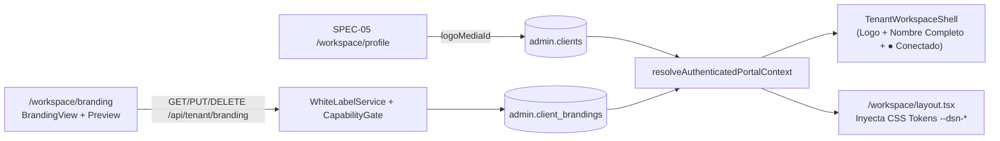

# SPEC-07 · Diseño Técnico: Shell del Inquilino y Marca Blanca

## 1. Arquitectura de Identidad Visual en Shell y Workspace

---

## 2. Cambios en `@mocter/domain`

1. **`packages/domain/src/services/session-context.service.ts`:**
   - Asegurar que `resolveAuthenticatedPortalContext` devuelva:
     - `tenantInfo.name`: nombre completo sin recortes.
     - `tenantInfo.logoUrl`: resuelto prioritariamente desde `client_brandings.logo_url` o `clients.logo_media_id` vía `ImgproxyService` (`SPEC-00`).
     - `tenantInfo.connectionHealthy`: booleano derivado de salud real de la sesión/celda (sin exponer `cellCode` en UI).
     - `branding`: configuración activa (`whiteLabelMode`, `brandName`, `faviconUrl`, `customFont`, `removeMocterBranding`, `palette`) y `brandingTokens` (variables `--dsn-accent`, `--dsn-accent-hover`, `--dsn-accent-fg`) cuando el modo efectivo es `'paleta'` o `'completa'`.
2. **`packages/domain/src/services/white-label.service.ts` y `tenant-capability-gate.service.ts`:**
   - Implementar `DrizzleWhiteLabelRepository` resolviendo `WhiteLabelCapabilityMode` (`none` | `paleta` | `completa`) en orden: override vigente en `admin.client_feature_overrides` → valor de plan en `admin.plan_feature_values` (`feature_key = 'white_label'`).
   - Sincronizar la capacidad derivada `custom_branding: mode !== 'none'` en `DrizzleTenantCapabilityGateRepository.getTenantCapabilities`.
   - Mantener `BrandingPaletteTokens` (`primary`, `primaryForeground`, `accent`, `accentForeground`, opcionales `background`, `foreground`, `card`, `cardForeground`) y agregar validación de formato FQDN sin puertos en `customDomain` y unicidad global en `admin.client_brandings`.
   - Soportar lectura y actualización del selector `white_label` (`none | paleta | completa`) en el catálogo de planes SaaS (`admin-dashboard.service.ts` + semilla de `admin.plan_features`).

---

## 3. Cambios en UI y Endpoints (`apps/admin`)

1. **`apps/admin/components/tenant-workspace-shell.tsx`:**
   - Reemplazar bloque del logo/título superior izquierdo (`bar móvil`, `drawer móvil` y `sidebar desktop`):
     - Mostrar `` con `onError` fallback seguro al icono predeterminado sin marca técnica.
     - Eliminar `truncate max-w-[120px]` / `truncate max-w-[130px]`; usar `break-words leading-snug text-sm font-semibold` (hasta 2 líneas en barra/sidebar, tooltip accesible cuando supera 40 caracteres) para desplegar el nombre comercial íntegro.
     - Renderizar debajo del nombre el indicador `span` con punto verde (`h-2 w-2 rounded-full bg-emerald-400`) + etiqueta localizada `Conectado` / `Connected`.
     - Mantener oculta la opción «Identidad y Marca Blanca» en la barra lateral cuando `custom_branding === false` (`D-SPEC-07-04`).
2. **`apps/admin/app/admin/plans/plan-modal-dialog.tsx` y `/api/admin/plans`:**
   - Incorporar selector `Nivel de Marca Blanca` (`none` | `paleta` | `completa`) al crear/editar planes SaaS (`D-SPEC-07-01`).
3. **`apps/admin/app/api/tenant/branding/route.ts` [Nuevo] y `/api/tenant/branding/asset/route.ts` [Nuevo]:**
   - `/api/tenant/branding`: `GET`, `PUT`, `DELETE` envueltos en `handle()` RFC 9457, exigiendo `tenancy_owner` (`tenant_owner`) para mutaciones.
   - `/api/tenant/branding/asset`: `POST` multipart para carga directa de Favicon (`PNG`/`ICO`/`SVG`) y Logotipo en SeaweedFS/imgproxy (`D-SPEC-07-03`), sincronizando `clients.logo_media_id` en perfil cuando aplica.
4. **`apps/admin/app/workspace/layout.tsx`, `branding/page.tsx` y `branding/branding-view.tsx` [Nuevo]:**
   - `layout.tsx` inyecta únicamente tokens seguros de acento (`--dsn-accent`, `--dsn-accent-hover`, `--dsn-accent-fg`) respetando el modo Claro/Oscuro (`D-SPEC-07-02`).
   - `branding/page.tsx` evalúa `WhiteLabelCapabilityMode` efectivo: si `'none'`, muestra estado educativo con CTA a `/workspace/billing` y acceso directo al logo básico en `/workspace/profile`; si `'paleta'` o `'completa'`, monta `BrandingView` Mobile First con medidor WCAG 2.2 AA en tiempo real, panel de vista previa con paleta completa, subida de favicon/logo (`completa`) y modal de confirmación `--dsn-*` para «Restaurar Marca Por Defecto».

