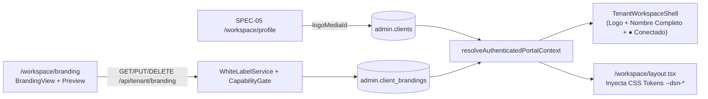

# SPEC-07 · Diseño Técnico: Shell del Inquilino y Marca Blanca

## 1. Arquitectura de Identidad Visual en Shell y Workspace

---

## 2. Cambios en `@mocter/domain`

1. **`packages/domain/src/services/session-context.service.ts`:**
   - Asegurar que `resolveAuthenticatedPortalContext` devuelva:
     - `tenantInfo.name`: nombre completo sin recortes.
     - `tenantInfo.logoUrl`: resuelto prioritariamente desde `client_brandings.logo_url` o `clients.logo_media_id` vía `ImgproxyService` (`SPEC-00`).
     - `tenantInfo.connectionHealthy`: booleano derivado de salud real de la sesión/celda (sin exponer `cellCode` en UI).
     - `brandingTokens`: objeto validado para CSS variables cuando `capabilityMode !== 'none'`.
2. **`packages/domain/src/services/white-label.service.ts`:**
   - Completar implementación del repositorio Drizzle (`DrizzleWhiteLabelRepository` [Nuevo o en `repositories/`]) leyendo `clientCapabilityOverrides` / `planCapabilities` desde `TenantCapabilityGateService` para determinar `'none' | 'paleta' | 'completa'`.
   - Agregar validación de formato FQDN sin puertos en `customDomain` y unicidad en `admin.client_brandings`.

---

## 3. Cambios en UI y Endpoints (`apps/admin`)

1. **`apps/admin/components/tenant-workspace-shell.tsx`:**
   - Reemplazar bloque del logo/título superior izquierdo (`sidebar` desktop + `drawer` móvil):
     - Mostrar `` con `onError` fallback seguro al icono predeterminado Mocter.
     - Eliminar `truncate max-w-[120px]`; usar `break-words leading-snug text-sm font-semibold` para desplegar el nombre comercial íntegro.
     - Renderizar debajo el indicador `span` con punto verde (`h-2 w-2 rounded-full bg-emerald-500`) + etiqueta localizada `t("shell.connection.connected")` («Conectado» / «Connected»).
2. **`apps/admin/app/api/tenant/branding/route.ts` [Nuevo]:**
   - `GET`, `PUT`, `DELETE` envueltos en `handle()` RFC 9457, exigiendo `tenancy_owner` para mutaciones.
3. **`apps/admin/app/workspace/branding/page.tsx` y `branding-view.tsx` [Nuevo]:**
   - Server Component evalúa `capabilityMode`.
   - Si `'none'`, muestra estado educativo con CTA a `/workspace/billing` y acceso a logo básico en `/workspace/profile`.
   - Si `'paleta'` o `'completa'`, monta editor interactivo Mobile First con medidor WCAG AA en tiempo real (`WhiteLabelService.validateContrast`), tarjeta de vista previa y modal de confirmación `--dsn-*` para «Restaurar Marca Por Defecto».

