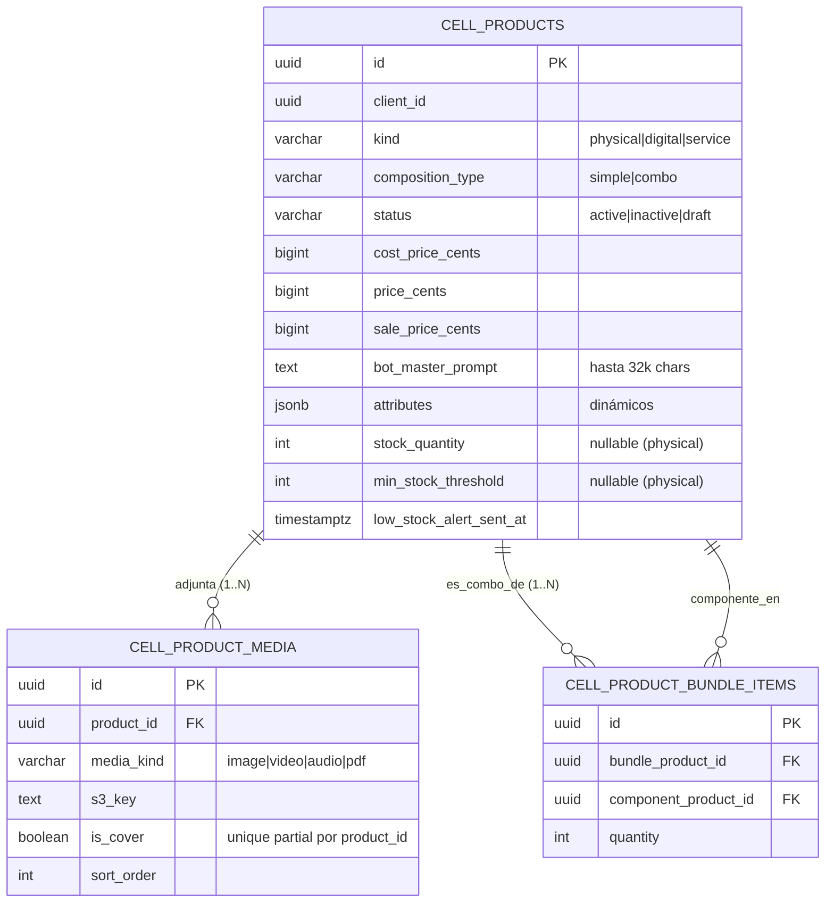

# SPEC-08 · Diseño Técnico: Catálogo Completo de Productos, Multimedia, Combos y Stock

## 1. Diagrama de Entidades y Flujo en Celda (`pg-cell-XX`)

---

## 2. Esquema Drizzle y Migración de Celda

### 2.1 `packages/domain/src/db/schemas/tenant/tenancy-catalog.ts`
- **`cellProducts`:** Añadir `costPriceCents`, `compositionType`, `stockQuantity`, `minStockThreshold`, `lowStockAlertSentAt`, `deletedAt`, asegurar `botMasterPrompt` mapeado sobre `text("bot_master_prompt")` (migrando o manteniendo compatibilidad con columna `prompt` existente).
- **`cellProductMedia`:** Añadir `isCover: boolean("is_cover").notNull().default(false)` + índice único parcial `WHERE is_cover = true` sobre `product_id`.
- **`cellProductBundleItems`:** Nueva tabla vinculando `bundleProductId` → `componentProductId` con restricción `client_id` y RLS.

---

## 3. Diseño de Servicios en `@mocter/domain`

### 3.1 `packages/domain/src/services/tenant-products-and-media.service.ts`
- **`getProductDetail(clientId, productId)`:** Retorna ficha + `profitability` (`calculateProductProfitability`) + lista ordenada de `media` agrupada por tipo con `resolvedUrl` / `thumbUrl` (vía `ImgproxyService`) + componentes de combo con stock actual de cada hijo.
- **`createProduct` / `updateProduct`:**
  - Si `compositionType === 'combo'`: valida que cada componente pertenezca al mismo `clientId`, sea `'simple'` y no exista referencia circular.
  - Si `kind !== 'physical'`: fuerza `stockQuantity = null`, `minStockThreshold = null`, `lowStockAlertSentAt = null`.
  - Si `kind === 'physical'`: evalúa `checkAndTriggerLowStockAlert(product)`.
- **`setProductMediaCover(clientId, productId, mediaId)`:** Verifica `mediaKind === 'image'`, ejecuta `UPDATE cell_product_media SET is_cover = (id = mediaId) WHERE product_id = productId AND client_id = clientId`.
- **`deleteProductMedia(clientId, productId, mediaId)`:** Ejecuta borrado en BD + decrementa `cell_client_usage` + borra objeto de SeaweedFS (`S3StorageService`); si `deleted.isCover === true`, busca la primera imagen restante y la promueve a portada.
- **`evaluateLowStockAfterStockMutation(clientId, productId)`:** Llamado tanto desde actualización de producto como desde descuento de inventario al confirmar pedido (`SPEC-11`). Si `stockQuantity <= minStockThreshold` y `lowStockAlertSentAt IS NULL`, encola correo usando `NotificationsService` (`SPEC-14` evento `'tenant.inventory.low_stock'`) vía `after()` y marca `lowStockAlertSentAt = NOW()`. Si `stockQuantity > minStockThreshold`, limpia `lowStockAlertSentAt = null`.

---

## 4. Diseño de Interfaz de Usuario (`apps/admin/app/workspace/products/`)

Modularización recomendada para mantener componentes limpios y legibles:
- `products-view.tsx`: Tabla paginada/ordenable/filtrable con vista móvil de tarjetas, acciones rápidas (**Ver**, **Editar**, **Inactivar/Activar**, **Eliminar**) y modales `--dsn-*` para inactivar/eliminar.
- `product-detail-modal.tsx` [Nuevo]: Modal de lectura completa («Ver Producto») con galería multimedia (imágenes + reproductor HTML5 `<video>` y `<audio>` + descarga PDF), atributos dinámicos, combo, márgenes y prompt maestro legible.
- `product-form-modal.tsx` [Nuevo]: Formulario por pestañas claras (`General y Costos`, `Stock`, `Atributos y Combo`, `Multimedia y Portada`, `Prompt Maestro AI`) reutilizando `<AiEnhanceTextarea />` (`SPEC-02`) y `<CatalogQuotaBanner />` (`SPEC-03`).
- Plantilla guía en la pestaña «Prompt Maestro Del Bot» con botón **«Insertar Estructura Recomendada»** (prellena esqueleto en español/inglés siguiendo mejores prácticas: Rol del asesor sobre el producto, Puntos diferenciales, Manejo de objeciones, Variantes/combos disponibles, Reglas de venta y cierre) listo para enriquecer con «Mejorar Con AI».

