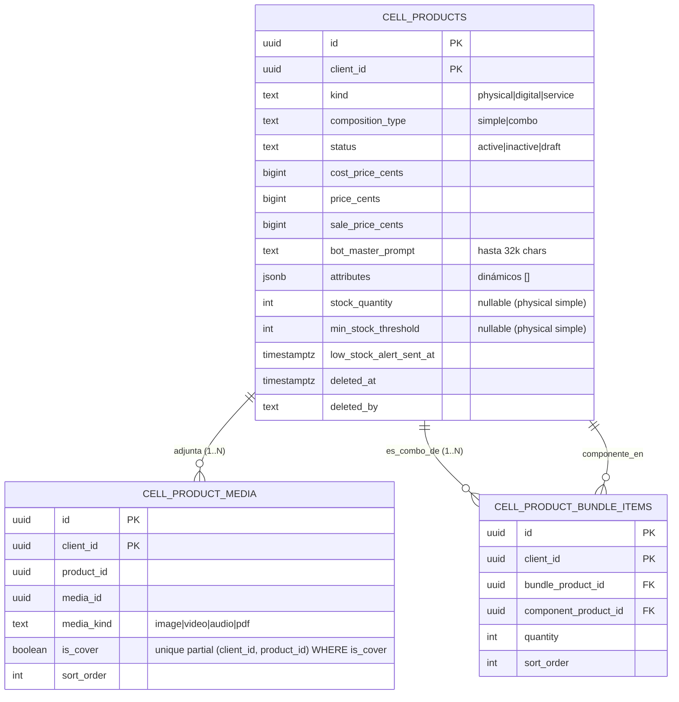

# SPEC-08 · Diseño Técnico: Catálogo Completo de Productos, Multimedia, Combos y Stock

## 1. Diagrama de Entidades y Flujo en Celda (`pg-cell-XX`)

---

## 2. Esquema Drizzle y Migración de Celda

### 2.1 `packages/domain/src/db/schemas/tenant/tenancy-catalog.ts`
- **`cellProducts`:** Conserva PK compuesta `(client_id, id)`; ajusta `costPriceCents` (`NOT NULL DEFAULT 0` coalesciendo nulos previos), agrega `compositionType` (`'simple' | 'combo'`), `botMasterPrompt` (`TEXT NOT NULL DEFAULT ''`, copiando `prompt` previo en migración y manteniendo espejo temporal), `stockQuantity`, `minStockThreshold`, `lowStockAlertSentAt`, cambia CHECK `status` a `('active', 'inactive', 'draft')` migrando `'published' → 'active'` y `'archived' → 'inactive'`, y normaliza default de `attributes` a `'[]'::jsonb`.
- **`cellProductMedia`:** Agrega `mediaKind` (`'image' | 'video' | 'audio' | 'pdf'`, `NOT NULL DEFAULT 'image'`), `isCover: boolean("is_cover").notNull().default(false)`, CHECK `NOT is_cover OR media_kind = 'image'`, e índice único parcial `product_media_one_cover_per_product` `WHERE is_cover = true` sobre `(client_id, product_id)`.
- **`cellProductBundleItems`:** Nueva tabla vinculando `(client_id, bundle_product_id)` → `admin.products(client_id, id)` (`ON DELETE CASCADE`) y `(client_id, component_product_id)` → `admin.products(client_id, id)` (`ON DELETE RESTRICT`), índice único `(client_id, bundle_product_id, component_product_id)`, `FORCE ROW LEVEL SECURITY` (`app.current_client_id`), grants a `mocter_migrator`/`mocter_admin`, auditoría completa y comentarios SQL.

---

## 3. Diseño de Servicios en `@mocter/domain` y Entrega Segura

### 3.1 `packages/domain/src/services/tenant-products-and-media.service.ts` (Autoridad Única) + `tenant-products-catalog.helpers.ts`
- Consolida CRUD paginado (`listCatalog`/`listProducts` formato `SPEC-17`), ficha detalle (`getProductDetail`), creación/actualización (`createProduct`, `updateProduct`), cambio de estado (`updateProductStatus`), eliminación segura (`softDeleteProduct` verificando `tenant_owner` en API y bloqueo `PRODUCT_USED_IN_COMBO`), subida e ingestión multimodal (`uploadAndAttachProductMedia` integrando `S3StorageService` + deduplicación `media_catalog`/`cell_client_media` + cuotas `*_per_product` y `storage_bytes`), `setProductMediaCover`, `deleteProductMedia`, `resolveTenantMediaStreamSource` y `evaluateLowStockAfterStockMutation`. Los tipos DTO, cálculos de rentabilidad/stock y normalización de atributos/estados se modularizan en `packages/domain/src/services/tenant-products-catalog.helpers.ts` y la firma de imágenes en `packages/domain/src/utils/imgproxy.ts`.
- **`TenantWorkspaceService` (`SPEC-06`):** Conserva wrappers delegados/compatibles para dashboard, onboarding y límites, actualizando `TenantOnboardingService` para emitir `status: 'active'`.
- **Combos (`D-03`):** Validación no-cíclica (solo hijos `composition_type = 'simple'` del mismo `client_id`), stock calculado dinámicamente en lectura `min(floor(comp.stock_quantity / qty))` sobre componentes físicos activos (ilimitado si solo digital/servicio), advertencia cuando algún hijo pasa a `inactive`, y sugerencia de costo en formulario sumando `(cost ?? price) * qty`.
- **Magic bytes y entrega privada (`D-04`):** `packages/domain/src/utils/media-magic-bytes.ts` amplía detección a `JPEG/PNG/WebP/AVIF` (rechazando `SVG` y `GIF`), `MP4/WebM/MOV`, `MP3/OGG/WAV/M4A` y `PDF`. Las imágenes se sirven por `imgproxy`; `video`, `audio` y `pdf` (más fallback original) se sirven desde `GET /api/tenant/media/[mediaId]` autenticado leyendo `S3StorageService.getObjectStream` con HTTP `Range` (`206`) y `Content-Disposition: inline`.
- **Alerta stock mínimo y AI seed (`D-02`, `D-05`):** Registra `"tenant.inventory.low_stock"` en `notifications-and-leads.service.ts` (`es`/`en`), disparado por `after()` hacia `clients.commercial_email ?? clients.contact_email` cuando `min_stock_threshold > 0`, `stock_quantity <= min_stock_threshold` y `low_stock_alert_sent_at IS NULL`; resetea `low_stock_alert_sent_at` únicamente cuando `stock_quantity > min_stock_threshold`. Amplía `ai-assist-catalog.seed.ts` (`product.bot_master_prompt` `outputRules.maxLength = 4000`, límite DB/Zod `32,000`).

---

## 4. Diseño de Interfaz de Usuario (`apps/admin/app/workspace/products/`) y API

- **`apps/admin/app/api/tenant/products/*` (`_shared.ts`, `route.ts`, `[id]/route.ts`, `[id]/status/route.ts`, `[id]/media/[mediaId]/route.ts`, `[id]/media/[mediaId]/cover/route.ts`) y `/api/tenant/media/*` (`upload/route.ts`, `[mediaId]/route.ts`):** Todas envueltas en `handle()` RFC 9457 (`@/lib/errors/route`), validando sesión vía `resolveTenantSession`, exigiendo `tenant_owner` en `DELETE` (`403` para `tenant_agent`), paginación `SPEC-17` y auditoría con Pino `appLogger` + `after()`.
- `products-view.tsx` + `product-ui-helpers.ts`: Tabla paginada/ordenable/filtrable Mobile First con `<CatalogQuotaBanner />`, resumen de stock (y badge «Stock Bajo» / advertencia combo con componente inactivo), acciones (**Ver Detalle**, **Editar**, **Multimedia**, **Inactivar/Activar**, **Eliminar** oculto para `tenant_agent`) y `<ConfirmationModal />` `--dsn-*`.
- `product-detail-modal.tsx` [Nuevo]: Modal de lectura completa («Ver Producto») con galería multimedia (imágenes vía `imgproxy` marcando portada + reproductor HTML5 `<video>` y `<audio>` + descarga/apertura PDF vía `/api/tenant/media/[mediaId]`), atributos dinámicos, combo con stock calculado, márgenes (`calculateProductProfitability`) y prompt maestro legible.
- `product-form-modal.tsx` [Nuevo]: Formulario por pestañas claras (`General y Precios`, `Stock Físico`, `Atributos y Combo`, `Multimedia`, `Prompt Maestro`) reutilizando `<AiEnhanceTextarea />` (`SPEC-02`) y límites de cuotas de `WorkspaceBillingDto` (`SPEC-03`), con pre-cálculo editable de costo en combos.
- Plantilla guía en la pestaña del Prompt Maestro con botón **«Insertar Estructura Recomendada»** (`buildRecommendedProductPromptTemplate` en `product-ui-helpers.ts`, esqueleto bilingüe `es`/`en` siguiendo mejores prácticas) lista para enriquecer con «Mejorar con AI».

