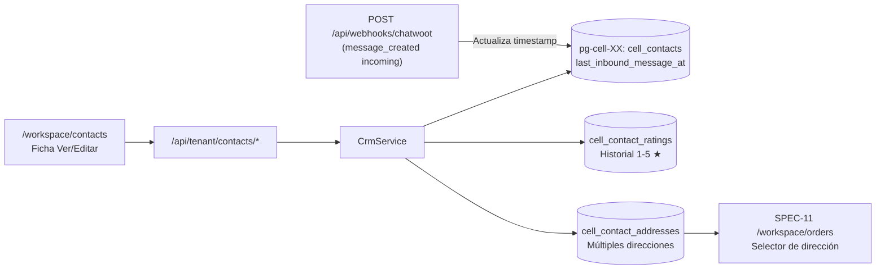

# SPEC-09 · Diseño Técnico: CRM Avanzado, Ventana 24h, Direcciones y Calificación

## 1. Arquitectura de Datos e Integración Chatwoot → CRM

---

## 2. Esquema Drizzle en Celda (`packages/domain/src/db/schemas/tenant/crm.ts`)

1. **`cellContacts`:** Añadir `phoneSecondary`, `companyName`, `birthDate`, `currentRatingStars`, `currentRatingComment`, `lastInboundMessageAt`, `convertedToCustomerAt`, `deletedAt`.
2. **`cellContactRatings`:** Nueva tabla con FK a `cellContacts`, `stars` (`1..5`), `comment`, `ratedByUserId`, `ratedByName`, `createdAt`, `clientId` + RLS.
3. **`cellContactAddresses`:** Nueva tabla con FK a `cellContacts`, `label`, `country`, `state`, `city`, `addressLine`, `neighborhood`, `postalCode`, `referenceNotes`, `isDefault`, `clientId` + RLS + índice único parcial `WHERE is_default = true`.

---

## 3. Lógica de Dominio y Webhooks (`packages/domain`)

### 3.1 Helper puro `computeWhatsappWindow(lastInboundMessageAt, now)`
- `24 * 60 * 60` segundos de ventana.
- Retorna `{ status: "active" | "expired" | "none", expiresAt: string | null, remainingSeconds: number }`.
- Reutilizable en backend (filtros y DTOs) y cliente (renderizado de badge regresivo sin desfase).

### 3.2 Extensión de `CrmService` (`packages/domain/src/services/crm.service.ts`)
- **`rateContact(clientId, contactId, actor, { stars, comment })`:** Transacción que inserta en `cell_contact_ratings` y actualiza `current_rating_stars` / `current_rating_comment` en `cell_contacts`.
- **`upsertContactAddress` / `setDefaultAddress` / `deleteContactAddress`:** Garantiza invariante de una sola `is_default = true` cuando hay `>= 1` direcciones y sincroniza dirección principal con `cell_contacts`.
- **`updateStage(clientId, contactId, stage, actor)`:** Registra transición y si `stage === 'customer'` y `convertedToCustomerAt IS NULL`, fija timestamp de conversión.

### 3.3 Hook en `apps/admin/app/api/webhooks/chatwoot/route.ts`
- Cuando el evento corresponde a mensaje entrante del cliente (`event === 'message_created' && payload.message_type === 'incoming'`), localizar contacto en celda por `chatwootContactId` o teléfono y actualizar `last_inbound_message_at = eventTimestamp`.

---

## 4. Interfaz de Usuario (`apps/admin/app/workspace/contacts/`)

- `contacts-view.tsx`: Tabla paginada, con filtros por etapa, ventana WhatsApp (`Activa` / `Expirada`) y estrellas mínimas; botón «Nuevo Prospecto / Contacto».
- `contact-detail-modal.tsx` [Nuevo]: Modal de 4 pestañas (**Datos Generales**, **Direcciones**, **Calificación**, **Atención Y Consentimiento**) en Title Case, Mobile First, sin jerga interna y modales `--dsn-*` para borrado lógico de contacto/dirección.

