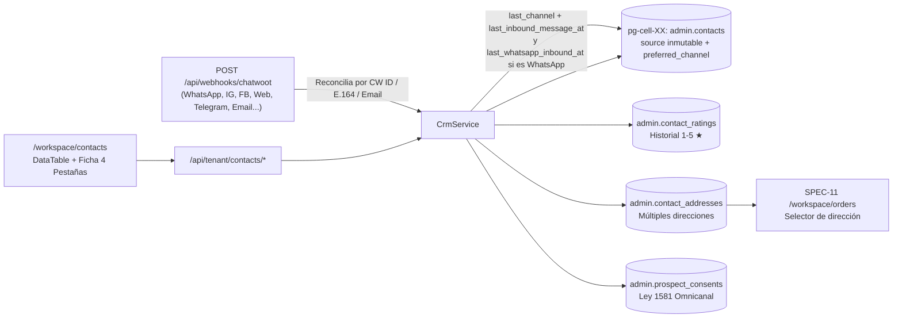

# SPEC-09 · Diseño Técnico: CRM Omnicanal, Prioridad WhatsApp, Ventana 24h, Direcciones y Calificación

## 1. Arquitectura de Datos e Integración Omnicanal Chatwoot → CRM

---

## 2. Esquema Drizzle en Celda (`packages/domain/src/db/schemas/tenant/crm.ts`)

1. **`cellContacts` (`admin.contacts`):**
   - Mantener columnas existentes (`phoneLandline`, `source`, `channel`, `deletedAt`, `deletedBy`, etc.).
   - Añadir: `phoneSecondary` (`text`), `companyName` (`text`), `birthDate` (`date`), `preferredChannel` (`text`), `lastChannel` (`text`), `lastInboundMessageAt` (`timestamp with time zone`), `lastWhatsappInboundAt` (`timestamp with time zone`), `currentRatingStars` (`smallint`), `currentRatingComment` (`text`), `convertedToCustomerAt` (`timestamp with time zone`).
   - Ampliar check `contacts_source_check` para cubrir: `'whatsapp'`, `'instagram'`, `'facebook'`, `'web'`, `'telegram'`, `'email'`, `'sms'`, `'manual'`, `'referral'`, `'import'`, `'api'`, `'other'`.
   - Añadir check `contacts_current_rating_stars_check`: `current_rating_stars IS NULL OR (current_rating_stars >= 1 AND current_rating_stars <= 5)`.
   - Índices de apoyo: `contacts_client_last_wa_inbound_idx` y `contacts_client_last_inbound_idx`.
2. **`cellContactRatings` (`admin.contact_ratings`):**
   - PK compuesta `(clientId, id)`, FK compuesta `(clientId, contactId)` → `admin.contacts(clientId, id)` `ON DELETE CASCADE`, `stars` (`smallint`, `1..5`), `comment` (`text`), `ratedByUserId` (`uuid`), `ratedByName` (`text`), `...auditColumns()`, RLS `app.current_client_id`.
3. **`cellContactAddresses` (`admin.contact_addresses`):**
   - PK compuesta `(clientId, id)`, FK compuesta `(clientId, contactId)` → `admin.contacts(clientId, id)` `ON DELETE CASCADE`, `label`, `country`, `state`, `city`, `addressLine`, `neighborhood`, `postalCode`, `referenceNotes`, `isDefault`, `...auditColumns()`, RLS `app.current_client_id`, índice único parcial `(clientId, contactId) WHERE is_default = true`.

---

## 3. Lógica de Dominio y Webhooks (`packages/domain`)

### 3.1 Helpers puros omnicanal y ventana WhatsApp
- **`computeWhatsappWindow(lastWhatsappInboundAt, now)`:**
  - Usa ventana estricta de `24 * 60 * 60` segundos sobre `lastWhatsappInboundAt` (nunca sobre otros canales).
  - Retorna `{ status: "active" | "expired" | "none", expiresAt: string | null, remainingSeconds: number }`.
- **`normalizeChatwootChannel(rawChannelType)`:**
  - Mapea tipos de inbox de Chatwoot (`Channel::Whatsapp`, `Channel::TwilioSms`, `Channel::Instagram`, `Channel::FacebookPage`, `Channel::WebWidget`, `Channel::TelegramProfile`/`Channel::Telegram`, `Channel::Email`, `Channel::Sms`, `Channel::Api`, `Channel::Line`, o códigos planos) hacia `{ source, channel, isWhatsapp }`.

### 3.2 Extensión de `CrmService` y unificación de contactos en celda (`packages/domain`)
- **`createProspect` / creación manual desde API:**
  - Valida nombre, al menos un canal de contacto (`email`, `phoneMobile`, `phoneSecondary` o `phoneLandline`), E.164 en móvil, fecha de cumpleaños no futura, cuota `contacts` (`SPEC-03`) y duplicidad activa en el comercio (`phoneMobile`, `email`, o `(documentType, documentNumber)` → error `CONFLICT`).
  - Asigna `source` seleccionado (default `'manual'`), `preferredChannel` (default `'whatsapp'` si hay `phoneMobile` o `source === 'whatsapp'`), `stage` inicial válido y, si se incluye dirección inicial, la crea automáticamente con `is_default = true` y sincroniza campos planos en `contacts`.
- **`ingestFromChatwoot` (reconciliación omnicanal):**
  - Busca contacto activo por `chatwootContactId`.
  - Si no existe, busca contacto activo único por `phoneMobile` E.164; si no hay coincidencia o no viene teléfono, busca contacto activo único por `email` (minúsculas).
  - Si encuentra coincidencia única, enlaza `chatwootContactId` (si estaba nulo), conserva `source` original, asigna `preferredChannel = 'whatsapp'` si estaba nulo y llega móvil o WhatsApp, y actualiza `lastChannel`, `lastSeenAt`, y (cuando es evento de mensaje entrante) `lastInboundMessageAt` + `lastWhatsappInboundAt` (solo si `isWhatsapp === true`).
  - Si no encuentra coincidencia, crea contacto nuevo asignando `source` y `lastChannel` reales del canal entrante (nunca hardcodeando `'whatsapp'` para Instagram/Web/etc.), validando cuota `contacts`.
- **`rateContact(clientId, contactId, actor, { stars, comment })`:**
  - Transacción que inserta en `admin.contact_ratings` y actualiza `current_rating_stars` / `current_rating_comment` en `admin.contacts`.
- **`upsertContactAddress` / `setDefaultAddress` / `deleteContactAddress`:**
  - Garantiza invariante de única `is_default = true` cuando hay `>= 1` direcciones (promoviendo automáticamente la siguiente al eliminar la predeterminada) y sincroniza dirección principal con `admin.contacts`.
- **`updateStage(clientId, contactId, stage, actor, notes?)`:**
  - Registra transición y si `stage === 'customer'` y `convertedToCustomerAt IS NULL`, fija timestamp de conversión.
- **`recordConsent` / `revokeConsent`:**
  - Expone otorgamiento y revocación manual Ley 1581 sobre `admin.prospect_consents` desde la ficha del contacto sin inventar aceptaciones por defecto.

### 3.3 Hook en `apps/admin/app/api/webhooks/chatwoot/route.ts`
- Soporta payloads reales de Chatwoot (`event`, `message_type` string `'incoming'` o numérico `0`, `inbox.channel_type`, `conversation.channel`, `created_at` del mensaje, `sender` / `meta.sender`).
- Normaliza canal omnicanal y delega a `CrmService.ingestFromChatwoot` informando si se trata de mensaje entrante para refrescar `last_inbound_message_at` y `last_whatsapp_inbound_at` (solo WhatsApp).

---

## 4. Interfaz de Usuario (`apps/admin/app/workspace/contacts/`)

- `contacts-view.tsx`:
  - Usa `<DataTable />` (`SPEC-17`) con paginación controlada, búsqueda, filtros por etapa, fuente de origen, canal, ventana WhatsApp (`active` / `expired` / `none`) y estrellas mínimas.
  - Ordenamiento por **Prioridad WhatsApp** activo por defecto (ventana WhatsApp 24h activa / canal WhatsApp primero, alternable con ordenamiento por último mensaje entrante, creación, calificación o nombre).
  - Botón «Nuevo Contacto» con selector de fuente de origen, canal preferido, datos ampliados y dirección inicial opcional.
  - Acceso rápido **Abrir Conversación** hacia `/workspace/conversations` (respetando `AGENTS.md §4.10`).
  - Eliminación lógica con `<ConfirmationModal />` (`--dsn-*`, exclusivo `tenancy_owner`).
- `contact-detail-modal.tsx` [Nuevo]:
  - Modal de 4 pestañas (**Datos Generales**, **Direcciones De Envío**, **Calificación E Historial**, **Atención Y Consentimiento**) en Title Case, Mobile First, i18n `es`/`en` y cero jerga interna.
