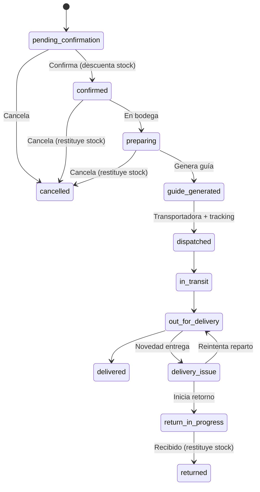

# SPEC-11 · Diseño Técnico: Pedidos Completo, 12 Estados Dropi/Effi, Guías y Repetir Pedido

## 1. Máquina de Estados Homologada y Flujo Logístico

---

## 2. Esquema y Migración de Celda (`packages/domain/src/db/schemas/tenant/orders.ts`)

1. **`cellOrders`:** Ampliar enum de `status` a los 12 valores homologados (`ORDER_STATUS_LIST`); añadir `contactAddressId`, `paymentChannelId`, `stockDeducted`, `guideGeneratedAt`, `cancellationReason`, `issueNotes`, `repeatedFromOrderId`.
2. **`cellOrderItems`:** Añadir `selectedAttributes` (`JSONB`) y `unitCostCents` (`BIGINT`).
3. **Migración de datos existentes:** `UPDATE cell_orders SET status = 'pending_confirmation' WHERE status = 'registered'; UPDATE cell_orders SET status = 'dispatched' WHERE status = 'shipped';`.

---

## 3. Servicios en `@mocter/domain` (`packages/domain/src/services/orders.service.ts`)

- **Matriz `ALLOWED_ORDER_TRANSITIONS`:** Mapa explícito `Record<OrderStatus, OrderStatus[]>` utilizado tanto para validación server-side como para enviar `allowedNextStatuses` a la UI.
- **`updateOrderDetails(clientId, orderId, payload)`:** Bloquea con `ORDER_LOCKED_AFTER_DISPATCH` si `status` ya está en etapa logística `>= dispatched`; recalcula totales si cambian ítems o flete y ajusta diferencia de stock si ya estaba `confirmed`.
- **`transitionOrderStatus(...)`:** Dentro de `db.transaction`: valida transición, exige `carrierName` + `trackingCode` para `dispatched`, gestiona `stock_deducted` idempotente (apoyándose en `TenantProductsAndMediaService.evaluateLowStockAfterStockMutation` para disparar alerta `PRD-08` vía `after()`), inserta `cell_order_events` y notifica cambio relevante.
- **`repeatOrder(clientId, orderId)`:** Carga orden base, consulta precios y estado actuales de sus productos, descarta inactivos/eliminados devolviéndolos en `skippedItems` y prepara payload actualizado para alta limpia.
- **`OrderGuideRendererService` [Nuevo]:** Genera plantilla HTML/CSS limpia `@page` (tamaño `10x15cm` o `Letter`) y/o PDF liviano con datos del remitente (`clients`), QR de verificación SVG inline, datos del destinatario y tabla de ítems, sin exponer rutas internas.

---

## 4. Interfaz y APIs (`apps/admin`)

- **Rutas API:**
  - `apps/admin/app/api/tenant/orders/route.ts`
  - `apps/admin/app/api/tenant/orders/[id]/route.ts` (`GET`, `PUT`, `PATCH` con `handle()` RFC 9457)
  - `apps/admin/app/api/tenant/orders/[id]/repeat/route.ts` [Nuevo]
  - `apps/admin/app/api/tenant/orders/[id]/guide/route.ts` [Nuevo]
- **UI Modular (`apps/admin/app/workspace/orders/`):**
  - `orders-view.tsx`: Tabla paginada con filtros por estado, transportadora, fechas y búsqueda.
  - `order-detail-modal.tsx` [Nuevo]: Ver completo + timeline + acciones Guía / Repetir Pedido / Avanzar Estado.
  - `order-form-modal.tsx` [Nuevo]: Crear / Editar (o prellenado por Repetir Pedido) con selector CRM de direcciones (`SPEC-09`), atributos (`SPEC-08`) y canales de pago (`SPEC-05`).
  - Modal `--dsn-*` para transición de estado / cancelación con validación condicional de guía o motivo.

