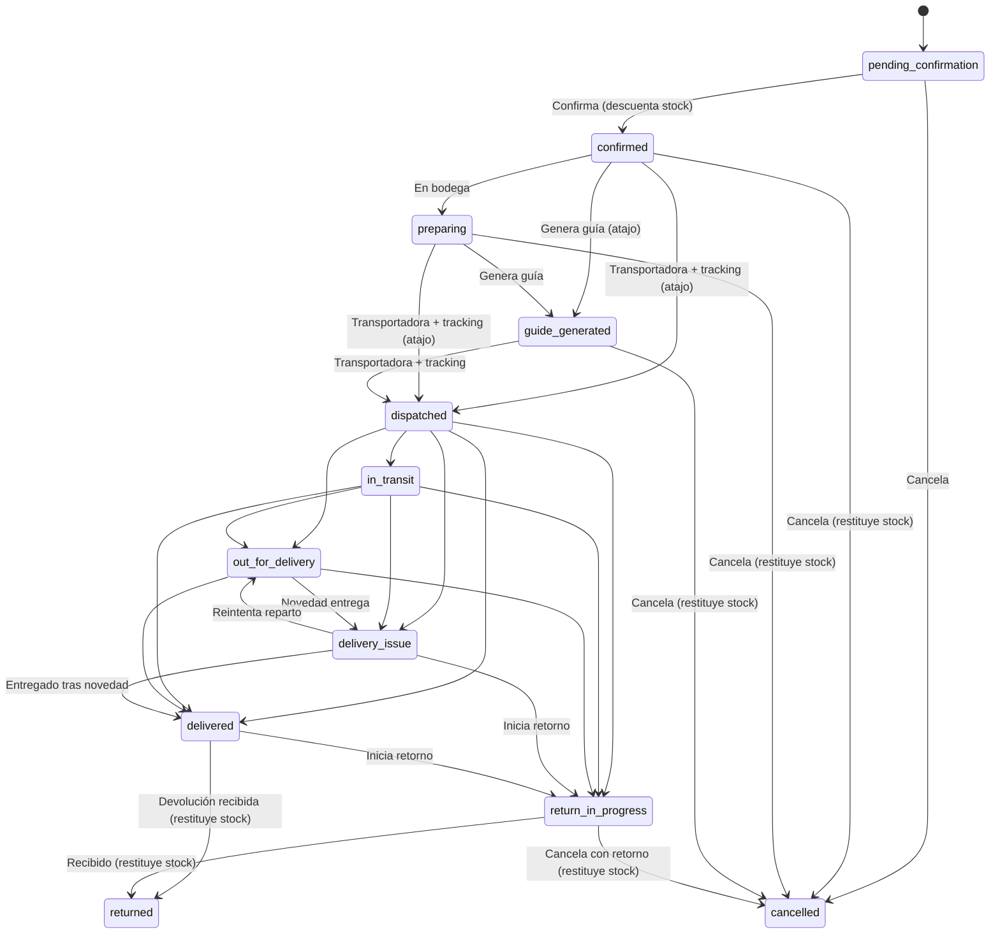

# SPEC-11 · Diseño Técnico: Pedidos Completo, 12 Estados Dropi/Effi, Guías y Repetir Pedido

## 1. Máquina de Estados Homologada y Flujo Logístico (Grafo Flexible Operativo)

---

## 2. Esquema y Migración de Celda (`packages/domain/src/db/schemas/tenant/orders.ts`)

1. **`cellOrders`:** Ampliar check/enum de `status` a los 12 valores homologados (`ORDER_STATUS_LIST`) y default `'pending_confirmation'`; conservar `prospectId` (`prospect_id` con FK compuesta opcional `(client_id, prospect_id) -> admin.contacts(client_id, id)` `ON DELETE SET NULL`, exponiendo alias `contactId` en API/DTOs); añadir `contactAddressId`, `stockDeducted` (`boolean NOT NULL DEFAULT false`), `guideGeneratedAt`, `cancellationReason`, `issueNotes`, `repeatedFromOrderId`, `externalErpSystem`, `externalErpReference`. Actualizar índice parcial `orders_cw_conversation_active_unique` a `status IN ('pending_confirmation', 'confirmed', 'preparing', 'guide_generated')`.
2. **`cellOrderItems`:** Añadir `selectedAttributes` (`JSONB` nullable) y `unitCostCents` (`BIGINT NOT NULL DEFAULT 0`).
3. **Migración de datos existentes:** `UPDATE admin.orders SET status = 'pending_confirmation' WHERE status = 'registered'; UPDATE admin.orders SET status = 'dispatched' WHERE status = 'shipped';`.

---

## 3. Servicios en `@mocter/domain` (`packages/domain/src/services/orders.service.ts`)

- **Matriz `ALLOWED_ORDER_TRANSITIONS`:** Mapa explícito `Record<OrderStatus, OrderStatus[]>` utilizado tanto para validación server-side como para enviar `allowedNextStatuses` a la UI.
- **Unificación `TenantWorkspaceService` → `OrdersService` (`TenantOrdersService`):** El backoffice (`/api/tenant/orders*` y `/workspace/orders`) y el bot (`BotOrderCaptureService`) comparten la misma instancia de negocio `OrdersService` + `DrizzleOrdersRepository` con resolución automática de celda (`cellDatabasePoolManager.resolveCellIdForClient`), eliminando SQL duplicado en `TenantWorkspaceService`.
- **`updateOrderDetails(clientId, orderId, payload)`:** Bloquea con `ORDER_LOCKED_AFTER_DISPATCH` (`422`) si `status` ya está en etapa logística `>= dispatched` (`dispatched`, `in_transit`, `out_for_delivery`, `delivered`, `return_in_progress`, `returned`, `cancelled`); recalcula totales si cambian ítems o flete y ajusta el delta neto de inventario físico si `stockDeducted = true`.
- **`transitionStatus(...)` / inventario atómico:** Dentro de `db.transaction` con `SELECT ... FOR UPDATE`: valida transición, exige `carrierName`/`carrierId` + `trackingCode` para `dispatched`, exige rol `tenant_owner` y confirmación de reembolso para cancelar pedidos con `paymentStatus === 'paid'`, gestiona `stock_deducted` idempotente (estricto solo en `kind === 'physical'` + `availability === 'in_stock'` y componentes de `combo`; `preorder`/`backorder` acotan a piso `0`; digitales/servicios e ítems sin `productId` no descuentan), dispara `TenantProductsAndMediaService.evaluateLowStockAfterStockMutation` vía `after()`, inserta `cell_order_events` y ejecuta `OrderNotificationHook` (renderizando plantilla `SPEC-10` con log estructurado sin bloquear la transacción).
- **`repeatOrder(clientId, orderId, options)`:** Carga orden base, consulta precios y estado actuales de sus productos, descarta inactivos/eliminados devolviéndolos en `skippedItems[]` (`warnings[]`) y prepara payload actualizado (o crea inmediatamente si `confirmImmediately: true`) con `repeatedFromOrderId = orderId`.
- **`OrderGuideRendererService` [Nuevo]:** Reutiliza el codificador puro ISO/IEC 18004 (`buildQrMatrix` / `renderQrMatrixToSvg`) para generar:
  - `format=html`: plantilla HTML/CSS limpia `@page` (`100mm 150mm` o `letter`) con QR SVG inline.
  - `format=pdf`: generador binario PDF 1.4 puro en TypeScript (`application/pdf`) sin dependencias externas con dibujo vectorial del QR, datos del remitente (`clients`), destinatario, contraentrega/pagado y tabla de ítems.

---

## 4. Interfaz y APIs (`apps/admin`)

- **Rutas API:**
  - `apps/admin/app/api/tenant/orders/route.ts`
  - `apps/admin/app/api/tenant/orders/[id]/route.ts` (`GET`, `PUT`, `PATCH` con `handle()` RFC 9457)
  - `apps/admin/app/api/tenant/orders/[id]/repeat/route.ts` [Nuevo]
  - `apps/admin/app/api/tenant/orders/[id]/guide/route.ts` [Nuevo]
- **UI Modular (`apps/admin/app/workspace/orders/`):**
  - `orders-view.tsx`: Tabla paginada con filtros por estado, transportadora, fechas y búsqueda.
  - `order-detail-modal.tsx` [Nuevo]: Ver completo + timeline + acciones Guía / Repetir Pedido / Avanzar Estado.
  - `order-form-modal.tsx` [Nuevo]: Crear / Editar (o prellenado por Repetir Pedido) con selector CRM de direcciones (`SPEC-09`), atributos (`SPEC-08`) y canales de pago (`SPEC-05`).
  - Modal `--dsn-*` para transición de estado / cancelación con validación condicional de guía o motivo.

