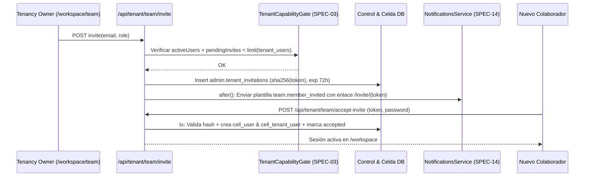

# SPEC-12 · Diseño Técnico: Gestión Completa del Equipo del Comercio

## 1. Flujo de Invitación, Aceptación y Control de Cuotas

---

## 2. Esquema y Servicios (`packages/domain`)

1. **`packages/domain/src/db/schemas/admin/chatwoot-media-onboarding.ts`:** Añadir `displayName` a `tenantInvitations` si no existía y verificar índice único parcial en `(clientId, email) WHERE status = 'pending'`.
2. **`packages/domain/src/db/schemas/tenant/tenancy-catalog.ts`:** Añadir `chatwootAgentId` opcional a `cellTenantUsers`.
3. **`packages/domain/src/services/tenant-contacts-and-users.service.ts`:**
   - `listTeamAndInvitations(clientId)` retornando cuota combinada (`activeUsers`, `pendingInvitations`, `limit`).
   - `inviteTeamMember(...)`: valida cuota `SPEC-03`, unicidad `1:0..1` (`ADM-001 D-15`), genera token 32 bytes hex + `sha256`, dispara correo vía `SPEC-14` (`after()`).
   - `resendInvitation` / `revokeInvitation`.
   - `acceptInvitation(token, { displayName, password })`: verifica expiración y hash en transacción, crea usuario con `Argon2`/`scrypt` estándar de `AuthService`, inserta en `cell_users` + `cell_tenant_users` y programa creación opcional de agente Chatwoot si tiene permiso.
   - `updateMemberRoleOrStatus(clientId, memberId, ...)` con guarda `LAST_OWNER_CANNOT_BE_REMOVED` y revocación inmediata de `session_tokens` al pasar a `suspended` o `left`.

---

## 3. UI y Endpoints (`apps/admin`)

- Nuevos Route Handlers bajo `apps/admin/app/api/tenant/team/` usando `handle()` RFC 9457.
- Nueva vista pública de aceptación `apps/admin/app/invite/[token]/page.tsx` [Nuevo] con branding Mocter, validación de contraseña y estado de token expirado claro.
- Actualización integral de `apps/admin/app/workspace/team/team-view.tsx` con dos pestañas (Miembros / Invitaciones), barra de cuota, formulario de invitación y modales `--dsn-*` para suspender/reactivar/retirar/revocar.

