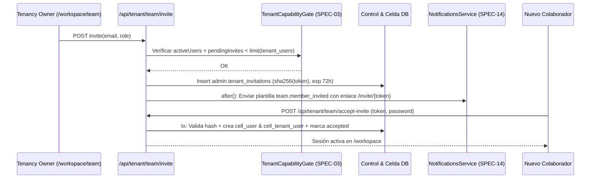

# SPEC-12 · Diseño Técnico: Gestión Completa del Equipo del Comercio

## 1. Flujo de Invitación, Aceptación y Control de Cuotas

---

## 2. Esquema y Servicios (`packages/domain`)

1. **`packages/domain/src/db/schemas/admin/chatwoot-media-onboarding.ts`:** Añadir `displayName` y `grantChatwootAccess` (boolean, default `true`) a `tenantInvitations`, y añadir índice único parcial en `(clientId, email) WHERE status = 'pending'` (`tenant_invitations_client_email_pending_unique`), manteniendo `role = 'tenant_agent'` (`ADM-001 D-31`).
2. **`packages/domain/src/db/schemas/tenant/tenancy-catalog.ts`:** Añadir `grantChatwootAccess` (boolean, default `true`) y `chatwootAgentId` (integer nullable) a `cellTenantUsers`, manteniendo `tenant_users_one_owner`.
3. **`packages/domain/src/services/notifications-and-leads.service.ts`:** Registrar evento `team.member_invited` en `CANONICAL_EMAIL_EVENTS` con plantillas bilingües `es`/`en` publicadas por defecto (`SPEC-14`).
4. **`packages/domain/src/services/chatwoot-provisioning.service.ts`:** Añadir método `removeMemberUserFromAccount` en `IChatwootPlatformGateway` / `ChatwootHttpPlatformGateway` (`DELETE /platform/api/v1/accounts/{account_id}/account_users`).
5. **`packages/domain/src/services/tenant-contacts-and-users.service.ts`:**
   - `listTeamAndInvitations(clientId, options)`: retorna miembros (`active`/`suspended`) enriquecidos desde `admin.users` y `admin.sessions` (último acceso), invitaciones (solo owner) y cuota combinada (`tenant_users` + `chatwoot_agents`).
   - `issueInvitation(...)`: valida rol `tenant_agent`, cuota combinada `tenant_users` y `chatwoot_agents` (`SPEC-03`), unicidad `1:0..1` (`ADM-001 D-15`), expiración automática de filas vencidas, genera token 32 bytes hex + `sha256` con TTL `72h`, y prepara payload para `SPEC-14`.
   - `resendInvitation` (vigentes y expiradas, revalidando cuotas si estaba expirada) / `revokeInvitation`.
   - `getInvitationPublicPreview(rawToken)` y `acceptInvitation({ rawToken, displayName?, password?, currentPassword?, authenticatedUserId? })`: verifica expiración y hash; si el correo es nuevo crea identidad `admin.users` (email verificado) + `cell_users` (`Argon2id` de `hashPassword`) + `cell_tenant_users` + sesión; si el correo ya existe en `admin.users` con `activeClientId = null`, exige contraseña actual o sesión activa coincidente, promueve/reactiva en celda y vincula membresía.
   - `updateMemberProfile(...)`: actualiza `displayName` y/o `grantChatwootAccess` (validando cuota `chatwoot_agents` al activar); protege al `tenant_owner`.
   - `updateMemberStatus(...)` / `removeMember(...)`: impide suspender/retirar al `tenant_owner`, valida cuota `tenant_users` y `chatwoot_agents` al reactivar (`suspended -> active`), revoca sesiones activas vía `authService.revokeUserSessions`, limpia `activeClientId` y deshabilita `cell_users` en `left`, y retorna metadata para sincronización/remoción Chatwoot en `after()`.
6. **`packages/domain/src/services/session-context.service.ts`:** Ordenar consulta de `cellTenantUsers` por `desc(cellTenantUsers.joinedAt)` para que membresías previas `left` nunca sombreen una re-invitación `active` reciente, y rechazar acceso si `status !== 'active'`.

---

## 3. UI y Endpoints (`apps/admin`)

- **`apps/admin/proxy.ts`:** Eximir `/invite` y `/api/tenant/team/accept-invite` del redireccionamiento a login cuando no existe cookie de sesión.
- **`apps/admin/app/api/auth/chatwoot/embed/route.ts`:** Verificar `grantChatwootAccess === true` en `cell_tenant_users` para colaboradores `tenant_agent` (manteniendo intacta la rama `scope=admin` de `SPEC-13`).
- Nuevos Route Handlers bajo `apps/admin/app/api/tenant/team/` usando `handle()` RFC 9457, Zod, RBAC estricto (`tenant_owner` en mutaciones) y `after()` para email `SPEC-14` + sync Chatwoot.
- Nueva vista pública de aceptación `apps/admin/app/invite/[token]/page.tsx` + formulario cliente con branding Mocter, flujo diferenciado para cuenta nueva vs cuenta existente, validación de contraseña y estado de token expirado/inválido claro (`es`/`en`).
- Actualización integral de `apps/admin/app/workspace/team/team-view.tsx` con dos pestañas (Miembros Del Equipo / Invitaciones Pendientes), barra de cuota (`tenant_users` y `chatwoot_agents`), búsqueda/filtros/paginación (`SPEC-17`), formulario de invitación/edición y modales `--dsn-*` (`ConfirmationModal`) para suspender/reactivar/retirar/revocar, más vista solo lectura para `tenant_agent`.

