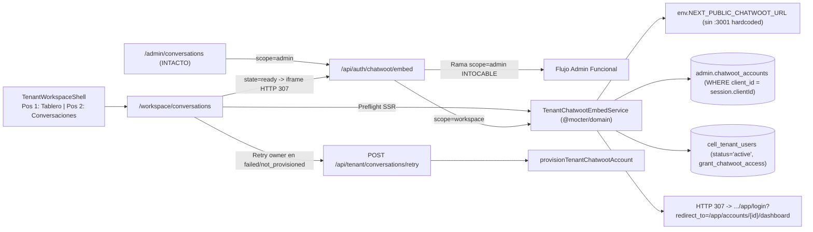

# SPEC-13 · Diseño Técnico: Estabilización de Chatwoot en Workspace (Sin Regresión Admin)

## 1. Arquitectura Aislada Workspace vs Admin SaaS

---

## 2. Cambios Focalizados

### 2.1 Variables de entorno (`env.ts` y `.env.example`)

- Estandarizar sobre la configuración ya tipada en `@t3-oss/env-nextjs` (`apps/admin/env.ts` y `packages/domain/src/utils/env.ts`) y documentada en `.env.example`:
  - `CHATWOOT_INTERNAL_URL`: comunicación interna servidor-a-servidor (Platform API / Account API).
  - `NEXT_PUBLIC_CHATWOOT_URL`: URL pública/same-site alcanzable por el navegador para el iframe.
  - `NEXT_PUBLIC_ADMIN_URL`: origen canónico del portal admin usado para `Content-Security-Policy: frame-ancestors` en `scope=workspace`.
- Eliminar el fallback `"http://localhost:3001"` de `apps/admin/app/api/auth/chatwoot/embed/route.ts` usando `env.NEXT_PUBLIC_CHATWOOT_URL` directamente.

### 2.2 `packages/domain/src/services/tenant-chatwoot-embed.service.ts` [Nuevo]

- Expone `TenantChatwootEmbedService` (y singleton/fábrica de conveniencia) con dos métodos principales y dependencias inyectables para testing:
  1. `resolveWorkspacePageState(params)`:
     - Evalúa `hasCapability` (`no_capability`).
     - Si el usuario no es `tenant_owner`, consulta `cell_tenant_users` en su celda: si no existe fila o `status !== "active"` o `!grantChatwootAccess`, devuelve `{ status: "access_denied" }`.
     - Consulta `admin.chatwoot_accounts` por `clientId` (nunca parámetros externos):
       - Sin registro -> `{ status: "not_provisioned" }`
       - `pending` o `provisioning` -> `{ status: "provisioning" }`
       - `suspended` -> `{ status: "suspended" }`
       - `failed` -> `{ status: "failed" }`
       - `active` con `chatwootAccountId !== null` -> `{ status: "ready", accountId }`.
  2. `resolveWorkspaceEmbedRedirect(params)`:
     - Valida sesión/capacidad (`403`), existencia/estado activo en `admin.chatwoot_accounts` (`404`), coincidencia si se envía `requestedAccountId` externo (`403 CHATWOOT_ACCOUNT_MISMATCH`), y permisos en `cell_tenant_users` para no propietarios (`403`).
     - Resuelve el usuario agente/administrador vía `gateway.ensureMemberUserInAccount` y actualiza `cell_tenant_users.chatwoot_agent_id` de forma best-effort si está desactualizado o nulo.
     - Genera la URL de login SSO vía `gateway.getUserSsoLoginUrl`, valida `publicBaseUrl` (sin puertos hardcoded `:3001`) y construye la URL final con `redirect_to=/app/accounts/${accountId}/dashboard` y `sso_account_id=${accountId}`.
     - Registra `appLogger.info("tenant.chatwoot.embed_resolved", ...)` sin exponer tokens SSO; ante error de gateway/red registra `appLogger.error("tenant.chatwoot.embed_failed", ...)` y retorna error tipado mapeado a HTTP `502` (`CHATWOOT_SSO_UNAVAILABLE`).

### 2.3 `apps/admin/app/api/auth/chatwoot/embed/route.ts` y `POST /api/tenant/conversations/retry`

- En `embed/route.ts`:
  - Validar `scope`: si viene explícito y no es `"workspace"` ni `"admin"`, responder `400 BAD_REQUEST` (RFC 9457) antes de invocar cualquier servicio.
  - Dejar el bloque `if (scope === "admin")` **completamente intacto** usando `env.NEXT_PUBLIC_CHATWOOT_URL` sin fallback `:3001`.
  - Delegar `scope === "workspace"` a `TenantChatwootEmbedService.resolveWorkspaceEmbedRedirect` dentro de `handle()` RFC 9457, respondiendo **HTTP 307** con `X-Frame-Options: SAMEORIGIN` y `Content-Security-Policy` derivada de `env.NEXT_PUBLIC_ADMIN_URL` + `'self'`.
- Nuevo `apps/admin/app/api/tenant/conversations/retry/route.ts`:
  - Envuelto en `handle()` + `resolveTenantSession()`.
  - Exige `tenant_owner` y capacidad `chatwoot_inboxes`.
  - Ejecuta `provisionTenantChatwootAccount` idempotentemente cuando la cuenta no está activa, devolviendo `{ ok: true, data: { state, chatwootAccountId } }` (`200`) o `502` RFC 9457 si falla.

### 2.4 `apps/admin/components/tenant-workspace-shell.tsx` e i18n

- Agregar `navConversations` y claves de vista `conversations*` en `apps/admin/lib/i18n.ts` (`es`: `"Conversaciones"` / `en`: `"Conversations"`, paridad 100% de claves `es`/`en`).
- Reordenar `navItems` en `TenantWorkspaceShell` ubicando `/workspace/conversations` en el índice `1` (posición #2, inmediatamente debajo de `/workspace` «Tablero»), con `label: dict.navConversations || "Conversaciones"`.

### 2.5 `apps/admin/app/workspace/conversations/page.tsx` y `conversations-view.tsx` [Nuevo]

- `page.tsx` (Server Component): resuelve sesión (`resolveAuthenticatedPortalContext`), `locale` (`resolveActiveLocale`), `requestId` (`x-request-id`) y preflight de estado vía `TenantChatwootEmbedService.resolveWorkspacePageState`, pasando props serializadas a `WorkspaceConversationsView`.
- `conversations-view.tsx` (`"use client"`):
  - En estado `ready`: cabecera discreta con estado de conexión y botón «Recargar Bandeja», overlay de carga hasta `onLoad` del `<iframe>`, detección de timeout (>12s) con aviso no bloqueante y botón «Reintentar Conexión», manteniendo el `<iframe>` sin `sandbox` restrictivo.
  - En estados `no_capability`, `access_denied`, `provisioning`, `not_provisioned`, `suspended` y `failed`: tarjetas Mobile First (`p-4 md:px-8 md:py-6`, Title Case, botones `--dsn-accent` / `--dsn-surface`) con acción «Reintentar Vinculación» (`POST /api/tenant/conversations/retry`) exclusiva para `tenant_owner` en `not_provisioned` / `failed`.
