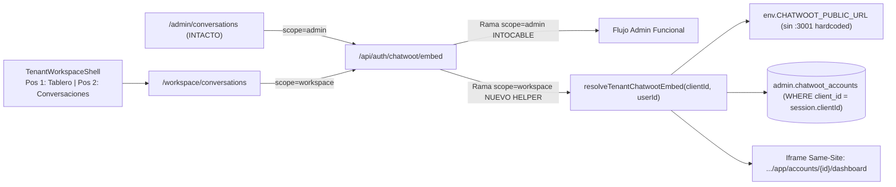

# SPEC-13 · Diseño Técnico: Estabilización de Chatwoot en Workspace (Sin Regresión Admin)

## 1. Arquitectura Aislada Workspace vs Admin SaaS

---

## 2. Cambios Focalizados

### 2.1 Variables de entorno (`env.ts` y `.env.example`)
- Asegurar validación tipada en `@t3-oss/env-nextjs`:
  - `CHATWOOT_BASE_URL` (comunicación interna backend/API)
  - `CHATWOOT_PUBLIC_URL` (URL pública/same-site para iframe en navegador — nunca hardcodear `localhost:3001` en route handlers).

### 2.2 `apps/admin/app/api/auth/chatwoot/embed/route.ts` y helper de dominio
- Dejar el bloque `if (scope === "admin")` (líneas 43–89) **completamente intacto**.
- Extraer la lógica de `scope === "workspace"` hacia `packages/domain/src/services/tenant-chatwoot-embed.service.ts` [Nuevo]:
  1. Busca `admin.chatwoot_accounts` por `session.clientId`.
  2. Si no existe o `status === 'pending'`, devuelve `{ state: 'provisioning' }` (no error 500).
  3. Verifica rol/estado activo del usuario en celda; si requiere sincronización de agente dentro del límite `chatwoot_agents`, intenta sincronizar o retorna estado claro.
  4. Construye ruta de destino `/app/accounts/${account.chatwootAccountId}/dashboard` unida a URL SSO validada usando `env.CHATWOOT_PUBLIC_URL`.
  5. Envuelto en `handle()` RFC 9457 para fallos inesperados de red.

### 2.3 `apps/admin/components/tenant-workspace-shell.tsx`
- Reordenar arreglo `navItems` situando `{ href: "/workspace/conversations", label: t("nav.conversations"), ... }` en índice `1` (justo debajo de `/workspace` «Tablero» en índice `0`).

### 2.4 `apps/admin/app/workspace/conversations/page.tsx`
- Client wrapper para el iframe con manejo de errores/timeout, botón «Recargar Bandeja» y tarjeta informativa limpia en estados `provisioning` o `error` con `requestId` en caso de soporte.

