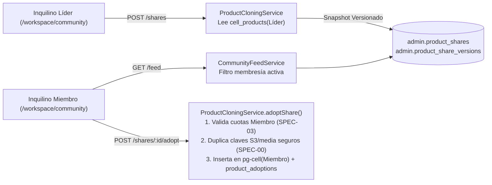

# SPEC-15 · Diseño Técnico: Comunidades Líder-Miembros (Inquilinos) y Clonación

## 1. Arquitectura Multi-Inquilino Líder → Miembro

---

## 2. Ajustes de Dominio (`packages/domain`)

1. **`packages/domain/src/db/schemas/admin/communities-and-cloning.ts`:**
   - Asegurar que `productShareVersions.payload` incluya campos de `SPEC-08`: `botMasterPrompt`, `attributes`, `compositionType`, `wholesaleCostCents`, `suggestedSalePriceCents` y lista ordenada `mediaSnapshot` con `isCover`.
2. **`packages/domain/src/services/product-cloning.service.ts`:**
   - Actualizar `publishShare` para validar que `sourceProduct.sourceShareId === null` (anti-recompartición en cadena) y empaquetar campos `SPEC-08`.
   - Actualizar `adoptShareToTenant`:
     - Ejecutar `TenantCapabilityGateService` sobre `adopterClientId` (`products` y multimedia).
     - Duplicar/registrar objetos S3 seguros bajo prefijo del `adopterClientId` vía `S3StorageService` para que el líder pueda borrar su producto futuro sin romper imágenes del clon.
     - Insertar en `cell_products` de la celda destino con `stock_quantity = initialStock ?? 0`, `cost_price_cents = wholesaleCostCents`, `price_cents = customSalePriceCents ?? suggestedSalePriceCents`, `source_share_id = shareId`.
   - Actualizar `syncAdoptionFromLatestVersion`: actualiza únicamente descripción, prompt maestro, atributos y metadatos autorizados preservando precio de venta, costo personalizado y stock propios del miembro.

---

## 3. APIs y UI (`apps/admin`)

- **Endpoints bajo `apps/admin/app/api/tenant/community/`:** `overview`, `organizations`, `organizations/[orgId]/invite`, `invitations/[id]/respond`, `requests/[id]/review`, `shares`, `shares/[shareId]/version`, `shares/[shareId]/adopt`, `feed`, `adoptions/[adoptionId]/sync`, `adoptions/[adoptionId]/link`, todos envueltos en `handle()` RFC 9457.
- **UI `apps/admin/app/workspace/community/`:**
  - `page.tsx`: resuelve `community_feed` capability + carga datos iniciales.
  - `community-view.tsx` [Nuevo] + subcomponentes (`community-feed-tab.tsx`, `community-adoptions-tab.tsx`, `community-leader-tab.tsx` [Nuevos]) en Title Case, Mobile First, i18n `es`/`en`, tablas paginadas `SPEC-17` y modales `--dsn-*`.

