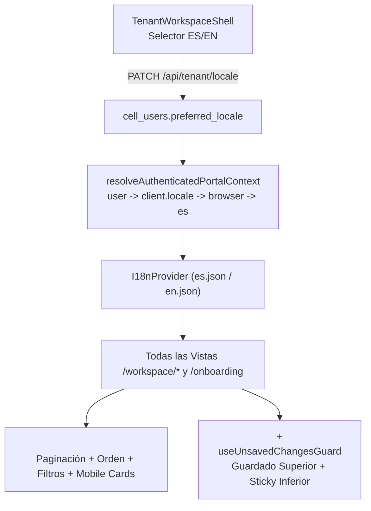

# SPEC-17 · Diseño Técnico: Primitivas Transversales (i18n, Tablas y Guardado)

## 1. Arquitectura de Primitivas Compartidas en `apps/admin`

---

## 2. Esquema y Servicios (`packages/domain`)

1. **`packages/domain/src/db/schemas/tenant/users.ts`:**
   - Añadir `preferredLocale: varchar("preferred_locale", { length: 10 })` nullable a `cellUsers`.
2. **`packages/domain/src/services/session-context.service.ts`:**
   - Exponer `activeLocale: "es" | "en"` calculado por la cascada oficial (`user.preferredLocale ?? client.locale ?? acceptLang ?? "es"`).
3. **`packages/domain/src/utils/pagination.ts` [Nuevo]:**
   - Esquema Zod compartido `paginationQuerySchema` (`page`, `limit <= 50`, `sortBy`, `sortDir`, `q`) y helper de respuesta `buildPaginatedResult()`.

---

## 3. Componentes Compartidos (`apps/admin`)

### 3.1 Diccionarios e i18n (`apps/admin/src/i18n/`)
- `es.json` / `en.json` estructurados por módulo (`common`, `shell`, `onboarding`, `dashboard`, `products`, `crm`, `orders`, `bot`, `team`, `billing`, `profile`, `branding`, `notifications`, `community`, `referrals`).
- Cero uso de funciones `@deprecated` (`AGENTS.md §4.11`).
- Prueba unitaria automatizada `apps/admin/src/i18n/i18n-audit.test.ts` [Nuevo] verificando:
  1. Igualdad exacta de llaves entre `es.json` y `en.json`.
  2. Inexistencia de códigos internos prohibidos (`ADM-001`, `SPEC-`, etc.) ni llamadas a `window.confirm` / `window.alert` / `window.prompt` ni `uppercase` en `<label>` dentro de `apps/admin/app/workspace/`.

### 3.2 `<WorkspaceDataTable />` (`apps/admin/components/ui/workspace-data-table.tsx` [Nuevo])
- Genérico tipado `<T>` con definición declarativa de columnas (`key`, `label`, `sortable`, `renderCell`, `mobilePriority`), controles integrados de filtro, búsqueda, ordenamiento, paginación y estados `loading`/`empty`/`error`.

### 3.3 `<FormSaveBar />` (`apps/admin/components/ui/form-save-bar.tsx` [Nuevo])
- Renderizado doble (slot en header + barra fija inferior cuando `isDirty = true` o al final del formulario) más diálogo modal `--dsn-*` para descartar cambios pendientes sin perder trabajo accidentalmente.

