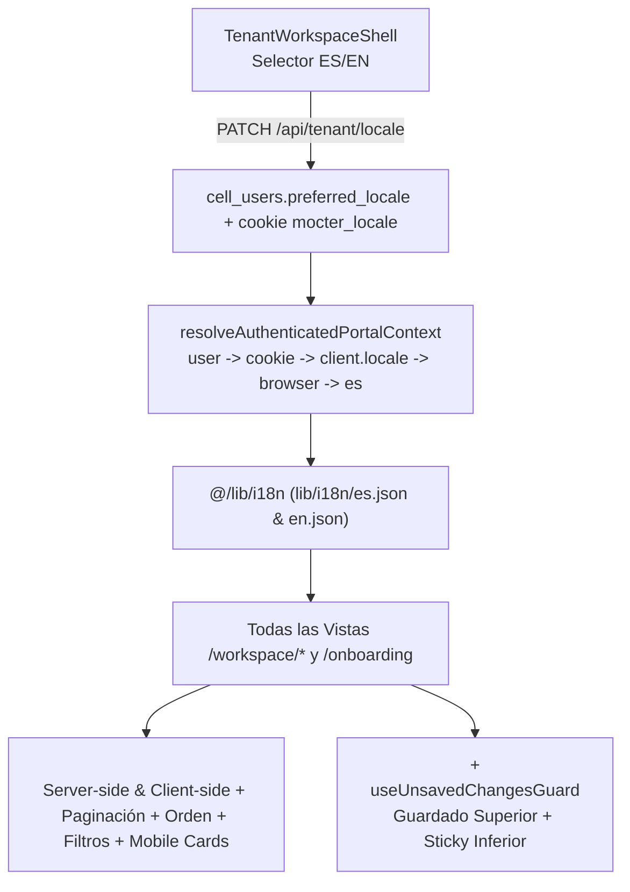

# SPEC-17 · Diseño Técnico: Primitivas Transversales (i18n, Tablas y Guardado)

## 1. Arquitectura de Primitivas Compartidas en `apps/admin`

---

## 2. Esquema y Servicios (`packages/domain`)

1. **`packages/domain/src/db/schemas/tenant/users.ts`:**
   - Añadir `preferredLocale: varchar("preferred_locale", { length: 10 })` nullable (con check `IN ('es', 'en')`) a `cellUsers` + migración SQL en `packages/domain/drizzle-cell/`.
2. **`packages/domain/src/services/session-context.service.ts`:**
   - Extender `resolveAuthenticatedPortalContext(sessionId, options?: { browserAcceptLanguage?: string | null; cookieLocale?: string | null })` para consultar `cellUsers.preferredLocale` cuando exista `activeClientId` y exponer `activeLocale: "es" | "en"` calculado por la cascada oficial (`user.preferredLocale ?? cookieLocale ?? client.locale ?? acceptLang ?? "es"`).
3. **`packages/domain/src/services/tenant-workspace.service.ts`:**
   - Exponer `invoices` recientes del inquilino (`listInvoicesByClientId`) dentro de `WorkspaceBillingDto` para renderizar la tabla estandarizada de Facturas/Pagos en `/workspace/billing`.
4. **`packages/domain/src/utils/pagination.ts` [Nuevo]:**
   - Esquema Zod compartido `paginationQuerySchema` (`page`, `limit <= 50`, `sortBy`, `sortDir`, `q`) y helpers `parsePaginationQuery()` + `buildPaginatedResult()`.

---

## 3. Componentes Compartidos (`apps/admin`)

### 3.1 Diccionarios e i18n (`apps/admin/lib/i18n.ts` + `apps/admin/lib/i18n/`)
- `apps/admin/lib/i18n/es.json` y `apps/admin/lib/i18n/en.json` re-exportados desde `@/lib/i18n` (`apps/admin/lib/i18n.ts`), manteniendo compatibilidad 100% con todas las vistas y tests existentes, cubriendo todas las ramas (`shell`, `dashboard`, `leads`, `notifications`, `designSystem`, `conversations`, `crm`, `onboarding`, `workspace`, `adminCommunities`, `community`).
- Cero uso de funciones `@deprecated` (`AGENTS.md §4.11`).
- Prueba unitaria automatizada `apps/admin/lib/i18n-audit.test.ts` [Nuevo] verificando:
  1. Igualdad recursiva exacta de todas las llaves entre `es.json` y `en.json`.
  2. Inexistencia de códigos internos prohibidos (`ADM-001`, `SPEC-`, `TRV-`, `AIB-`, etc.) ni llamadas a `window.confirm` / `window.alert` / `window.prompt` ni `setRequestLocale` ni `uppercase` en `<label>` dentro de `apps/admin/app/workspace/`, `apps/admin/app/onboarding/` y `apps/admin/components/`.

### 3.2 `<WorkspaceDataTable />` (`apps/admin/components/ui/workspace-data-table.tsx` [Nuevo])
- Genérico tipado `<T>` compatible con **modo server-side controlado** (callbacks `onPageChange`, `onPageSizeChange`, `onSortChange`, `onSearchChange`, `onFilterChange`, `onResetFilters`) y **modo client-side en memoria**, con definición declarativa de columnas (`key`, `label`, `sortable`, `renderCell`, `mobilePriority`), selector `10/20/50`, contador *«Mostrando X–Y de Z resultados»*, búsqueda debounced `300ms` y estados `loading`/`empty`/`error` + tarjetas Mobile First `< 768px`.

### 3.3 `<FormSaveBar />` y `useUnsavedChangesGuard` (`apps/admin/components/ui/form-save-bar.tsx` [Nuevo] + `apps/admin/lib/use-unsaved-changes-guard.ts` [Nuevo])
- Renderizado doble (slot en header + barra fija inferior `sticky bottom-4` cuando `isDirty = true` con contador de cambios y botón «Descartar Cambios») + diálogo modal `--dsn-*` para descartar cambios o proteger la navegación fuera de la vista con cambios pendientes (`beforeunload` + intercepción de enlaces en shell mediante contexto compartido). Integrado en `/workspace/bot`, `/workspace/profile`, `/workspace/branding` y `/workspace/ai`, más guard de cierre sucio en `product-form-modal.tsx`.

