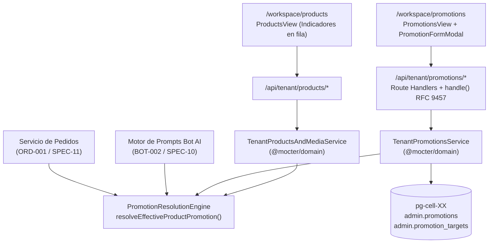

# SPEC-18 · Diseño Técnico · Central de Promociones y Descuentos Comerciales Automáticos

## 1. Arquitectura de Componentes



---

## 2. Motor Determinístico de Resolución (`PromotionResolutionEngine`)

### 2.1 Entrada y Salida
Para un lote de productos del catálogo (`ProductRow[]`) y el conjunto de promociones vigentes del inquilino (`ActivePromotionWithTargets[]`):

1. **Filtro de elegibilidad temporal, borrado lógico y cupo:**
   Una promoción es elegible si y solo si:
   - `deleted_at === null` (`D-08`)
   - `is_active === true`
   - `starts_at <= now`
   - `ends_at === null || ends_at >= now`
   - `max_discounted_units === null || discounted_units_sold < max_discounted_units`

2. **Evaluación de coincidencia por producto (`matchRank`):**
   - `scope_type === 'product'` y `target.product_id === product.id` → `rank = 1` (Máxima especificidad).
   - `scope_type === 'category'` y `normalizeCategory(target.category_name) === normalizeCategory(product.category)` → `rank = 2`.
   - `scope_type === 'all_catalog'` → `rank = 3`.

3. **Cálculo del precio promocional candidato (`candidatePriceCents`):**
   - Si `discount_type === 'percentage'`:
     `candidatePriceCents = Math.max(1, Math.round(product.priceCents * (100 - discountValue) / 100))` (solo aplica si `candidatePriceCents < product.priceCents`).
   - Si `discount_type === 'fixed_amount'`:
     **Exclusión preventiva (`D-06`):** si `product.priceCents <= discountValue`, la promoción **NO aplica** sobre este producto (conserva `product.priceCents` regular). Si `product.priceCents > discountValue`, `candidatePriceCents = product.priceCents - discountValue`.
   - Si `discount_type === 'fixed_price'`:
     `candidatePriceCents = discountValue` (válido solo si `discountValue > 0 && discountValue < product.priceCents`).

4. **Selección ganadora sin acumulación (`D-04`):**
   - Se ordenan las promociones coincidentes por:
     1. `rank ASC` (`1` Producto > `2` Categoría > `3` Todo el Catálogo).
     2. `candidatePriceCents ASC` (mayor ahorro para el comprador).
     3. `createdAt DESC` (desempate determinístico).
   - La primera promoción de la lista ordenada es la `activePromotion` del producto.

---

## 3. Contratos DTO (`@mocter/domain`)

```ts
export type PromotionScopeType = "all_catalog" | "category" | "product";
export type PromotionDiscountType = "percentage" | "fixed_amount" | "fixed_price";
export type PromotionLifecycleStatus =
  | "active"
  | "scheduled"
  | "paused"
  | "expired"
  | "depleted";

export interface AppliedProductPromotionDto {
  promotionId: string;
  name: string;
  description: string | null;
  scopeType: PromotionScopeType;
  discountType: PromotionDiscountType;
  discountValue: number;
  originalPriceCents: number;
  effectivePriceCents: number;
  savingsCents: number;
  savingsPct: number;
  startsAt: string;
  endsAt: string | null;
  remainingUnits: number | null;
}
```

En `ProductListItemDto` y `ProductDetailDto` (`SPEC-08`), cuando existe una `AppliedProductPromotionDto` vigente:
- `salePriceCents` refleja automáticamente `effectivePriceCents`.
- `profitability` se recalcula sobre `effectivePriceCents` frente a `costPriceCents`.
- Se adjunta `activePromotion: AppliedProductPromotionDto | null` para renderizar el badge con nombre de campaña, `% OFF` y fecha de vigencia en cada fila de `/workspace/products` y en el prompt dinámico del Bot AI.

---

## 3.1 Integración con Bot AI (`BOT-002` / `PromptComposer`, `D-07`)

En `PromptProduct` (`packages/domain/src/services/prompt-composer.ts`) se añade el campo opcional `activePromotion?: AppliedProductPromotionDto | null` (más `timezone?: string` opcional para formateo de `endsAt`). Cuando está presente:
- Se renderiza el precio regular, el precio promocional vigente, el ahorro (`% OFF` y monto), el nombre de la campaña, el argumento comercial (`description`), la vigencia (`endsAt` si existe) y las unidades restantes en oferta (`remainingUnits` si existe).
- Si además el producto tiene `tiers` por volumen, se inyecta la regla explícita de **no acumulación (`D-07`)**: la promoción aplica sobre el precio base y no se suma a escalones por volumen, instruyendo al Bot a ofrecer el mejor precio unitario aplicable según la cantidad solicitada.

## 3.2 Integración con Pedidos (`SPEC-11` / `OrdersService`, `D-05` & `D-08`)

- En `admin.orders` se añade `promotion_quota_deducted BOOLEAN NOT NULL DEFAULT false` y en `admin.order_items` se añaden `promotion_id UUID NULL` (FK compuesta hacia `admin.promotions(client_id, id)` con `ON DELETE RESTRICT`, preservada mediante soft delete `D-08`), `promotion_name TEXT NULL` y `original_unit_price_cents BIGINT NULL`.
- Al registrar o actualizar ítems de un pedido (`OrdersService.registerOrderDetailed` / `updateOrderDetails`), para ítems con `productId` se resuelve la promoción vigente (si no se envió ya explícitamente `promotionId`) y se almacena el snapshot inmutable (`promotionId`, `promotionName`, `originalUnitPriceCents`) cuando el precio aplicado corresponde a la campaña.
- Al confirmar un pedido (nacimiento en `confirmed` o transición a `confirmed`/`preparing`/`guide_generated`/`dispatched`) con `promotion_quota_deducted = false`, dentro de la misma transacción de celda se incrementa `admin.promotions.discounted_units_sold` por la suma de `quantity` de las líneas vinculadas a cada `promotion_id` (permitiendo desborde acotado del último pedido para cerrar la campaña en `depleted`, `D-05`) y se marca `promotion_quota_deducted = true`.
- Si un pedido con `promotion_quota_deducted = true` pasa a `cancelled` o `returned`, dentro de la misma transacción se restituye `discounted_units_sold = GREATEST(0, discounted_units_sold - qty)` y se marca `promotion_quota_deducted = false`.

## 3.3 Asistencia AI (`AI-001` / `SPEC-19`, `D-09`)

- Se registra `promotion.description` en `INITIAL_AI_ASSIST_FIELDS` y su prompt maestro `IDEAL` en `INITIAL_AI_ASSIST_PROMPTS` (`packages/domain/src/services/ai-assist-catalog.seed.ts`), habilitando `AiEnhanceTextarea` en el formulario de campañas.

---

## 4. Diseño de UI/UX y Cumplimiento de Reglas Transversales

1. **Layout perimetral (`AGENTS.md §4.19`):**
   - `/workspace/promotions` utiliza `<div className="w-full space-y-6 p-4 md:px-8 md:py-6">` como contenedor raíz y `<header className="flex flex-col sm:flex-row sm:items-center justify-between gap-4 border-b border-[var(--dsn-border)] pb-5">`.
2. **Botones canónicos (`AGENTS.md §4.19`):**
   - Acción secundaria («Actualizar»): `bg-[var(--dsn-surface)] border-[var(--dsn-border)] hover:border-[var(--dsn-accent)]` con ícono `text-[var(--dsn-accent)]`.
   - Acción primaria («Crear Nueva Promoción»): `bg-[var(--dsn-accent)] text-white`.
3. **Cierre automático de modal (`AGENTS.md §4.19`):**
   - Al guardar una promoción en `PromotionFormModal`, el callback `onSaved` cierra el modal inmediatamente (`setFormOpen(false)`), refresca la grilla y muestra el banner de confirmación.
4. **Higiene y accesibilidad (`AGENTS.md §4.6, §4.8, §4.15, §4.17`):**
   - Diccionarios completos `es` y `en` en `apps/admin/lib/i18n.ts`.
   - Labels en **Title Case** gramatical sin clases `uppercase`.
   - Confirmaciones de pausa/activación y eliminación mediante `ConfirmationModal` (`--dsn-*`).
