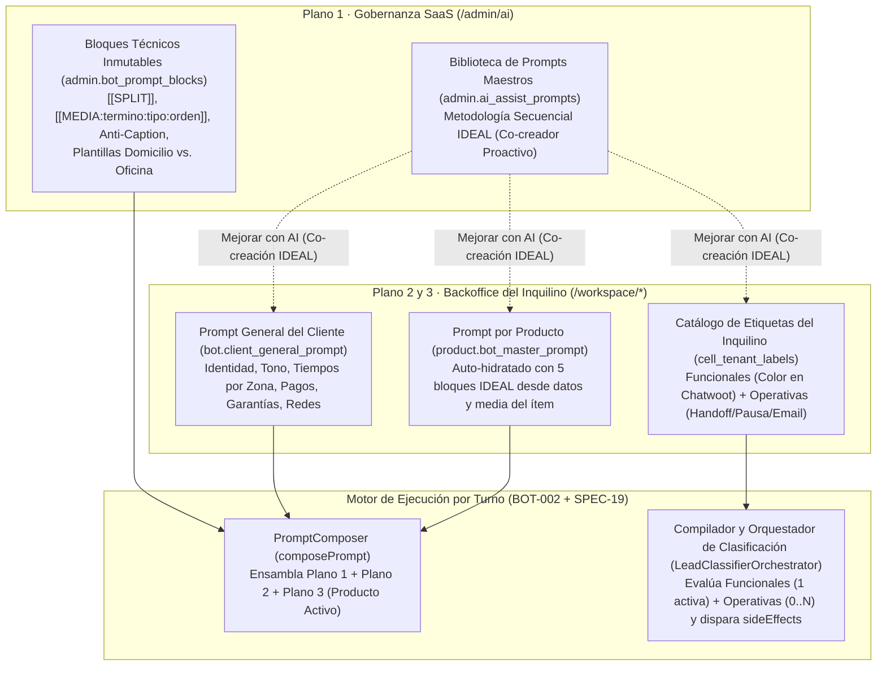

# SPEC-19 · Diseño Técnico · Arquitectura de Prompts bajo Metodología IDEAL y Clasificador Dinámico Funcional/Operativo

| Atributo | Valor |
| --- | --- |
| **ID** | `SPEC-19` |
| **Versión** | `1.0.0` |
| **Depende de** | [`requirements.md`](requirements.md), [BOT-002](../bot-002-motor-atencion-prompts/design.md), [SPEC-02](../spec-02-proveedores-ai-byok-prompts/requirements.md), [SPEC-08](../spec-08-catalogo-productos-crud-multimedia-combos-stock/design.md), [SPEC-10](../spec-10-asistente-ai-bot-presets-politicas-mensajes/requirements.md) |
| **Estado** | Aprobada · En implementación |

---

## 1. Visión Arquitectónica General



---

## 2. Estandarización de la Metodología `IDEAL` en `ai-assist-catalog.seed.ts`

Cada prompt maestro en `INITIAL_AI_ASSIST_PROMPTS` se estructura explícitamente con el encabezado de rol co-creador y las 5 secciones `IDEAL`:

```text
Rol: Actúas como co-creador experto en Prompt Engineering e ingeniería conversacional para Mocter, aplicando rigurosamente la metodología secuencial IDEAL. Asumes un rol altamente propositivo, creativo y analítico: interpretas borradores breves o incompletos del inquilino, los enriqueces con mejores prácticas (Few-Shot, delimitadores claros, razonamiento estructurado y restricciones negativas) y entregas una propuesta lista para usar.

[I] INTENCIÓN: <Objetivo principal de alto nivel del campo>
[D] DETALLE: <Contexto operativo, audiencia y variables del negocio/producto>
[E] EJEMPLO: <Estructura esperada, tono y referencias prácticas>
[A] ACCIÓN: <Pasos concretos que ejecuta el modelo para transformar el borrador>
[L] LÍMITE: <Restricciones negativas, longitud máxima y sesgos prohibidos>
```

### Nuevos campos y versiones en `INITIAL_AI_ASSIST_FIELDS` / `INITIAL_AI_ASSIST_PROMPTS`

1. **`bot.client_general_prompt`** (`entity: "tenant_bots"`, `columnName: "instructions"`):
   - **Label (`es`/`en`)**: `"Prompt General de Operación del Cliente"` / `"Client General Operation Prompt"`.
   - **Propósito**: Co-crear el prompt general que rige la operación transversal del negocio (identidad, personalidad, tiempos de entrega por zona como Bogotá/Soacha vs. nacional, medios de pago, devoluciones/garantías, casos especiales, redes sociales y regla de catálogo único vs. múltiple) bajo estructura `IDEAL`.
2. **`bot.conversation_classifier`** (`entity: "tenant_bots"`, `columnName: "classifier_prompt"`):
   - **Label (`es`/`en`)**: `"Prompt Clasificador de Conversaciones"` / `"Conversation Classifier Prompt"`.
   - **Propósito**: Co-crear y ajustar criterios de clasificación dinámica del inquilino articulando sus Etiquetas Funcionales (embudo/color Chatwoot) y Etiquetas Operativas (acciones de transferencia a humano, pausa del bot y correo).
3. **Actualización a `version: 2` y promoción automática en `seedAiAssistCatalog()`**:
   - Si `seedAiAssistCatalog()` encuentra una versión sembrada por `system.seed` con versión superior a la activa previa (y la activa previa también fue creada por `system.seed`), promueve la nueva versión `IDEAL` a `active` y retira la versión `1` anterior, garantizando que tanto entornos nuevos como existentes reciban los prompts `IDEAL` sin sobrescribir personalizaciones manuales hechas por un humano en `/admin/ai`.

---

## 3. Generador de Adopción Rápida por Producto (`buildRecommendedProductPromptTemplate`)

En `apps/admin/app/workspace/products/product-ui-helpers.ts`, `buildRecommendedProductPromptTemplate` acepta un objeto opcional `ProductPromptTemplateContext`:

```ts
export interface ProductPromptTemplateContext {
  productName?: string;
  description?: string;
  category?: string;
  brand?: string;
  kind?: ProductKind;
  compositionType?: ProductCompositionType;
  priceAmount?: string | number;
  currency?: string;
  attributes?: Array<{ key: string; value: string }>;
  comboItems?: Array<{ name?: string; quantity: number }>;
  mediaCounts?: { image: number; video: number; audio: number; pdf: number };
  audioItems?: Array<{ order: number; filename: string; triggerHint?: string }>;
}
```

### Estructura de 5 bloques `IDEAL` generada para el producto:
1. **`## [I] Intención Comercial y Palabras Clave (<Producto>)`**:
   - Objetivo de venta consultiva y cierre del ítem.
   - Término multimedia canónico: `[[MEDIA:<Producto>]]`.
   - Palabras clave sugeridas a partir del nombre, categoría y marca.
2. **`## [D] Detalle Comercial y Beneficios Clave (Formato WhatsApp)`**:
   - Propuesta de valor sintetizada desde `description` y `attributes`.
   - Lista de beneficios con emojis (`✅`, `🔥`) lista para enviar en la burbuja de beneficios (máximo 4-6 líneas).
   - Componentes incluidos cuando `compositionType === "combo"`.
3. **`## [E] Estrategia de Precios, Escalones y Presentación`**:
   - Precio base formateado (`$156.000 COP`) y plantilla lista para escalones por cantidad (`1 unidad`, `2 unidades ⭐ La más recomendada`, `3 unidades`).
   - Regla de primer contacto: presentar primero multimedia + beneficios + pregunta de ciudad; entregar el bloque de precios únicamente cuando el cliente consulte el valor o en el segundo turno.
4. **`## [A] Acción Multimedia, Audios y Calificación de Pedido`**:
   - Marcadores automáticos de primer contacto / interés: `[[MEDIA:<Producto>:imagen]]` y `[[MEDIA:<Producto>:video]]` en su propia línea sin texto introductorio (Regla Anti-Caption).
   - Reglas de disparo de audios por orden (`[[MEDIA:<Producto>:audio:1]]`): detalla los audios cargados en el producto (o deja la guía lista si aún no hay audios) indicando que cada orden se rastrea de forma independiente y no se reenvía sin confirmación.
   - Datos específicos del producto a calificar antes de registrar el pedido (cantidad, variante/atributos declarados).
5. **`## [L] Límites del Producto y Manejo de Objeciones`**:
   - Guardrails específicos del artículo (no inventar usos ni certificaciones no declaradas, responder dudas de confianza destacando pago contraentrega/garantía del comercio).

### Algoritmo de Idempotencia en el botón «Insertar Estructura Recomendada» (`replaceOrInsertRecommendedPrompt`)
- Se define una función pura `applyRecommendedProductPromptTemplate(currentPrompt, newTemplate)` en `product-ui-helpers.ts`:
  - Si `currentPrompt` está vacío, contiene una versión previa de la plantilla recomendada (detectada por encabezados `## Beneficios Clave`, `## Core Value Proposition`, `## [I] Intención Comercial` o `## [I] Commercial Intent`), **reemplaza** la plantilla por `newTemplate` (actualizando precios, atributos y archivos multimedia recién editados) sin duplicar jamás las secciones.
  - Si el usuario había escrito notas breves sueltas (sin encabezados de plantilla), conserva sus notas al final bajo un bloque `## Notas Adicionales del Comercio` o hidrata la plantilla sin duplicar si se vuelve a pulsar.

---

## 4. Clasificador Dinámico por Inquilino: Etiquetas Funcionales vs. Operativas (`lead-classifier.ts` y `lead-classifier-orchestrator.ts`)

### 4.1 Modelo de Etiquetas Categorizadas

```ts
export type TenantLabelCategory = "functional" | "operational";

export type OperationalSideEffect =
  | "handoff_human"
  | "pause_bot"
  | "send_email_notification"
  | "register_order";

export interface TenantClassifierLabelDefinition {
  slug: string;
  title: string;
  category: TenantLabelCategory;
  /** Color hex orientativo para la conversación en Chatwoot (ej. #3B82F6). */
  color: string;
  /** Criterio semántico de activación evaluado por el LLM bajo metodología IDEAL. */
  activationRule: string;
  /** Acciones operativas disparadas al activarse (solo aplica a category === 'operational'). */
  sideEffects?: OperationalSideEffect[];
  /** Indica si es etiqueta base de plataforma o personalizada del inquilino. */
  isSystemBase?: boolean;
}
```

### 4.2 Catálogo Base Canónico (`DEFAULT_FUNCTIONAL_LABELS` y `DEFAULT_OPERATIONAL_LABELS`)

| Categoría | Slug | Color Chatwoot | Regla de Activación | Efectos (`sideEffects`) |
| --- | --- | --- | --- | --- |
| `functional` | `lead-frio` | `#3B82F6` (Azul) | Acaba de escribir, saludo inicial, pregunta muy general sin intención de compra clara aún o lleva mucho tiempo sin responder. | Color orientativo azul en Chatwoot |
| `functional` | `lead-tibio` | `#F59E0B` (Ámbar) | Explora beneficios, usos, cobertura de envío o variantes del producto, pero aún no pide precio de cierre ni confirma compra. | Color orientativo ámbar en Chatwoot |
| `functional` | `lead-caliente` | `#F97316` (Naranja) | Preguntó precio, pidió fotos/videos/audio, mostró interés claro o eligió una opción recomendada, pero **aún NO ha suministrado todos sus datos de envío** (nombre completo, celular y ciudad/dirección). | Color orientativo naranja en Chatwoot |
| `functional` | `compra-realizada` | `#10B981` (Esmeralda) | **Únicamente** cuando en el historial aparecen explícitamente nombre completo, número celular y ciudad/dirección (o modalidad oficina) y el pedido fue confirmado. Si falta algún dato, clasificar como `lead-caliente`. | Color orientativo verde en Chatwoot |
| `functional` | `devolucion` | `#EF4444` (Rojo) | Solicitó devolución, cambio o garantía, reportó problema con el producto, no recibió el pedido o expresó insatisfacción post-venta. | Color orientativo rojo en Chatwoot |
| `operational` | `nuevo_pedido` | `#10B981` | El comprador entregó todos los datos del pedido listos para despacho. | `["register_order", "send_email_notification"]` |
| `operational` | `pendiente_pago` | `#F59E0B` | Pedido o reserva pendiente de comprobante de pago anticipado o transferencia. | `[]` |
| `operational` | `pagado` | `#06B6D4` | El cliente envió soporte de pago verificado o confirmó pago exitoso. | `[]` |
| `operational` | `despachado` | `#8B5CF6` | El pedido ya cuenta con guía de transportadora o confirmación de despacho. | `[]` |
| `operational` | `soporte_humano` | `#EF4444` | El cliente pide hablar con una persona/asesor, expresa molestia reiterada o plantea un caso fuera del alcance del bot. | `["handoff_human", "pause_bot", "send_email_notification"]` |
| `operational` | `cliente_recurrente` | `#EC4899` | El cliente menciona una compra previa o figura con pedidos históricos en el comercio. | `[]` |

### 4.3 Compilador Dinámico `buildTenantClassifierPrompt(labels, locale)`
Construye en tiempo de ejecución el prompt clasificador del inquilino bajo los 5 bloques **`IDEAL`**, inyectando:
- Las etiquetas `functional` activas (base + personalizadas del inquilino) con sus reglas y colores orientativos.
- Las etiquetas `operational` activas (base + personalizadas del inquilino) con sus reglas y acciones asociadas.
- Soporta tanto respuesta JSON estructurada `{"functionalLabel": "...", "operationalLabels": ["..."]}` como respuesta simple de 1 palabra para retrocompatibilidad total con clientes/modelos legados.
- `resolveTenantConversationClassification(rawOutput, catalog, previousFunctional, hasOrderEvidence)` valida cada slug contra el catálogo real del inquilino, aplica el guardrail de `compra-realizada` / `nuevo_pedido` (`RN-SPEC-19-04`), resuelve el `chatwootOrientationColor` de la etiqueta funcional ganadora y deduplica la lista de `triggeredSideEffects` de las etiquetas operativas activadas.
