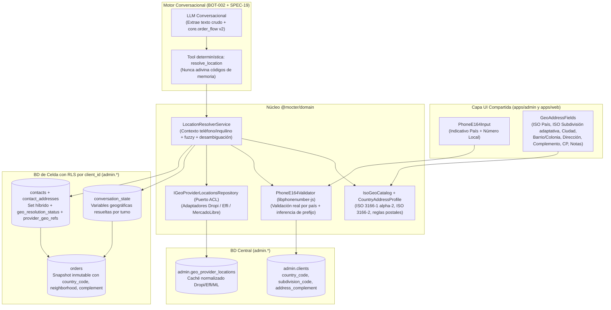

# SPEC-20 · Diseño Técnico · Estándar Geográfico Internacional, Teléfonos E.164 y Homologación Conversacional

| Atributo | Valor |
| --- | --- |
| **ID** | `SPEC-20` |
| **Versión** | `1.0.0` |
| **Depende de** | [`requirements.md`](requirements.md), [DAT-001](../dat-001-arquitectura-datos-multiinquilino/design.md), [SPEC-09](../spec-09-crm-contactos-calificacion-direcciones-prospeccion/design.md), [SPEC-10](../spec-10-asistente-ai-bot-presets-politicas-mensajes/design.md), [SPEC-11](../spec-11-pedidos-crud-estados-guias-repetir/design.md), [SPEC-19](../spec-19-arquitectura-prompts-ideal-comercializacion-clasificador/design.md), [Investigación MCP Dropi](../../dropi-mcp-investigacion-inicial.md) |
| **Estado** | Borrador técnico · Pendiente de aprobación |

---

## 1. Arquitectura General

La solución separa estrictamente el **Núcleo Canónico Internacional de Mocter** (país ISO 3166-1 alpha-2, subdivisión ISO 3166-2, contrato híbrido de dirección y teléfonos E.164 validados por país) del **Anti-Corruption Layer (ACL)** encargado de traducir y validar diccionarios propietarios de terceros (`Dropi`, `Effi`, `MercadoLibre`).



---

## 2. Estándares Adoptados y Metadata por País (`packages/domain/src/geo/`)

### 2.1 Catálogo ISO y Perfiles de Dirección (`country-profiles.ts`)
Siguiendo el modelo de metadata internacional (`libaddressinput` / CLDR) sin dependencias externas de red en tiempo de renderizado:

```ts
export type CountryIsoAlpha2 = string; // CHAR(2) mayúsculas: "CO", "AR", "MX", "US", "ES", etc.
export type SubdivisionIsoCode = string; // Ej.: "CO-ANT", "AR-C", "MX-JAL"

export type AdminAreaKind = "department" | "province" | "state" | "region" | "none";
export type DependentLocalityKind = "neighborhood" | "colony" | "district" | "sector";

export interface CountryAddressProfile {
  /** Código ISO 3166-1 alpha-2 canónico. */
  countryCode: CountryIsoAlpha2;
  /** Código numérico ISO 3166-1 solo para adaptadores externos que lo exijan (ej. "032", "170"). */
  numericIsoCode: string;
  /** Código de marcación telefónica E.164 sin '+' (ej. "57", "54", "52", "1"). */
  callingCode: string;
  /** Tipo semántico del segundo nivel territorial para etiqueta localizada en UI. */
  adminAreaKind: AdminAreaKind;
  /** Tipo semántico del subnivel urbano (Barrio, Colonia, Distrito). */
  dependentLocalityKind: DependentLocalityKind;
  /** Indica si el país exige subdivisión administrativa en formularios estándar. */
  requireAdminArea: boolean;
  /** Indica si el código postal suele ser requerido en operación estándar o logística. */
  postalCodeRequired: boolean;
  /** Expresión regular opcional para validar formato estructural del código postal cuando se informe. */
  postalCodePattern?: string;
  /** Ejemplo ilustrativo localizado para placeholder en UI (ej. "110111", "1425", "06700"). */
  postalCodeExample?: string;
}
```

- **Nombres localizados de países:** Generados de forma determinística con `Intl.DisplayNames([locale], { type: "region" })` con mapa de respaldo tipado en `@mocter/domain` para consistencia SSR/Node y pruebas unitarias.
- **Catálogo ISO 3166-2 embebido:** Mapa tipado por `countryCode` con énfasis completo de arranque en América y Europa (CO, AR, MX, CL, PE, EC, PA, CR, US, CA, BR, UY, PY, BO, VE, DO, GT, SV, HN, NI, ES, etc.) y fallback elegante a entrada asistida para países fuera del set de subdivisiones detalladas.
- **Helper 1:1 para ISO numérico:** `toIsoNumericCountryCode(alpha2)` y `fromIsoNumericCountryCode(numeric)` viven encapsulados en `@mocter/domain` para adaptadores externos específicos (aduanas/bancos) manteniendo `"AR"`, `"CO"`, `"MX"` como única llave interna.

### 2.2 Validación y Normalización E.164 (`phone-e164.ts`)
Se incorpora `libphonenumber-js` (`parsePhoneNumberFromString`, `getCountries`, `getCountryCallingCode`) en `@mocter/domain`:

```ts
export interface NormalizedE164Result {
  e164: string; // "+573001234567"
  countryCode?: string; // "CO" (cuando es determinable)
  callingCode: string; // "57"
  nationalNumber: string; // "3001234567"
}

export function normalizeAndValidatePhoneE164(params: {
  rawPhone: string;
  defaultCountryCode?: string;
  allowLocalWithDefaultCountry?: boolean;
}): Result<NormalizedE164Result>;

export function inferCandidateCountriesFromE164(e164Phone: string): string[];
```

- **Reglas clave:**
  - En formularios UI y APIs actualizadas, el valor transmitido debe iniciar con `+` (prefijo seleccionado en `<PhoneE164Input />` + número nacional, limpiando automáticamente `0` troncal inicial cuando aplique, p. ej. Argentina/Reino Unido/etc., mediante `parsePhoneNumberFromString(nationalDigits, selectedCountryCode)`).
  - En ingestas webhook externas (Chatwoot/WhatsApp) donde pueda llegar un número sin `+`, se acepta normalización con `defaultCountryCode` del comercio solo si es válido en `libphonenumber-js`.
  - Para prefijos compartidos (`+1` → `["US", "CA", "PR", "DO", ...]`), `inferCandidateCountriesFromE164` devuelve todos los candidatos para que el resolver desempaté con `clients.country_code` en lugar de asumir `"US"` ciegamente.

---

## 3. Diseño de Base de Datos y Migraciones (`rules-for-database-postgres-drizzle.md`)

Todas las modificaciones cumplen `R-09` (migraciones nuevas sin editar existentes), nomenclatura `snake_case`, `COMMENT ON TABLE/COLUMN` en SQL, `auditColumns()` y RLS en tablas de celda.

### 3.1 BD Central (`packages/domain/src/db/schemas/admin/`)

1. **Extensión de `admin.clients` (`clients.ts`):**
   - `country_code CHAR(2)` (nullable para compatibilidad histórica; nuevo alta/perfil lo persiste siempre).
   - `subdivision_code VARCHAR(16)` (nullable, ISO 3166-2, p. ej. `"CO-ANT"`).
   - `address_complement TEXT` (nullable).
   - **Backfill seguro en migración:** actualiza `country_code` donde `lower(trim(country))` coincida inequívocamente con nombres estándar (`'colombia' -> 'CO'`, `'argentina' -> 'AR'`, `'mexico'` / `'méxico' -> 'MX'`, `'chile' -> 'CL'`, `'peru'` / `'perú' -> 'PE'`, `'estados unidos'` / `'united states'` -> 'US', `'españa'` / `'spain' -> 'ES'`, o cadenas de 2 letras ISO válidas).

2. **Nueva tabla ACL `admin.geo_provider_locations` (`geo-provider-locations.ts`):**
   - Almacena el catálogo geográfico cacheado y normalizado de operadores externos para consultas sub-30 ms sin saturar rate limits externos ni contaminar el CRM.
   - Columnas principales:
     - `id`: `uuid` PK `default uuidv7()`
     - `provider`: `text` NOT NULL (`'dropi' | 'effi' | 'mercadolibre'`)
     - `country_code`: `char(2)` NOT NULL
     - `level`: `text` NOT NULL (`'subdivision' | 'city'`)
     - `external_id`: `text` NOT NULL (p. ej. `"50"` en Dropi, `"05001"` en Effi, `"TUxBQlBBTDI1MTVa"` en MercadoLibre)
     - `external_parent_id`: `text` (id externo del departamento/estado)
     - `subdivision_code`: `varchar(16)` (mapeo hacia ISO 3166-2 cuando aplique)
     - `dane_code`: `varchar(16)` (DANE 5 u 8 dígitos si aplica)
     - `postal_code`: `varchar(20)` (opcional, p. ej. `zip_code` de Dropi)
     - `name`: `text` NOT NULL
     - `normalized_name`: `text` NOT NULL (minúsculas, sin diacríticos, colapsado para búsqueda rápida)
     - `aliases`: `jsonb` (`string[]`, default `'[]'::jsonb`)
     - `raw_payload`: `jsonb` NOT NULL (`default '{}'::jsonb` — conserva peculiaridades originales sin afectar columnas limpias)
     - `is_active`: `boolean` NOT NULL `default true`
     - `synced_at`: `timestamp with time zone` NOT NULL `default now()`
     - `...auditColumns()`
   - Restricciones e índices:
     - `uniqueIndex("geo_provider_locations_provider_ext_unique").on(table.provider, table.countryCode, table.level, table.externalId)`
     - `index("geo_provider_locations_lookup_idx").on(table.provider, table.countryCode, table.level, table.normalizedName)`

### 3.2 BD de Celda (`packages/domain/src/db/schemas/tenant/`)

Se amplían con columnas aditivas (con `COMMENT ON COLUMN` en `drizzle-cell/`):

1. **`admin.contacts` (`crm.ts`):**
   - `country_code CHAR(2)`
   - `subdivision_code VARCHAR(16)`
   - `neighborhood TEXT`
   - `address_complement TEXT`
   - `phone_validation_status TEXT NOT NULL DEFAULT 'valid'` (`CHECK IN ('valid', 'legacy_unformatted')`)
2. **`admin.contact_addresses` (`crm.ts`):**
   - `country_code CHAR(2)` (en migración backfill desde `country` cuando sea unívoco; en nuevas escrituras siempre obligatorio, eliminando el acoplamiento implícito `"Colombia"` en capa de aplicación reemplazándolo por el `country_code` del inquilino como default de UI)
   - `subdivision_code VARCHAR(16)`
   - `address_complement TEXT` *(separado de `reference_notes` y `neighborhood` ya existentes)*
   - `geo_resolution_status TEXT NOT NULL DEFAULT 'unverified'` (`CHECK IN ('unverified', 'soft_normalized', 'resolved', 'ambiguous', 'unresolved')`)
   - `raw_location_input JSONB`
   - `provider_geo_refs JSONB NOT NULL DEFAULT '{}'::jsonb`
3. **`admin.conversation_state` (`conversation-state.ts`):**
   - `country_code CHAR(2)`
   - `subdivision_code VARCHAR(16)`
   - `state_name TEXT`
   - `neighborhood TEXT`
   - `address_line TEXT`
   - `address_complement TEXT`
   - `postal_code TEXT`
   - `reference_notes TEXT`
   - `geo_resolution_status TEXT`
   - `provider_geo_refs JSONB`
4. **`admin.orders` (`orders.ts`):**
   - `country_code CHAR(2)`
   - `subdivision_code VARCHAR(16)`
   - `neighborhood TEXT`
   - `address_complement TEXT`
   - `reference_notes TEXT`
   - `geo_resolution_status TEXT NOT NULL DEFAULT 'unverified'`
   - `provider_geo_refs JSONB NOT NULL DEFAULT '{}'::jsonb`

---

## 4. Resolución Determinística en Bot y ACL de Conectores

### 4.1 Contrato de `LocationResolverService` (`packages/domain/src/services/location-resolver.service.ts`)

```ts
export type GeoResolutionStatus =
  | "resolved"
  | "soft_normalized"
  | "ambiguous"
  | "unresolved";

export interface ResolveLocationInput {
  clientId: string;
  tenantCountryCode?: string | null;
  contactPhoneE164?: string | null;
  activeProviders?: Array<"dropi" | "effi" | "mercadolibre">;
  hints: {
    country?: string | null;
    state?: string | null;
    city?: string | null;
    neighborhood?: string | null;
    addressLine?: string | null;
    addressComplement?: string | null;
    postalCode?: string | null;
    referenceNotes?: string | null;
  };
}

export interface ResolveLocationCandidate {
  countryCode: string;
  subdivisionCode?: string | null;
  stateName?: string | null;
  cityName: string;
  providerRefs: Record<string, Record<string, string | number>>;
  confidence: number;
}

export interface ResolveLocationOutput {
  status: GeoResolutionStatus;
  resolved: {
    countryCode: string | null;
    subdivisionCode: string | null;
    stateName: string | null;
    city: string | null;
    neighborhood: string | null;
    addressLine: string | null;
    addressComplement: string | null;
    postalCode: string | null;
    referenceNotes: string | null;
    providerGeoRefs: Record<string, unknown>;
  };
  /** Presente cuando status === 'ambiguous' (máximo 5 opciones reales para preguntar al comprador). */
  candidates: ResolveLocationCandidate[];
  /** Código de código postal faltante cuando el perfil del país o conector activo lo exige. */
  missingRequiredFields: Array<"countryCode" | "subdivisionCode" | "city" | "postalCode" | "neighborhood">;
}
```

### 4.2 Flujo del Bot por Turno (`core.order_flow` v2 + `resolve_location`)
1. Se actualiza `INITIAL_PROMPT_BLOCKS` (`core.order_flow` a `version: 2`) en `packages/domain/src/services/prompt-blocks.seed.ts` para sustituir el set acoplado a Colombia por el contrato híbrido internacional en ambos idiomas (`es`/`en`):
   - **Domicilio:** 1. Nombre completo, 2. Número celular (con código de país), 3. País, 4. Departamento / Estado / Provincia, 5. Ciudad / Municipio, 6. Barrio / Colonia, 7. Dirección física, 8. Complemento (apto, torre, conjunto, piso) y punto de referencia, 9. Cantidad *(más Código Postal cuando el país/conector lo indique)*.
   - **Oficina:** 1. Nombre completo, 2. Número celular (con código de país), 3. País, 4. Departamento / Estado / Provincia, 5. Ciudad / Municipio, 6. Cantidad.
2. Al recibir datos geográficos en un turno, el runtime ejecuta `LocationResolverService.resolve(...)` (tool `resolve_location`) antes de persistir estado final o llamar a `registrar_pedido`:
   - Si `status === "ambiguous"`: el bot devuelve **una única pregunta puntual** presentando únicamente los `candidates` devueltos por la tool (*"¿Tu envío es a Rionegro (Antioquia) o Rionegro (Santander)?"*).
   - Si `status === "resolved"` o `status === "soft_normalized"`: actualiza `ConversationStateService.applyTurn(...)` con los campos normalizados y permite continuar hacia `BotOrderCaptureService.capture(...)`.
   - Si `status === "unresolved"` con conector obligatorio activo: pide aclaración de subdivisión o municipio cercano; si no se resuelve tras el intento o no hay conector activo, registra el contacto/pedido con `geoResolutionStatus: "unresolved"` y preserva `rawLocationInput` sin perder la venta.

---

## 5. Diseño de Componentes UI Compartidos e Inventario de Formularios

### 5.1 `<PhoneE164Input />`
- **Ubicación:** Componente compartido reutilizable (p. ej. `packages/ui` o componente compartido importable / duplicado limpio sin lógica de negocio duplicada respaldado por helpers de `@mocter/domain`). Dado que actualmente `apps/admin/components/` y `apps/web/components/` están separados en el monorepo, la lógica pura (catálogo de indicativos, formato y validación `libphonenumber-js`) vive en `@mocter/domain`, y se implementan los wrappers UI con el sistema de diseño respectivo en `apps/admin/components/phone-e164-input.tsx` y `apps/web/components/phone-e164-input.tsx`.
- **Comportamiento UX (Mobile First + WCAG 2.2 AA + Title Case):**
  - Combo compacto de indicativo (`CO +57`, `AR +54`, `MX +52`, `US +1`, etc.) con búsqueda rápida o `<select>` accesible nativo en móvil + campo `type="tel"` (`inputMode="tel"`) para el número local.
  - Emite siempre el string E.164 ensamblado (`+573001234567`) hacia el formulario padre; cuando recibe un valor E.164 existente (edición), lo descompone automáticamente en indicativo + número local.
  - Si un registro legado contiene un teléfono sin `+` (`"3001234567"`), muestra un aviso inline amable en el idioma activo indicando que seleccione el código de país para actualizarlo.

### 5.2 `<GeoAddressFields />`
- **Ubicación:** `apps/admin/components/geo-address-fields.tsx`.
- **Comportamiento UX:**
  - Selector de **País** (ordenado alfabéticamente según `locale`, default `tenant.countryCode || "CO"` sin quemar texto literal `"Colombia"`).
  - Selector / combobox de **División Administrativa** con etiqueta adaptativa desde `CountryAddressProfile` (*Departamento*, *Provincia*, *Estado*, *Región*), filtrado dinámicamente por `countryCode`, con opción de entrada manual si la subdivisión no está en el catálogo ISO.
  - Campos explícitos en grilla Mobile First (`grid-cols-1 md:grid-cols-2`):
    - **Ciudad / Municipio / Localidad** (campo de texto con sugerencias cuando exista caché ACL del conector activo, sin bloquear entrada libre si no hay conector obligatorio).
    - **Barrio / Colonia** (etiqueta adaptativa según `dependentLocalityKind`).
    - **Dirección Principal** (calle, avenida, número).
    - **Complemento** (apartamento, conjunto residencial, torre, piso, oficina).
    - **Código Postal** (marca `*` obligatorio solo cuando `profile.postalCodeRequired` o conector activo lo exija).
    - **Notas de Referencia** (indicaciones para el mensajero).

### 5.3 Inventario Completo de Formularios y APIs a Actualizar

| Superficie | Archivo UI | Endpoint / Servicio Backend | Cambio Específico |
| --- | --- | --- | --- |
| Alta rápida contacto CRM | `apps/admin/app/workspace/contacts/contacts-view.tsx` | `POST /api/tenant/contacts` (`_shared.ts`, `CrmService`) | `<PhoneE164Input />` en `phoneMobile` y `phoneSecondary`; `<GeoAddressFields />` en dirección inicial (sumando `neighborhood`, `addressComplement`, `postalCode`, `referenceNotes`). |
| Ficha Ver/Editar contacto | `apps/admin/app/workspace/contacts/contact-detail-modal.tsx` | `PATCH /api/tenant/contacts/[id]` y `.../addresses` | `<PhoneE164Input />` en `phoneMobile`, `phoneSecondary` y teléfono fijo con indicativo; `<GeoAddressFields />` en pestaña **Direcciones De Envío** diferenciando `Complemento` de `Notas De Referencia`. |
| Onboarding Paso 1 | `apps/admin/app/onboarding/steps/step-business.tsx` | `TenantOnboardingService` / API onboarding | `<PhoneE164Input />` en `phone` del comercio y captura/sincronización inicial de `countryCode`. |
| Perfil del comercio | `apps/admin/app/workspace/profile/profile-view.tsx` | `TenantProfileService` / API `/workspace/profile` | `<PhoneE164Input />` en `phone` y `<GeoAddressFields />` (país ISO, subdivisión ISO, ciudad, dirección, complemento, código postal). |
| Administración SaaS de inquilinos | `apps/admin/app/admin/tenants/create-tenant-form.tsx` y `tenant-actions.tsx` | `TenancyService` / API `/api/admin/tenants` | `<PhoneE164Input />` en teléfono de contacto y selector ISO de país si aplica. |
| Creación de pedidos | `apps/admin/app/admin/orders/new-order-dialog.tsx` (y formulario de pedidos `/workspace/orders` cuando se habilite/conecte) | `OrdersService` / API pedidos | `<PhoneE164Input />` en `customerPhone`; soporte completo de `countryCode`, `subdivisionCode`, `neighborhood`, `addressComplement`, `postalCode`, `referenceNotes`. |
| Landing Demo / CRM web | `apps/web/components/demo-form.tsx` y `apps/web/components/admin/crm/contacts-dashboard.tsx` | `apps/web/app/actions/demo-request.ts` (`LeadService`) | `<PhoneE164Input />` en captura de teléfono y validación E.164 con `libphonenumber-js` en Server Action. |

---

## 6. Seguridad, Observabilidad y Cumplimiento

- **Cero datos sensibles en logs (`AGENTS.md §4.13`):** Toda traza en `LocationResolverService` y `PhoneE164Validator` registra únicamente códigos ISO (`countryCode`, `subdivisionCode`), proveedor (`dropi`/`effi`), `geoResolutionStatus` y conteo de candidatos; prohíbe registrar números E.164 completos o direcciones textuales en logs.
- **Cero hardcoding de configuración (`AGENTS.md §4.12`):** Si en fases futuras de sincronización ACL se configuran URLs o intervalos externos, deben declararse en `env.ts` y `.env.example`. Los catálogos ISO estándar y diccionarios locales son metadata de dominio versionada en `@mocter/domain`, no credenciales ni configuración por entorno.
- **Sin `@deprecated` (`AGENTS.md §4.11`):** Ningún helper nuevo de teléfonos o geografía utiliza APIs marcadas como deprecadas.
