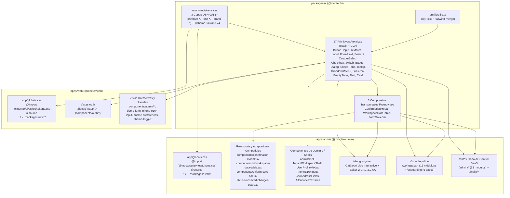

# SPEC-21 · Diseño Técnico: Paquete `@mocter/ui`, Primitivas Radix + shadcn/ui y Migración Total (`DSN-001`)

## 1. Arquitectura General del Sistema de Diseño en el Monorepo



---

## 2. Estructura del Paquete `packages/ui` (`@mocter/ui`)

```text
packages/ui/
├── components.json                 # Descriptor canónico shadcn/ui (style: base-nova, CSS vars --dsn-*)
├── package.json                    # @mocter/ui · exports TS directos + styles/tokens.css
├── tsconfig.json                   # Strict TypeScript React 19
├── vitest.config.ts                # Entorno jsdom para pruebas unitarias de primitivas
└── src/
    ├── index.ts                    # Barrel principal de @mocter/ui
    ├── styles/
    │   └── tokens.css              # 3 capas DSN-001 (--primitive-*, --dsn-*, --brand-*) + @theme Tailwind v4
    ├── lib/
    │   ├── i18n.ts                 # Diccionario mínimo es/en para compuestos (@mocter/ui)
    │   ├── use-unsaved-changes-guard.ts # Guardia de cambios sin guardar compartido
    │   └── utils.ts                # cn(...inputs: ClassValue[])
    └── components/
        ├── alert.tsx               # <Alert />, <AlertTitle />, <AlertDescription />
        ├── badge.tsx               # <Badge />, badgeVariants
        ├── button.tsx              # <Button />, buttonVariants (Radix Slot + Loader2)
        ├── card.tsx                # <Card />, <CardHeader />, <CardTitle />, <CardDescription />, <CardContent />, <CardFooter />
        ├── checkbox.tsx            # <Checkbox /> (accesible + compatible con forms/onChange)
        ├── confirmation-modal.tsx  # <ConfirmationModal /> construido sobre <Dialog /> y <Button />
        ├── dialog.tsx              # <Dialog />, <DialogContent />, <DialogHeader />, <DialogTitle />, <DialogDescription />, <DialogFooter /> (Radix Dialog)
        ├── dropdown-menu.tsx       # <DropdownMenu />, <DropdownMenuTrigger />, <DropdownMenuContent />, <DropdownMenuItem />, ... (Radix DropdownMenu)
        ├── empty-state.tsx         # <EmptyState />
        ├── form-save-bar.tsx       # <FormSaveBar /> construido sobre <Button /> y <ConfirmationModal />
        ├── input.tsx               # <Input />
        ├── label.tsx               # <Label /> (Radix Label + Title Case) y <FormField />
        ├── select.tsx              # <Select /> / <NativeSelect /> (Mobile First + <option>) y <CustomSelect /> (Radix Select)
        ├── sheet.tsx               # <Sheet />, <SheetContent />, <SheetHeader />, <SheetTitle />, ... (Radix Dialog lateral)
        ├── skeleton.tsx            # <Skeleton />
        ├── switch.tsx              # <Switch /> (Radix Switch / role="switch")
        ├── tabs.tsx                # <Tabs />, <TabsList />, <TabsTrigger />, <TabsContent /> (Radix Tabs)
        ├── textarea.tsx            # <Textarea />
        ├── tooltip.tsx             # <TooltipProvider />, <Tooltip />, <TooltipTrigger />, <TooltipContent /> (Radix Tooltip)
        ├── workspace-data-table.tsx# <WorkspaceDataTable /> construido sobre <Button />, <Input />, <Select />, <Badge />, <Skeleton />, <EmptyState />
        └── __tests__/
            └── primitives.test.tsx # Suite unitaria de accesibilidad, teclado, variantes y tokens de @mocter/ui
```

---

## 3. Contrato de Tokens CSS (`packages/ui/src/styles/tokens.css`)

1. **Capa 1 — Primitivos (`:root`):**
   - Espaciado (`--primitive-space-1` a `--primitive-space-8`), radios (`--primitive-radius-sm: 0.375rem`, `--primitive-radius-md: 0.5rem`, `--primitive-radius-lg: 0.75rem`, `--primitive-radius-xl: 1rem`, `--primitive-radius-full: 9999px`), dimensiones (`--primitive-sidebar-width: 260px`, `--primitive-content-max-width: 720px`, `--primitive-touch-target: 44px`), duraciones de transición (`--primitive-duration-fast: 150ms`, `--primitive-duration-normal: 200ms`, `--primitive-duration-slow: 240ms`).
2. **Capa 2 — Semánticos (`:root, .dark` y `.light, html:not(.dark)`):**
   - **Oscuro (`DSN-001 §3.1`):**
     - `--dsn-background: #0a0a0b`
     - `--dsn-surface: #121214`
     - `--dsn-surface-secondary: #18181b`
     - `--dsn-sidebar: rgba(12, 12, 14, 0.72)`
     - `--dsn-text: #ededef`
     - `--dsn-text-secondary: #8d8d93`
     - `--dsn-text-tertiary: #5c5c63`
     - `--dsn-border: rgba(255, 255, 255, 0.09)`
     - `--dsn-border-subtle: rgba(255, 255, 255, 0.05)`
     - `--dsn-input-bg: #0c121a`
     - `--dsn-input-border: rgba(79, 209, 255, 0.12)`
     - `--dsn-accent: #22d3ee`
     - `--dsn-accent-hover: #67e8f9`
     - `--dsn-accent-fg: #ffffff`
     - `--dsn-accent-subtle: rgba(34, 211, 238, 0.1)`
     - `--dsn-accent-glow: rgba(34, 211, 238, 0.3)`
     - `--dsn-accent-amber: #f5a524`
     - `--dsn-accent-purple: #b794ff`
     - `--dsn-success: #3ddc97`
     - `--dsn-warning: #f5a524`
     - `--dsn-error: #ff6b6b`
     - `--dsn-code-bg: #0c121a`
   - **Claro (`DSN-001 §3.1`):**
     - `--dsn-background: #f9f9f9`
     - `--dsn-surface: #ffffff`
     - `--dsn-surface-secondary: #f4f4f5`
     - `--dsn-sidebar: rgba(250, 250, 250, 0.85)`
     - `--dsn-text: #09090b`
     - `--dsn-text-secondary: #71717a`
     - `--dsn-text-tertiary: #a1a1aa`
     - `--dsn-border: rgba(0, 0, 0, 0.08)`
     - `--dsn-border-subtle: rgba(0, 0, 0, 0.04)`
     - `--dsn-input-bg: #ffffff`
     - `--dsn-input-border: #d4d4d8`
     - `--dsn-accent: #0891b2`
     - `--dsn-accent-hover: #0e7490`
     - `--dsn-accent-fg: #ffffff`
     - `--dsn-accent-subtle: rgba(8, 145, 178, 0.08)`
     - `--dsn-accent-glow: rgba(8, 145, 178, 0.25)`
     - `--dsn-accent-amber: #f59e0b`
     - `--dsn-accent-purple: #8b5cf6`
     - `--dsn-success: #15803d`
     - `--dsn-warning: #a16207`
     - `--dsn-error: #dc2626`
     - `--dsn-code-bg: #f4f4f5`
3. **Capa 3 — Marca (`--brand-*`), `@variant dark` y Mapeo `@theme inline` en Tailwind v4:**
   - `--color-dsn-background: var(--dsn-background)`, `--color-dsn-surface: var(--dsn-surface)`, `--color-dsn-surface-secondary: var(--dsn-surface-secondary)`, `--color-dsn-text: var(--dsn-text)`, `--color-dsn-text-secondary: var(--dsn-text-secondary)`, `--color-dsn-border: var(--dsn-border)`, `--color-dsn-accent: var(--dsn-accent)`, `--color-dsn-accent-hover: var(--dsn-accent-hover)`, `--color-dsn-success: var(--dsn-success)`, `--color-dsn-warning: var(--dsn-warning)`, `--color-dsn-error: var(--dsn-error)`.
   - Los alias `--color-surface` / `--bg` propios de la landing pública permanecen en `apps/web/app/globals.css` sin ser sobrescritos por `@theme inline`.

---

## 4. Especificación Técnica de las Primitivas Clave

### 4.1 `<Button />` (`packages/ui/src/components/button.tsx`)
- Construido con `cva` y `Slot.Root` de `radix-ui`.
- **Variantes obligatorias (alineadas con `.agents/rules/rules-for-backoffice-layout-and-ui-styles.md`):**
  - `primary` (default): `bg-[var(--dsn-accent)] text-white shadow-xs hover:opacity-90`
  - `secondary`: `border border-[var(--dsn-border)] bg-[var(--dsn-surface)] text-[var(--dsn-text)] hover:border-[var(--dsn-accent)] hover:bg-[var(--dsn-surface-secondary)]`
  - `outline`: `border border-[var(--dsn-border)] bg-transparent text-[var(--dsn-text)] hover:bg-[var(--dsn-surface-secondary)]`
  - `ghost`: `bg-transparent text-[var(--dsn-text-secondary)] hover:bg-[var(--dsn-surface-secondary)] hover:text-[var(--dsn-text)]`
  - `destructive`: `bg-rose-600 text-white shadow-xs hover:bg-rose-500`
  - `warning`: `bg-amber-600 text-white shadow-xs hover:bg-amber-500`
  - `ai`: `border border-[var(--dsn-accent)]/40 bg-[var(--dsn-accent)]/10 text-[var(--dsn-accent)] hover:bg-[var(--dsn-accent)]/20` (patrón `AI-001` «Mejorar con AI»)
- **Tamaños:**
  - `default` / `md`: `min-h-[40px] px-4 py-2 text-xs font-semibold rounded-lg`
  - `sm`: `min-h-[34px] px-3 py-1.5 text-xs font-semibold rounded-md`
  - `lg`: `min-h-[44px] px-5 py-2.5 text-sm font-semibold rounded-lg`
  - `icon`: `min-h-[38px] min-w-[38px] p-2 rounded-lg`
- **Props adicionales:** `asChild?: boolean`, `loading?: boolean`, `loadingText?: string`.

### 4.2 `<Select />` Dual (`packages/ui/src/components/select.tsx`)
1. **`<Select />` (y alias `<NativeSelect />`):**
   - Extiende `React.SelectHTMLAttributes<HTMLSelectElement>`.
   - Renderiza un `<div className="relative w-full">` con el `<select>` nativo (`appearance-none w-full min-h-[40px] rounded-lg border border-[var(--dsn-border)] bg-[var(--dsn-surface)] px-3 py-2 pr-9 text-xs text-[var(--dsn-text)] focus:border-[var(--dsn-accent)] focus:outline-none focus:ring-1 focus:ring-[var(--dsn-accent)] disabled:opacity-50`) y un icono `<ChevronDown />` superpuesto a la derecha.
   - Si el consumidor pasa clases de ancho fijo (ej. `w-auto`, `sm:w-48`), el wrapper y el `<select>` se adaptan sin romper layouts flexbox de barras de filtro.
2. **`<CustomSelect />` (`CustomSelect`, `CustomSelectTrigger`, `CustomSelectValue`, `CustomSelectContent`, `CustomSelectItem`):**
   - Construido sobre `Select` de `radix-ui` con portal, teclado completo y estilos `--dsn-surface` / `--dsn-border`.

### 4.3 `<Dialog />` y `<Sheet />` (`packages/ui/src/components/dialog.tsx` y `sheet.tsx`)
- Construidos sobre `Dialog` de `radix-ui`.
- Proveen trampa de foco automática, cierre con tecla `Escape`, bloqueo de scroll de fondo, `role="dialog"`, `aria-modal="true"` y asociación automática de `aria-labelledby` con `<DialogTitle />`.
- Soportan tanto uso declarativo con `<DialogTrigger />` como uso controlado (`open`, `onOpenChange`), permitiendo reemplazar de forma limpia todos los `<div role="dialog" aria-modal="true" className="fixed inset-0 z-50 ...">` escritos a mano en las vistas actuales.

### 4.4 `<Tabs />` (`packages/ui/src/components/tabs.tsx`)
- Construido sobre `Tabs` de `radix-ui` (`Tabs.Root`, `Tabs.List`, `Tabs.Trigger`, `Tabs.Content`).
- Incluye navegación accesible por flechas izquierda/derecha (`ArrowLeft`, `ArrowRight`), `role="tablist"`, `role="tab"`, `aria-selected` y estilos activos con `border-[var(--dsn-accent)]` / `bg-[var(--dsn-accent)]`.

---

## 5. Configuración de Monorepo, Next.js y Docker

1. **`apps/admin/package.json` y `apps/web/package.json`:**
   - Se añade `"@mocter/ui": "workspace:*"` en `dependencies`.
2. **`apps/admin/next.config.ts` y `apps/web/next.config.ts`:**
   - Se añade `transpilePackages: ["@mocter/ui"]` en `nextConfig`.
3. **`Dockerfile`:**
   - En stage `deps`: `COPY packages/ui/package.json packages/ui/package.json`.
   - En stage `build`: `COPY --from=deps /app/packages/ui/node_modules ./packages/ui/node_modules`.
4. **`docker-compose.yml`:**
   - Se añade `- ui-node-modules:/app/packages/ui/node_modules` en `web-portal.volumes`, `- admin-ui-node-modules:/app/packages/ui/node_modules` en `admin-portal.volumes`, y ambos (`ui-node-modules:` y `admin-ui-node-modules:`) en la sección raíz `volumes:` para mantener aislamiento entre servicios.

---

## 6. Plan de Migración por Lotes (Sin Regresión de Pruebas)

| Lote | Alcance | Regla de Compatibilidad con Tests Existentes |
| --- | --- | --- |
| **Lote 1** | Fundación `packages/ui`, `tokens.css`, 17 primitivas atómicas, tests de `@mocter/ui`, actualización de `apps/web/lib/design-tokens.test.ts`, configuración de `next.config.ts`, `Dockerfile` y `docker-compose.yml` | Pruebas unitarias propias en `packages/ui` validando roles ARIA, variantes y eventos. |
| **Lote 2** | Compuestos promovidos (`ConfirmationModal`, `WorkspaceDataTable`, `FormSaveBar` + `useUnsavedChangesGuard` con re-exports/adaptador en `apps/admin`), componentes compartidos (`DataTable`, `AdminShell`, `TenantWorkspaceShell`, `UserProfileModal`, `AiEnhanceTextarea`, `PhoneE164Input`, `GeoAddressFields`, `BillingCheckoutPanel`, `CatalogQuotaBanner`, `EmailRichTextEditor`, `ThemeToggle`) y catálogo vivo `/design-system` | Re-exports y adaptadores en `apps/admin/components/...` preservan todas las firmas de props, mocks de `next/navigation` y `data-testid` / roles consultados por los tests actuales. |
| **Lote 3** | Vistas de `/workspace/*` (Tablero, Productos + modales, Contactos + modales, Pedidos + modales, Conversaciones, Bot, Promociones, Comunidades + 5 tabs, Equipo, Referidos, Notificaciones, Perfil, Marca Blanca, Facturación, AI, Informes) y `/onboarding` (`tenant-onboarding-wizard` + 5 pasos en `steps/`) | Conservación exacta de etiquetas i18n, `aria-label`, `data-testid`, `placeholder` y semántica `<select>` (`<Select />`) / `role="dialog"` (`<Dialog />`). |
| **Lote 4** | Vistas de `/admin/*` (Dashboard, Leads, Orders, Tenants, Plans, Cells, Billing, AI, Notifications, Communities, Conversations, Referrals, Reports, Users, Settings Branding) + `/invite/*` y vistas de `apps/web` (`components/auth/*`, `components/admin/*`, `demo-form`, `phone-e164-input`, `cookie-preferences`, `theme-toggle`) | Ejecución de `vitest` por módulo tras cada grupo migrado para garantizar cero roturas. |
| **Lote 5** | Test de auditoría estática (`apps/admin/lib/ui-kit-audit.test.ts`), verificación integral (`pnpm lint`, `pnpm test`, `pnpm build`) y protocolo `AGENTS.md §4.18` (reinicio de contenedores Docker y healthcheck HTTP 200) | Certificación automatizada de adopción de `@mocter/ui` y salud de los contenedores. |
