# SPEC-22 · Diseño Técnico · Particionamiento Físico `pgvector` en Celda, Pipeline Automático de Embeddings y Motor de Búsqueda Híbrida (RRF)

| Atributo | Valor |
| --- | --- |
| **ID** | `SPEC-22` |
| **Versión** | `1.1.0` (Post Spec Review — sin ambigüedades) |
| **Estado** | Aprobada · Lista para implementación |
| **Depende de** | [`requirements.md`](requirements.md), [DAT-001](../dat-001-arquitectura-datos-multiinquilino/design.md), [SPEC-08](../spec-08-catalogo-productos-crud-multimedia-combos-stock/design.md), [SPEC-18](../spec-18-motor-promociones-descuentos-campanas/design.md) |

---

## 1. Arquitectura General: Separación No-Determinista (Vector/Léxico) vs. Determinista (Transaccional)

```mermaid
flowchart TB
    subgraph WritePipeline["1. Pipeline de Escritura y Sincronización Semántica (Stateless)"]
        ProdWrite["CRUD Producto (TenantProductsAndMediaService)\ncreateProduct / updateProduct / importProducts / updateStatus"]
        ComboCheck["Si cambia 'name' de componente simple:\nresolver combos padres afectados (findActiveBundleParentsForComponent)"]
        SemComposer["composeProductSemanticText() + normalizeLexicalText()\nSOLO: name, category, brand, kind, compositionType,\ncomboComponentNames, description, benefits, keywords, mediaTerm, attributes\nEXCLUYE: priceCents, salePriceCents, costPriceCents, stock, promotions, botMasterPrompt"]
        HashCheck{"¿Cambió\nsemantic_hash?"}
        NoOp["No-Op en product_embeddings\n(0 llamadas a Embeddings API ante cambio de precio/stock)"]
        FastPath["admin.create_client_embedding_partition(clientId)\nFast-Path: to_regclass() sin lock exclusivo;\nsolo si NULL -> advisory lock + CREATE PARTITION + HNSW + GIN"]
        EmbedGen["EmbeddingProviderService\nMOCTER_EMBEDDING_API_KEY (1536d, timeout 5s)\nFail-soft -> embedding = NULL conservando lexical_text"]
        UpsertVec["UPSERT ON CONFLICT (client_id, product_id, chunk_index)\nPartición admin.product_embeddings_c_<hex>"]
    end

    ProdWrite --> ComboCheck --> SemComposer --> HashCheck
    HashCheck -->|"No cambió"| NoOp
    HashCheck -->|"Cambió y status='active'"| FastPath --> EmbedGen --> UpsertVec

    subgraph ReadPipeline["2. Consulta Híbrida RRF + Hidratación Determinista en Tiempo Real"]
        AgentQuery["CatalogHybridSearchService.searchCatalogHybrid(clientId, query, filters)"]
        QueryNorm["normalizeLexicalText(query) + EmbeddingProviderService(query)"]
        SemSearch["Rama Semántica HNSW (Partición product_embeddings_c_<hex>)\nSET LOCAL hnsw.iterative_scan = relaxed_order; hnsw.ef_search = 60;\nORDER BY embedding <=> queryVec::halfvec(1536) LIMIT 25"]
        LexSearch["Rama Léxica & Exacta\nSKU / GTIN / media_term exacto + GIN to_tsvector('simple', lexical_text)\nLIMIT 25"]
        RRF["Fusión RRF (k = 60) + Exact Boost\nTop-K product_ids activos"]
        DetHydrate["Hidratación Determinista en Vivo (Misma Transacción RLS)\nadmin.products + product_bundle_items + product_media\n+ resolveEffectivePromotionsForProducts (SPEC-18)"]
        OutputDTO["DeterministicCatalogProductDto[]\nPrecios exactos en centavos, promoción activa, stock real,\natributos requiredForOrder, mediaSummary y botMasterPrompt"]
    end

    AgentQuery --> QueryNorm
    QueryNorm --> SemSearch --> RRF
    QueryNorm --> LexSearch --> RRF
    RRF --> DetHydrate --> OutputDTO
```



---

## 2. Diseño de Base de Datos Celular (`packages/domain/drizzle-cell/`)

### 2.1 Esquema Drizzle (`packages/domain/src/db/schemas/tenant/tenancy-catalog.ts`)

```typescript
export const cellProductEmbeddings = cellAdminSchema.table(
  "product_embeddings",
  {
    id: uuid("id").notNull().default(sql`uuidv7()`),
    clientId: uuid("client_id").notNull(),
    productId: uuid("product_id").notNull(),
    chunkIndex: integer("chunk_index").notNull().default(0),
    /** Clave semántica del fragmento ('composite' por defecto). */
    attributeKey: text("attribute_key").notNull().default("composite"),
    /** Texto semántico compuesto legible, estrictamente libre de precios, stock y prompts. */
    composedText: text("composed_text").notNull(),
    /** Texto normalizado en minúsculas sin diacríticos (Unicode NFD) para índice GIN tsvector IMMUTABLE. */
    lexicalText: text("lexical_text").notNull().default(""),
    /** Hash SHA-256 de composedText para omitir re-vectorización cuando solo cambian precio o stock. */
    semanticHash: text("semantic_hash").notNull().default(""),
    /** Metadatos filtrables no volátiles (category, brand, kind, compositionType, mediaTerm, sku). */
    metadata: jsonb("metadata")
      .$type<Record<string, unknown>>()
      .notNull()
      .default(sql`'{}'::jsonb`),
    /** Vector cuantizado halfvec(1536); nullable en modo fail-soft léxico. */
    embedding: halfvec1536("embedding"),
    modelCode: text("model_code").notNull().default("text-embedding-3-small"),
    ...auditColumns(),
  },
  (table) => [
    primaryKey({
      name: "cell_product_embeddings_pkey",
      columns: [table.clientId, table.id],
    }),
    uniqueIndex("product_embeddings_chunk_unique").on(
      table.clientId,
      table.productId,
      table.chunkIndex,
    ),
  ],
);
```

### 2.2 Migración Celular `0027_cell_phase12_pgvector_partitions_hnsw_spec22.sql`

> **Restricción `R-09`:** Las migraciones `0000`..`0026` no se editan. La migración `0027` es **100 % idempotente**, compatible con `CellMigrationService` (sentencias separadas por `--> statement-breakpoint`) y acompañada por `meta/0027_snapshot.json` + `meta/_journal.json` para que `pnpm --filter @mocter/domain db:check:cell` pase en CI.

```sql
CREATE EXTENSION IF NOT EXISTS vector;
--> statement-breakpoint

-- 1. Conversión no destructiva de admin.product_embeddings a PARTITION BY LIST (client_id)
DO $$
DECLARE
  v_relkind "char";
BEGIN
  SELECT c.relkind INTO v_relkind
  FROM pg_class c
  JOIN pg_namespace n ON n.oid = c.relnamespace
  WHERE n.nspname = 'admin' AND c.relname = 'product_embeddings';

  IF v_relkind = 'r' THEN
    ALTER TABLE admin.product_embeddings RENAME TO product_embeddings_unpartitioned_legacy;
    ALTER INDEX IF EXISTS admin.cell_product_embeddings_pkey RENAME TO cell_product_embeddings_legacy_pkey;
    ALTER INDEX IF EXISTS admin.product_embeddings_chunk_unique RENAME TO product_embeddings_chunk_legacy_unique;

    CREATE TABLE admin.product_embeddings (
      id            uuid DEFAULT uuidv7() NOT NULL,
      client_id     uuid NOT NULL,
      product_id    uuid NOT NULL,
      chunk_index   integer DEFAULT 0 NOT NULL,
      attribute_key text DEFAULT 'composite' NOT NULL,
      composed_text text NOT NULL,
      lexical_text  text DEFAULT '' NOT NULL,
      semantic_hash text DEFAULT '' NOT NULL,
      metadata      jsonb DEFAULT '{}'::jsonb NOT NULL,
      embedding     halfvec(1536),
      model_code    text DEFAULT 'text-embedding-3-small' NOT NULL,
      created_at    timestamptz DEFAULT now() NOT NULL,
      updated_at    timestamptz DEFAULT now() NOT NULL,
      created_by    text NOT NULL,
      updated_by    text NOT NULL,
      CONSTRAINT cell_product_embeddings_pkey PRIMARY KEY (client_id, id)
    ) PARTITION BY LIST (client_id);

    -- Índice UNIQUE en tabla padre particionada: obligatorio para ON CONFLICT (client_id, product_id, chunk_index)
    CREATE UNIQUE INDEX product_embeddings_chunk_unique
      ON admin.product_embeddings (client_id, product_id, chunk_index);
  END IF;
END
$$;
--> statement-breakpoint

-- 2. Conversión no destructiva de admin.contact_memories a PARTITION BY LIST (client_id)
DO $$
DECLARE
  v_relkind "char";
BEGIN
  SELECT c.relkind INTO v_relkind
  FROM pg_class c
  JOIN pg_namespace n ON n.oid = c.relnamespace
  WHERE n.nspname = 'admin' AND c.relname = 'contact_memories';

  IF v_relkind = 'r' THEN
    ALTER TABLE admin.contact_memories RENAME TO contact_memories_unpartitioned_legacy;
    ALTER INDEX IF EXISTS admin.cell_contact_memories_pkey RENAME TO cell_contact_memories_legacy_pkey;
    ALTER INDEX IF EXISTS admin.contact_memories_profile_unique RENAME TO contact_memories_profile_legacy_unique;
    ALTER INDEX IF EXISTS admin.contact_memories_by_contact_idx RENAME TO contact_memories_by_contact_legacy_idx;

    CREATE TABLE admin.contact_memories (
      id              uuid DEFAULT uuidv7() NOT NULL,
      client_id       uuid NOT NULL,
      contact_id      uuid NOT NULL,
      kind            text NOT NULL,
      content         text NOT NULL,
      structured_data jsonb DEFAULT '{}'::jsonb NOT NULL,
      embedding       halfvec(1536),
      model_code      text DEFAULT 'text-embedding-3-small' NOT NULL,
      source_event_id text,
      created_at      timestamptz DEFAULT now() NOT NULL,
      updated_at      timestamptz DEFAULT now() NOT NULL,
      created_by      text NOT NULL,
      updated_by      text NOT NULL,
      CONSTRAINT cell_contact_memories_pkey PRIMARY KEY (client_id, id),
      CONSTRAINT contact_memories_kind_check CHECK (kind IN ('profile', 'episode'))
    ) PARTITION BY LIST (client_id);

    -- Índices en tabla padre particionada: preservan ON CONFLICT (client_id, contact_id) WHERE kind = 'profile'
    CREATE UNIQUE INDEX contact_memories_profile_unique
      ON admin.contact_memories (client_id, contact_id)
      WHERE kind = 'profile';
    CREATE INDEX contact_memories_by_contact_idx
      ON admin.contact_memories (client_id, contact_id, kind);
  END IF;
END
$$;
--> statement-breakpoint

-- 3. Función fast-path sin lock para crear partición de product_embeddings + HNSW + GIN
CREATE OR REPLACE FUNCTION admin.create_client_embedding_partition(p_client_id uuid)
RETURNS void
LANGUAGE plpgsql
SECURITY DEFINER
SET search_path = admin, public
AS $$
DECLARE
  v_hex text := replace(p_client_id::text, '-', '');
  v_partition text := 'product_embeddings_c_' || v_hex;
BEGIN
  -- Fast-path sin lock exclusivo sobre la tabla padre
  IF to_regclass(format('admin.%I', v_partition)) IS NOT NULL THEN
    RETURN;
  END IF;

  -- Serialización por inquilino solo cuando falta crear la partición
  PERFORM pg_advisory_xact_lock(hashtext('mocter:partition:' || v_partition));

  IF to_regclass(format('admin.%I', v_partition)) IS NOT NULL THEN
    RETURN;
  END IF;

  EXECUTE format(
    'CREATE TABLE IF NOT EXISTS admin.%I PARTITION OF admin.product_embeddings FOR VALUES IN (%L)',
    v_partition, p_client_id
  );

  EXECUTE format('ALTER TABLE admin.%I ENABLE ROW LEVEL SECURITY', v_partition);
  EXECUTE format('ALTER TABLE admin.%I FORCE ROW LEVEL SECURITY', v_partition);

  EXECUTE format('DROP POLICY IF EXISTS %I ON admin.%I', v_partition || '_isolation', v_partition);
  EXECUTE format(
    'CREATE POLICY %I ON admin.%I USING (client_id = NULLIF(current_setting(''app.current_client_id'', true), '''')::uuid) WITH CHECK (client_id = NULLIF(current_setting(''app.current_client_id'', true), '''')::uuid)',
    v_partition || '_isolation', v_partition
  );

  -- Índice vectorial HNSW cuantizado halfvec_cosine_ops
  EXECUTE format(
    'CREATE INDEX IF NOT EXISTS %I ON admin.%I USING hnsw (embedding halfvec_cosine_ops) WITH (m = 16, ef_construction = 64)',
    v_partition || '_hnsw_idx', v_partition
  );

  -- Índice léxico GIN sobre lexical_text normalizado sin diacríticos (100% IMMUTABLE)
  EXECUTE format(
    'CREATE INDEX IF NOT EXISTS %I ON admin.%I USING gin (to_tsvector(''simple'', lexical_text))',
    v_partition || '_fts_gin_idx', v_partition
  );

  -- Índice GIN sobre metadata JSONB
  EXECUTE format(
    'CREATE INDEX IF NOT EXISTS %I ON admin.%I USING gin (metadata jsonb_path_ops)',
    v_partition || '_meta_gin_idx', v_partition
  );

  IF EXISTS (SELECT 1 FROM pg_roles WHERE rolname = 'mocter_migrator') THEN
    EXECUTE format('GRANT ALL ON TABLE admin.%I TO mocter_migrator', v_partition);
  END IF;
  IF EXISTS (SELECT 1 FROM pg_roles WHERE rolname = 'mocter_admin') THEN
    EXECUTE format('GRANT SELECT, INSERT, UPDATE, DELETE ON TABLE admin.%I TO mocter_admin', v_partition);
  END IF;
  IF EXISTS (SELECT 1 FROM pg_roles WHERE rolname = 'mocter_app') THEN
    EXECUTE format('GRANT SELECT, INSERT, UPDATE, DELETE ON TABLE admin.%I TO mocter_app', v_partition);
  END IF;
END;
$$;
--> statement-breakpoint

-- 4. Función fast-path sin lock para crear partición de contact_memories + HNSW
CREATE OR REPLACE FUNCTION admin.create_client_memory_partition(p_client_id uuid)
RETURNS void
LANGUAGE plpgsql
SECURITY DEFINER
SET search_path = admin, public
AS $$
DECLARE
  v_hex text := replace(p_client_id::text, '-', '');
  v_partition text := 'contact_memories_c_' || v_hex;
BEGIN
  IF to_regclass(format('admin.%I', v_partition)) IS NOT NULL THEN
    RETURN;
  END IF;

  PERFORM pg_advisory_xact_lock(hashtext('mocter:partition:' || v_partition));

  IF to_regclass(format('admin.%I', v_partition)) IS NOT NULL THEN
    RETURN;
  END IF;

  EXECUTE format(
    'CREATE TABLE IF NOT EXISTS admin.%I PARTITION OF admin.contact_memories FOR VALUES IN (%L)',
    v_partition, p_client_id
  );

  EXECUTE format('ALTER TABLE admin.%I ENABLE ROW LEVEL SECURITY', v_partition);
  EXECUTE format('ALTER TABLE admin.%I FORCE ROW LEVEL SECURITY', v_partition);

  EXECUTE format('DROP POLICY IF EXISTS %I ON admin.%I', v_partition || '_isolation', v_partition);
  EXECUTE format(
    'CREATE POLICY %I ON admin.%I USING (client_id = NULLIF(current_setting(''app.current_client_id'', true), '''')::uuid) WITH CHECK (client_id = NULLIF(current_setting(''app.current_client_id'', true), '''')::uuid)',
    v_partition || '_isolation', v_partition
  );

  EXECUTE format(
    'CREATE INDEX IF NOT EXISTS %I ON admin.%I USING hnsw (embedding halfvec_cosine_ops) WITH (m = 16, ef_construction = 64)',
    v_partition || '_hnsw_idx', v_partition
  );

  IF EXISTS (SELECT 1 FROM pg_roles WHERE rolname = 'mocter_migrator') THEN
    EXECUTE format('GRANT ALL ON TABLE admin.%I TO mocter_migrator', v_partition);
  END IF;
  IF EXISTS (SELECT 1 FROM pg_roles WHERE rolname = 'mocter_admin') THEN
    EXECUTE format('GRANT SELECT, INSERT, UPDATE, DELETE ON TABLE admin.%I TO mocter_admin', v_partition);
  END IF;
  IF EXISTS (SELECT 1 FROM pg_roles WHERE rolname = 'mocter_app') THEN
    EXECUTE format('GRANT SELECT, INSERT, UPDATE, DELETE ON TABLE admin.%I TO mocter_app', v_partition);
  END IF;
END;
$$;
--> statement-breakpoint

-- 5. Función fachada de aprovisionamiento vectorial por inquilino
CREATE OR REPLACE FUNCTION admin.create_client_partitions(p_client_id uuid)
RETURNS void
LANGUAGE plpgsql
SECURITY DEFINER
SET search_path = admin, public
AS $$
BEGIN
  PERFORM admin.create_client_embedding_partition(p_client_id);
  PERFORM admin.create_client_memory_partition(p_client_id);
END;
$$;
--> statement-breakpoint

-- 6. Backfill automático: crear particiones para todos los inquilinos existentes y migrar datos legacy
DO $$
DECLARE
  v_client_id uuid;
BEGIN
  -- Desactivar RLS temporalmente sobre tablas legacy si existen para mover datos entre tablas
  IF to_regclass('admin.product_embeddings_unpartitioned_legacy') IS NOT NULL THEN
    ALTER TABLE admin.product_embeddings_unpartitioned_legacy DISABLE ROW LEVEL SECURITY;
    ALTER TABLE admin.product_embeddings_unpartitioned_legacy NO FORCE ROW LEVEL SECURITY;
  END IF;

  IF to_regclass('admin.contact_memories_unpartitioned_legacy') IS NOT NULL THEN
    ALTER TABLE admin.contact_memories_unpartitioned_legacy DISABLE ROW LEVEL SECURITY;
    ALTER TABLE admin.contact_memories_unpartitioned_legacy NO FORCE ROW LEVEL SECURITY;
  END IF;

  FOR v_client_id IN
    SELECT DISTINCT client_id FROM (
      SELECT client_id FROM admin.client_business_info
      UNION
      SELECT client_id FROM admin.products
      UNION
      SELECT client_id FROM admin.contacts
      UNION
      SELECT client_id FROM admin.tenant_users
    ) existing_clients
    WHERE client_id IS NOT NULL
  LOOP
    PERFORM admin.create_client_partitions(v_client_id);
  END LOOP;

  IF to_regclass('admin.product_embeddings_unpartitioned_legacy') IS NOT NULL THEN
    FOR v_client_id IN SELECT DISTINCT client_id FROM admin.product_embeddings_unpartitioned_legacy LOOP
      PERFORM admin.create_client_embedding_partition(v_client_id);
    END LOOP;

    INSERT INTO admin.product_embeddings (
      id, client_id, product_id, chunk_index, attribute_key,
      composed_text, lexical_text, semantic_hash, metadata,
      embedding, model_code, created_at, updated_at, created_by, updated_by
    )
    SELECT
      id, client_id, product_id, chunk_index, 'composite',
      composed_text, lower(composed_text), '', '{}'::jsonb,
      embedding, model_code, created_at, updated_at, created_by, updated_by
    FROM admin.product_embeddings_unpartitioned_legacy
    ON CONFLICT (client_id, product_id, chunk_index) DO NOTHING;

    DROP TABLE admin.product_embeddings_unpartitioned_legacy;
  END IF;

  IF to_regclass('admin.contact_memories_unpartitioned_legacy') IS NOT NULL THEN
    FOR v_client_id IN SELECT DISTINCT client_id FROM admin.contact_memories_unpartitioned_legacy LOOP
      PERFORM admin.create_client_memory_partition(v_client_id);
    END LOOP;

    INSERT INTO admin.contact_memories (
      id, client_id, contact_id, kind, content, structured_data,
      embedding, model_code, source_event_id,
      created_at, updated_at, created_by, updated_by
    )
    SELECT
      id, client_id, contact_id, kind, content, structured_data,
      embedding, model_code, source_event_id,
      created_at, updated_at, created_by, updated_by
    FROM admin.contact_memories_unpartitioned_legacy
    ON CONFLICT DO NOTHING;

    DROP TABLE admin.contact_memories_unpartitioned_legacy;
  END IF;
END
$$;
```

### 2.3 Migración Celular `0028_cell_phase12_rls_grants_comments_spec22.sql`

- Aplica `ENABLE ROW LEVEL SECURITY`, `FORCE ROW LEVEL SECURITY` y políticas `cell_product_embeddings_isolation` y `cell_contact_memories_isolation` sobre ambas tablas padre particionadas.
- Concede `GRANT ALL` a `mocter_migrator`, `GRANT SELECT, INSERT, UPDATE, DELETE` a `mocter_admin` y `mocter_app` (si existe), y `GRANT EXECUTE` sobre las 3 funciones de partición a `mocter_migrator`, `mocter_admin` y `mocter_app` (si existe).
- Documenta con `COMMENT ON TABLE`, `COMMENT ON COLUMN` y `COMMENT ON FUNCTION` todos los objetos nuevos en español técnico (`.agents/rules/rules-for-database-postgres-drizzle.md`).

---

## 3. Compositor Semántico, Normalización Léxica y Autogeneración de `mediaTerm`

Ubicación: `packages/domain/src/services/product-semantic-composer.ts`

```typescript
import { createHash } from "node:crypto";

export interface SemanticProductInput {
  name: string;
  description: string;
  category?: string | null;
  brand?: string | null;
  kind?: string | null;
  compositionType?: string | null;
  mediaTerm?: string | null;
  benefits?: string[];
  keywords?: string[];
  attributes?: Array<{ name: string; values: string[] }>;
  comboComponentNames?: string[];
}

/**
 * Normaliza texto a minúsculas ASCII sin diacríticos (Unicode NFD) para búsqueda léxica
 * insensible a tildes (`maquina` === `máquina`) y generación de índice GIN `tsvector` IMMUTABLE.
 */
export function normalizeLexicalText(input: string): string {
  return input
    .normalize("NFD")
    .replace(/[\u0300-\u036f]/g, "")
    .toLowerCase()
    .replace(/[^a-z0-9\s_-]+/g, " ")
    .replace(/\s+/g, " ")
    .trim();
}

/**
 * Genera un `media_term` determinista y seguro para marcadores `[[MEDIA:termino:...]]`
 * cuando el comercio no especifica uno manualmente (SPEC-19 / SPEC-23).
 */
export function slugifyMediaTerm(name: string): string {
  const base = normalizeLexicalText(name)
    .replace(/[\s-]+/g, "_")
    .replace(/[^a-z0-9_]/g, "")
    .replace(/_+/g, "_")
    .replace(/^_|_$/g, "");
  return (base || "producto").slice(0, 64);
}

/**
 * Compone el texto semántico canónico de un producto para vectorización en `halfvec(1536)`.
 * PROHIBIDO incluir precios, costos, stock, disponibilidad, promociones o `botMasterPrompt` (RN-SPEC-22-01).
 */
export function composeProductSemanticText(input: SemanticProductInput): string {
  const sections: string[] = [`Producto: ${input.name.trim()}`];
  if (input.category?.trim()) sections.push(`Categoría: ${input.category.trim()}`);
  if (input.brand?.trim()) sections.push(`Marca: ${input.brand.trim()}`);
  if (input.compositionType === "combo" && input.comboComponentNames?.length) {
    sections.push(`Combo incluye: ${input.comboComponentNames.join(", ")}`);
  }
  if (input.description?.trim()) sections.push(`Descripción: ${input.description.trim()}`);
  if (input.benefits?.length) {
    const clean = input.benefits.map((b) => b.trim()).filter(Boolean);
    if (clean.length) sections.push(`Beneficios: ${clean.join("; ")}`);
  }
  if (input.keywords?.length) {
    const clean = input.keywords.map((k) => k.trim()).filter(Boolean);
    if (clean.length) sections.push(`Palabras clave: ${clean.join(", ")}`);
  }
  if (input.attributes?.length) {
    const attrs = input.attributes
      .map((a) => `${a.name.trim()}: ${a.values.join(", ")}`)
      .join(" | ");
    sections.push(`Variantes y opciones: ${attrs}`);
  }
  return sections.join("\n");
}

export function computeProductSemanticHash(composedText: string): string {
  return createHash("sha256").update(composedText.trim(), "utf8").digest("hex");
}
```

---

## 4. Servicio Canónico de Embeddings (`EmbeddingProviderService`)

Ubicación: `packages/domain/src/services/embedding-provider.service.ts`

- **Variables de entorno en `packages/domain/src/utils/env.ts` y `.env.example`:**
  - `MOCTER_EMBEDDING_API_KEY`: `z.string().min(8).optional()`
  - `MOCTER_EMBEDDING_BASE_URL`: `z.string().url().default("https://api.openai.com/v1")`
  - `MOCTER_EMBEDDING_MODEL`: `z.string().min(1).default("text-embedding-3-small")`
  - `MOCTER_EMBEDDING_TIMEOUT_MS`: `z.coerce.number().int().min(1000).max(15000).default(5000)`
- **Protección en `AiCredentialResolverService`:** En `packages/domain/src/services/ai-credential-resolver.service.ts` (`findActivePlatformTrialKeys`), agregar condición `ne(aiPlatformKeys.purpose, "embeddings")` para evitar cruces futuros.
- **Contrato TypeScript:**
  ```typescript
  export interface EmbeddingGenerationResult {
    embedding: number[];
    modelCode: string;
    dimensions: 1536;
    inputTokens: number;
  }

  export interface IEmbeddingProviderPort {
    generateEmbedding(params: {
      text: string;
    }): Promise<Result<EmbeddingGenerationResult>>;
  }
  ```
- Valida `Array.isArray(vec) && vec.length === 1536 && vec.every((n) => typeof n === "number" && Number.isFinite(n))`.
- Ante ausencia de `MOCTER_EMBEDDING_API_KEY`, error HTTP o timeout, retorna `err(reason, "EMBEDDING_UNAVAILABLE")` sin lanzar excepciones para habilitar el modo fail-soft léxico.

---

## 5. Motor de Búsqueda Híbrida RRF + Hidratación Determinista (`CatalogHybridSearchService`)

Ubicación: `packages/domain/src/services/catalog-hybrid-search.service.ts`

### 5.1 Contrato de Entrada y Salida

```typescript
export interface SearchCatalogHybridInput {
  clientId: string;
  query: string;
  category?: string;
  kind?: "physical" | "digital" | "service";
  compositionType?: "simple" | "combo";
  onlyInStock?: boolean;
  limit?: number; // default 5, máx. 20
}

export interface DeterministicCatalogProductDto {
  productId: string;
  sku: string | null;
  mediaTerm: string | null;
  name: string;
  description: string;
  category: string | null;
  brand: string | null;
  kind: "physical" | "digital" | "service";
  compositionType: "simple" | "combo";
  pricing: {
    currency: string;
    regularPriceCents: number;
    salePriceCents: number | null;
    effectivePriceCents: number;
    activePromotion: AppliedProductPromotionDto | null;
  };
  inventory: {
    availability: "in_stock" | "out_of_stock" | "preorder" | "backorder";
    effectiveStock: number | null;
    isAvailableForOrder: boolean;
  };
  attributes: ProductDynamicAttribute[];
  comboComponents: Array<{
    componentProductId: string;
    name: string;
    quantity: number;
  }>;
  mediaSummary: {
    mediaTerm: string | null;
    coverImageUrl: string | null;
    counts: { image: number; video: number; audio: number; pdf: number };
    audioCount: number;
  };
  botMasterPrompt: string;
  retrievalMeta: {
    rrfScore: number;
    semanticSimilarity: number | null;
    lexicalScore: number;
    matchSource: "hybrid" | "semantic" | "lexical";
    matchedSnippet: string;
  };
}

export interface SearchCatalogHybridResultDto {
  items: DeterministicCatalogProductDto[];
  totalCandidates: number;
  searchMode: "hybrid" | "lexical_fallback";
}
```

### 5.2 Algoritmo SQL + Dominio en Una Sola Transacción Celular

1. Pre-transacción:
   - `const normalizedQuery = normalizeLexicalText(input.query);`
   - Invoca `embeddingProvider.generateEmbedding({ text: input.query })` (fuera de la transacción SQL para no retener conexiones de PgBouncer durante llamadas HTTP externas).
2. Dentro de `withTenantCellTransaction(clientId, async (tx) => { ... })`:
   - Si existe `queryVector`:
     ```sql
     SET LOCAL hnsw.iterative_scan = relaxed_order;
     SET LOCAL hnsw.ef_search = 60;
     ```
     Ejecuta la rama semántica sobre `admin.product_embeddings pe` con `WHERE pe.client_id = $1 AND pe.embedding IS NOT NULL ORDER BY pe.embedding <=> $2::halfvec(1536) LIMIT 25`.
   - Ejecuta la rama léxica y exacta sobre `admin.products p LEFT JOIN admin.product_embeddings pe ON pe.client_id = p.client_id AND pe.product_id = p.id`:
     - Exact boost (`+0.50`): `lower(p.sku) = $qLower OR lower(p.gtin) = $qLower OR lower(p.media_term) = $qSlug`.
     - FTS rank: `ts_rank_cd(to_tsvector('simple', coalesce(pe.lexical_text, lower(p.name))), websearch_to_tsquery('simple', $normalizedQuery))` + coincidencia `ILIKE` sobre `p.name`.
     - Siempre filtrado por `p.client_id = $1 AND p.status = 'active' AND p.deleted_at IS NULL` (+ filtros opcionales `category`, `kind`, `compositionType`).
   - Fusiona ambos rankings en TypeScript con RRF ($k = 60$): $\text{score}(p) = \frac{1}{60 + r_{\text{sem}}} + \frac{1}{60 + r_{\text{lex}}} + \text{exactBoost}$.
   - **Hidratación Determinista en Vivo:** Para los Top `limit` `productId`, lee `admin.products`, `admin.product_bundle_items`, `admin.product_media` + `media_catalog` y `resolveEffectivePromotionsForProducts` (`SPEC-18`), calculando `effectiveStock` (incluyendo combos mediante `computeComboDerivedMetrics`) y `effectivePriceCents`.

---

## 6. Memoria RAG de Contacto (`admin.contact_memories`)

En `DrizzleCrmRepository` y `CrmService`:
1. **`getContactMemoryContextForTurn(cellId, clientId, contactId, queryText)`:**
   - Vectoriza `queryText` fuera de la transacción (si hay `EmbeddingProviderService` disponible).
   - Dentro de la transacción RLS (`SET LOCAL app.current_client_id`), ejecuta `UNION ALL` sobre `admin.contact_memories` (`WHERE client_id = $1 AND contact_id = $2`):
     - Rama 1: `kind = 'profile' LIMIT 1` (`relevance_score = 1.0`).
     - Rama 2: `kind = 'episode'` ordenados por `embedding <=> $queryVec::halfvec(1536)` (si existe vector y `embedding IS NOT NULL`) o `created_at DESC` en modo fallback, `LIMIT 3`.
2. **`consolidateContactMemory({ cellId, clientId, contactId, kind, content, structuredData, sourceEventId, actor })`:**
   - Vectoriza `content` fuera de la transacción (`halfvec(1536)`, fail-soft a `null`).
   - Dentro de la transacción RLS, llama al fast-path `SELECT admin.create_client_memory_partition($1)` y ejecuta `upsertContactProfile` (si `kind === 'profile'`, usando el índice único en el padre `contact_memories_profile_unique`) o `appendContactEpisode` (si `kind === 'episode'`).
