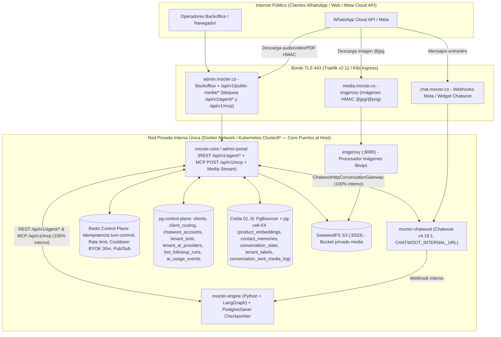
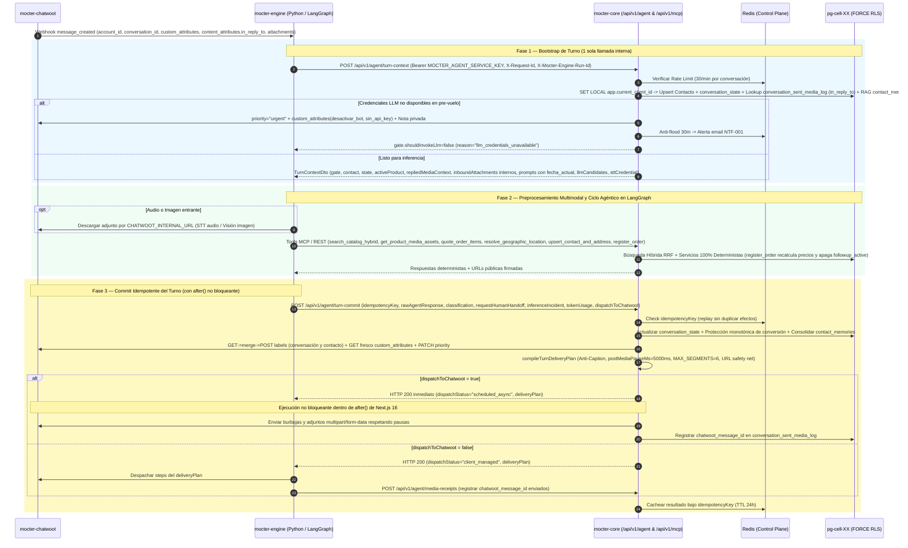

# SPEC-23 · Diseño Técnico · Gateway Híbrido RESTful (OpenAPI 3.1) + MCP Stateless, Multimedia Firmada, Resiliencia BYOK, Adaptador Chatwoot y Guía de Integración para `mocter-engine` (Python / LangGraph)

| Atributo       | Valor                                                                                                                                                                                                                                                                                                                                                                                                                                                                                                                  |
| -------------- | ---------------------------------------------------------------------------------------------------------------------------------------------------------------------------------------------------------------------------------------------------------------------------------------------------------------------------------------------------------------------------------------------------------------------------------------------------------------------------------------------------------------------- |
| **ID**         | `SPEC-23`                                                                                                                                                                                                                                                                                                                                                                                                                                                                                                              |
| **Versión**    | `1.2.0` (Post Spec Review + Patrones Operativos de Producción)                                                                                                                                                                                                                                                                                                                                                                                                                                                         |
| **Estado**     | Aprobada · Lista para implementación                                                                                                                                                                                                                                                                                                                                                                                                                                                                                   |
| **Depende de** | [`requirements.md`](requirements.md), [SPEC-22](../spec-22-particionamiento-pgvector-embeddings-busqueda-hibrida/design.md), [API-001](../api-001-openapi-swagger/design.md), [BOT-001](../bot-001-atencion-automatizada-llm/design.md), [BOT-002](../bot-002-motor-atencion-prompts/design.md), [NTF-001](../ntf-001-notificaciones-email/design.md), [SPEC-19](../spec-19-arquitectura-prompts-ideal-comercializacion-clasificador/design.md), [SPEC-20](../spec-20-estandar-geografico-e164-homologacion/design.md) |

---

## 1. Topología de Red Privada (Docker Actual → Kubernetes Futuro)



### Mapeo Explícito Docker → Kubernetes (Escalado Multi-Celda)

| Aspecto                                                    | Entorno Actual (Red Privada Docker)                                                                  | Evolución Multi-Celda (Kubernetes)                                                                                  |
| ---------------------------------------------------------- | ---------------------------------------------------------------------------------------------------- | ------------------------------------------------------------------------------------------------------------------- |
| **Invocación `mocter-engine` → `mocter-core`**             | `http://admin-portal:3003/api/v1/...` (DNS Docker interno)                                           | `http://mocter-admin.mocter.svc.cluster.local:3003/api/v1/...` (Service `ClusterIP`)                                |
| **Invocación `mocter-core` → `mocter-chatwoot`**           | `CHATWOOT_INTERNAL_URL=http://mocter-chatwoot-rails-1:3000`                                          | `CHATWOOT_INTERNAL_URL=http://mocter-chatwoot.mocter.svc.cluster.local:3000`                                        |
| **Estado MCP / Idempotencia / Rate limit / Cooldown BYOK** | **100 % stateless** en Redis del Control Plane (`ioredis`)                                           | Multi-réplica HPA sin _sticky sessions_ (`POST /api/v1/mcp` stateless)                                              |
| **Enrutamiento a Celdas 01, 02… N**                        | `CellDatabasePoolManager` vía `client_routing` + PgBouncer                                           | Misma capa de dominio sobre Clusters + Poolers de CloudNativePG                                                     |
| **Regla Traefik / Ingress**                                | Regla de red privada: NO publicar rutas `/api/v1/agent/*` ni `/api/v1/mcp` al router público externo | `Ingress` expone únicamente `/api/v1/public-media/*` y Backoffice; M2M viaja solo por `ClusterIP` + `NetworkPolicy` |

---

## 2. Flujo de Secuencia Completo por Turno



---

## 3. Cambios Obligatorios en Infraestructura Interna de `apps/admin`

### 3.1 Actualización de `apps/admin/proxy.ts`

1. Añadir exención explícita del chequeo de cookie `mocter_sid` para:
   - `pathname.startsWith("/api/v1/agent/")` (incluyendo `/api/v1/agent/openapi.json` y `/api/v1/agent/media-receipts`)
   - `pathname === "/api/v1/mcp"`
   - `pathname.startsWith("/api/v1/public-media/")`
2. **Inyección garantizada de `x-request-id` (`AGENTS.md §4.13`):** En las rutas exentas anteriores, `proxy.ts` clona `request.headers`, asegura `x-request-id` (preservando el entrante de `mocter-engine` o generando `crypto.randomUUID()`) y retorna `NextResponse.next({ request: { headers: requestHeaders } })`, propagando `x-request-id` también en la respuesta.
3. **Eliminación del bypass accidental de `pathname.includes(".")` sobre `/api/v1/agent/openapi.json`:**
   - `/api/v1/agent/openapi.json` es validado explícitamente en su Route Handler exigiendo `MOCTER_AGENT_SERVICE_KEY` válida **o** sesión activa de `platform_admin`/`platform_owner`.
   - `/api-docs/agent` permanece protegido por `proxy.ts` y valida rol `platform_admin`/`platform_owner` en Server Component.
4. Actualizar `config.matcher` para mantener coherencia con las nuevas rutas.

### 3.2 Sanitización de Errores `500` en `apps/admin/lib/errors/route.ts`

En `handle()`, cuando `status >= 500`:

- Registrar el error real completo en `appLogger.error(...)` con `{ requestId, path }`.
- Devolver en el cuerpo RFC 9457 (`application/problem+json`) un `detail` genérico seguro (`"Error interno del servidor. Utiliza el identificador de referencia para diagnóstico."`) sin filtrar `e.message` (`AGENTS.md §4.14`).

### 3.3 Dependencias en `apps/admin/package.json`

Agregar las versiones ya estandarizadas en `apps/web/package.json`:

- `"@asteasolutions/zod-to-openapi": "^9.1.0"`
- `"@scalar/api-reference-react": "^0.9.81"`

---

## 4. Evolución Celular (`0029` / `0030`) en `packages/domain`

### 4.1 Cambios en `admin.conversation_state` (`packages/domain/src/db/schemas/tenant/conversation-state.ts`)

Se añaden a `cellConversationState`:

- `botPaused: boolean("bot_paused").notNull().default(false)`
- `botPausedReason: text("bot_paused_reason")`
- `botPausedAt: timestamp("bot_paused_at", { withTimezone: true })`
- `turnCount: integer("turn_count").notNull().default(0)` (`CHECK (turn_count >= 0)`)
- `operationalLabels: jsonb("operational_labels").$type<string[]>().notNull().default(sql`'[]'::jsonb`)`
- `followupActive: boolean("followup_active").notNull().default(true)` — indica si la conversación sigue elegible para secuencias de seguimiento (`BOT-001 RF-11.4`).
- `lastCommittedMessageId: text("last_committed_message_id")`
- Se elimina el constraint rígido `conversation_state_last_label_check` de 4 slugs y se reemplaza por `CHECK (last_label IS NULL OR length(trim(last_label)) > 0)`, permitiendo `devolucion` y todas las etiquetas funcionales personalizadas de `SPEC-19`.

### 4.2 Cambios en `admin.tenant_labels` (`packages/domain/src/db/schemas/tenant/tenancy-catalog.ts`)

Se añaden a `cellTenantLabels` (tabla residente en la celda):

- `chatwootPriority: text("chatwoot_priority")` con `CHECK (chatwoot_priority IS NULL OR chatwoot_priority IN ('urgent', 'high', 'medium', 'low'))` — prioridad que Mocter aplica automáticamente en Chatwoot al activar la etiqueta.
- `isConversion: boolean("is_conversion").notNull().default(false)` — marca etiquetas de conversión terminal que activan la protección monotónica (`RN-SPEC-23-07`) y apagan `followup_active`.
- **Backfill idempotente en `0029`:**
  - `UPDATE admin.tenant_labels SET is_conversion = true, chatwoot_priority = 'urgent' WHERE lower(title) = 'compra-realizada';`
  - `UPDATE admin.tenant_labels SET chatwoot_priority = 'urgent' WHERE lower(title) IN ('soporte_humano', 'devolucion') AND chatwoot_priority IS NULL;`

### 4.3 Nueva Tabla Celular `admin.conversation_sent_media_log`

Ubicación en esquema Drizzle: `packages/domain/src/db/schemas/tenant/conversation-state.ts` (exportado en `tenant/index.ts`).

```sql
CREATE TABLE IF NOT EXISTS admin.conversation_sent_media_log (
  id                       uuid        NOT NULL DEFAULT uuidv7(),
  client_id                uuid        NOT NULL,
  chatwoot_conversation_id integer     NOT NULL,
  chatwoot_message_id      integer     NOT NULL,
  product_id               uuid,
  media_id                 uuid,
  media_kind               text        NOT NULL,
  created_at               timestamptz NOT NULL DEFAULT now(),
  CONSTRAINT cell_conversation_sent_media_log_pkey PRIMARY KEY (client_id, id),
  CONSTRAINT conversation_sent_media_log_kind_check CHECK (media_kind IN ('image', 'video', 'audio', 'pdf'))
);

CREATE UNIQUE INDEX IF NOT EXISTS conversation_sent_media_log_client_msg_unique
  ON admin.conversation_sent_media_log (client_id, chatwoot_message_id);

CREATE INDEX IF NOT EXISTS conversation_sent_media_log_client_conv_idx
  ON admin.conversation_sent_media_log (client_id, chatwoot_conversation_id, created_at DESC);
```

### 4.4 Migraciones Celulares `0029` y `0030` (`packages/domain/drizzle-cell/`)

- `0029_cell_phase13_agent_gateway_spec23.sql`: altera `admin.conversation_state` y `admin.tenant_labels`, aplica backfill idempotente en `admin.tenant_labels` y crea `admin.conversation_sent_media_log` con sus índices y constraints.
- `0030_cell_phase13_rls_grants_comments_spec23.sql`:
  - Habilita `ENABLE` y `FORCE ROW LEVEL SECURITY` en `admin.conversation_sent_media_log` con política `tenant_isolation` (`client_id = current_setting('app.current_client_id', true)::uuid`).
  - Otorga `GRANT SELECT, INSERT, UPDATE, DELETE ON admin.conversation_sent_media_log TO mocter_migrator, mocter_admin, mocter_app`.
  - Declara `COMMENT ON TABLE` y `COMMENT ON COLUMN` obligatorios (`AGENTS.md §4.5`) para todas las columnas nuevas y la tabla nueva.
  - Actualiza `meta/_journal.json` y snapshots para que `pnpm --filter @mocter/domain db:check:cell` pase limpio.

---

## 5. Seguridad M2M, Rate Limit, Cooldown Anti-Flood y Redacción de Secretos

### 5.1 Variables de Entorno (`packages/domain/src/utils/env.ts`, `apps/admin/env.ts`, `.env.example`)

- `MOCTER_AGENT_SERVICE_KEY`: `z.string().min(32).optional()` (secreto compartido en red interna entre `mocter-engine` y `mocter-core`).
- `MOCTER_PUBLIC_ADMIN_URL`: `z.string().url().optional()` (origen público para `/api/v1/public-media/:mediaId`, p. ej. `https://admin.mocter.co`; fallback `NEXT_PUBLIC_ADMIN_URL`).
- `MOCTER_PUBLIC_MEDIA_SIGNING_KEY`: `z.string().min(32).optional()` (clave dedicada para firmar URLs de `/api/v1/public-media/:mediaId`; si no se define explícitamente, se deriva con `HMAC-SHA256(IMGPROXY_KEY, "mocter-public-media-v1:" + IMGPROXY_SALT)`).
- `MOCTER_PUBLIC_MEDIA_TTL_SECONDS`: `z.coerce.number().int().min(60).max(86400).default(3600)`.
- `MOCTER_AGENT_RATE_LIMIT_PER_CONV_PER_MIN`: `z.coerce.number().int().min(5).max(300).default(30)`.
- `MOCTER_STT_API_KEY`: `z.string().min(16).optional()` (credencial de plataforma para transcripción STT de respaldo cuando el comercio use proveedores de chat sin STT nativo, p. ej. Anthropic o DeepSeek).
- `MOCTER_WHATSAPP_POST_MEDIA_PAUSE_MS`: `z.coerce.number().int().min(0).max(8000).default(5000)` (pausa de sincronización tras binarios en WhatsApp).
- `MOCTER_INCIDENT_COOLDOWN_SECONDS`: `z.coerce.number().int().min(60).max(86400).default(1800)` (enfriamiento anti-flood de 30 minutos para alertas de incidentes BYOK/LLM).

### 5.2 Redacción Ampliada en `packages/domain/src/utils/logger.ts`

- Añadir en `SENSITIVE_PATTERNS`:
  - `{ regex: /([?&]sig=)[^&\s"']+/gi, replacement: "$1[REDACTED]" }`
  - `{ regex: /(x-mocter-agent-key["']?\s*[:=]\s*["']?)[^\s"',}]+/gi, replacement: "$1[REDACTED]" }`
- Añadir en el regex de claves de `sanitizeObject`: `x-mocter-agent-key|mocter_agent_service_key|mocter_stt_api_key` (además de la redacción ya existente de `apiKey`/`api_key`/`authorization`/`token`/`secret`).

### 5.3 Guardia `verifyAgentServiceAuth` (`apps/admin/lib/agent-auth.ts`)

1. Valida `Authorization: Bearer <token>` o `X-Mocter-Agent-Key` contra `env.MOCTER_AGENT_SERVICE_KEY` mediante `compareHashesConstantTime(hashToken(provided), hashToken(expected))`. Si falta o no coincide → `401 UNAUTHORIZED` (RFC 9457). Si `MOCTER_AGENT_SERVICE_KEY` no está configurada → `503 SERVICE_UNAVAILABLE`.
2. Extrae `requestId` (`x-request-id`) y `engineRunId` (`x-mocter-engine-run-id`).
3. **Resolución y validación anti-conflicto de tenencia (`RN-SPEC-23-05`):**
   - Lee `headerClientId = req.headers.get("x-mocter-client-id")`, `bodyClientId` y `chatwootAccountId`.
   - Si existe `chatwootAccountId`, resuelve `resolvedFromCw = findTenantByChatwootAccountId(chatwootAccountId)`.
   - Verifica que todos los identificadores presentes coincidan exactamente; si difieren → `400 TENANT_CONTEXT_MISMATCH`.
   - Resuelve `cellId` vía `cellDatabasePoolManager.resolveCellIdForClient(clientId)`.
4. **Rate Limit distribuido en Redis:** Cuando exista `chatwootConversationId` (de body o cabecera `x-mocter-conversation-id`), incrementa `INCR agent:rl:${clientId}:${chatwootConversationId}:${minuteBucket}` con `EXPIRE 60`; si supera `MOCTER_AGENT_RATE_LIMIT_PER_CONV_PER_MIN` → `429 Too Many Requests` con `Retry-After`.

---

## 6. Entrega Multimedia Pública Firmada, Compilador `deliveryPlan` Endurecido y Despacho No Bloqueante `after()`

### 6.1 Firmador y Verificador (`packages/domain/src/utils/public-media-signer.ts`)

```typescript
export interface PublicAgentMediaAssetDto {
  mediaId: string;
  productId?: string | null;
  mediaKind: "image" | "video" | "audio" | "pdf";
  sortOrder: number;
  audioOrder: number | null;
  isCover: boolean;
  mimeType: string;
  originalFilename: string;
  sizeBytes: number;
  altText: string | null;
  deliveryEngine: "imgproxy" | "public_media_hmac";
  publicDeliveryUrl: string;
  expiresAt: string | null;
  /** Indica si el MIME/formato es admitido directamente por WhatsApp Cloud API. */
  whatsappCompatible: boolean;
  channelCompatibilityNotes: string | null;
}
```

- **Regla de resolución por tipo (`RN-SPEC-23-02`):**
  1. `mediaKind === "image"`: firma con `buildImgproxyUrl(storageKey, { width: 1200, height: 1200, resizingType: "fit", format: mimeType === "image/png" ? "png" : "jpg" })`. `deliveryEngine = "imgproxy"`, `whatsappCompatible = true`.
  2. `mediaKind IN ("audio", "video", "pdf")`: genera token HMAC-SHA256 sobre `"mocter-public-media-v1:" + clientId + ":" + mediaId + ":" + expiresUnixSec` y construye `${publicAdminOrigin}/api/v1/public-media/${mediaId}?clientId=${clientId}&exp=${expiresUnixSec}&sig=${sig}`.
     - `whatsappCompatible`: `true` para `video/mp4`, `audio/ogg`, `audio/mpeg`, `audio/aac`, `audio/mp4`, `application/pdf`; `false` para `video/webm` y `audio/wav` (con `channelCompatibilityNotes` detallando la restricción de WhatsApp Cloud API).

### 6.2 Endpoint `GET /api/v1/public-media/[mediaId]/route.ts`

- Valida `clientId` (UUID), `exp` (entero Unix `>= now`), `sig` (HMAC en tiempo constante). Si expiró → `410 Gone`; si firma inválida → `403 Forbidden`.
- Obtiene el stream desde `resolveTenantMediaStreamSource(clientId, mediaId)` + `S3StorageService.getObjectStream(storageKey, rangeHeader)`.
- Respuesta HTTP `200` / `206 Partial Content` con:
  - `Content-Type: <source.mimeType>`
  - `Content-Disposition: inline; filename="<sanitized>"`
  - `Accept-Ranges: bytes`
  - `Cache-Control: private, max-age=${Math.max(0, Math.min(300, exp - now))}` (o `no-store` si `exp - now <= 0`)
  - `X-Content-Type-Options: nosniff`

### 6.3 Compilador `compileTurnDeliveryPlan` (`packages/domain/src/services/turn-delivery-compiler.ts`)

Algoritmo determinista paso a paso:

1. **Normalización de saltos de línea:** Reemplaza `\r\n` y `\r` por `\n`.
2. **Segmentación por marcadores:** Parsea `[[SPLIT]]`, `[[SPLIT:ms]]` (pausa explícita acotada a `0..5000 ms`) y **`[[SPLIT:media]]`** (delay `0 ms`), respetando `BubbleChannel` y `BubblePreset`.
3. **Tope defensivo `MAX_SEGMENTS = 6`:** Si los segmentos resultantes superan `6`, concatena los segmentos `6..N` en el sexto segmento separados por `\n\n` y reporta `wasTruncated: true`.
4. **Resolución de marcadores `[[MEDIA:([^:\]]+)(?::(imagen|image|video|audio|pdf))?(?::(\d+))?]]`:**
   - Prioridad 1: `term` coincide con `productId` (UUID) o con el producto activo de la conversación si `term === "activo"`.
   - Prioridad 2: `normalizeLexicalText(term)` coincide con `normalizeLexicalText(product.mediaTerm)`.
   - Prioridad 3: `slugifyMediaTerm(term)` coincide con `slugifyMediaTerm(product.name)`.
5. **Red de seguridad para URLs crudas del dominio confiable:** Si un segmento de texto contiene una URL HTTP(S) cuyo origen coincide exactamente con `IMGPROXY_PUBLIC_URL` o `${MOCTER_PUBLIC_ADMIN_URL}/api/v1/public-media/`, el compilador extrae dicha URL del texto y genera un paso `{ kind: "media", caption: null, publicDeliveryUrl, ... }` (evitando fugas de URLs crudas en WhatsApp).
6. **Regla Anti-Caption (`RN-SPEC-23-03`) sin reordenamiento ciego:** Dentro de cada segmento, si coexisten uno o más pasos `media` y texto residual, emite primero los pasos `media` del segmento (`caption: null`) y luego el paso `text` limpio. **No** mueve todos los binarios al principio de la respuesta completa, preservando el orden secuencial de audios definido por `SPEC-19`.
7. **Pausa Post-Multimedia (`postMediaPauseMs`):** Si `channel === "whatsapp"`, todo paso `text` cuyo paso inmediatamente anterior en el `deliveryPlan` final sea `kind === "media"` recibe `pauseMs = Math.max(computedPauseMs, env.MOCTER_WHATSAPP_POST_MEDIA_PAUSE_MS)` (default `5000 ms`, tope `8000 ms`).

### 6.4 Despacho No Bloqueante vía `after()` (`apps/admin/app/api/v1/agent/turn-commit/route.ts`)

- Cuando `dispatchToChatwoot === true`:
  - Todas las mutaciones deterministas (estado celular, etiquetas, prioridad, `custom_attributes`, tokens, memoria RAG, registro de incidente BYOK) concluyen antes de responder HTTP `200`.
  - Si `deliveryPlan.steps` contiene pasos con pausas acumuladas `> 0 ms`, el Route Handler registra el despacho secuencial dentro de **`after(async () => { ... })`** (`import { after } from "next/server"`), respondiendo de inmediato con `dispatchStatus: "scheduled_async"`.
  - Dentro de `after()`, cada `sendMediaAttachment` exitoso persiste el `chatwootMessageId` retornado en `admin.conversation_sent_media_log`; cualquier fallo de red hacia Chatwoot se captura y registra con `appLogger.error({ event: "agent.turn_commit.async_dispatch_failed", requestId, ... })` sin lanzar excepciones no controladas.

---

## 7. Adaptador HTTP Conversacional Seguro hacia `mocter-chatwoot`

Ubicación: `packages/domain/src/services/chatwoot-conversation.gateway.ts`

Implementa `IChatwootConversationGateway` (de `lead-classifier-orchestrator.ts`) extendido para operación productiva sobre `env.CHATWOOT_INTERNAL_URL` usando `api_access_token: <decryptedServiceToken>` descifrado en memoria desde `admin.chatwoot_accounts.service_token_ciphertext`:

1. **`updateConversationLabels({ accountId, conversationId, labels, managedCatalogTitles, serviceToken })`:**
   - Ejecuta primero `GET /api/v1/accounts/{accountId}/conversations/{conversationId}/labels`.
   - Preserva todas las etiquetas actuales que **no** pertenezcan al conjunto gestionado (`managedCatalogTitles` de `admin.tenant_labels`), une el nuevo conjunto de etiquetas funcionales/operativas dedupado y envía `POST .../labels` (`RN-SPEC-23-08`).
2. **`updateContactLabels({ accountId, contactId, labels, managedCatalogTitles, serviceToken })`:**
   - Ejecuta el mismo patrón **`GET → merge → POST`** sobre `/api/v1/accounts/{accountId}/contacts/{contactId}/labels`, asegurando que la etiqueta comercial y operativa quede visible también en la ficha CRM del contacto en Chatwoot sin destruir etiquetas manuales.
3. **`getConversationDetails({ accountId, conversationId, serviceToken })`:**
   - `GET /api/v1/accounts/{accountId}/conversations/{conversationId}` retornando `{ status, priority, customAttributes, labels, contactId }`.
4. **`updateConversationCustomAttributes({ accountId, conversationId, patch, respectHumanBotPause = true, serviceToken })`:**
   - Ejecuta primero `getConversationDetails` para leer `current = custom_attributes`.
   - Fusiona `{ ...current, ...patch }`; si `respectHumanBotPause === true` y `current.desactivar_bot === true`, **impide** sobrescribir `desactivar_bot` a `false` y devuelve `humanPausedDetected: true`.
   - Envía `POST /api/v1/accounts/{accountId}/conversations/{conversationId}/custom_attributes`.
5. **`updateConversationPriority({ accountId, conversationId, priority, serviceToken })`:**
   - `PATCH /api/v1/accounts/{accountId}/conversations/{conversationId}` con `{ priority }` (`"urgent" | "high" | "medium" | "low" | null`).
6. **`getRecentMessages({ accountId, conversationId, limit = 20, serviceToken })`:**
   - `GET /api/v1/accounts/{accountId}/conversations/{conversationId}/messages`, filtrando obligatoriamente `msg.private !== true && msg.message_type !== 2` (descartando notas privadas de agentes y mensajes de actividad del sistema).
7. **`sendPrivateNote({ accountId, conversationId, content, serviceToken })`:**
   - `POST /api/v1/accounts/{accountId}/conversations/{conversationId}/messages` con `{ content, message_type: "outgoing", private: true }`.
8. **`handoffToHumanAgent({ accountId, conversationId, reasonLabel, noteContent?, serviceToken })`:**
   - `POST .../toggle_status` (`{ status: "open" }`) + `updateConversationPriority("urgent")` + `updateConversationCustomAttributes({ desactivar_bot: true })` + `sendPrivateNote(...)`.
9. **`sendTextMessage({ accountId, conversationId, content, serviceToken })`:**
   - `POST .../messages` con `{ content, message_type: "outgoing", private: false }`, retornando `{ success, chatwootMessageId }`.
10. **`sendMediaAttachment({ accountId, conversationId, asset, buffer, serviceToken })`:**
    - `POST .../messages` en `multipart/form-data` adjuntando `attachments[]` (imágenes desde `imgproxy` interno `@jpg`/`@png`; audio/video/PDF directo desde `S3StorageService`), `message_type=outgoing`, `content=""` (Anti-Caption), retornando `{ success, chatwootMessageId }`.

---

## 8. Evolución de `PromptComposer`, Clasificador Monotónico y Circuito de Incidentes BYOK/LLM

### 8.1 Inyección de `{fecha_actual}` Localizada en `PromptComposer` (`packages/domain/src/services/prompt-composer.ts`)

- Se agregan a `ComposePromptInput`:
  - `currentDateTimeIso?: string` (default `new Date().toISOString()`)
  - `timezone?: string | null` (derivado de `clients.timezone`, fallback `"UTC"`)
- `PromptComposer` formatea la fecha localizada mediante:
  ```typescript
  const formattedCurrentDate = new Intl.DateTimeFormat(
    input.locale === "es" ? "es-419" : "en-US",
    { timeZone: safeTimezone, dateStyle: "full", timeStyle: "short" },
  ).format(referenceDate);
  ```
- Sustituye tanto `{{current_date}}` como `{fecha_actual}` (compatibilidad con plantillas existentes de comercios) y añade una línea compacta en el bloque de estado operativo (`Fecha y hora actual del comercio: <formattedCurrentDate> (<safeTimezone>)`).

### 8.2 Protección Monotónica de Conversión y Seguimientos (`packages/domain/src/services/lead-classifier.ts` y `lead-classifier-orchestrator.ts`)

- Se extiende `TenantClassifierLabelDefinition` con `isConversion?: boolean` y `chatwootPriority?: "urgent" | "high" | "medium" | "low" | null`.
- En `resolveTenantConversationClassification`:
  - Si `previousFunctionalLabel` corresponde a una etiqueta con `isConversion === true` (ej. `compra-realizada`), y el clasificador propone otra etiqueta funcional cuyo slug **no** es `"devolucion"` (ni tiene `isConversion === true`), la transición funcional se marca `conversionDowngradeBlocked: true` y se **conserva** `previousFunctionalLabel`.
  - La evaluación de **Etiquetas Operativas** (`soporte_humano`, `pagado`, `despachado`, `cliente_recurrente`, etc.) y sus `sideEffects` **nunca** se bloquea por `isConversion`.
  - Determina `recommendedChatwootPriority` como la mayor severidad (`urgent > high > medium > low`) entre la etiqueta funcional final y las etiquetas operativas activas.
- **Cancelación automática de seguimientos (`BOT-001 RF-11.4`):** Cada vez que una conversación alcanza `isConversion = true`, registra un pedido en `register_order` o pasa a `bot_paused = true`:
  - Actualiza `admin.conversation_state.followup_active = false` en la celda.
  - Ejecuta en Control Plane: `UPDATE admin.bot_followup_runs SET status = 'stopped', stop_reason = $stopReason, updated_at = now() WHERE client_id = $clientId AND chatwoot_conversation_id = $conversationId AND status = 'running'`.

### 8.3 Circuito de Incidentes de Credenciales BYOK/LLM (`AgentGatewayOrchestratorService`)

Disparado en dos puntos:

1. **Pre-vuelo en `bootstrapConversationTurn`:** Cuando `AiCredentialResolverService.resolveCredentialCandidates({ clientId })` no devuelve ningún candidato ejecutable (`AI_BYOK_REQUIRED`, `AI_KEY_INVALID`, `AI_PLATFORM_QUOTA_EXCEEDED`).
2. **Runtime en `commitConversationTurn`:** Cuando `mocter-engine` reporta `inferenceIncident`.

Comportamiento exacto según alcance:

- **`scope === "partial_failover"` (falló `primary`, respondió `secondary`):**
  1. Actualiza en Control Plane `admin.tenant_ai_providers` del `failedProviderId`: `last_verification_error = summary`; si `errorType === "invalid_api_key"` o `httpStatus === 401`, actualiza `status = "invalid"`; si `errorType === "insufficient_quota"`, conserva `status = "active"` (respetando `tenant_ai_providers_status_check`).
  2. NO pausa el bot, NO cambia prioridad de conversación, NO interrumpe el envío de la respuesta generada por el proveedor secundario.
  3. Evalúa cooldown Redis `SET agent:key_incident_cooldown:${clientId} 1 NX EX ${cooldownSec}`; si lo adquiere, envía correo de aviso preventivo vía `NTF-001` al propietario del comercio.
- **`scope === "total_failure"` (sin candidatos en pre-vuelo o fallaron todos los candidatos en runtime):**
  1. Actualiza `admin.tenant_ai_providers` igual que arriba.
  2. Actualiza en celda `admin.conversation_state`: `bot_paused = true`, `bot_paused_reason = "llm_credentials_incident"`, `bot_paused_at = now()`, `followup_active = false`, y detiene `admin.bot_followup_runs`.
  3. Invoca `ChatwootHttpConversationGateway`:
     - `updateConversationPriority(..., "urgent")`
     - `updateConversationCustomAttributes(..., { desactivar_bot: true, sin_api_key: true })`
     - `sendPrivateNote(...)` indicando el tipo de incidente (`invalid_api_key` o `insufficient_quota`) y cómo reactivar el bot desde el Backoffice.
  4. Evalúa cooldown Redis `SET agent:key_incident_cooldown:${clientId} 1 NX EX ${cooldownSec}`; si lo adquiere, dispara correo de alerta crítica vía `NTF-001` al comercio y copia al correo administrativo SaaS.

---

## 9. Contratos Canónicos de las 9 Operaciones + Recibos Multimedia (Zod v4 + REST + MCP)

Ubicación de esquemas: `packages/domain/src/validation/agent-gateway.schemas.ts`
Ubicación del servicio: `packages/domain/src/services/agent-gateway-orchestrator.service.ts`

1. **`bootstrap_conversation_turn` (`POST /api/v1/agent/turn-context`):**
   - Entrada: `{ chatwootAccountId?, clientId?, chatwootConversationId, chatwootInboxId?, channel?, conversation?: { customAttributes?: Record<string, unknown>, labels?: string[], priority?: string | null }, sender: { chatwootContactId, name?, phoneMobile?, email? }, message: { id, content, messageType, createdAt?, inReplyToChatwootMessageId?: number | null, attachments?: Array<{ id?: number, fileType: "audio" | "image" | "video" | "file", dataUrl: string, mimeType?: string, fileSize?: number }> } }`.
   - Guardrails (`gate`): evalúa en orden:
     1. `messageType !== "incoming"` → `ignoring_non_incoming`.
     2. `tenantBot.status !== "active"` → `bot_paused`.
     3. Canal deshabilitado en `tenant_bot_channels` → `channel_disabled`.
     4. `conversation.customAttributes?.desactivar_bot === true` (sincroniza `conversation_state.bot_paused = true`, `followup_active = false` y detiene `bot_followup_runs`) o `conversationState.botPaused === true` → `conversation_handed_off`.
     5. `conversationState.turnCount >= tenantBot.maxTurns` → `max_turns_exceeded`.
     6. Fuera de `tenantBot.businessHours` → `out_of_hours` con `staticReplyMessage = defaultMessages.out_of_hours.body`.
     7. Sin `llmCandidates` válidos → dispara circuito de incidente total BYOK/LLM y retorna `shouldInvokeLlm = false`, `reason = "llm_credentials_unavailable"`.
     8. Caso contrario → `shouldInvokeLlm = true`, `reason = "ready"`.
   - Salida: `{ tenant, gate, contact, conversationState, activeProduct, repliedMediaContext, inboundAttachments, contactMemory, prompts: { systemPrompt, classifierPrompt, usedBlocks, estimatedTokens, formattedCurrentDate }, businessContext: { bubblePreset, paymentChannels, carriers, shippingPolicy }, llmCandidates, sttCredential }`.
2. **`search_catalog_hybrid` (`POST /api/v1/agent/catalog/search`):**
   - Delega en `CatalogHybridSearchService.searchCatalogHybrid` (`SPEC-22`).
3. **`get_product_details_and_pricing` (`GET /api/v1/agent/catalog/products/[productId]`):**
   - Acepta `productId` (UUID), `sku` o `mediaTerm` + opcional `recomposePromptForConversationId`.
4. **`get_product_media_assets` (`GET /api/v1/agent/catalog/products/[productId]/media`):**
   - Filtra por `mediaKind?` y `audioOrder?` (1-based) y retorna `PublicAgentMediaAssetDto[]`.
5. **`quote_order_items` (`POST /api/v1/agent/orders/quote`):**
   - Entrada: `{ clientId?, items: Array<{ productId: uuid, quantity: int > 0, selectedAttributes?: Record<string, string> }>, shippingMethod?: "home" | "office", countryCode?, subdivisionCode?, city? }`.
   - Salida: `{ currency, isReadyToOrder, unavailableItems, missingRequiredAttributes, lines, subtotalCents, discountCents, shippingCents, totalCents }`.
6. **`resolve_geographic_location` (`POST /api/v1/agent/geo/resolve`):**
   - Delega en `LocationResolverService.resolve` (`SPEC-20`).
7. **`upsert_contact_and_address` (`POST /api/v1/agent/crm/contacts/upsert`):**
   - Valida E.164 con `libphonenumber-js`, aplica **patch no destructivo** (`COALESCE(NULLIF(trim(nuevo), ''), actual)`, `RN-SPEC-23-06`), actualiza/crea libreta de direcciones de 8 campos y consentimientos Habeas Data.
8. **`register_order` (`POST /api/v1/agent/orders/register`):**
   - **Entrada estricta SIN precios (`RN-SPEC-23-01`):** `{ clientId?, chatwootConversationId, prospectId?, paymentMethod, paymentChannelId?, customer: { name, phone, document? }, shipping: { method, contactAddressId?, countryCode?, subdivisionCode?, state?, city?, neighborhood?, addressLine?, addressComplement?, postalCode?, referenceNotes?, carrierId?, carrierName? }, items: Array<{ productId: uuid, quantity: int > 0, selectedAttributes?: Record<string, string> }>, notes? }`.
   - Invoca `quoteOrderItems()` primero; si `!quote.isReadyToOrder` rechaza con código tipado (`ORDER_STOCK_INSUFFICIENT` / `ORDER_REQUIRED_ATTRIBUTE_MISSING` / `ORDER_PRODUCT_INACTIVE`). Al crear la orden vía `BotOrderCaptureService.capture()`, actualiza `conversation_state.followup_active = false` y detiene `admin.bot_followup_runs` activos.
9. **`commit_conversation_turn` (`POST /api/v1/agent/turn-commit`):**
   - **Entrada con idempotencia obligatoria (`RN-SPEC-23-04`):** `{ idempotencyKey: string (min 8, max 160), clientId?, chatwootAccountId?, chatwootConversationId, chatwootContactId?, inboundMessageId?, prospectId?, channel?, rawAgentResponse, statePatch?, classification?, requestHumanHandoff?: { enabled: boolean, reason?: string }, inferenceIncident?: { scope: "partial_failover" | "total_failure", failedProviderId: uuid, failedRole: "primary" | "secondary", errorType: "invalid_api_key" | "insufficient_quota" | "rate_limit" | "provider_error", httpStatus?: number, providerErrorCode?: string, message?: string }, tokenUsage?, memoryConsolidation?, dispatchToChatwoot?: boolean }`.
   - **Ejecución idempotente:** Consulta Redis `agent:commit:${clientId}:${idempotencyKey}` (fallback `conversation_state.last_committed_message_id`). Si es nuevo: procesa `inferenceIncident` y/o `requestHumanHandoff`, actualiza `conversation_state`, aplica clasificación monotónica + `GET→merge→POST` en conversación y contacto + `priority` + `custom_attributes` frescos, compila `deliveryPlan` endurecido, programa despacho vía `after()` si `dispatchToChatwoot === true` (registrando `conversation_sent_media_log`), inserta `admin.ai_usage_events`, consolida `contact_memories` y cachea 24h en Redis.
10. **Auxiliar REST M2M — `POST /api/v1/agent/media-receipts` (no expuesto en MCP `tools/list`):**
    - Entrada: `{ clientId?, chatwootAccountId?, chatwootConversationId, receipts: Array<{ chatwootMessageId: int > 0, productId?: uuid | null, mediaId?: uuid | null, mediaKind: "image" | "video" | "audio" | "pdf" }> }`.
    - Inserta idempotentemente (`ON CONFLICT (client_id, chatwoot_message_id) DO NOTHING`) en `admin.conversation_sent_media_log`.

---

## 10. Servidor MCP Streamable HTTP Stateless (`POST /api/v1/mcp`)

Ubicación: `apps/admin/app/api/v1/mcp/route.ts`

- **Protocolo:** JSON-RPC 2.0 sobre MCP Streamable HTTP (`2025-03-26`, con fallback negociado a `2024-11-05`).
- **Handlers HTTP:**
  - `POST`: autentica con `verifyAgentServiceAuth(req)` (permite `initialize`, `ping` y `tools/list` sin `clientId` en cabecera; exige `clientId` o `chatwootAccountId` en `tools/call`).
    - Notificaciones JSON-RPC sin `id` (como `notifications/initialized`) retornan `new Response(null, { status: 202 })`.
    - `tools/list`: serializa únicamente las 9 herramientas canónicas de `AGENT_GATEWAY_TOOLS` generando `inputSchema` con `z.toJSONSchema(tool.inputSchema)` (nativo de Zod v4 `^4.6.7`).
    - `tools/call`: fusiona `X-Mocter-Client-Id` / `X-Mocter-Conversation-Id` (validando anti-conflicto `RN-SPEC-23-05`), valida argumentos con Zod, invoca `AgentGatewayOrchestratorService` y retorna `{ content: [{ type: "text", text: JSON.stringify(result) }], isError: !result.ok }`.
  - `GET` y `DELETE`: retornan `405 Method Not Allowed` con cabecera `Allow: POST` (servidor MCP stateless compatible con balanceo horizontal en Kubernetes).

---

## 11. Guía de Integración de Referencia para `mocter-engine` (Python + LangGraph)

Para el desarrollo del proyecto hermano **`mocter-engine`**:

1. **Variables de entorno en `mocter-engine` (Docker / Kubernetes):**
   ```env
   MOCTER_CORE_BASE_URL=http://admin-portal:3003          # K8s: http://mocter-admin.mocter.svc.cluster.local:3003
   MOCTER_AGENT_SERVICE_KEY=<clave_compartida_min_32_chars>
   CHATWOOT_INTERNAL_URL=http://mocter-chatwoot-rails-1:3000
   ENGINE_CHECKPOINTER_DATABASE_URL=postgresql://...      # BD operativa propia de LangGraph
   ```
2. **Frontera Explícita de Memoria (Corto Plazo vs. Largo Plazo):**
   - **Memoria Conversacional de Corto Plazo (ventana de últimos 20 turnos):** Reside en el **`PostgresSaver` Checkpointer nativo de LangGraph** (en la base de datos propia de `mocter-engine`) indexado por `thread_id = f"{client_id}:{chatwoot_conversation_id}"`. Al hidratar mensajes desde Chatwoot en frío, `mocter-engine` filtra siempre `private !== true` y `message_type !== 2`.
   - **Memoria Semántica de Largo Plazo (perfil del comprador y episodios entre conversaciones):** Reside en la celda Mocter (`admin.contact_memories`, `SPEC-22`), recibida automáticamente en `turn-context.contactMemory` y actualizada en `turn-commit.memoryConsolidation`.
3. **Estructura de nodos en el `StateGraph` de LangGraph:**
   - **`node_bootstrap`:** Envía `POST {MOCTER_CORE_BASE_URL}/api/v1/agent/turn-context` pasando `conversation.customAttributes`, `message.inReplyToChatwootMessageId` (`content_attributes.in_reply_to`) y `message.attachments`. Si `gate.shouldInvokeLlm == False`, salta al nodo de salida sin gastar tokens.
   - **`node_preprocess_media` (condicional):** Si `inboundAttachments` tiene `audio`, descarga por `internalDownloadUrl` y transcribe con `sttCredential`; si tiene `image`, descarga por `internalDownloadUrl` y adjunta el bloque multimodal (`image_url`/base64) al mensaje humano para análisis por Visión (comprobantes de pago, capturas de productos). Si existe `repliedMediaContext`, inyecta una nota estructurada de contexto en el turno humano indicando el producto citado.
   - **`node_agent` (Tool Calling):** Conecta al servidor MCP `POST {MOCTER_CORE_BASE_URL}/api/v1/mcp` pasando `{"Authorization": f"Bearer {key}", "X-Mocter-Client-Id": state["client_id"], "X-Mocter-Conversation-Id": str(state["chatwoot_conversation_id"])}`. Instancia el LLM primario desde `state["llm_candidates"][0]` con `.with_fallbacks([build_llm(c) for c in state["llm_candidates"][1:]])`. Si ocurre failover parcial o fallo total de todos los candidatos, captura el error estructurado en `state["inference_incident"]` sin abortar el grafo.
   - **`node_classifier`:** Si la inferencia principal fue exitosa, ejecuta el clasificador liviano con `state["prompts"]["classifierPrompt"]`.
   - **`node_commit`:** Envía `POST {MOCTER_CORE_BASE_URL}/api/v1/agent/turn-commit` con `idempotencyKey = f"turn:{client_id}:{conversation_id}:{inbound_message_id}"`, `rawAgentResponse`, `classification`, `requestHumanHandoff`, `inferenceIncident`, `tokenUsage` y `dispatchToChatwoot = True` (recibiendo HTTP `200` inmediato mientras `mocter-core` ejecuta las pausas y envíos vía `after()`). Si opera con `dispatchToChatwoot = False`, despacha `deliveryPlan.steps` y reporta los IDs de adjuntos enviados a `POST /api/v1/agent/media-receipts`.
