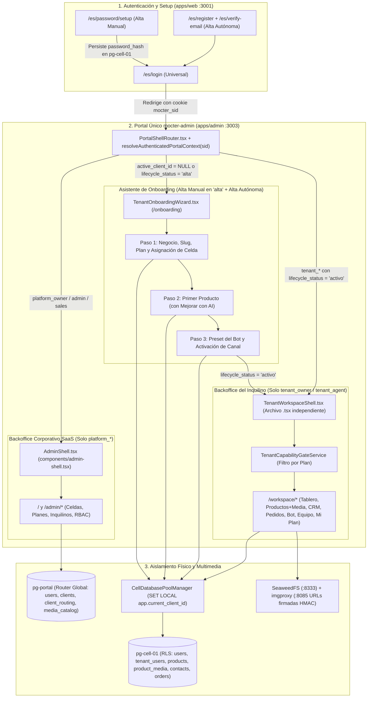

# TNT-001 · Diseño · Estabilización del Entorno Operativo del Inquilino, Onboarding Unificado y Backoffice Celular

| Atributo | Valor |
|---|---|
| ID | TNT-001 |
| Versión | 1.0 |
| Estado | Aprobada · v1.0 |
| Fecha | 2026-11-08 |
| Depende de | [`requirements.md`](requirements.md) · [ADM-001](../adm-001-mocter-admin/design.md) · [AUTH-001](../auth-001-autenticacion-hibrida/design.md) · [DAT-001](../dat-001-arquitectura-datos-multiinquilino/design.md) · [CEL-001](../cel-001-despliegue-celdas/design.md) |

## 1. Arquitectura de Separación de Planos y Flujo de Datos

## 2. Componentes de Dominio (`@mocter/domain`)

### 2.1 `CellDatabasePoolManager` (`packages/domain/src/db/cell-client.ts`)

- Mantiene un mapa en memoria de instancias Drizzle `PostgresJsDatabase` indexadas por `cellId` y hash de configuración de conexión.
- **`getCellDb(cellId)`**:
  1. Consulta la fila `admin.cells` en `db-portal`.
  2. Verifica que la celda tenga `cellSecretsCiphertext` y descifra el payload JSON mediante `cellSecretsCryptoService.decrypt(cell.id, cell.cellSecretsCiphertext)`.
  3. Resuelve el host y puerto de PgBouncer con `resolveLocalProbeTarget(cell.pgbouncerHost, cell.pgbouncerPort, cell.topologyType)` para garantizar que los contenedores `admin-portal` y `web-portal` alcancen `host.docker.internal:6432` en `local_compose` y la IP privada en `remote_vps`.
  4. Construye la cadena de conexión hacia `cell.databaseName` con `prepare: false` (requerido por PgBouncer en `transaction` pooling).
- **`withTenantCellTransaction(clientId, callback)`**:
  1. Resuelve `cell_id` desde `admin.client_routing` en `db-portal` (o selecciona y vincula la celda activa si aún no tenía fila).
  2. Abre una transacción `cellDb.transaction(async (tx) => ...)` y ejecuta como primera instrucción `SELECT set_config('app.current_client_id', ${clientId}, true)`.
  3. Entrega `tx` y `cell` al callback, garantizando que `FORCE ROW LEVEL SECURITY` se cumpla en cada tabla de `pg-cell-XX`.

### 2.2 Provisión y Reconciliación Celular (`packages/domain/src/services/admin-dashboard.service.ts`)

- **`provisionTenantInCellDataPlane({ cellId, clientId, ownerUser, actor })`**:
  - Ejecuta dentro de `withTenantCellTransaction(clientId, ...)`:
    1. `INSERT INTO admin.users` (proyección local del dueño con el mismo `id` global, `client_id`, `email`, `display_name`, `password_hash`, `email_verified_at` y `status = 'active'`) con `ON CONFLICT (client_id, id) DO UPDATE`.
    2. `INSERT INTO admin.tenant_users` (`client_id`, `user_id`, `role = 'tenant_owner'`, `status = 'active'`) verificando ausencia de vínculo activo previo.
    3. Sembrado idempotente en `admin.tenant_labels` de las 4 etiquetas reservadas (`lead-frio`, `lead-tibio`, `lead-caliente`, `compra-realizada`) con `origin = 'mocter_default'`.
    4. `INSERT INTO admin.client_business_info` con los defaults de plataforma (`payment_methods`, `shipping_policy`, `returns_policy`, `warranty_policy`, `order_message`) con `ON CONFLICT (client_id) DO NOTHING`.
- **`reconcileProvisionedTenantsInCells()`**:
  - Recorre los comercios en `admin.clients` enrutados en `admin.client_routing`, verifica su materialización en `pg-cell-XX`, ejecuta `provisionTenantInCellDataPlane`, actualiza `users.identity_location = cellId` (trasladando `password_hash` a la celda si aún estaba en `db-portal`) y, si el comercio no tiene productos en `pg-cell-XX`, asegura `lifecycle_status = 'alta'` para que el propietario complete su Onboarding.

### 2.3 Resolución Autoritativa de Contexto de Sesión (`packages/domain/src/services/session-context.service.ts`)

- **`resolveAuthenticatedPortalContext(sid)`**:
  - Valida la sesión opaca (`authService.validateSession(sid)`).
  - Consulta en `db-portal`:
    1. Roles activos en `admin.platform_user_roles`: si tiene `platform_owner`, `platform_admin` o `platform_sales`, retorna `scope: "platform"` con su rol corporativo.
    2. Si no es operador de plataforma y `user.activeClientId` (o `clients.owner_user_id`) existe: carga el comercio (`admin.clients`), el plan (`admin.plans`, `admin.plan_limits`, `admin.plan_feature_values`, `admin.client_feature_overrides`) y la celda (`admin.client_routing` → `admin.cells`), reconcilia la provisión celular si faltaba y retorna `scope: "tenant"` con `role: "tenant_owner" | "tenant_agent"`, `onboardingRequired: client.lifecycleStatus === "alta"`, `capabilities` y `limits`.
    3. Si no tiene roles de plataforma ni `activeClientId`: retorna `scope: "onboarding_prospect"`, `onboardingRequired: true`.

### 2.4 Servicios de Onboarding y Espacio de Trabajo Celular

- **`TenantOnboardingService` (`packages/domain/src/services/tenant-onboarding.service.ts`)**:
  - `getOnboardingState(userId)`: devuelve el paso actual (`1`, `2` o `3`), planes públicos disponibles, datos del comercio (pre-cargados si viene de alta manual) y estado de productos en `pg-cell-XX`.
  - `completeStep1Business(userId, input)`: crea o actualiza el comercio en estado `alta`, asigna `cell-01`, ejecuta `provisionTenantInCellDataPlane` y promueve la identidad a `pg-cell-01`.
  - `completeStep2FirstProduct(userId, input)`: inserta el primer producto en `pg-cell-XX` (`admin.products`) bajo RLS y actualiza `admin.client_usage`.
  - `completeStep3BotAndActivate(userId, input)`: actualiza `admin.client_business_info` en `pg-cell-XX` y cambia `admin.clients.lifecycle_status` a `'activo'`.
- **`TenantWorkspaceService` (`packages/domain/src/services/tenant-workspace.service.ts`)**:
  - Orquesta el resumen del tablero (`/workspace`), CRUD de productos (`/workspace/products`), subida de archivos a **SeaweedFS** (`S3StorageService`) + generación de URLs firmadas con HMAC-SHA256 de **imgproxy** (`/api/tenant/media`), CRUD de contactos CRM (`/workspace/contacts`), pedidos (`/workspace/orders`), configuración del bot (`/workspace/bot`) e invitación/listado de agentes (`/workspace/team`) validando los topes de `plan_limits`.

## 3. Separación de Componentes `.tsx` en `apps/admin`

| Ruta | Archivo `.tsx` | Público Objetivo |
|---|---|---|
| `/` y `/admin/*` | `components/admin-shell.tsx` + `app/page.tsx` | Exclusivo `platform_owner`, `platform_admin`, `platform_sales` |
| `/onboarding` | `app/onboarding/tenant-onboarding-wizard.tsx` | Propietarios en `lifecycle_status = 'alta'` y prospectos de `/register` |
| `/workspace` y `/workspace/*` | `components/tenant-workspace-shell.tsx` + `app/workspace/*/page.tsx` | Exclusivo `tenant_owner` y `tenant_agent` con `lifecycle_status = 'activo'` |

## 4. Trazabilidad

| Sección de Diseño | Requisitos TNT-001 | Especificaciones Relacionadas |
|---|---|---|
| §2.1 Pool Celular y RLS | TNT-RF-01.1, TNT-RF-01.2 | ADM-001 D-37, DAT-001 RF-10.11, CEL-001 |
| §2.2 Provisión y Reconciliación | TNT-RF-01.3 a TNT-RF-01.6 | ADM-001 D-36, AUTH-001 AUTH-D-01 / AUTH-D-09 |
| §2.3 Contexto de Sesión y Guards | TNT-RF-02.1 a TNT-RF-02.4 | ADM-001 D-35, AUTH-001 AUTH-D-09 |
| §2.4 Onboarding y Workspace | TNT-RF-03.1 a TNT-RF-04.3 | ADM-001 RF-04, RF-05, RF-07, RF-14, CEL-001 |

